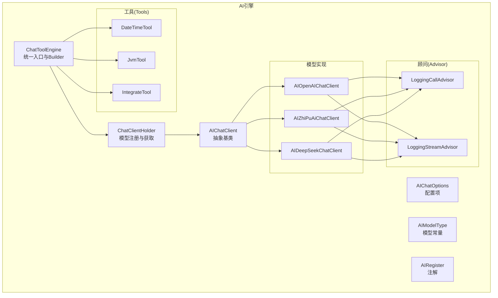
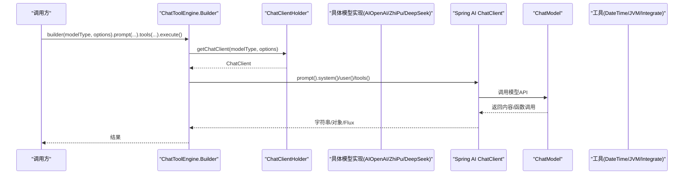
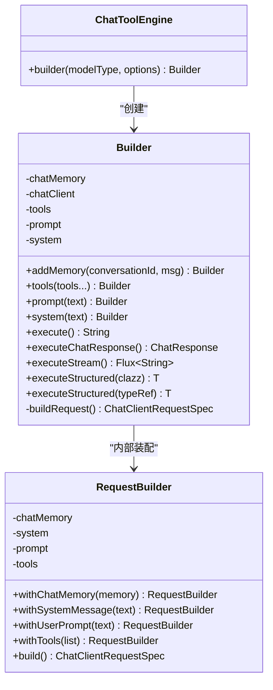
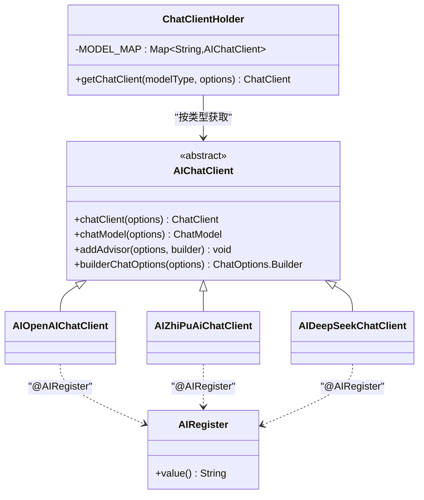
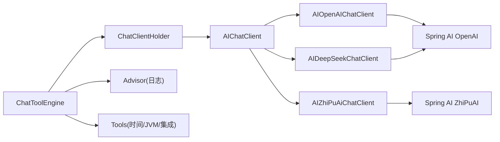
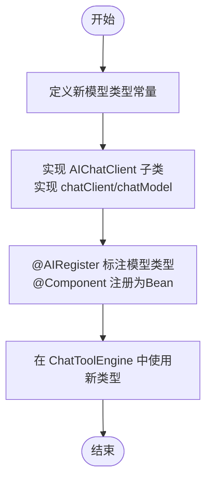

# AI引擎架构

<cite>
**本文引用的文件**   
- [ChatToolEngine.java](file://backend/framework/ai-engine/src/main/java/io/metersphere/ai/engine/ChatToolEngine.java)
- [AIChatClient.java](file://backend/framework/ai-engine/src/main/java/io/metersphere/ai/engine/common/AIChatClient.java)
- [AIChatOptions.java](file://backend/framework/ai-engine/src/main/java/io/metersphere/ai/engine/common/AIChatOptions.java)
- [AIModelType.java](file://backend/framework/ai-engine/src/main/java/io/metersphere/ai/engine/common/AIModelType.java)
- [AIRegister.java](file://backend/framework/ai-engine/src/main/java/io/metersphere/ai/engine/common/AIRegister.java)
- [ChatClientHolder.java](file://backend/framework/ai-engine/src/main/java/io/metersphere/ai/engine/holder/ChatClientHolder.java)
- [AIOpenAIChatClient.java](file://backend/framework/ai-engine/src/main/java/io/metersphere/ai/engine/models/AIOpenAIChatClient.java)
- [AIZhiPuAiChatClient.java](file://backend/framework/ai-engine/src/main/java/io/metersphere/ai/engine/models/AIZhiPuAiChatClient.java)
- [AIDeepSeekChatClient.java](file://backend/framework/ai-engine/src/main/java/io/metersphere/ai/engine/models/AIDeepSeekChatClient.java)
- [LoggingCallAdvisor.java](file://backend/framework/ai-engine/src/main/java/io/metersphere/ai/engine/advisor/LoggingCallAdvisor.java)
- [LoggingStreamAdvisor.java](file://backend/framework/ai-engine/src/main/java/io/metersphere/ai/engine/advisor/LoggingStreamAdvisor.java)
- [DateTimeTool.java](file://backend/framework/ai-engine/src/main/java/io/metersphere/ai/engine/tools/DateTimeTool.java)
- [JvmTool.java](file://backend/framework/ai-engine/src/main/java/io/metersphere/ai/engine/tools/JvmTool.java)
- [IntegrateTool.java](file://backend/framework/ai-engine/src/main/java/io/metersphere/ai/engine/tools/IntegrateTool.java)
</cite>

## 目录
1. [简介](#简介)
2. [项目结构](#项目结构)
3. [核心组件](#核心组件)
4. [架构总览](#架构总览)
5. [详细组件分析](#详细组件分析)
6. [依赖关系分析](#依赖关系分析)
7. [性能与资源管理](#性能与资源管理)
8. [故障排查指南](#故障排查指南)
9. [结论](#结论)
10. [附录：扩展新模型步骤](#附录扩展新模型步骤)

## 简介
本文件面向 MeterSphere 的 AI 引擎，聚焦 ChatToolEngine 的核心设计模式、Builder 实现、模型类型抽象与配置选项管理。文档说明引擎如何以统一接口对接多种 AI 模型（OpenAI、智谱AI、DeepSeek 等），并阐述扩展机制、生命周期管理、流式响应、结构化响应与工具调用的底层实现。

## 项目结构
AI 引擎位于 backend/framework/ai-engine 模块，采用分层与按能力划分的组织方式：
- common：通用抽象与配置（AIChatClient、AIChatOptions、AIModelType、AIRegister）
- models：各厂商模型的具体实现（OpenAI、ZhiPuAI、DeepSeek）
- holder：模型注册与获取（ChatClientHolder）
- advisor：可插拔的日志拦截器（调用前后、流式）
- tools：工具方法（时间、JVM、集成输出）
- ChatToolEngine：对外暴露的统一入口与 Builder 构造链

图表来源
- [ChatToolEngine.java:40-335](file://backend/framework/ai-engine/src/main/java/io/metersphere/ai/engine/ChatToolEngine.java#L40-L335)
- [AIChatClient.java:14-63](file://backend/framework/ai-engine/src/main/java/io/metersphere/ai/engine/common/AIChatClient.java#L14-L63)
- [AIChatOptions.java:6-23](file://backend/framework/ai-engine/src/main/java/io/metersphere/ai/engine/common/AIChatOptions.java#L6-L23)
- [AIModelType.java:3-10](file://backend/framework/ai-engine/src/main/java/io/metersphere/ai/engine/common/AIModelType.java#L3-L10)
- [AIRegister.java:17-21](file://backend/framework/ai-engine/src/main/java/io/metersphere/ai/engine/common/AIRegister.java#L17-L21)
- [ChatClientHolder.java:19-67](file://backend/framework/ai-engine/src/main/java/io/metersphere/ai/engine/holder/ChatClientHolder.java#L19-L67)
- [AIOpenAIChatClient.java:21-67](file://backend/framework/ai-engine/src/main/java/io/metersphere/ai/engine/models/AIOpenAIChatClient.java#L21-L67)
- [AIZhiPuAiChatClient.java:30-67](file://backend/framework/ai-engine/src/main/java/io/metersphere/ai/engine/models/AIZhiPuAiChatClient.java#L30-L67)
- [AIDeepSeekChatClient.java:19-86](file://backend/framework/ai-engine/src/main/java/io/metersphere/ai/engine/models/AIDeepSeekChatClient.java#L19-L86)
- [LoggingCallAdvisor.java:15-55](file://backend/framework/ai-engine/src/main/java/io/metersphere/ai/engine/advisor/LoggingCallAdvisor.java#L15-L55)
- [LoggingStreamAdvisor.java:15-52](file://backend/framework/ai-engine/src/main/java/io/metersphere/ai/engine/advisor/LoggingStreamAdvisor.java#L15-L52)
- [DateTimeTool.java:6-12](file://backend/framework/ai-engine/src/main/java/io/metersphere/ai/engine/tools/DateTimeTool.java#L6-L12)
- [JvmTool.java:8-59](file://backend/framework/ai-engine/src/main/java/io/metersphere/ai/engine/tools/JvmTool.java#L8-L59)
- [IntegrateTool.java:5-10](file://backend/framework/ai-engine/src/main/java/io/metersphere/ai/engine/tools/IntegrateTool.java#L5-L10)

章节来源
- [ChatToolEngine.java:40-335](file://backend/framework/ai-engine/src/main/java/io/metersphere/ai/engine/ChatToolEngine.java#L40-L335)
- [ChatClientHolder.java:19-67](file://backend/framework/ai-engine/src/main/java/io/metersphere/ai/engine/holder/ChatClientHolder.java#L19-L67)

## 核心组件
- ChatToolEngine：对外统一入口，提供 Builder 构建带工具的聊天请求，支持记忆、系统提示、工具、流式与结构化响应。
- AIChatClient：抽象基类，定义 chatClient/chatModel 工厂方法与通用顾问注入、参数校验与选项构建。
- AIChatOptions：统一的模型配置项（baseUrl、apiKey、modelType、temperature、frequencyPenalty、maxTokens、topP、disableLoggingAdvisor）。
- AIModelType：模型类型常量（OpenAI、ZhiPuAI、DeepSeek、QianFan、Ollama）。
- AIRegister：自定义注解，用于将具体模型实现注册到运行时映射。
- ChatClientHolder：启动时扫描所有 AIChatClient Bean，依据 @AIRegister 建立“模型类型 -> 实现”的映射，并提供 getChatClient 静态方法。
- 模型实现：AIOpenAIChatClient、AIZhiPuAiChatClient、AIDeepSeekChatClient，分别封装对应 SDK 的 ChatModel/ChatClient 构建逻辑。
- Advisor：LoggingCallAdvisor（同步调用日志）、LoggingStreamAdvisor（流式调用日志）。
- Tools：DateTimeTool、JvmTool、IntegrateTool，通过 Spring AI Tool 注解暴露给模型调用。

章节来源
- [ChatToolEngine.java:40-335](file://backend/framework/ai-engine/src/main/java/io/metersphere/ai/engine/ChatToolEngine.java#L40-L335)
- [AIChatClient.java:14-63](file://backend/framework/ai-engine/src/main/java/io/metersphere/ai/engine/common/AIChatClient.java#L14-L63)
- [AIChatOptions.java:6-23](file://backend/framework/ai-engine/src/main/java/io/metersphere/ai/engine/common/AIChatOptions.java#L6-L23)
- [AIModelType.java:3-10](file://backend/framework/ai-engine/src/main/java/io/metersphere/ai/engine/common/AIModelType.java#L3-L10)
- [AIRegister.java:17-21](file://backend/framework/ai-engine/src/main/java/io/metersphere/ai/engine/common/AIRegister.java#L17-L21)
- [ChatClientHolder.java:19-67](file://backend/framework/ai-engine/src/main/java/io/metersphere/ai/engine/holder/ChatClientHolder.java#L19-L67)
- [AIOpenAIChatClient.java:21-67](file://backend/framework/ai-engine/src/main/java/io/metersphere/ai/engine/models/AIOpenAIChatClient.java#L21-L67)
- [AIZhiPuAiChatClient.java:30-67](file://backend/framework/ai-engine/src/main/java/io/metersphere/ai/engine/models/AIZhiPuAiChatClient.java#L30-L67)
- [AIDeepSeekChatClient.java:19-86](file://backend/framework/ai-engine/src/main/java/io/metersphere/ai/engine/models/AIDeepSeekChatClient.java#L19-L86)
- [LoggingCallAdvisor.java:15-55](file://backend/framework/ai-engine/src/main/java/io/metersphere/ai/engine/advisor/LoggingCallAdvisor.java#L15-L55)
- [LoggingStreamAdvisor.java:15-52](file://backend/framework/ai-engine/src/main/java/io/metersphere/ai/engine/advisor/LoggingStreamAdvisor.java#L15-L52)
- [DateTimeTool.java:6-12](file://backend/framework/ai-engine/src/main/java/io/metersphere/ai/engine/tools/DateTimeTool.java#L6-L12)
- [JvmTool.java:8-59](file://backend/framework/ai-engine/src/main/java/io/metersphere/ai/engine/tools/JvmTool.java#L8-L59)
- [IntegrateTool.java:5-10](file://backend/framework/ai-engine/src/main/java/io/metersphere/ai/engine/tools/IntegrateTool.java#L5-L10)

## 架构总览
下图展示从调用方到模型实现的完整链路，包括 Builder 装配、模型选择、顾问注入、工具启用与执行路径。

图表来源
- [ChatToolEngine.java:49-147](file://backend/framework/ai-engine/src/main/java/io/metersphere/ai/engine/ChatToolEngine.java#L49-L147)
- [ChatClientHolder.java:60-67](file://backend/framework/ai-engine/src/main/java/io/metersphere/ai/engine/holder/ChatClientHolder.java#L60-L67)
- [AIOpenAIChatClient.java:31-42](file://backend/framework/ai-engine/src/main/java/io/metersphere/ai/engine/models/AIOpenAIChatClient.java#L31-L42)
- [AIZhiPuAiChatClient.java:40-53](file://backend/framework/ai-engine/src/main/java/io/metersphere/ai/engine/models/AIZhiPuAiChatClient.java#L40-L53)
- [AIDeepSeekChatClient.java:58-74](file://backend/framework/ai-engine/src/main/java/io/metersphere/ai/engine/models/AIDeepSeekChatClient.java#L58-L74)

## 详细组件分析

### ChatToolEngine 与 Builder 模式
- 设计要点
  - 使用静态 builder(modelType, options) 创建 Builder，内部通过 ChatClientHolder 获取 ChatClient。
  - Builder 维护聊天记忆（MessageWindowChatMemory + InMemoryChatMemoryRepository，窗口大小默认10条）、工具列表、用户提示与系统提示。
  - 提供 execute()/executeChatResponse()/executeStream()/executeStructured(...) 四种执行模式，覆盖字符串、完整响应、流式与结构化对象。
  - 内部 RequestBuilder 负责组装 ChatClientRequestSpec：可选的记忆顾问、系统消息、用户提示、工具集合。
- 关键流程
  - buildRequest 校验 prompt 非空后，依次装配记忆、系统、用户与工具，最终返回 ChatClientRequestSpec。
  - executeStream 返回 Flux<String>，适合实时渲染；executeStructured 将响应反序列化为指定泛型类型。

图表来源
- [ChatToolEngine.java:40-335](file://backend/framework/ai-engine/src/main/java/io/metersphere/ai/engine/ChatToolEngine.java#L40-L335)

章节来源
- [ChatToolEngine.java:40-335](file://backend/framework/ai-engine/src/main/java/io/metersphere/ai/engine/ChatToolEngine.java#L40-L335)

### 模型类型抽象与注册机制
- 抽象层
  - AIChatClient 定义 chatClient(options)/chatModel(options) 两个工厂方法，并提供 addAdvisor 与 builderChatOptions 通用能力。
  - AIChatOptions 集中管理连接与采样参数，供各模型实现复用。
- 注册与发现
  - AIRegister 注解标注在实现类上，value 为模型类型键。
  - ChatClientHolder 在构造期扫描 ApplicationContext 中所有 AIChatClient Bean，读取 @AIRegister 值，建立 Map<模型类型, AIChatClient>。
  - getChatClient(modelType, options) 根据类型查找实现并调用其 chatClient(options)。

图表来源
- [AIChatClient.java:14-63](file://backend/framework/ai-engine/src/main/java/io/metersphere/ai/engine/common/AIChatClient.java#L14-L63)
- [AIOpenAIChatClient.java:21-67](file://backend/framework/ai-engine/src/main/java/io/metersphere/ai/engine/models/AIOpenAIChatClient.java#L21-L67)
- [AIZhiPuAiChatClient.java:30-67](file://backend/framework/ai-engine/src/main/java/io/metersphere/ai/engine/models/AIZhiPuAiChatClient.java#L30-L67)
- [AIDeepSeekChatClient.java:19-86](file://backend/framework/ai-engine/src/main/java/io/metersphere/ai/engine/models/AIDeepSeekChatClient.java#L19-L86)
- [AIRegister.java:17-21](file://backend/framework/ai-engine/src/main/java/io/metersphere/ai/engine/common/AIRegister.java#L17-L21)
- [ChatClientHolder.java:19-67](file://backend/framework/ai-engine/src/main/java/io/metersphere/ai/engine/holder/ChatClientHolder.java#L19-L67)

章节来源
- [AIChatClient.java:14-63](file://backend/framework/ai-engine/src/main/java/io/metersphere/ai/engine/common/AIChatClient.java#L14-L63)
- [AIRegister.java:17-21](file://backend/framework/ai-engine/src/main/java/io/metersphere/ai/engine/common/AIRegister.java#L17-L21)
- [ChatClientHolder.java:19-67](file://backend/framework/ai-engine/src/main/java/io/metersphere/ai/engine/holder/ChatClientHolder.java#L19-L67)

### 配置选项管理（AIChatOptions）
- 字段涵盖基础连接信息（baseUrl、apiKey、modelType）与生成参数（temperature、frequencyPenalty、maxTokens、topP），以及 disableLoggingAdvisor 控制是否注入日志顾问。
- 各模型实现通过 AIChatClient.builderChatOptions 或各自 Options 构建器进行参数映射与校验（如温度范围、topP 范围）。

章节来源
- [AIChatOptions.java:6-23](file://backend/framework/ai-engine/src/main/java/io/metersphere/ai/engine/common/AIChatOptions.java#L6-L23)
- [AIChatClient.java:39-63](file://backend/framework/ai-engine/src/main/java/io/metersphere/ai/engine/common/AIChatClient.java#L39-L63)

### 顾问（Advisor）与日志
- LoggingCallAdvisor：拦截同步调用，记录请求体。
- LoggingStreamAdvisor：拦截流式调用，记录请求体。
- 通过 AIChatClient.addAdvisor 统一注入，可由 AIChatOptions.disableLoggingAdvisor 关闭。

章节来源
- [LoggingCallAdvisor.java:15-55](file://backend/framework/ai-engine/src/main/java/io/metersphere/ai/engine/advisor/LoggingCallAdvisor.java#L15-L55)
- [LoggingStreamAdvisor.java:15-52](file://backend/framework/ai-engine/src/main/java/io/metersphere/ai/engine/advisor/LoggingStreamAdvisor.java#L15-L52)
- [AIChatClient.java:26-31](file://backend/framework/ai-engine/src/main/java/io/metersphere/ai/engine/common/AIChatClient.java#L26-L31)

### 工具（Tools）机制
- DateTimeTool：提供当前时间戳的工具方法。
- JvmTool：提供 JVM/OS/内存等运行环境信息的工具方法。
- IntegrateTool：示例工具，演示 returnDirect 行为。
- 通过 @Tool 注解暴露，由 ChatToolEngine.Builder.tools(...) 传入，参与模型的工具调用流程。

章节来源
- [DateTimeTool.java:6-12](file://backend/framework/ai-engine/src/main/java/io/metersphere/ai/engine/tools/DateTimeTool.java#L6-L12)
- [JvmTool.java:8-59](file://backend/framework/ai-engine/src/main/java/io/metersphere/ai/engine/tools/JvmTool.java#L8-L59)
- [IntegrateTool.java:5-10](file://backend/framework/ai-engine/src/main/java/io/metersphere/ai/engine/tools/IntegrateTool.java#L5-L10)
- [ChatToolEngine.java:110-113](file://backend/framework/ai-engine/src/main/java/io/metersphere/ai/engine/ChatToolEngine.java#L110-L113)

## 依赖关系分析
- ChatToolEngine 依赖 ChatClientHolder 获取 ChatClient，依赖 Spring AI 的 ChatClient/ChatModel 与 Memory/Advisor 体系。
- 模型实现依赖各自厂商 SDK（OpenAI/ZhiPuAI），并通过 AIChatClient 抽象解耦。
- 顾问与工具作为横切关注点，通过 Spring AI 的 Advisor/Tool 机制接入。

图表来源
- [ChatToolEngine.java:40-335](file://backend/framework/ai-engine/src/main/java/io/metersphere/ai/engine/ChatToolEngine.java#L40-L335)
- [ChatClientHolder.java:19-67](file://backend/framework/ai-engine/src/main/java/io/metersphere/ai/engine/holder/ChatClientHolder.java#L19-L67)
- [AIOpenAIChatClient.java:21-67](file://backend/framework/ai-engine/src/main/java/io/metersphere/ai/engine/models/AIOpenAIChatClient.java#L21-L67)
- [AIZhiPuAiChatClient.java:30-67](file://backend/framework/ai-engine/src/main/java/io/metersphere/ai/engine/models/AIZhiPuAiChatClient.java#L30-L67)
- [AIDeepSeekChatClient.java:19-86](file://backend/framework/ai-engine/src/main/java/io/metersphere/ai/engine/models/AIDeepSeekChatClient.java#L19-L86)

章节来源
- [ChatToolEngine.java:40-335](file://backend/framework/ai-engine/src/main/java/io/metersphere/ai/engine/ChatToolEngine.java#L40-L335)
- [ChatClientHolder.java:19-67](file://backend/framework/ai-engine/src/main/java/io/metersphere/ai/engine/holder/ChatClientHolder.java#L19-L67)

## 性能与资源管理
- 会话记忆
  - 默认使用 MessageWindowChatMemory + InMemoryChatMemoryRepository，窗口大小固定（例如10条），避免无限增长导致上下文膨胀与延迟上升。
- 客户端实例化
  - ChatClient 由 ChatClientHolder 根据模型类型创建，未做全局池化；若需高并发场景，可在上层对 ChatClient 进行池化或缓存策略优化。
- 流式响应
  - executeStream 返回 Flux<String>，适合低延迟、渐进式渲染；注意背压与下游消费速度。
- 结构化响应
  - executeStructured 将响应反序列化为对象，适用于需要强类型处理的场景；注意模型输出格式稳定性。
- 顾问开销
  - 日志顾问会序列化请求体，建议在调试阶段开启，生产环境可通过 disableLoggingAdvisor 关闭以降低开销。

[本节为通用指导，不直接分析具体文件]

## 故障排查指南
- 不支持的模型类型
  - 现象：抛出“不支持的聊天模型类型”异常。
  - 原因：ChatClientHolder 未找到对应 @AIRegister 的实现。
  - 处理：检查模型类型常量与实现类上的 @AIRegister 值是否一致，并确保实现类被 Spring 扫描到。
- Prompt 未设置
  - 现象：抛出“Prompt must be set before execution.”异常。
  - 原因：Builder 在执行前未设置 prompt。
  - 处理：确保调用 .prompt(...) 后再执行。
- 工具未生效
  - 现象：模型未调用工具或返回不符合预期。
  - 原因：未在 Builder 中传入工具或未正确声明 @Tool。
  - 处理：确认 tools(...) 已传入，且工具类被 Spring 管理且方法标注 @Tool。
- 日志过多或性能下降
  - 现象：日志量大、吞吐下降。
  - 原因：LoggingAdvisor 开启。
  - 处理：在 AIChatOptions 中设置 disableLoggingAdvisor=true 关闭日志顾问。

章节来源
- [ChatClientHolder.java:60-67](file://backend/framework/ai-engine/src/main/java/io/metersphere/ai/engine/holder/ChatClientHolder.java#L60-L67)
- [ChatToolEngine.java:323-334](file://backend/framework/ai-engine/src/main/java/io/metersphere/ai/engine/ChatToolEngine.java#L323-L334)
- [AIChatOptions.java:10-11](file://backend/framework/ai-engine/src/main/java/io/metersphere/ai/engine/common/AIChatOptions.java#L10-L11)

## 结论
该 AI 引擎通过 ChatToolEngine 提供统一入口，结合 Builder 模式完成请求装配；借助 AIChatClient 抽象与 @AIRegister 注解实现多模型统一接入；通过 Advisor/Tool 机制扩展横切能力与外部工具调用；配合流式与结构化响应满足多样化业务场景。整体设计具备良好扩展性与可观测性，便于后续接入更多模型与增强功能。

[本节为总结性内容，不直接分析具体文件]

## 附录：扩展新模型步骤
- 新建模型实现类
  - 继承 AIChatClient，实现 chatClient/options 构建逻辑。
  - 使用 @AIRegister("你的模型类型") 与 @Component 注解注册。
- 添加模型类型常量
  - 在 AIModelType 中添加新的常量值。
- 使用示例
  - 通过 ChatToolEngine.builder(新模型类型, options).prompt(...).tools(...).execute() 调用。

图表来源
- [AIModelType.java:3-10](file://backend/framework/ai-engine/src/main/java/io/metersphere/ai/engine/common/AIModelType.java#L3-L10)
- [AIChatClient.java:14-63](file://backend/framework/ai-engine/src/main/java/io/metersphere/ai/engine/common/AIChatClient.java#L14-L63)
- [AIRegister.java:17-21](file://backend/framework/ai-engine/src/main/java/io/metersphere/ai/engine/common/AIRegister.java#L17-L21)
- [ChatToolEngine.java:49-147](file://backend/framework/ai-engine/src/main/java/io/metersphere/ai/engine/ChatToolEngine.java#L49-L147)

章节来源
- [AIModelType.java:3-10](file://backend/framework/ai-engine/src/main/java/io/metersphere/ai/engine/common/AIModelType.java#L3-L10)
- [AIChatClient.java:14-63](file://backend/framework/ai-engine/src/main/java/io/metersphere/ai/engine/common/AIChatClient.java#L14-L63)
- [AIRegister.java:17-21](file://backend/framework/ai-engine/src/main/java/io/metersphere/ai/engine/common/AIRegister.java#L17-L21)
- [ChatToolEngine.java:49-147](file://backend/framework/ai-engine/src/main/java/io/metersphere/ai/engine/ChatToolEngine.java#L49-L147)