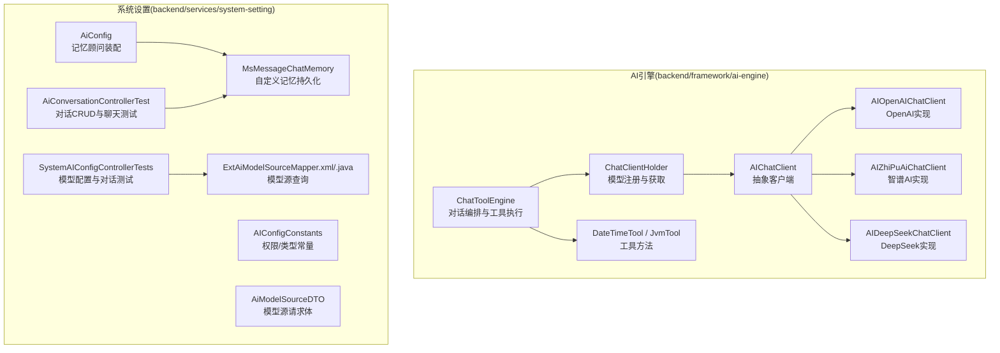
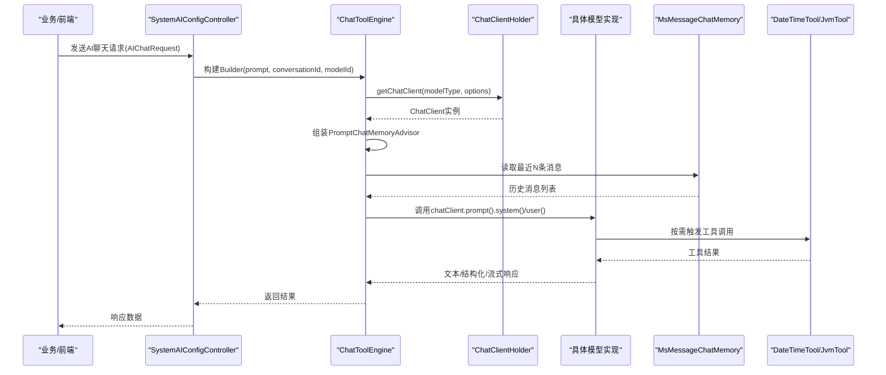
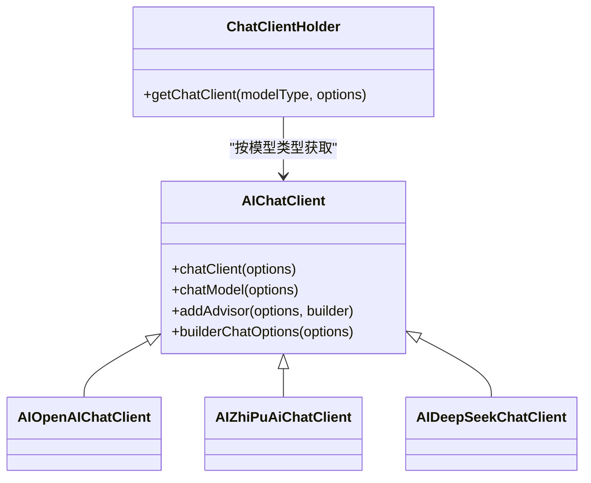
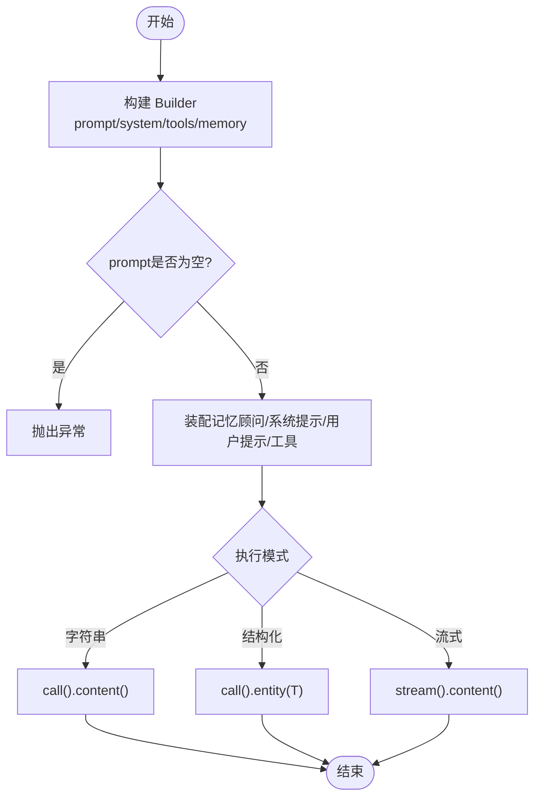
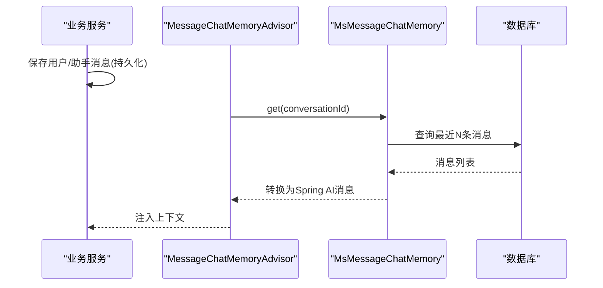
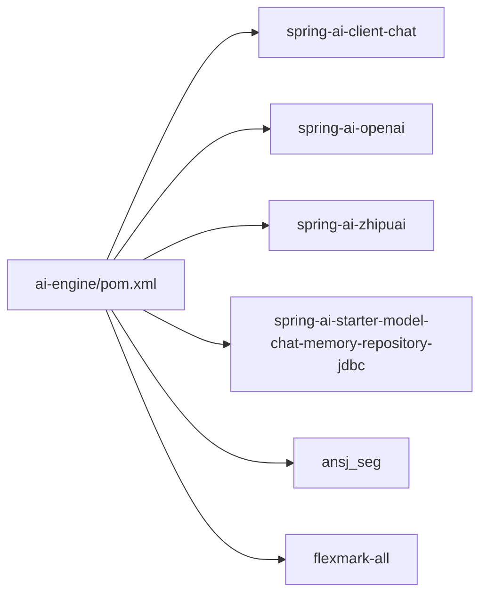

# AI智能助手

<cite>
**本文引用的文件**   
- [ai-engine/pom.xml](file://backend/framework/ai-engine/pom.xml)
- [AIChatClient.java](file://backend/framework/ai-engine/src/main/java/io/metersphere/ai/engine/common/AIChatClient.java)
- [AIChatOptions.java](file://backend/framework/ai-engine/src/main/java/io/metersphere/ai/engine/common/AIChatOptions.java)
- [AIModelType.java](file://backend/framework/ai-engine/src/main/java/io/metersphere/ai/engine/common/AIModelType.java)
- [AIOpenAIChatClient.java](file://backend/framework/ai-engine/src/main/java/io/metersphere/ai/engine/models/AIOpenAIChatClient.java)
- [AIZhiPuAiChatClient.java](file://backend/framework/ai-engine/src/main/java/io/metersphere/ai/engine/models/AIZhiPuAiChatClient.java)
- [AIDeepSeekChatClient.java](file://backend/framework/ai-engine/src/main/java/io/metersphere/ai/engine/models/AIDeepSeekChatClient.java)
- [ChatClientHolder.java](file://backend/framework/ai-engine/src/main/java/io/metersphere/ai/engine/holder/ChatClientHolder.java)
- [ChatToolEngine.java](file://backend/framework/ai-engine/src/main/java/io/metersphere/ai/engine/ChatToolEngine.java)
- [DateTimeTool.java](file://backend/framework/ai-engine/src/main/java/io/metersphere/ai/engine/tools/DateTimeTool.java)
- [JvmTool.java](file://backend/framework/ai-engine/src/main/java/io/metersphere/ai/engine/tools/JvmTool.java)
- [AiConfig.java](file://backend/services/system-setting/src/main/java/io/metersphere/system/config/ai/AiConfig.java)
- [MsMessageChatMemory.java](file://backend/services/system-setting/src/main/java/io/metersphere/system/config/ai/MsMessageChatMemory.java)
- [AIChatRequest.java](file://backend/services/system-setting/src/main/java/io/metersphere/system/dto/request/ai/AIChatRequest.java)
- [AIConversationUpdateRequest.java](file://backend/services/system-setting/src/main/java/io/metersphere/system/dto/request/ai/AIConversationUpdateRequest.java)
- [SystemAIConfigControllerTests.java](file://backend/services/system-setting/src/test/java/io/metersphere/system/controller/SystemAIConfigControllerTests.java)
- [AiConversationControllerTest.java](file://backend/services/system-setting/src/test/java/io/metersphere/system/controller/AiConversationControllerTest.java)
- [ExtAiModelSourceMapper.xml](file://backend/services/system-setting/src/main/resources/mapper/ExtAiModelSourceMapper.xml)
- [ExtAiModelSourceMapper.java](file://backend/services/system-setting/src/main/java/io/metersphere/system/mapper/ExtAiModelSourceMapper.java)
- [AIConfigConstants.java](file://backend/services/system-setting/src/main/java/io/metersphere/system/constants/AIConfigConstants.java)
- [AiModelSourceDTO.java](file://backend/services/system-setting/src/main/java/io/metersphere/system/dto/request/ai/AiModelSourceDTO.java)
</cite>

## 目录
1. [简介](#简介)
2. [项目结构](#项目结构)
3. [核心组件](#核心组件)
4. [架构总览](#架构总览)
5. [详细组件分析](#详细组件分析)
6. [依赖关系分析](#依赖关系分析)
7. [性能与可扩展性](#性能与可扩展性)
8. [故障排查指南](#故障排查指南)
9. [结论](#结论)
10. [附录：API接口文档](#附录api接口文档)

## 简介
本章节概述 MeterSphere 的 AI 智能助手模块，涵盖 AI 引擎架构、对话管理系统、模型配置与管理、记忆持久化机制、支持的 AI 模型（OpenAI、智谱AI等）、对话历史管理、上下文处理、工具调用机制，以及在测试用例生成、接口调试等业务场景中的应用方式。

## 项目结构
AI 能力由后端框架层 ai-engine 提供统一抽象与多模型适配，系统设置服务 system-setting 负责模型源配置、对话管理与持久化，并通过 Spring AI 的记忆顾问进行上下文注入。前端通过统一的 API 路由与业务页面集成 AI 能力。

图表来源
- [AIChatClient.java:14-63](file://backend/framework/ai-engine/src/main/java/io/metersphere/ai/engine/common/AIChatClient.java#L14-L63)
- [AIOpenAIChatClient.java:21-67](file://backend/framework/ai-engine/src/main/java/io/metersphere/ai/engine/models/AIOpenAIChatClient.java#L21-L67)
- [AIZhiPuAiChatClient.java:30-67](file://backend/framework/ai-engine/src/main/java/io/metersphere/ai/engine/models/AIZhiPuAiChatClient.java#L30-L67)
- [AIDeepSeekChatClient.java:21-...](file://backend/framework/ai-engine/src/main/java/io/metersphere/ai/engine/models/AIDeepSeekChatClient.java#L21-L...)
- [ChatClientHolder.java:19-67](file://backend/framework/ai-engine/src/main/java/io/metersphere/ai/engine/holder/ChatClientHolder.java#L19-L67)
- [ChatToolEngine.java:40-335](file://backend/framework/ai-engine/src/main/java/io/metersphere/ai/engine/ChatToolEngine.java#L40-L335)
- [DateTimeTool.java:6-12](file://backend/framework/ai-engine/src/main/java/io/metersphere/ai/engine/tools/DateTimeTool.java#L6-L12)
- [JvmTool.java:8-59](file://backend/framework/ai-engine/src/main/java/io/metersphere/ai/engine/tools/JvmTool.java#L8-L59)
- [AiConfig.java:11-17](file://backend/services/system-setting/src/main/java/io/metersphere/system/config/ai/AiConfig.java#L11-L17)
- [MsMessageChatMemory.java:18-66](file://backend/services/system-setting/src/main/java/io/metersphere/system/config/ai/MsMessageChatMemory.java#L18-L66)
- [SystemAIConfigControllerTests.java:1-30](file://backend/services/system-setting/src/test/java/io/metersphere/system/controller/SystemAIConfigControllerTests.java#L1-L30)
- [AiConversationControllerTest.java:36-48](file://backend/services/system-setting/src/test/java/io/metersphere/system/controller/AiConversationControllerTest.java#L36-L48)
- [ExtAiModelSourceMapper.xml:1-33](file://backend/services/system-setting/src/main/resources/mapper/ExtAiModelSourceMapper.xml#L1-L33)
- [ExtAiModelSourceMapper.java:10-17](file://backend/services/system-setting/src/main/java/io/metersphere/system/mapper/ExtAiModelSourceMapper.java#L10-L17)
- [AIConfigConstants.java:3-21](file://backend/services/system-setting/src/main/java/io/metersphere/system/constants/AIConfigConstants.java#L3-L21)
- [AiModelSourceDTO.java:13-30](file://backend/services/system-setting/src/main/java/io/metersphere/system/dto/request/ai/AiModelSourceDTO.java#L13-L30)

章节来源
- [ai-engine/pom.xml:16-56](file://backend/framework/ai-engine/pom.xml#L16-L56)

## 核心组件
- AIChatClient：抽象聊天客户端，定义 chatClient/chatModel 构建方法与通用选项装配、日志顾问添加逻辑。
- ChatClientHolder：扫描并注册所有 AIChatClient 实现，按模型类型返回对应 ChatClient。
- ChatToolEngine：对话编排器，支持记忆、系统提示、用户提示、工具调用，并提供字符串、结构化、流式等多种执行模式。
- 模型实现：AIOpenAIChatClient、AIZhiPuAiChatClient、AIDeepSeekChatClient 分别对接 OpenAI、智谱AI、DeepSeek。
- 工具：DateTimeTool、JvmTool 等以 @Tool 注解暴露给模型调用。
- 记忆与对话：AiConfig 装配 MessageChatMemoryAdvisor；MsMessageChatMemory 将最近消息持久化到数据库并按窗口大小读取。
- 模型配置：AIConfigConstants、AiModelSourceDTO、ExtAiModelSourceMapper 提供模型源枚举、请求体与查询能力。

章节来源
- [AIChatClient.java:14-63](file://backend/framework/ai-engine/src/main/java/io/metersphere/ai/engine/common/AIChatClient.java#L14-L63)
- [ChatClientHolder.java:19-67](file://backend/framework/ai-engine/src/main/java/io/metersphere/ai/engine/holder/ChatClientHolder.java#L19-L67)
- [ChatToolEngine.java:40-335](file://backend/framework/ai-engine/src/main/java/io/metersphere/ai/engine/ChatToolEngine.java#L40-L335)
- [AIOpenAIChatClient.java:21-67](file://backend/framework/ai-engine/src/main/java/io/metersphere/ai/engine/models/AIOpenAIChatClient.java#L21-L67)
- [AIZhiPuAiChatClient.java:30-67](file://backend/framework/ai-engine/src/main/java/io/metersphere/ai/engine/models/AIZhiPuAiChatClient.java#L30-L67)
- [AIDeepSeekChatClient.java:21-...](file://backend/framework/ai-engine/src/main/java/io/metersphere/ai/engine/models/AIDeepSeekChatClient.java#L21-L...)
- [DateTimeTool.java:6-12](file://backend/framework/ai-engine/src/main/java/io/metersphere/ai/engine/tools/DateTimeTool.java#L6-L12)
- [JvmTool.java:8-59](file://backend/framework/ai-engine/src/main/java/io/metersphere/ai/engine/tools/JvmTool.java#L8-L59)
- [AiConfig.java:11-17](file://backend/services/system-setting/src/main/java/io/metersphere/system/config/ai/AiConfig.java#L11-L17)
- [MsMessageChatMemory.java:18-66](file://backend/services/system-setting/src/main/java/io/metersphere/system/config/ai/MsMessageChatMemory.java#L18-L66)
- [AIConfigConstants.java:3-21](file://backend/services/system-setting/src/main/java/io/metersphere/system/constants/AIConfigConstants.java#L3-L21)
- [AiModelSourceDTO.java:13-30](file://backend/services/system-setting/src/main/java/io/metersphere/system/dto/request/ai/AiModelSourceDTO.java#L13-L30)

## 架构总览
下图展示从业务侧发起对话请求，到引擎选择模型、注入记忆上下文、执行工具调用并返回结果的完整流程。

图表来源
- [ChatToolEngine.java:88-335](file://backend/framework/ai-engine/src/main/java/io/metersphere/ai/engine/ChatToolEngine.java#L88-L335)
- [ChatClientHolder.java:33-67](file://backend/framework/ai-engine/src/main/java/io/metersphere/ai/engine/holder/ChatClientHolder.java#L33-L67)
- [MsMessageChatMemory.java:31-66](file://backend/services/system-setting/src/main/java/io/metersphere/system/config/ai/MsMessageChatMemory.java#L31-L66)
- [DateTimeTool.java:6-12](file://backend/framework/ai-engine/src/main/java/io/metersphere/ai/engine/tools/DateTimeTool.java#L6-L12)
- [JvmTool.java:8-59](file://backend/framework/ai-engine/src/main/java/io/metersphere/ai/engine/tools/JvmTool.java#L8-L59)

## 详细组件分析

### AI引擎抽象与模型注册
- AIChatClient 定义 chatClient/chatModel 抽象方法，并提供 builderChatOptions 统一温度、频率惩罚、最大 token、top_p 等参数校验与装配，以及 addAdvisor 默认注入日志顾问。
- ChatClientHolder 在启动时扫描所有 AIChatClient Bean，依据 @AIRegister 注解值建立“模型类型 -> 实现类”映射，getChatClient 根据模型类型返回对应 ChatClient。
- 模型类型常量集中在 AIModelType，包含 DeepSeek、OpenAI、ZhiPuAI、QianFan、Ollama 等。

图表来源
- [AIChatClient.java:14-63](file://backend/framework/ai-engine/src/main/java/io/metersphere/ai/engine/common/AIChatClient.java#L14-L63)
- [AIOpenAIChatClient.java:21-67](file://backend/framework/ai-engine/src/main/java/io/metersphere/ai/engine/models/AIOpenAIChatClient.java#L21-L67)
- [AIZhiPuAiChatClient.java:30-67](file://backend/framework/ai-engine/src/main/java/io/metersphere/ai/engine/models/AIZhiPuAiChatClient.java#L30-L67)
- [AIDeepSeekChatClient.java:21-...](file://backend/framework/ai-engine/src/main/java/io/metersphere/ai/engine/models/AIDeepSeekChatClient.java#L21-L...)
- [ChatClientHolder.java:19-67](file://backend/framework/ai-engine/src/main/java/io/metersphere/ai/engine/holder/ChatClientHolder.java#L19-L67)

章节来源
- [AIChatClient.java:14-63](file://backend/framework/ai-engine/src/main/java/io/metersphere/ai/engine/common/AIChatClient.java#L14-L63)
- [ChatClientHolder.java:19-67](file://backend/framework/ai-engine/src/main/java/io/metersphere/ai/engine/holder/ChatClientHolder.java#L19-L67)
- [AIModelType.java:1-10](file://backend/framework/ai-engine/src/main/java/io/metersphere/ai/engine/common/AIModelType.java#L1-L10)

### 对话编排与工具调用
- ChatToolEngine.Builder 封装了记忆、系统提示、用户提示、工具集合，并提供 execute()/executeStream()/executeStructured() 等多形态执行入口。
- RequestBuilder.build() 顺序装配 PromptChatMemoryAdvisor、system/user 提示与 tools，最终交由底层 ChatClient 执行。
- 工具通过 @Tool 注解暴露，如 DateTimeTool.getCurrentDateTime、JvmTool.getJVMInfo，模型可在推理过程中自动调用。

图表来源
- [ChatToolEngine.java:142-200](file://backend/framework/ai-engine/src/main/java/io/metersphere/ai/engine/ChatToolEngine.java#L142-L200)
- [ChatToolEngine.java:289-335](file://backend/framework/ai-engine/src/main/java/io/metersphere/ai/engine/ChatToolEngine.java#L289-L335)
- [DateTimeTool.java:6-12](file://backend/framework/ai-engine/src/main/java/io/metersphere/ai/engine/tools/DateTimeTool.java#L6-L12)
- [JvmTool.java:8-59](file://backend/framework/ai-engine/src/main/java/io/metersphere/ai/engine/tools/JvmTool.java#L8-L59)

章节来源
- [ChatToolEngine.java:40-335](file://backend/framework/ai-engine/src/main/java/io/metersphere/ai/engine/ChatToolEngine.java#L40-L335)
- [DateTimeTool.java:6-12](file://backend/framework/ai-engine/src/main/java/io/metersphere/ai/engine/tools/DateTimeTool.java#L6-L12)
- [JvmTool.java:8-59](file://backend/framework/ai-engine/src/main/java/io/metersphere/ai/engine/tools/JvmTool.java#L8-L59)

### 记忆持久化与上下文管理
- AiConfig 装配 MessageChatMemoryAdvisor，使用 MsMessageChatMemory 作为 ChatMemory 实现。
- MsMessageChatMemory 不直接写入 add，而是由上层手动保存原始提示词；get 时从数据库拉取最近 N 条消息（默认10），转换为 Spring AI 的 User/Assistant/System/ToolResponse 消息对象供上下文使用。
- 该设计确保对话历史可持久化且可按窗口大小控制上下文长度。

图表来源
- [AiConfig.java:11-17](file://backend/services/system-setting/src/main/java/io/metersphere/system/config/ai/AiConfig.java#L11-L17)
- [MsMessageChatMemory.java:18-66](file://backend/services/system-setting/src/main/java/io/metersphere/system/config/ai/MsMessageChatMemory.java#L18-L66)

章节来源
- [AiConfig.java:11-17](file://backend/services/system-setting/src/main/java/io/metersphere/system/config/ai/AiConfig.java#L11-L17)
- [MsMessageChatMemory.java:18-66](file://backend/services/system-setting/src/main/java/io/metersphere/system/config/ai/MsMessageChatMemory.java#L18-L66)

### 模型配置与管理
- 常量与类型：AIConfigConstants 定义权限类型、模型类型（LLM/VISION/AUDIO）、所有者类型（SYSTEM/PERSONAL）、提示词类型（FUNCTIONAL_CASE/API_CASE）。
- 模型源请求体：AiModelSourceDTO 包含 name/type/providerName 等字段，用于创建/更新模型源。
- 查询扩展：ExtAiModelSourceMapper.xml/.java 提供按关键词、所有者、供应商名称过滤的列表查询，以及启用模型的选项列表查询。
- 测试覆盖：SystemAIConfigControllerTests 验证模型配置的增删改查与高级参数设置。

章节来源
- [AIConfigConstants.java:3-21](file://backend/services/system-setting/src/main/java/io/metersphere/system/constants/AIConfigConstants.java#L3-L21)
- [AiModelSourceDTO.java:13-30](file://backend/services/system-setting/src/main/java/io/metersphere/system/dto/request/ai/AiModelSourceDTO.java#L13-L30)
- [ExtAiModelSourceMapper.xml:1-33](file://backend/services/system-setting/src/main/resources/mapper/ExtAiModelSourceMapper.xml#L1-L33)
- [ExtAiModelSourceMapper.java:10-17](file://backend/services/system-setting/src/main/java/io/metersphere/system/mapper/ExtAiModelSourceMapper.java#L10-L17)
- [SystemAIConfigControllerTests.java:1-30](file://backend/services/system-setting/src/test/java/io/metersphere/system/controller/SystemAIConfigControllerTests.java#L1-L30)

### 对话历史管理
- 对话实体与内容：AiConversation 与 AiConversationContent 用于存储会话标题与消息内容。
- 控制器测试：AiConversationControllerTest 覆盖对话新增、更新标题、列表、聊天历史、删除等流程，并演示如何向数据库插入用户消息以便后续对话。

章节来源
- [AiConversationControllerTest.java:36-48](file://backend/services/system-setting/src/test/java/io/metersphere/system/controller/AiConversationControllerTest.java#L36-L48)
- [AiConversationControllerTest.java:160-168](file://backend/services/system-setting/src/test/java/io/metersphere/system/controller/AiConversationControllerTest.java#L160-L168)
- [AiConversationControllerTest.java:170-209](file://backend/services/system-setting/src/test/java/io/metersphere/system/controller/AiConversationControllerTest.java#L170-L209)

### 支持的AI模型与接入方式
- OpenAI：AIOpenAIChatClient 基于 OpenAiApi/OpenAiChatModel 构建，支持自定义 baseUrl/apiKey/modelType，并注入 HTTP 头。
- 智谱AI：AIZhiPuAiChatClient 基于 ZhiPuAiApi/ZhiPuAiChatModel 构建，支持 topP/temperature/maxTokens 等参数。
- DeepSeek：AIDeepSeekChatClient 提供对应实现（具体细节见源码）。
- 模型类型常量：AIModelType 集中声明各模型标识。

章节来源
- [AIOpenAIChatClient.java:21-67](file://backend/framework/ai-engine/src/main/java/io/metersphere/ai/engine/models/AIOpenAIChatClient.java#L21-L67)
- [AIZhiPuAiChatClient.java:30-67](file://backend/framework/ai-engine/src/main/java/io/metersphere/ai/engine/models/AIZhiPuAiChatClient.java#L30-L67)
- [AIDeepSeekChatClient.java:21-...](file://backend/framework/ai-engine/src/main/java/io/metersphere/ai/engine/models/AIDeepSeekChatClient.java#L21-L...)
- [AIModelType.java:1-10](file://backend/framework/ai-engine/src/main/java/io/metersphere/ai/engine/common/AIModelType.java#L1-L10)

### 业务集成与应用场景
- 测试用例生成：结合 ChatToolEngine 的结构化输出与工具调用，可将自然语言需求转化为测试用例数据结构，便于落地到用例管理模块。
- 接口调试：在接口调试场景中，可通过工具（如 JVM 信息、时间）辅助构造请求、解析响应，并结合记忆上下文提升连续调试体验。
- 与业务模块集成：通过 SystemAIConfigController 提供的模型配置与对话接口，业务模块仅需传入 prompt、conversationId、chatModelId、organizationId 即可复用 AI 能力。

章节来源
- [AIChatRequest.java:9-29](file://backend/services/system-setting/src/main/java/io/metersphere/system/dto/request/ai/AIChatRequest.java#L9-L29)
- [AiConversationControllerTest.java:150-158](file://backend/services/system-setting/src/test/java/io/metersphere/system/controller/AiConversationControllerTest.java#L150-L158)

## 依赖关系分析
- 运行时依赖：spring-ai-client-chat、spring-ai-openai、spring-ai-zhipuai、spring-ai-starter-model-chat-memory-repository-jdbc 等。
- 中文分词与Markdown处理：ansj_seg、flexmark-all。
- 这些依赖为多模型接入、记忆持久化、文本处理提供了基础能力。

图表来源
- [ai-engine/pom.xml:16-56](file://backend/framework/ai-engine/pom.xml#L16-L56)

章节来源
- [ai-engine/pom.xml:16-56](file://backend/framework/ai-engine/pom.xml#L16-L56)

## 性能与可扩展性
- 上下文窗口：MsMessageChatMemory 默认仅加载最近10条消息，避免过长上下文导致延迟与成本上升。
- 流式输出：ChatToolEngine.executeStream 支持实时增量返回，适合长文本或交互式场景。
- 结构化输出：executeStructured 将模型输出映射为强类型对象，减少后处理开销。
- 可扩展模型：新增模型只需实现 AIChatClient 并使用 @AIRegister 注册，无需改动现有编排逻辑。
- 工具扩展：新增 @Tool 方法即可被模型发现与调用，便于扩展系统能力。

[本节为通用指导，不涉及具体文件分析]

## 故障排查指南
- 不支持的模型类型：当 ChatClientHolder.getChatClient 找不到对应模型类型时会抛出异常，检查 AIModelType 与 @AIRegister 是否匹配。
- 未设置 prompt：ChatToolEngine 在执行前会校验 prompt 是否为空，若为空将抛出异常，请确保 Builder.prompt 已设置。
- 记忆上下文重复：MsMessageChatMemory 在 get 时会移除最后一条以避免重复，若出现重复，检查上层是否正确持久化了原始提示词。
- 工具未生效：确认工具类被 Spring 管理且方法标注 @Tool，并在 ChatToolEngine 中通过 tools(...) 传入。

章节来源
- [ChatClientHolder.java:60-67](file://backend/framework/ai-engine/src/main/java/io/metersphere/ai/engine/holder/ChatClientHolder.java#L60-L67)
- [ChatToolEngine.java:323-335](file://backend/framework/ai-engine/src/main/java/io/metersphere/ai/engine/ChatToolEngine.java#L323-L335)
- [MsMessageChatMemory.java:37-60](file://backend/services/system-setting/src/main/java/io/metersphere/system/config/ai/MsMessageChatMemory.java#L37-L60)

## 结论
MeterSphere 的 AI 智能助手模块通过抽象化的 AIChatClient 与 ChatClientHolder 实现了多模型统一管理，借助 ChatToolEngine 完成对话编排与工具调用，配合 MsMessageChatMemory 实现可持久化、可控制的上下文管理。系统设置层提供模型源配置与对话管理能力，使业务模块能够便捷地接入 AI 能力，应用于测试用例生成、接口调试等场景。

[本节为总结性内容，不涉及具体文件分析]

## 附录：API接口文档
以下接口定义与行为参考测试类中的路径与请求体，实际控制器实现位于 system-setting 模块。

- 对话管理
  - 新增对话
    - 路径：/ai/conversation/add
    - 方法：POST
    - 请求体：AIConversationUpdateRequest（含 id/title）
    - 说明：用于创建或更新对话标题
  - 更新标题
    - 路径：/ai/conversation/update
    - 方法：POST
    - 请求体：AIConversationUpdateRequest
  - 列出对话
    - 路径：/ai/conversation/list
    - 方法：GET
  - 获取对话历史
    - 路径：/ai/conversation/chat/list/{conversationId}
    - 方法：GET
  - 删除对话
    - 路径：/ai/conversation/delete/{conversationId}
    - 方法：GET

- 对话聊天
  - 路径：/ai/conversation/chat
  - 方法：POST
  - 请求体：AIChatRequest
    - prompt：必填，用户提示词
    - chatModelId：必填，模型ID
    - conversationId：必填，对话ID
    - organizationId：必填，组织ID
  - 响应：字符串或结构化对象（取决于模型与工具）

章节来源
- [AiConversationControllerTest.java:36-48](file://backend/services/system-setting/src/test/java/io/metersphere/system/controller/AiConversationControllerTest.java#L36-L48)
- [AiConversationControllerTest.java:170-209](file://backend/services/system-setting/src/test/java/io/metersphere/system/controller/AiConversationControllerTest.java#L170-L209)
- [AIChatRequest.java:9-29](file://backend/services/system-setting/src/main/java/io/metersphere/system/dto/request/ai/AIChatRequest.java#L9-L29)
- [AIConversationUpdateRequest.java:9-20](file://backend/services/system-setting/src/main/java/io/metersphere/system/dto/request/ai/AIConversationUpdateRequest.java#L9-L20)