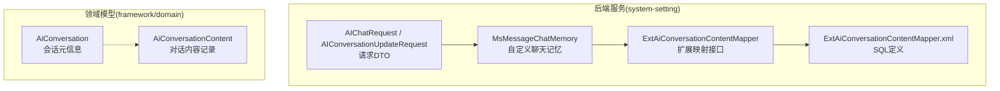
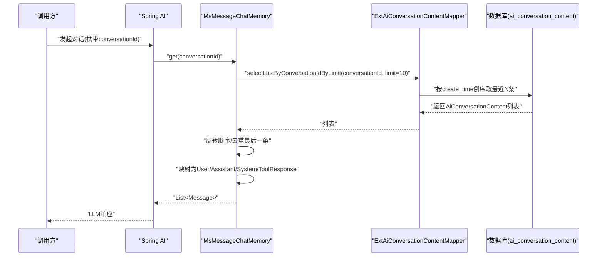
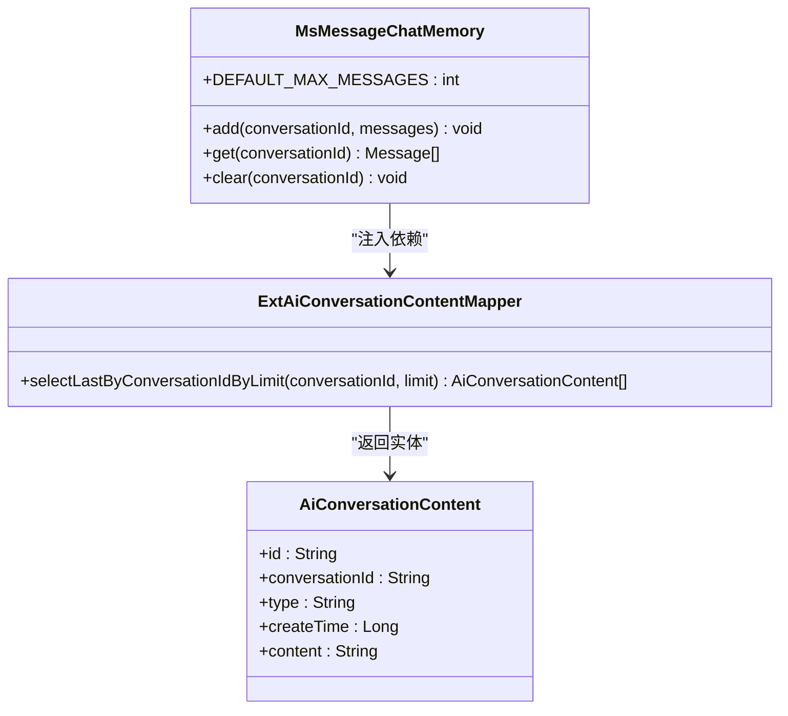
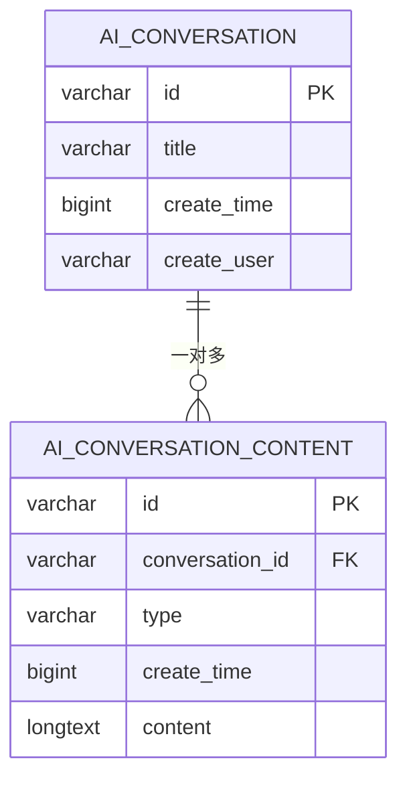
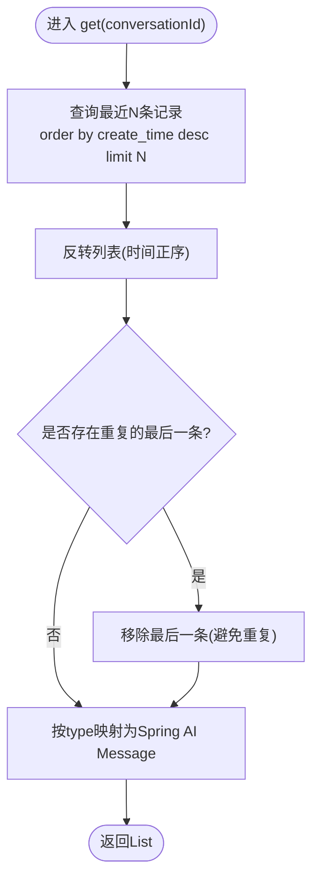
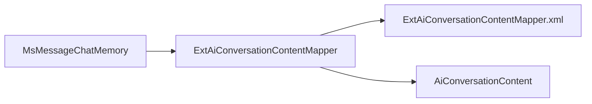

# 对话管理系统

<cite>
**本文引用的文件**   
- [MsMessageChatMemory.java](file://backend/services/system-setting/src/main/java/io/metersphere/system/config/ai/MsMessageChatMemory.java)
- [ExtAiConversationContentMapper.java](file://backend/services/system-setting/src/main/java/io/metersphere/system/mapper/ExtAiConversationContentMapper.java)
- [ExtAiConversationContentMapper.xml](file://backend/services/system-setting/src/main/java/io/metersphere/system/mapper/ExtAiConversationContentMapper.xml)
- [AiConversation.java](file://backend/framework/domain/src/main/java/io/metersphere/system/domain/AiConversation.java)
- [AiConversationContent.java](file://backend/framework/domain/src/main/java/io/metersphere/system/domain/AiConversationContent.java)
- [AIChatRequest.java](file://backend/services/system-setting/src/main/java/io/metersphere/system/dto/request/ai/AIChatRequest.java)
- [AIConversationUpdateRequest.java](file://backend/services/system-setting/src/main/java/io/metersphere/system/dto/request/ai/AIConversationUpdateRequest.java)
- [AiConversationControllerTest.java](file://backend/services/system-setting/src/test/java/io/metersphere/system/controller/AiConversationControllerTest.java)
</cite>

## 目录
1. [简介](#简介)
2. [项目结构](#项目结构)
3. [核心组件](#核心组件)
4. [架构总览](#架构总览)
5. [详细组件分析](#详细组件分析)
6. [依赖关系分析](#依赖关系分析)
7. [性能与容量规划](#性能与容量规划)
8. [故障排查指南](#故障排查指南)
9. [结论](#结论)
10. [附录：使用示例与最佳实践](#附录使用示例与最佳实践)

## 简介
本文件面向 MeterSphere 的对话管理系统，重点阐述对话历史存储机制、上下文管理策略、消息持久化与会话生命周期管理。围绕 MsMessageChatMemory 的实现原理，说明其“内存读取最近N条 + 数据库全量持久化”的设计，并给出多轮对话上下文保持、查询与清理的实践方式。同时补充与业务模块的集成点与数据同步策略，帮助读者快速理解并在实际项目中正确使用该能力。

## 项目结构
对话相关代码主要分布在以下位置：
- 配置与记忆层：system-setting 模块下的 ai 配置包，包含自定义 ChatMemory 实现
- 数据访问层：MyBatis Mapper 接口与 XML，用于对话内容的分页/限制查询
- 领域模型：framework/domain 下 AiConversation 与 AiConversationContent 实体
- 请求 DTO：system-setting 模块下 AIChatRequest、AIConversationUpdateRequest
- 测试用例：AiConversationControllerTest 演示了会话创建、内容写入、列表查询与删除等流程

图表来源
- [MsMessageChatMemory.java:1-66](file://backend/services/system-setting/src/main/java/io/metersphere/system/config/ai/MsMessageChatMemory.java#L1-L66)
- [ExtAiConversationContentMapper.java:1-13](file://backend/services/system-setting/src/main/java/io/metersphere/system/mapper/ExtAiConversationContentMapper.java#L1-L13)
- [ExtAiConversationContentMapper.xml:1-13](file://backend/services/system-setting/src/main/java/io/metersphere/system/mapper/ExtAiConversationContentMapper.xml#L1-L13)
- [AiConversation.java:1-104](file://backend/framework/domain/src/main/java/io/metersphere/system/domain/AiConversation.java#L1-L104)
- [AiConversationContent.java:1-112](file://backend/framework/domain/src/main/java/io/metersphere/system/domain/AiConversationContent.java#L1-L112)
- [AIChatRequest.java:1-29](file://backend/services/system-setting/src/main/java/io/metersphere/system/dto/request/ai/AIChatRequest.java#L1-L29)
- [AIConversationUpdateRequest.java:1-20](file://backend/services/system-setting/src/main/java/io/metersphere/system/dto/request/ai/AIConversationUpdateRequest.java#L1-L20)

章节来源
- [MsMessageChatMemory.java:1-66](file://backend/services/system-setting/src/main/java/io/metersphere/system/config/ai/MsMessageChatMemory.java#L1-L66)
- [ExtAiConversationContentMapper.java:1-13](file://backend/services/system-setting/src/main/java/io/metersphere/system/mapper/ExtAiConversationContentMapper.java#L1-L13)
- [ExtAiConversationContentMapper.xml:1-13](file://backend/services/system-setting/src/main/java/io/metersphere/system/mapper/ExtAiConversationContentMapper.xml#L1-L13)
- [AiConversation.java:1-104](file://backend/framework/domain/src/main/java/io/metersphere/system/domain/AiConversation.java#L1-L104)
- [AiConversationContent.java:1-112](file://backend/framework/domain/src/main/java/io/metersphere/system/domain/AiConversationContent.java#L1-L112)
- [AIChatRequest.java:1-29](file://backend/services/system-setting/src/main/java/io/metersphere/system/dto/request/ai/AIChatRequest.java#L1-L29)
- [AIConversationUpdateRequest.java:1-20](file://backend/services/system-setting/src/main/java/io/metersphere/system/dto/request/ai/AIConversationUpdateRequest.java#L1-L20)

## 核心组件
- MsMessageChatMemory：实现 Spring AI 的 ChatMemory 接口，负责从数据库读取最近若干条对话作为上下文；默认保留最近10条作为 LLM 的记忆窗口。
- ExtAiConversationContentMapper/XML：提供按 conversationId 倒序取最近 N 条记录的 SQL 查询。
- AiConversation/AiConversationContent：会话元信息与对话内容记录的领域模型。
- AIChatRequest/AIConversationUpdateRequest：对话发起与标题更新等请求对象。

章节来源
- [MsMessageChatMemory.java:1-66](file://backend/services/system-setting/src/main/java/io/metersphere/system/config/ai/MsMessageChatMemory.java#L1-L66)
- [ExtAiConversationContentMapper.java:1-13](file://backend/services/system-setting/src/main/java/io/metersphere/system/mapper/ExtAiConversationContentMapper.java#L1-L13)
- [ExtAiConversationContentMapper.xml:1-13](file://backend/services/system-setting/src/main/java/io/metersphere/system/mapper/ExtAiConversationContentMapper.xml#L1-L13)
- [AiConversation.java:1-104](file://backend/framework/domain/src/main/java/io/metersphere/system/domain/AiConversation.java#L1-L104)
- [AiConversationContent.java:1-112](file://backend/framework/domain/src/main/java/io/metersphere/system/domain/AiConversationContent.java#L1-L112)
- [AIChatRequest.java:1-29](file://backend/services/system-setting/src/main/java/io/metersphere/system/dto/request/ai/AIChatRequest.java#L1-L29)
- [AIConversationUpdateRequest.java:1-20](file://backend/services/system-setting/src/main/java/io/metersphere/system/dto/request/ai/AIConversationUpdateRequest.java#L1-L20)

## 架构总览
下图展示了对话系统的关键交互：上层通过 Spring AI 调用 ChatMemory，MsMessageChatMemory 从数据库拉取最近若干条消息，转换为 Spring AI Message 类型供模型推理使用。

图表来源
- [MsMessageChatMemory.java:31-60](file://backend/services/system-setting/src/main/java/io/metersphere/system/config/ai/MsMessageChatMemory.java#L31-L60)
- [ExtAiConversationContentMapper.java:8-12](file://backend/services/system-setting/src/main/java/io/metersphere/system/mapper/ExtAiConversationContentMapper.java#L8-L12)
- [ExtAiConversationContentMapper.xml:5-11](file://backend/services/system-setting/src/main/java/io/metersphere/system/mapper/ExtAiConversationContentMapper.xml#L5-L11)

## 详细组件分析

### MsMessageChatMemory 设计与实现
- 设计目标
  - 持久化所有消息（由外部逻辑写入数据库），但仅将最近若干条作为 LLM 的上下文记忆。
  - 默认记忆窗口大小为10条，可通过常量调整。
- 关键行为
  - add：空实现，表示不在此处落库，原始提示词由其他逻辑保存。
  - get：按 conversationId 查询最近 N 条，反转后去除重复的最后一条，再映射为 Spring AI Message。
  - clear：空实现，清理逻辑不在该组件内处理。
- 类型映射
  - USER/ASSISTANT/SYSTEM/TOOL 四类消息分别映射到对应的 Spring AI Message 类型。

图表来源
- [MsMessageChatMemory.java:18-66](file://backend/services/system-setting/src/main/java/io/metersphere/system/config/ai/MsMessageChatMemory.java#L18-L66)
- [ExtAiConversationContentMapper.java:8-12](file://backend/services/system-setting/src/main/java/io/metersphere/system/mapper/ExtAiConversationContentMapper.java#L8-L12)
- [AiConversationContent.java:11-35](file://backend/framework/domain/src/main/java/io/metersphere/system/domain/AiConversationContent.java#L11-L35)

章节来源
- [MsMessageChatMemory.java:14-66](file://backend/services/system-setting/src/main/java/io/metersphere/system/config/ai/MsMessageChatMemory.java#L14-L66)

### 数据模型与持久化
- AiConversation：会话元信息，包含 id、title、createTime、createUser 等字段。
- AiConversationContent：对话内容记录，包含 id、conversationId、type、createTime、content 等字段。
- 查询 SQL：按 conversation_id 过滤，按 create_time 倒序，limit 控制返回条数。

图表来源
- [AiConversation.java:11-35](file://backend/framework/domain/src/main/java/io/metersphere/system/domain/AiConversation.java#L11-L35)
- [AiConversationContent.java:11-35](file://backend/framework/domain/src/main/java/io/metersphere/system/domain/AiConversationContent.java#L11-L35)
- [ExtAiConversationContentMapper.xml:5-11](file://backend/services/system-setting/src/main/java/io/metersphere/system/mapper/ExtAiConversationContentMapper.xml#L5-L11)

章节来源
- [AiConversation.java:11-35](file://backend/framework/domain/src/main/java/io/metersphere/system/domain/AiConversation.java#L11-L35)
- [AiConversationContent.java:11-35](file://backend/framework/domain/src/main/java/io/metersphere/system/domain/AiConversationContent.java#L11-L35)
- [ExtAiConversationContentMapper.xml:5-11](file://backend/services/system-setting/src/main/java/io/metersphere/system/mapper/ExtAiConversationContentMapper.xml#L5-L11)

### 上下文获取流程（算法流程图）

图表来源
- [MsMessageChatMemory.java:36-60](file://backend/services/system-setting/src/main/java/io/metersphere/system/config/ai/MsMessageChatMemory.java#L36-L60)
- [ExtAiConversationContentMapper.xml:5-11](file://backend/services/system-setting/src/main/java/io/metersphere/system/mapper/ExtAiConversationContentMapper.xml#L5-L11)

章节来源
- [MsMessageChatMemory.java:36-60](file://backend/services/system-setting/src/main/java/io/metersphere/system/config/ai/MsMessageChatMemory.java#L36-L60)

### 会话生命周期管理
- 创建会话：通过上层服务或控制器创建 AiConversation 记录，分配 conversationId。
- 写入消息：由外部逻辑将用户输入、助手回复、系统提示等写入 AiConversationContent。
- 读取上下文：Spring AI 在每次推理前调用 MsMessageChatMemory.get 获取最近若干条消息。
- 更新标题：通过 AIConversationUpdateRequest 更新会话标题。
- 删除会话：删除会话及其关联的所有对话内容。

章节来源
- [AIConversationUpdateRequest.java:1-20](file://backend/services/system-setting/src/main/java/io/metersphere/system/dto/request/ai/AIConversationUpdateRequest.java#L1-L20)
- [AiConversationControllerTest.java:160-210](file://backend/services/system-setting/src/test/java/io/metersphere/system/controller/AiConversationControllerTest.java#L160-L210)

## 依赖关系分析
- MsMessageChatMemory 依赖 ExtAiConversationContentMapper 进行数据读取。
- ExtAiConversationContentMapper 依赖 MyBatis XML 中的 SQL 语句访问数据库。
- 领域模型 AiConversationContent 作为数据载体贯穿 Mapper 与 Memory 层。

图表来源
- [MsMessageChatMemory.java:28-29](file://backend/services/system-setting/src/main/java/io/metersphere/system/config/ai/MsMessageChatMemory.java#L28-L29)
- [ExtAiConversationContentMapper.java:8-12](file://backend/services/system-setting/src/main/java/io/metersphere/system/mapper/ExtAiConversationContentMapper.java#L8-L12)
- [ExtAiConversationContentMapper.xml:5-11](file://backend/services/system-setting/src/main/java/io/metersphere/system/mapper/ExtAiConversationContentMapper.xml#L5-L11)
- [AiConversationContent.java:11-35](file://backend/framework/domain/src/main/java/io/metersphere/system/domain/AiConversationContent.java#L11-L35)

章节来源
- [MsMessageChatMemory.java:28-29](file://backend/services/system-setting/src/main/java/io/metersphere/system/config/ai/MsMessageChatMemory.java#L28-L29)
- [ExtAiConversationContentMapper.java:8-12](file://backend/services/system-setting/src/main/java/io/metersphere/system/mapper/ExtAiConversationContentMapper.java#L8-L12)
- [ExtAiConversationContentMapper.xml:5-11](file://backend/services/system-setting/src/main/java/io/metersphere/system/mapper/ExtAiConversationContentMapper.xml#L5-L11)
- [AiConversationContent.java:11-35](file://backend/framework/domain/src/main/java/io/metersphere/system/domain/AiConversationContent.java#L11-L35)

## 性能与容量规划
- 记忆窗口大小：默认10条，可根据业务场景调整 DEFAULT_MAX_MESSAGES，以平衡上下文长度与成本。
- 查询复杂度：按 conversation_id 过滤并按 create_time 排序，建议对 (conversation_id, create_time) 建立复合索引以提升查询性能。
- 写入路径：add 为空实现，意味着消息写入由外部逻辑完成，需确保写入幂等与批量优化。
- 缓存策略：当前未引入应用级缓存，若高频读取同一会话，可考虑在 Service 层增加短时缓存以降低数据库压力。

[本节为通用指导，无需具体文件引用]

## 故障排查指南
- 问题：上下文缺失或顺序异常
  - 检查 ExtAiConversationContentMapper.xml 中 order by 与 limit 参数是否正确。
  - 确认 MsMessageChatMemory.get 中反转与去重逻辑是否被修改。
- 问题：对话内容未持久化
  - 确认外部写入逻辑是否将 AiConversationContent 正确插入数据库。
  - 校验 AiConversationContent.type 是否为合法枚举值（USER/ASSISTANT/SYSTEM/TOOL）。
- 问题：会话删除后仍有残留
  - 参考测试用例中对会话与内容的一致性校验，确保删除操作级联清理。

章节来源
- [ExtAiConversationContentMapper.xml:5-11](file://backend/services/system-setting/src/main/java/io/metersphere/system/mapper/ExtAiConversationContentMapper.xml#L5-L11)
- [MsMessageChatMemory.java:36-60](file://backend/services/system-setting/src/main/java/io/metersphere/system/config/ai/MsMessageChatMemory.java#L36-L60)
- [AiConversationControllerTest.java:197-210](file://backend/services/system-setting/src/test/java/io/metersphere/system/controller/AiConversationControllerTest.java#L197-L210)

## 结论
MsMessageChatMemory 通过“数据库全量持久化 + 最近N条作为上下文”的策略，既保证了对话历史的完整性，又控制了 LLM 上下文的长度与成本。配合清晰的领域模型与简洁的 Mapper 查询，系统实现了稳定可靠的对话上下文管理。建议在业务侧完善消息写入与清理逻辑，并根据实际负载优化索引与缓存策略。

[本节为总结性内容，无需具体文件引用]

## 附录：使用示例与最佳实践

- 创建与管理对话会话
  - 创建会话：生成 AiConversation 记录并分配 conversationId。
  - 更新标题：使用 AIConversationUpdateRequest 更新会话标题。
  - 删除会话：删除会话及关联内容，保证数据一致性。

- 处理多轮对话的上下文保持
  - 每次推理前，Spring AI 会调用 MsMessageChatMemory.get 获取最近若干条消息。
  - 确保 AiConversationContent 按时间顺序写入，type 字段准确标识消息角色。

- 对话历史的查询与清理
  - 查询：通过 ExtAiConversationContentMapper.selectLastByConversationIdByLimit 获取最近N条。
  - 清理：删除会话时级联清理内容，或在定时任务中归档/清理历史数据。

- 与业务模块的集成与数据同步
  - 业务模块在触发对话时，先创建会话，再将用户输入写入 AiConversationContent。
  - 当 LLM 返回结果后，将助手回复写入 AiConversationContent，以便后续上下文读取。
  - 如需跨模块共享会话状态，可在 Service 层封装统一的会话管理与同步方法。

章节来源
- [AIChatRequest.java:1-29](file://backend/services/system-setting/src/main/java/io/metersphere/system/dto/request/ai/AIChatRequest.java#L1-L29)
- [AIConversationUpdateRequest.java:1-20](file://backend/services/system-setting/src/main/java/io/metersphere/system/dto/request/ai/AIConversationUpdateRequest.java#L1-L20)
- [AiConversationControllerTest.java:160-210](file://backend/services/system-setting/src/test/java/io/metersphere/system/controller/AiConversationControllerTest.java#L160-L210)