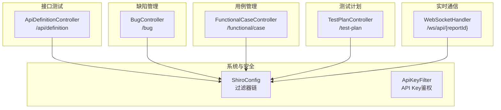
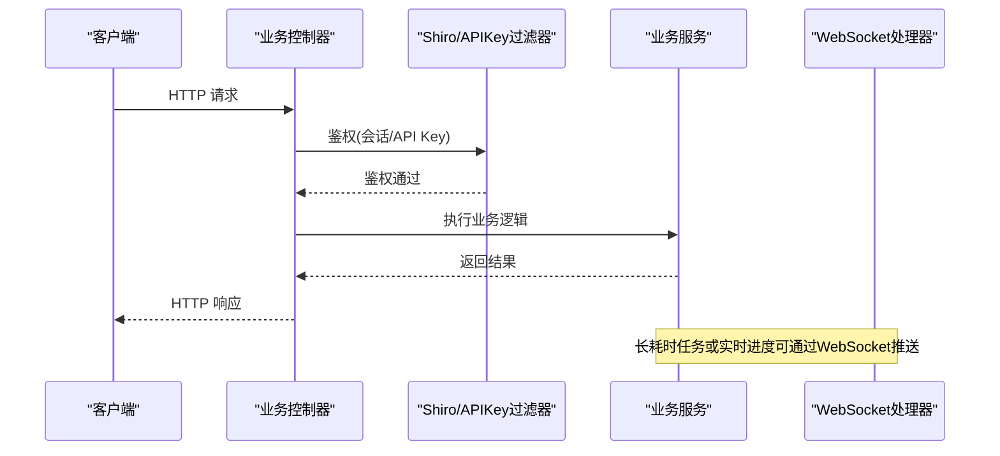
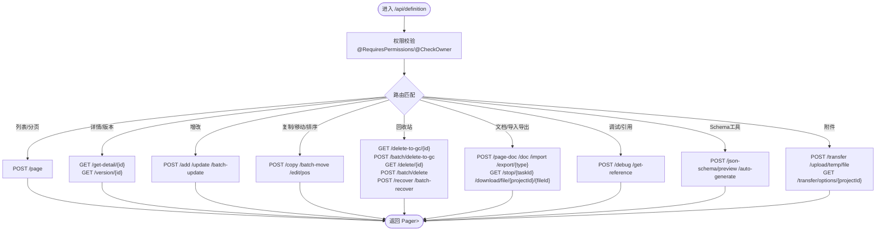
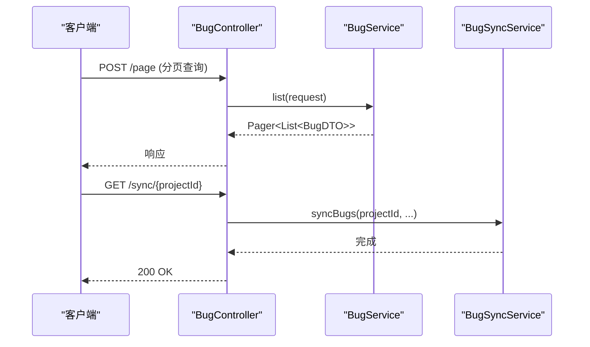
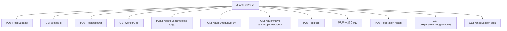
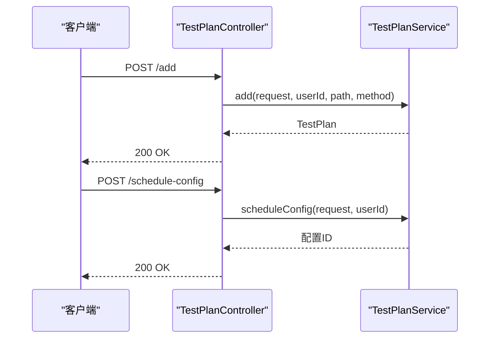
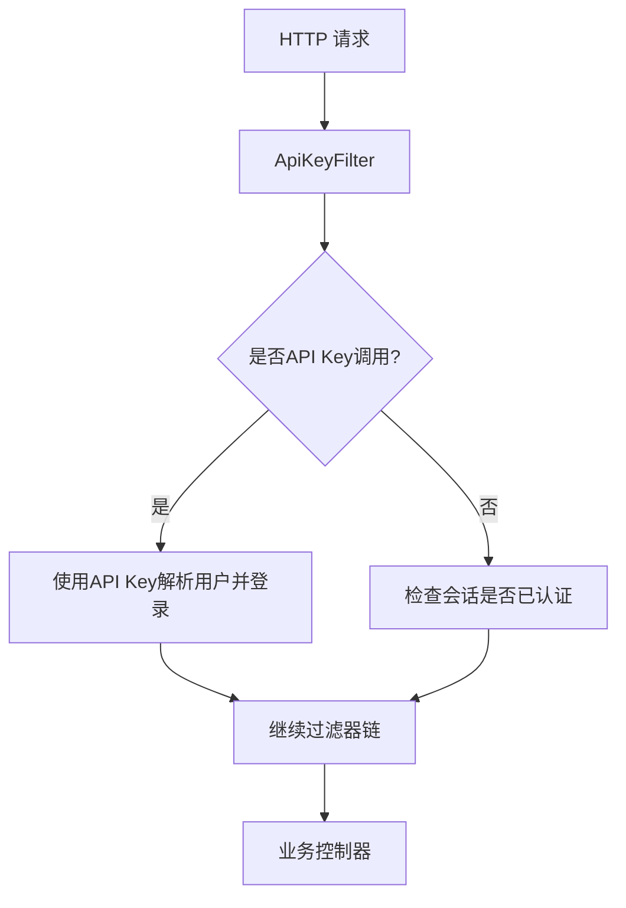
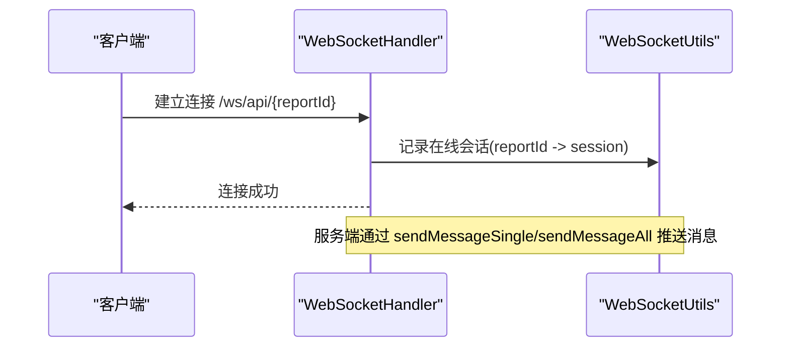

# API参考

<cite>
**本文引用的文件**   
- [ApiDefinitionController.java](file://backend/services/api-test/src/main/java/io/metersphere/api/controller/definition/ApiDefinitionController.java)
- [BugController.java](file://backend/services/bug-management/src/main/java/io/metersphere/bug/controller/BugController.java)
- [FunctionalCaseController.java](file://backend/services/case-management/src/main/java/io/metersphere/functional/controller/FunctionalCaseController.java)
- [TestPlanController.java](file://backend/services/test-plan/src/main/java/io/metersphere/plan/controller/TestPlanController.java)
- [WebSocketHandler.java](file://backend/services/api-test/src/main/java/io/metersphere/api/socket/WebSocketHandler.java)
- [ShiroConfig.java](file://backend/services/system-setting/src/main/java/io/metersphere/system/config/ShiroConfig.java)
- [ApiKeyFilter.java](file://backend/services/system-setting/src/main/java/io/metersphere/system/security/ApiKeyFilter.java)
- [BasicAuth.java](file://backend/services/project-management/src/main/java/io/metersphere/project/dto/environment/auth/BasicAuth.java)
- [NoAuth.java](file://backend/services/project-management/src/main/java/io/metersphere/project/dto/environment/auth/NoAuth.java)
</cite>

## 目录
1. [简介](#简介)
2. [项目结构](#项目结构)
3. [核心组件](#核心组件)
4. [架构总览](#架构总览)
5. [详细组件分析](#详细组件分析)
6. [依赖关系分析](#依赖关系分析)
7. [性能与速率限制](#性能与速率限制)
8. [故障排查指南](#故障排查指南)
9. [结论](#结论)
10. [附录：API端点清单](#附录api端点清单)

## 简介
本文件为 MeterSphere 的 RESTful API 参考文档，覆盖接口测试、缺陷管理、用例管理与测试计划等核心业务模块。文档包含：
- RESTful 规范、HTTP方法与URL模式
- 请求/响应结构与通用分页格式
- 认证与授权（会话、API Key）
- WebSocket 实时通信接口
- 参数校验与错误码说明
- 版本管理与向后兼容性策略

## 项目结构
后端采用多服务模块化组织，按业务域划分控制器与服务层：
- 接口测试：定义、调试、执行、报告分享等
- 缺陷管理：缺陷CRUD、同步、导出、模板等
- 用例管理：功能用例CRUD、导入导出、变更历史等
- 测试计划：计划CRUD、统计、定时任务、关联用例等

图表来源
- [ApiDefinitionController.java:59-62](file://backend/services/api-test/src/main/java/io/metersphere/api/controller/definition/ApiDefinitionController.java#L59-L62)
- [BugController.java:52-55](file://backend/services/bug-management/src/main/java/io/metersphere/bug/controller/BugController.java#L52-L55)
- [FunctionalCaseController.java:51-54](file://backend/services/case-management/src/main/java/io/metersphere/functional/controller/FunctionalCaseController.java#L51-L54)
- [TestPlanController.java:40-43](file://backend/services/test-plan/src/main/java/io/metersphere/plan/controller/TestPlanController.java#L40-L43)
- [ShiroConfig.java:31-54](file://backend/services/system-setting/src/main/java/io/metersphere/system/config/ShiroConfig.java#L31-L54)
- [WebSocketHandler.java:17-18](file://backend/services/api-test/src/main/java/io/metersphere/api/socket/WebSocketHandler.java#L17-L18)

章节来源
- [ApiDefinitionController.java:59-62](file://backend/services/api-test/src/main/java/io/metersphere/api/controller/definition/ApiDefinitionController.java#L59-L62)
- [BugController.java:52-55](file://backend/services/bug-management/src/main/java/io/metersphere/bug/controller/BugController.java#L52-L55)
- [FunctionalCaseController.java:51-54](file://backend/services/case-management/src/main/java/io/metersphere/functional/controller/FunctionalCaseController.java#L51-L54)
- [TestPlanController.java:40-43](file://backend/services/test-plan/src/main/java/io/metersphere/plan/controller/TestPlanController.java#L40-L43)

## 核心组件
- 接口测试（接口定义）：提供接口定义的增删改查、复制、批量操作、版本、文档、导入导出、调试、引用关系等能力。
- 缺陷管理：提供缺陷的增删改查、分页、同步、导出、模板、关注/取消关注等能力。
- 用例管理：提供功能用例的增删改查、分页、导入导出、变更历史、模板字段、拖拽排序等能力。
- 测试计划：提供测试计划的增删改查、统计、分组、定时任务、归档、批量操作等能力。
- 安全与认证：基于 Shiro 的会话认证与API Key鉴权；统一过滤器链配置。
- 实时通信：WebSocket 用于调试/执行结果实时推送。

章节来源
- [ApiDefinitionController.java:97-407](file://backend/services/api-test/src/main/java/io/metersphere/api/controller/definition/ApiDefinitionController.java#L97-L407)
- [BugController.java:66-250](file://backend/services/bug-management/src/main/java/io/metersphere/bug/controller/BugController.java#L66-L250)
- [FunctionalCaseController.java:69-327](file://backend/services/case-management/src/main/java/io/metersphere/functional/controller/FunctionalCaseController.java#L69-L327)
- [TestPlanController.java:58-289](file://backend/services/test-plan/src/main/java/io/metersphere/plan/controller/TestPlanController.java#L58-L289)
- [ShiroConfig.java:31-54](file://backend/services/system-setting/src/main/java/io/metersphere/system/config/ShiroConfig.java#L31-L54)
- [ApiKeyFilter.java:15-38](file://backend/services/system-setting/src/main/java/io/metersphere/system/security/ApiKeyFilter.java#L15-L38)
- [WebSocketHandler.java:17-50](file://backend/services/api-test/src/main/java/io/metersphere/api/socket/WebSocketHandler.java#L17-L50)

## 架构总览
整体调用链路：客户端 → Spring MVC 控制器 → 权限校验（Shiro/API Key）→ 业务服务 → 数据访问层。部分流程通过异步任务与WebSocket推送结果。

图表来源
- [ShiroConfig.java:31-54](file://backend/services/system-setting/src/main/java/io/metersphere/system/config/ShiroConfig.java#L31-L54)
- [ApiKeyFilter.java:15-38](file://backend/services/system-setting/src/main/java/io/metersphere/system/security/ApiKeyFilter.java#L15-L38)
- [WebSocketHandler.java:17-50](file://backend/services/api-test/src/main/java/io/metersphere/api/socket/WebSocketHandler.java#L17-L50)

## 详细组件分析

### 接口测试（接口定义）
- 基础路径：/api/definition
- 主要能力：
  - 列表与分页：GET /rage/{projectId}、POST /page
  - 详情与版本：GET /get-detail/{id}、GET /version/{id}
  - 创建/更新/批量更新：POST /add、POST /update、POST /batch-update
  - 复制/移动/排序：POST /copy、POST /batch-move、POST /edit/pos
  - 回收站：GET /delete-to-gc/{id}、POST /batch/delete-to-gc、GET /delete/{id}、POST /batch/delete、POST /recover、POST /batch-recover
  - 文档与导入导出：POST /page-doc、POST /doc、POST /import、POST /export/{type}、GET /stop/{taskId}、GET /download/file/{projectId}/{fileId}
  - 调试与引用：POST /debug、POST /get-reference
  - JSON Schema预览与自动生成：POST /json-schema/preview、POST /json-schema/auto-generate
  - 附件转存与临时文件：POST /transfer、GET /transfer/options/{projectId}、POST /upload/temp/file

图表来源
- [ApiDefinitionController.java:97-407](file://backend/services/api-test/src/main/java/io/metersphere/api/controller/definition/ApiDefinitionController.java#L97-L407)

章节来源
- [ApiDefinitionController.java:97-407](file://backend/services/api-test/src/main/java/io/metersphere/api/controller/definition/ApiDefinitionController.java#L97-L407)

### 缺陷管理
- 基础路径：/bug
- 主要能力：
  - 列表与分页：POST /page
  - 详情与校验：GET /get/{id}、GET /check-exist/{id}
  - 创建/更新：POST /add、POST /update（支持文件上传）
  - 删除/批量删除：GET /delete/{id}、POST /batch-delete
  - 同步：GET /sync/{projectId}、POST /sync/all、GET /sync/check/{projectId}
  - 导出：POST /export、GET /export/columns/{projectId}
  - 模板：GET /template/option/{projectId}、POST /template/detail
  - 关注/取消关注：GET /follow/{id}、GET /unfollow/{id}
  - 拖拽排序：POST /edit/pos

图表来源
- [BugController.java:90-102](file://backend/services/bug-management/src/main/java/io/metersphere/bug/controller/BugController.java#L90-L102)
- [BugController.java:151-173](file://backend/services/bug-management/src/main/java/io/metersphere/bug/controller/BugController.java#L151-L173)

章节来源
- [BugController.java:66-250](file://backend/services/bug-management/src/main/java/io/metersphere/bug/controller/BugController.java#L66-L250)

### 用例管理（功能用例）
- 基础路径：/functional/case
- 主要能力：
  - 默认模板字段：GET /default/template/field/{projectId}
  - 新增/更新：POST /add、POST /update（支持文件上传）
  - 详情：GET /detail/{id}
  - 关注/取消关注：POST /edit/follower
  - 版本信息：GET /version/{id}
  - 删除/批量删除到回收站：POST /delete、POST /batch/delete-to-gc
  - 列表与统计：POST /page、POST /module/count
  - 批量移动/复制/编辑：POST /batch/move、POST /batch/copy、POST /batch/edit
  - 拖拽排序：POST edit/pos
  - 导入导出：POST /pre-check/excel、POST /import/excel、POST /pre-check/xmind、POST /import/xmind、POST /export/excel、POST /export/xmind、GET /stop/{taskId}、GET /download/file/{projectId}/{fileId}
  - 变更历史：POST /operation-history
  - 导出列配置：GET /export/columns/{projectId}
  - 导出任务校验：GET /check/export-task

图表来源
- [FunctionalCaseController.java:69-327](file://backend/services/case-management/src/main/java/io/metersphere/functional/controller/FunctionalCaseController.java#L69-L327)

章节来源
- [FunctionalCaseController.java:69-327](file://backend/services/case-management/src/main/java/io/metersphere/functional/controller/FunctionalCaseController.java#L69-L327)

### 测试计划
- 基础路径：/test-plan
- 主要能力：
  - 列表与统计：POST /page、POST /statistics、POST /module/count、POST /rage
  - 分组与计划列表：GET /group-list/{projectId}、GET /test-plan-list/{projectId}、GET /list-in-group/{groupId}
  - 增删改：POST /add、POST /update、GET /delete/{id}
  - 关注/取消关注：POST /edit/follower
  - 归档：GET /archived/{id}、POST /batch-archived
  - 详情：GET /{id}
  - 批量操作：POST /batch-delete、POST /batch-copy、POST /batch-move、POST /batch-edit
  - 排序：POST /sort
  - 定时任务：POST /schedule-config、POST /batch-schedule-config、GET /schedule-config-delete/{testPlanId}
  - 执行历史：POST /his/page

图表来源
- [TestPlanController.java:124-142](file://backend/services/test-plan/src/main/java/io/metersphere/plan/controller/TestPlanController.java#L124-L142)
- [TestPlanController.java:252-269](file://backend/services/test-plan/src/main/java/io/metersphere/plan/controller/TestPlanController.java#L252-L269)

章节来源
- [TestPlanController.java:58-289](file://backend/services/test-plan/src/main/java/io/metersphere/plan/controller/TestPlanController.java#L58-L289)

### 认证与授权
- 会话认证：基于 Shiro，未登录时重定向至登录页，未授权跳转403。
- API Key鉴权：通过自定义过滤器 ApiKeyFilter，在请求头携带有效API Key可免密登录。
- 环境HTTP认证：支持 BasicAuth 与 NoAuth 等类型，用于下游接口调用的认证配置。

图表来源
- [ShiroConfig.java:31-54](file://backend/services/system-setting/src/main/java/io/metersphere/system/config/ShiroConfig.java#L31-L54)
- [ApiKeyFilter.java:15-38](file://backend/services/system-setting/src/main/java/io/metersphere/system/security/ApiKeyFilter.java#L15-L38)
- [BasicAuth.java:10-18](file://backend/services/project-management/src/main/java/io/metersphere/project/dto/environment/auth/BasicAuth.java#L10-L18)
- [NoAuth.java:10-13](file://backend/services/project-management/src/main/java/io/metersphere/project/dto/environment/auth/NoAuth.java#L10-L13)

章节来源
- [ShiroConfig.java:31-54](file://backend/services/system-setting/src/main/java/io/metersphere/system/config/ShiroConfig.java#L31-L54)
- [ApiKeyFilter.java:15-38](file://backend/services/system-setting/src/main/java/io/metersphere/system/security/ApiKeyFilter.java#L15-L38)
- [BasicAuth.java:10-18](file://backend/services/project-management/src/main/java/io/metersphere/project/dto/environment/auth/BasicAuth.java#L10-L18)
- [NoAuth.java:10-13](file://backend/services/project-management/src/main/java/io/metersphere/project/dto/environment/auth/NoAuth.java#L10-L13)

### WebSocket 实时通信
- 端点：/ws/api/{reportId}
- 用途：调试/执行结果的实时推送，连接成功后将消息推送到指定 reportId 的在线会话。

图表来源
- [WebSocketHandler.java:17-50](file://backend/services/api-test/src/main/java/io/metersphere/api/socket/WebSocketHandler.java#L17-L50)

章节来源
- [WebSocketHandler.java:17-50](file://backend/services/api-test/src/main/java/io/metersphere/api/socket/WebSocketHandler.java#L17-L50)

## 依赖关系分析
- 控制器依赖权限注解与资源归属校验：
  - @RequiresPermissions：控制接口访问权限
  - @CheckOwner：校验当前用户对资源的拥有者关系
- 控制器依赖服务层进行业务处理，并通过日志与通知注解记录审计与发送通知。
- 安全层由 Shiro 统一管理过滤器链，API Key 作为可选认证方式。

```mermaid
graph LR
Ctrl["业务控制器"] --> Perm["@RequiresPermissions"]
Ctrl --> Owner["@CheckOwner"]
Ctrl --> Log["@Log"]
Ctrl --> Notice["@SendNotice"]
Ctrl --> Svc["业务服务"]
Perm --> Shiro["ShiroConfig"]
Owner --> DB["数据持久化"]
```

图表来源
- [ApiDefinitionController.java:128-179](file://backend/services/api-test/src/main/java/io/metersphere/api/controller/definition/ApiDefinitionController.java#L128-L179)
- [BugController.java:104-126](file://backend/services/bug-management/src/main/java/io/metersphere/bug/controller/BugController.java#L104-L126)
- [FunctionalCaseController.java:78-110](file://backend/services/case-management/src/main/java/io/metersphere/functional/controller/FunctionalCaseController.java#L78-L110)
- [TestPlanController.java:124-142](file://backend/services/test-plan/src/main/java/io/metersphere/plan/controller/TestPlanController.java#L124-L142)
- [ShiroConfig.java:31-54](file://backend/services/system-setting/src/main/java/io/metersphere/system/config/ShiroConfig.java#L31-L54)

章节来源
- [ApiDefinitionController.java:128-179](file://backend/services/api-test/src/main/java/io/metersphere/api/controller/definition/ApiDefinitionController.java#L128-L179)
- [BugController.java:104-126](file://backend/services/bug-management/src/main/java/io/metersphere/bug/controller/BugController.java#L104-L126)
- [FunctionalCaseController.java:78-110](file://backend/services/case-management/src/main/java/io/metersphere/functional/controller/FunctionalCaseController.java#L78-L110)
- [TestPlanController.java:124-142](file://backend/services/test-plan/src/main/java/io/metersphere/plan/controller/TestPlanController.java#L124-L142)
- [ShiroConfig.java:31-54](file://backend/services/system-setting/src/main/java/io/metersphere/system/config/ShiroConfig.java#L31-L54)

## 性能与速率限制
- 分页查询：普遍使用 PageHelper 进行数据库分页，建议合理设置 pageSize 与 sortString 以提升查询效率。
- 导出与导入：大文件导入/导出采用异步任务与停止任务接口（如 /stop/{taskId}），避免阻塞请求。
- 速率限制：代码中存在配额拦截器扩展点（QuotaInterceptor），可用于接入配额插件实现限流与配额控制。

章节来源
- [ApiDefinitionController.java:269-311](file://backend/services/api-test/src/main/java/io/metersphere/api/controller/definition/ApiDefinitionController.java#L269-L311)
- [FunctionalCaseController.java:275-327](file://backend/services/case-management/src/main/java/io/metersphere/functional/controller/FunctionalCaseController.java#L275-L327)

## 故障排查指南
- 鉴权失败：
  - 检查是否携带有效会话或API Key；未认证时响应头会包含认证状态标识。
  - 确认 Shiro 过滤器链是否正确加载。
- 权限不足：
  - 检查 @RequiresPermissions 与 @CheckOwner 的资源ID与权限常量是否匹配。
- 导入/导出异常：
  - 使用预检查接口（如 /pre-check/excel、/pre-check/xmind）先验证数据合法性。
  - 通过 /stop/{taskId} 停止长时间运行的导出任务。
- WebSocket连接问题：
  - 确认 reportId 正确且服务端在线会话存在；检查网络代理对WebSocket的支持。

章节来源
- [ApiKeyFilter.java:15-38](file://backend/services/system-setting/src/main/java/io/metersphere/system/security/ApiKeyFilter.java#L15-L38)
- [ShiroConfig.java:31-54](file://backend/services/system-setting/src/main/java/io/metersphere/system/config/ShiroConfig.java#L31-L54)
- [FunctionalCaseController.java:228-262](file://backend/services/case-management/src/main/java/io/metersphere/functional/controller/FunctionalCaseController.java#L228-L262)
- [ApiDefinitionController.java:386-399](file://backend/services/api-test/src/main/java/io/metersphere/api/controller/definition/ApiDefinitionController.java#L386-L399)
- [WebSocketHandler.java:17-50](file://backend/services/api-test/src/main/java/io/metersphere/api/socket/WebSocketHandler.java#L17-L50)

## 结论
本文档梳理了 MeterSphere 的核心REST API与WebSocket接口，涵盖接口测试、缺陷管理、用例管理与测试计划等模块。通过统一的权限与鉴权机制、分页与异步任务设计，保障了系统的可扩展性与稳定性。建议在集成时遵循分页与异步导出的最佳实践，并结合配额插件实现速率限制与配额控制。

## 附录：API端点清单
以下为各模块常用端点与其HTTP方法、URL模式与简要说明（以控制器注解为准）。

- 接口测试（/api/definition）
  - GET /rage/{projectId}：接口覆盖率统计
  - POST /page：接口列表分页
  - GET /get-detail/{id}：获取接口详情
  - GET /version/{id}：接口版本信息
  - POST /add：添加接口定义
  - POST /update：更新接口定义
  - POST /batch-update：批量更新接口定义
  - POST /copy：复制接口定义
  - POST /batch-move：批量移动接口定义
  - POST /edit/pos：拖拽排序
  - GET /delete-to-gc/{id}：删除到回收站
  - POST /batch/delete-to-gc：批量删除到回收站
  - GET /delete/{id}：删除回收站接口定义
  - POST /batch/delete：批量从回收站删除
  - POST /recover：恢复回收站接口定义
  - POST /batch-recover：批量恢复回收站接口定义
  - POST /page-doc：接口文档列表
  - POST /doc：接口文档信息
  - POST /import：导入接口定义
  - POST /export/{type}：导出接口定义
  - GET /stop/{taskId}：停止导出
  - GET /download/file/{projectId}/{fileId}：下载文件
  - POST /debug：接口调试
  - POST /get-reference：引用关系
  - POST /json-schema/preview：JSON Schema预览
  - POST /json-schema/auto-generate：自动生成测试数据
  - POST /transfer：文件转存
  - GET /transfer/options/{projectId}：转存目录下拉框
  - POST /upload/temp/file：上传临时文件

- 缺陷管理（/bug）
  - GET /current-platform/{projectId}：获取当前平台
  - GET /header/custom-field/{projectId}：表头自定义字段
  - GET /header/columns-option/{projectId}：表头状态选项
  - POST /page：分页获取缺陷列表
  - POST /add：创建缺陷（支持文件）
  - POST /update：编辑缺陷（支持文件）
  - GET /check-exist/{id}：校验缺陷是否存在
  - GET /get/{id}：查看缺陷详情
  - GET /delete/{id}：删除缺陷
  - GET /sync/{projectId}：同步缺陷
  - POST /sync/all：区间同步缺陷
  - GET /sync/check/{projectId}：校验同步状态
  - GET /export/columns/{projectId}：导出字段配置
  - POST /export：批量导出缺陷
  - POST /batch-delete：批量删除缺陷
  - POST /batch-update：批量编辑缺陷
  - POST /edit/pos：拖拽排序
  - GET /template/option/{projectId}：模板选项
  - POST /template/detail：模板详情
  - GET /follow/{id}：关注缺陷
  - GET /unfollow/{id}：取消关注缺陷

- 用例管理（/functional/case）
  - GET /default/template/field/{projectId}：默认模板自定义字段
  - POST /add：新增用例（支持文件）
  - GET /detail/{id}：查看用例详情
  - POST /update：更新用例（支持文件）
  - POST /edit/follower：关注/取消关注
  - GET /version/{id}：版本信息
  - POST /delete：删除用例
  - POST /page：用例列表查询
  - POST /module/count：统计模块数量
  - POST /batch/delete-to-gc：批量删除到回收站
  - GET /custom/field/{projectId}：表头自定义字段
  - POST /batch/move：批量移动用例
  - POST /batch/copy：批量复制用例
  - POST /batch/edit：批量编辑用例
  - POST edit/pos：拖拽排序
  - GET /download/excel/template/{projectId}：下载Excel模板
  - POST /pre-check/excel：Excel导入检查
  - POST /pre-check/xmind：XMind导入检查
  - POST /import/excel：Excel导入
  - POST /import/xmind：XMind导入
  - POST /operation-history：变更历史
  - POST /export/excel：Excel导出
  - GET /stop/{taskId}：停止导出
  - GET /download/xmind/template/{projectId}：下载XMind模板
  - GET /export/columns/{projectId}：导出列配置
  - GET /download/file/{projectId}/{fileId}：下载文件
  - POST /export/xmind：XMind导出
  - GET /check/export-task：导出任务校验

- 测试计划（/test-plan）
  - POST /page：表格分页查询
  - POST /rage：测试计划统计
  - GET /group-list/{projectId}：测试计划组查询
  - GET /test-plan-list/{projectId}：测试计划列表
  - GET /list-in-group/{groupId}：组内计划列表
  - POST /statistics：计划详情统计
  - POST /module/count：模块统计
  - POST /add：创建测试计划
  - POST /update：更新测试计划
  - GET /delete/{id}：删除测试计划
  - POST /edit/follower：关注/取消关注
  - GET /archived/{id}：归档
  - GET /{id}：详情
  - POST /batch-delete：批量删除
  - GET /copy/{id}：复制测试计划
  - POST /batch-copy：批量复制
  - POST /batch-move：批量移动
  - POST /batch-archived：批量归档
  - POST /batch-edit：批量编辑
  - POST /sort：排序
  - POST /schedule-config：定时任务配置
  - POST /batch-schedule-config：批量定时任务配置
  - GET /schedule-config-delete/{testPlanId}：删除定时任务配置
  - POST /his/page：执行历史分页

章节来源
- [ApiDefinitionController.java:97-407](file://backend/services/api-test/src/main/java/io/metersphere/api/controller/definition/ApiDefinitionController.java#L97-L407)
- [BugController.java:66-250](file://backend/services/bug-management/src/main/java/io/metersphere/bug/controller/BugController.java#L66-L250)
- [FunctionalCaseController.java:69-327](file://backend/services/case-management/src/main/java/io/metersphere/functional/controller/FunctionalCaseController.java#L69-L327)
- [TestPlanController.java:58-289](file://backend/services/test-plan/src/main/java/io/metersphere/plan/controller/TestPlanController.java#L58-L289)