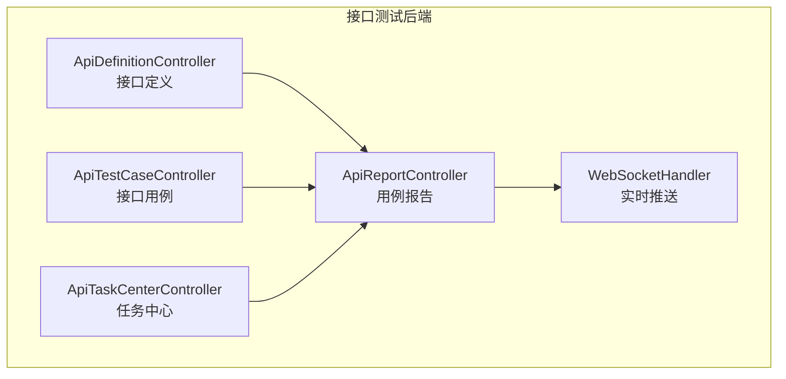
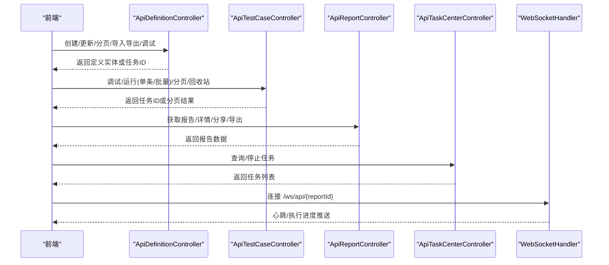
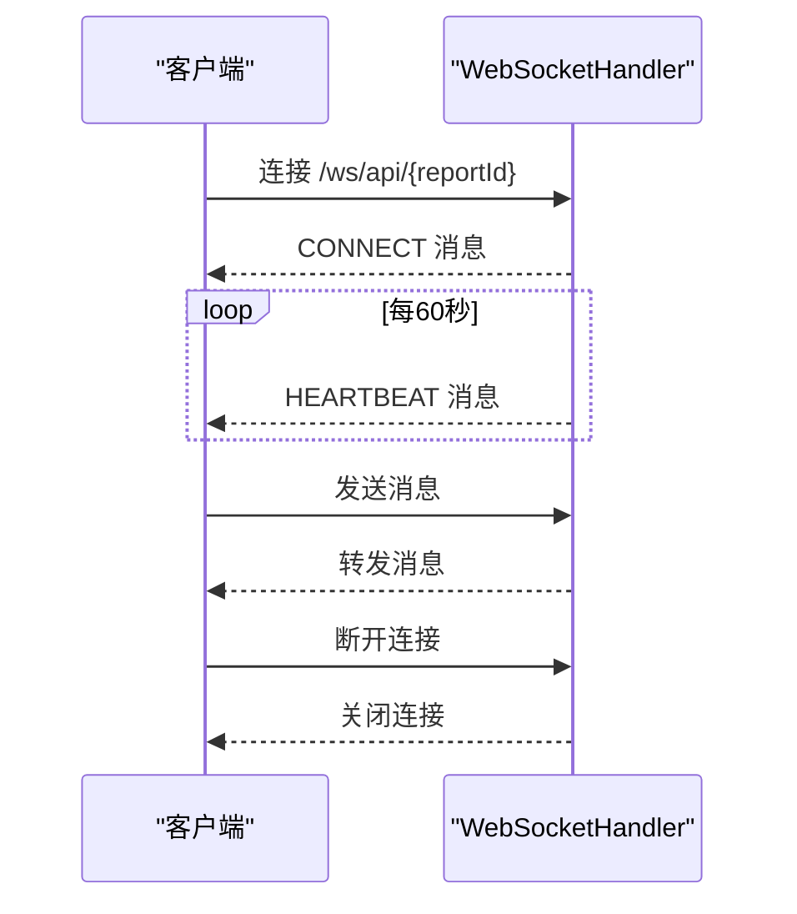
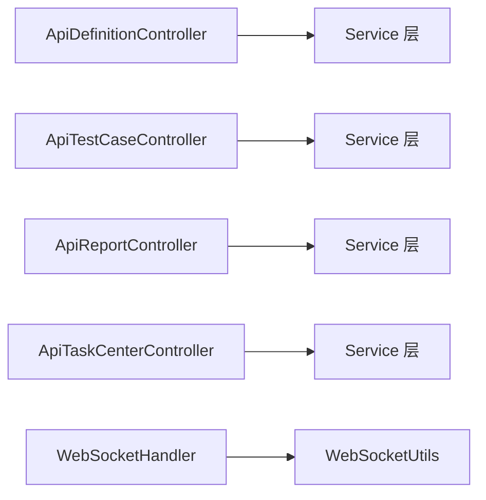

# 接口测试API

<cite>
**本文引用的文件**   
- [ApiTestController.java](file://backend/services/api-test/src/main/java/io/metersphere/api/controller/ApiTestController.java)
- [ApiDefinitionController.java](file://backend/services/api-test/src/main/java/io/metersphere/api/controller/definition/ApiDefinitionController.java)
- [ApiTestCaseController.java](file://backend/services/api-test/src/main/java/io/metersphere/api/controller/definition/ApiTestCaseController.java)
- [ApiReportController.java](file://backend/services/api-test/src/main/java/io/metersphere/api/controller/definition/ApiReportController.java)
- [ApiTaskCenterController.java](file://backend/services/api-test/src/main/java/io/metersphere/api/controller/ApiTaskCenterController.java)
- [WebSocketHandler.java](file://backend/services/api-test/src/main/java/io/metersphere/api/socket/WebSocketHandler.java)
</cite>

## 目录
1. [简介](#简介)
2. [项目结构](#项目结构)
3. [核心组件](#核心组件)
4. [架构总览](#架构总览)
5. [详细组件分析](#详细组件分析)
6. [依赖关系分析](#依赖关系分析)
7. [性能与并发](#性能与并发)
8. [故障排查指南](#故障排查指南)
9. [结论](#结论)

## 简介
本文件为 MeterSphere 接口测试模块的 RESTful API 文档，覆盖以下核心能力：
- 接口定义管理：增删改查、分页、导入导出、版本与变更历史、引用关系、JSON Schema 预览与自动生成数据、调试执行等。
- 接口用例管理：增删改查、批量操作、状态/优先级更新、回收站、执行历史、对比接口定义、同步接口变更、调试与运行（单条/批量）。
- 场景编排：场景模块、场景CRUD、报告、关联选择等（见“架构总览”中的控制器分组）。
- 批量执行与任务中心：统一的任务列表查询与停止控制。
- 实时通信：基于 WebSocket 的执行进度与状态推送。

说明：
- 所有端点均位于后端 services/api-test 模块中，通过 Spring MVC Controller 暴露。
- 权限控制使用 Shiro 注解；资源归属校验使用 CheckOwner 注解。
- 分页统一返回 Pager 包装对象；异步任务统一返回 TaskRequestDTO。

## 项目结构
本节聚焦与接口测试相关的后端控制器与 WebSocket 处理器，展示其职责边界与调用关系。

图表来源
- [ApiDefinitionController.java:59-62](file://backend/services/api-test/src/main/java/io/metersphere/api/controller/definition/ApiDefinitionController.java#L59-L62)
- [ApiTestCaseController.java:49-52](file://backend/services/api-test/src/main/java/io/metersphere/api/controller/definition/ApiTestCaseController.java#L49-L52)
- [ApiReportController.java:32-35](file://backend/services/api-test/src/main/java/io/metersphere/api/controller/definition/ApiReportController.java#L32-L35)
- [ApiTaskCenterController.java:25-28](file://backend/services/api-test/src/main/java/io/metersphere/api/controller/ApiTaskCenterController.java#L25-L28)
- [WebSocketHandler.java:16-18](file://backend/services/api-test/src/main/java/io/metersphere/api/socket/WebSocketHandler.java#L16-L18)

章节来源
- [ApiDefinitionController.java:59-62](file://backend/services/api-test/src/main/java/io/metersphere/api/controller/definition/ApiDefinitionController.java#L59-L62)
- [ApiTestCaseController.java:49-52](file://backend/services/api-test/src/main/java/io/metersphere/api/controller/definition/ApiTestCaseController.java#L49-L52)
- [ApiReportController.java:32-35](file://backend/services/api-test/src/main/java/io/metersphere/api/controller/definition/ApiReportController.java#L32-L35)
- [ApiTaskCenterController.java:25-28](file://backend/services/api-test/src/main/java/io/metersphere/api/controller/ApiTaskCenterController.java#L25-L28)
- [WebSocketHandler.java:16-18](file://backend/services/api-test/src/main/java/io/metersphere/api/socket/WebSocketHandler.java#L16-L18)

## 核心组件
- 接口定义控制器：提供接口定义的 CRUD、分页、导入导出、版本与变更历史、引用关系、JSON Schema 预览/生成、调试执行等。
- 接口用例控制器：提供用例 CRUD、批量操作、状态/优先级更新、回收站、执行历史、对比接口定义、同步接口变更、调试与运行（单条/批量）。
- 用例报告控制器：报告分页、详情、分享、导出日志、任务中心查看等。
- 任务中心控制器：组织/项目/系统维度的任务列表与停止任务。
- WebSocket 处理器：按 reportId 建立连接，支持心跳检测与消息转发。

章节来源
- [ApiDefinitionController.java:97-409](file://backend/services/api-test/src/main/java/io/metersphere/api/controller/definition/ApiDefinitionController.java#L97-L409)
- [ApiTestCaseController.java:66-371](file://backend/services/api-test/src/main/java/io/metersphere/api/controller/definition/ApiTestCaseController.java#L66-L371)
- [ApiReportController.java:41-142](file://backend/services/api-test/src/main/java/io/metersphere/api/controller/definition/ApiReportController.java#L41-L142)
- [ApiTaskCenterController.java:35-99](file://backend/services/api-test/src/main/java/io/metersphere/api/controller/ApiTaskCenterController.java#L35-L99)
- [WebSocketHandler.java:16-73](file://backend/services/api-test/src/main/java/io/metersphere/api/socket/WebSocketHandler.java#L16-L73)

## 架构总览
下图展示了从前端到后端控制器、服务层、数据库与 WebSocket 的整体交互流程。

图表来源
- [ApiDefinitionController.java:128-409](file://backend/services/api-test/src/main/java/io/metersphere/api/controller/definition/ApiDefinitionController.java#L128-L409)
- [ApiTestCaseController.java:66-371](file://backend/services/api-test/src/main/java/io/metersphere/api/controller/definition/ApiTestCaseController.java#L66-L371)
- [ApiReportController.java:41-142](file://backend/services/api-test/src/main/java/io/metersphere/api/controller/definition/ApiReportController.java#L41-L142)
- [ApiTaskCenterController.java:35-99](file://backend/services/api-test/src/main/java/io/metersphere/api/controller/ApiTaskCenterController.java#L35-L99)
- [WebSocketHandler.java:16-73](file://backend/services/api-test/src/main/java/io/metersphere/api/socket/WebSocketHandler.java#L16-L73)

## 详细组件分析

### 接口定义管理 API（/api/definition）
- 基础信息
  - 路径前缀：/api/definition
  - 典型方法：GET/POST
  - 权限：多类 PROJECT_API_DEFINITION_* 权限组合
  - 资源校验：CheckOwner 对 projectId 或 api_definition 进行归属校验

- 关键端点
  - GET /api/definition/rage/{projectId}
    - 功能：接口覆盖率统计
    - 权限：PROJECT_API_DEFINITION_READ
    - 响应：覆盖率聚合 DTO
  - POST /api/definition/add
    - 功能：新增接口定义
    - 权限：PROJECT_API_DEFINITION_ADD
    - 请求体：ApiDefinitionAddRequest
    - 响应：ApiDefinition
  - POST /api/definition/update
    - 功能：更新接口定义
    - 权限：PROJECT_API_DEFINITION_UPDATE
    - 请求体：ApiDefinitionUpdateRequest
    - 响应：ApiDefinition
  - POST /api/definition/batch-update
    - 功能：批量更新
    - 权限：PROJECT_API_DEFINITION_UPDATE
    - 请求体：ApiDefinitionBatchUpdateRequest
  - POST /api/definition/copy
    - 功能：复制接口定义
    - 权限：PROJECT_API_DEFINITION_UPDATE
    - 请求体：ApiDefinitionCopyRequest
    - 响应：ApiDefinition
  - POST /api/definition/batch-move
    - 功能：批量移动
    - 权限：PROJECT_API_DEFINITION_UPDATE
    - 请求体：ApiDefinitionBatchMoveRequest
  - GET /api/definition/version/{id}
    - 功能：获取版本列表
    - 权限：PROJECT_API_DEFINITION_READ
    - 响应：List<ApiDefinitionVersionDTO>
  - GET /api/definition/get-detail/{id}
    - 功能：获取详情
    - 权限：PROJECT_API_DEFINITION_READ
    - 响应：ApiDefinitionDTO
  - POST /api/definition/page
    - 功能：分页查询
    - 权限：PROJECT_API_DEFINITION_READ
    - 请求体：ApiDefinitionPageRequest
    - 响应：Pager<List<ApiDefinitionDTO>>
  - GET /api/definition/delete-to-gc/{id}
    - 功能：移动到回收站
    - 权限：PROJECT_API_DEFINITION_DELETE
  - POST /api/definition/batch/delete-to-gc
    - 功能：批量移动到回收站
    - 权限：PROJECT_API_DEFINITION_DELETE
  - GET /api/definition/delete/{id}
    - 功能：删除回收站条目
    - 权限：PROJECT_API_DEFINITION_DELETE
  - POST /api/definition/batch/delete
    - 功能：批量删除
    - 权限：PROJECT_API_DEFINITION_DELETE
  - POST /api/definition/recover
    - 功能：恢复
    - 权限：PROJECT_API_DEFINITION_DELETE
  - POST /api/definition/batch-recover
    - 功能：批量恢复
    - 权限：PROJECT_API_DEFINITION_DELETE
  - POST /api/definition/page-doc
    - 功能：接口文档分页
    - 权限：PROJECT_API_DEFINITION_DOC_READ
    - 响应：Pager<List<ApiDefinitionDTO>>
  - POST /api/definition/upload/temp/file
    - 功能：上传临时文件
    - 权限：PROJECT_API_DEFINITION_ADD/UPDATE
    - 响应：文件ID
  - POST /api/definition/doc
    - 功能：接口文档信息
    - 权限：PROJECT_API_DEFINITION_DOC_SHARE
    - 响应：ApiDefinitionDocDTO
  - POST /api/definition/import
    - 功能：导入接口定义
    - 权限：PROJECT_API_DEFINITION_IMPORT
    - 内容类型：multipart/form-data
  - POST /api/definition/operation-history
    - 功能：变更历史分页
    - 权限：PROJECT_API_DEFINITION_READ
    - 响应：Pager<List<OperationHistoryDTO>>
  - POST /api/definition/operation-history/recover
    - 功能：恢复指定历史版本
    - 权限：PROJECT_API_DEFINITION_UPDATE
  - POST /api/definition/operation-history/save
    - 功能：另存为指定版本
    - 权限：PROJECT_API_DEFINITION_UPDATE
  - POST /api/definition/edit/pos
    - 功能：拖拽排序
    - 权限：PROJECT_API_DEFINITION_UPDATE
  - GET /api/definition/transfer/options/{projectId}
    - 功能：转存目录树
    - 权限：PROJECT_FILE_MANAGEMENT_READ_ADD
    - 响应：List<BaseTreeNode>
  - POST /api/definition/transfer
    - 功能：附件转存
    - 权限：PROJECT_FILE_MANAGEMENT_READ_ADD
  - POST /api/definition/json-schema/preview
    - 功能：JSON Schema 预览
    - 权限：PROJECT_API_DEFINITION_READ
    - 响应：字符串
  - POST /api/definition/json-schema/auto-generate
    - 功能：根据 JSON Schema 自动生成测试数据
    - 权限：PROJECT_API_DEFINITION_READ
    - 响应：字符串
  - POST /api/definition/debug
    - 功能：接口调试
    - 权限：PROJECT_API_DEFINITION_EXECUTE
    - 请求体：ApiDefinitionRunRequest
    - 响应：TaskRequestDTO
  - POST /api/definition/get-reference
    - 功能：引用关系分页
    - 权限：PROJECT_API_DEFINITION_READ
    - 响应：Pager<List<ReferenceDTO>>
  - POST /api/definition/export/{type}
    - 功能：导出接口定义
    - 权限：PROJECT_API_DEFINITION_EXPORT
    - 响应：字符串（任务ID或导出结果标识）
  - GET /api/definition/stop/{taskId}
    - 功能：停止导出
    - 权限：PROJECT_API_DEFINITION_EXPORT
  - GET /api/definition/download/file/{projectId}/{fileId}
    - 功能：下载文件
    - 权限：PROJECT_API_DEFINITION_EXPORT

- 错误处理
  - 未授权：Shiro 权限不足将返回 403
  - 资源不存在：CheckOwner 校验失败将拒绝访问
  - 参数校验失败：@Validated 触发 400

- 示例（以调试为例）
  - 请求
    - 方法：POST
    - URL：/api/definition/debug
    - Header：Content-Type: application/json, Authorization: Bearer {token}
    - Body：{ ... ApiDefinitionRunRequest ... }
  - 响应
    - 200 OK
    - Body：TaskRequestDTO（包含 taskId 等字段）

章节来源
- [ApiDefinitionController.java:97-409](file://backend/services/api-test/src/main/java/io/metersphere/api/controller/definition/ApiDefinitionController.java#L97-L409)

### 接口用例管理 API（/api/case）
- 基础信息
  - 路径前缀：/api/case
  - 典型方法：GET/POST
  - 权限：PROJECT_API_DEFINITION_CASE_* 系列权限
  - 资源校验：CheckOwner 对 api_test_case 进行归属校验

- 关键端点
  - POST /api/case/add
    - 功能：新增用例
    - 权限：PROJECT_API_DEFINITION_CASE_ADD
    - 响应：ApiTestCase
  - GET /api/case/get-detail/{id}
    - 功能：获取详情
    - 权限：PROJECT_API_DEFINITION_CASE_READ
    - 响应：ApiTestCaseDTO
  - GET /api/case/delete-to-gc/{id}
    - 功能：移动到回收站
    - 权限：PROJECT_API_DEFINITION_CASE_DELETE
  - GET /api/case/recover/{id}
    - 功能：恢复
    - 权限：PROJECT_API_DEFINITION_CASE_DELETE
  - GET /api/case/follow/{id}
    - 功能：关注
    - 权限：PROJECT_API_DEFINITION_CASE_UPDATE
  - GET /api/case/unfollow/{id}
    - 功能：取消关注
    - 权限：PROJECT_API_DEFINITION_CASE_UPDATE
  - GET /api/case/delete/{id}
    - 功能：删除
    - 权限：PROJECT_API_DEFINITION_CASE_DELETE
  - POST /api/case/update
    - 功能：更新
    - 权限：PROJECT_API_DEFINITION_CASE_UPDATE
    - 响应：ApiTestCase
  - POST /api/case/file/copy
    - 功能：复制用例时复制文件
    - 权限：PROJECT_API_DEFINITION_CASE_UPDATE/ADD
    - 响应：Map<String,String>
  - GET /api/case/update-priority/{id}/{priority}
    - 功能：更新优先级
    - 权限：PROJECT_API_DEFINITION_CASE_UPDATE
  - GET /api/case/update-status/{id}/{status}
    - 功能：更新状态
    - 权限：PROJECT_API_DEFINITION_CASE_UPDATE
  - POST /api/case/page
    - 功能：分页查询
    - 权限：PROJECT_API_DEFINITION_CASE_READ
    - 响应：Pager<List<ApiTestCaseDTO>>
  - POST /api/case/statistics
    - 功能：统计
    - 权限：PROJECT_API_DEFINITION_CASE_READ
    - 响应：List<ApiTestCaseDTO>
  - POST /api/case/batch/delete
    - 功能：批量删除
    - 权限：PROJECT_API_DEFINITION_CASE_DELETE
  - POST /api/case/batch/delete-to-gc
    - 功能：批量移动到回收站
    - 权限：PROJECT_API_DEFINITION_CASE_DELETE
  - POST /api/case/batch/edit
    - 功能：批量编辑
    - 权限：PROJECT_API_DEFINITION_CASE_UPDATE
  - POST /api/case/batch/recover
    - 功能：批量恢复
    - 权限：PROJECT_API_DEFINITION_CASE_DELETE
  - POST /api/case/batch/api-change/sync
    - 功能：批量同步接口变更
    - 权限：PROJECT_API_DEFINITION_CASE_UPDATE
  - POST /api/case/trash/page
    - 功能：回收站分页
    - 权限：PROJECT_API_DEFINITION_CASE_READ
    - 响应：Pager<List<ApiTestCaseDTO>>
  - POST /api/case/edit/pos
    - 功能：拖拽排序
    - 权限：PROJECT_API_DEFINITION_CASE_UPDATE
  - POST /api/case/upload/temp/file
    - 功能：上传临时文件
    - 权限：PROJECT_API_DEFINITION_CASE_ADD/UPDATE
    - 响应：文件ID
  - POST /api/case/execute/page
    - 功能：执行历史分页
    - 权限：PROJECT_API_DEFINITION_CASE_READ/UPDATE
    - 响应：Pager<List<ExecuteReportDTO>>
  - POST /api/case/operation-history/page
    - 功能：变更历史分页
    - 权限：PROJECT_API_DEFINITION_CASE_READ/UPDATE
    - 响应：Pager<List<OperationHistoryDTO>>
  - POST /api/case/transfer
    - 功能：附件转存
    - 权限：PROJECT_FILE_MANAGEMENT_READ_ADD
  - GET /api/case/transfer/options/{projectId}
    - 功能：转存目录树
    - 权限：PROJECT_FILE_MANAGEMENT_READ_ADD
    - 响应：List<BaseTreeNode>
  - POST /api/case/debug
    - 功能：用例调试
    - 权限：PROJECT_API_DEFINITION_CASE_EXECUTE
    - 请求体：ApiCaseRunRequest
    - 响应：TaskRequestDTO
  - GET /api/case/run/{id}
    - 功能：按 ID 执行
    - 权限：PROJECT_API_DEFINITION_CASE_EXECUTE
    - 参数：reportId（可选）
    - 响应：TaskRequestDTO
  - POST /api/case/run
    - 功能：按请求详情执行
    - 权限：PROJECT_API_DEFINITION_CASE_EXECUTE
    - 请求体：ApiCaseRunRequest
    - 响应：TaskRequestDTO
  - POST /api/case/batch/run
    - 功能：批量执行
    - 权限：PROJECT_API_DEFINITION_CASE_EXECUTE
  - POST /api/case/get-reference
    - 功能：引用关系分页
    - 权限：PROJECT_API_DEFINITION_CASE_READ
    - 响应：Pager<List<ReferenceDTO>>
  - GET /api/case/api-change/clear/{id}
    - 功能：清除接口参数变更标识
    - 权限：PROJECT_API_DEFINITION_CASE_ADD/UPDATE
  - GET /api/case/api-change/ignore/{id}?ignore={true|false}
    - 功能：忽略接口变更提示
    - 权限：PROJECT_API_DEFINITION_CASE_ADD/UPDATE
  - POST /api/case/api-change/sync
    - 功能：获取同步后的用例详情
    - 权限：PROJECT_API_DEFINITION_CASE_UPDATE
    - 响应：AbstractMsTestElement
  - GET /api/case/api/compare/{id}
    - 功能：与接口定义对比
    - 权限：PROJECT_API_DEFINITION_CASE_READ
    - 响应：ApiCaseCompareData

- 错误处理
  - 同上，遵循 Shiro 权限与 @Validated 校验规则

- 示例（以批量执行为例）
  - 请求
    - 方法：POST
    - URL：/api/case/batch/run
    - Header：Content-Type: application/json, Authorization: Bearer {token}
    - Body：{ selectIds: ["id1","id2"], ... }
  - 响应
    - 200 OK
    - Body：空或任务提交成功标志（具体由服务实现决定）

章节来源
- [ApiTestCaseController.java:66-371](file://backend/services/api-test/src/main/java/io/metersphere/api/controller/definition/ApiTestCaseController.java#L66-L371)

### 用例报告 API（/api/report/case）
- 基础信息
  - 路径前缀：/api/report/case
  - 典型方法：GET/POST
  - 权限：PROJECT_API_REPORT_* 或执行相关权限

- 关键端点
  - POST /api/report/case/page
    - 功能：用例报告分页
    - 权限：PROJECT_API_REPORT_READ
    - 响应：Pager<List<ApiReportListDTO>>
  - POST /api/report/case/rename/{id}
    - 功能：重命名
    - 权限：PROJECT_API_REPORT_UPDATE
  - GET /api/report/case/delete/{id}
    - 功能：删除
    - 权限：PROJECT_API_REPORT_DELETE
  - POST /api/report/case/batch/delete
    - 功能：批量删除
    - 权限：PROJECT_API_REPORT_DELETE
  - POST /api/report/case/batch-param
    - 功能：批量参数获取
    - 权限：PROJECT_API_REPORT_READ
    - 响应：List<String>
  - GET /api/report/case/get/{id}
    - 功能：获取报告
    - 权限：PROJECT_API_REPORT_READ 或 PROJECT_API_DEFINITION_CASE_EXECUTE
    - 响应：ApiReportDTO
  - GET /api/report/case/share/{shareId}/{reportId}
    - 功能：分享报告获取
    - 无需鉴权（通过 shareId 校验）
    - 响应：ApiReportDTO
  - GET /api/report/case/get/detail/{reportId}/{stepId}
    - 功能：报告详情
    - 权限：PROJECT_API_REPORT_READ 或 PROJECT_API_DEFINITION_CASE_EXECUTE
    - 响应：List<ApiReportDetailDTO>
  - GET /api/report/case/share/detail/{shareId}/{reportId}/{stepId}
    - 功能：分享报告详情
    - 无需鉴权（通过 shareId 校验）
    - 响应：List<ApiReportDetailDTO>
  - POST /api/report/case/export/{reportId}
    - 功能：导出日志
    - 权限：PROJECT_API_REPORT_EXPORT
  - POST /api/report/case/batch-export
    - 功能：批量导出日志
    - 权限：PROJECT_API_REPORT_EXPORT
  - GET /api/report/case/task-report/{id}
    - 功能：任务中心查看用例执行任务详情
    - 权限：SYSTEM/ORGANIZATION/PROJECT_TASK_CENTER_READ 或 PROJECT_API_REPORT_READ 或 PROJECT_API_DEFINITION_CASE_EXECUTE
    - 响应：ApiTaskReportDTO

- 错误处理
  - 分享链接过期：分享校验失败将返回错误
  - 权限不足：返回 403

章节来源
- [ApiReportController.java:41-142](file://backend/services/api-test/src/main/java/io/metersphere/api/controller/definition/ApiReportController.java#L41-L142)

### 任务中心 API（/task/center）
- 基础信息
  - 路径前缀：/task/center
  - 典型方法：GET/POST
  - 权限：不同维度对应不同权限常量

- 关键端点
  - POST /task/center/api/project/real-time/page
    - 功能：项目维度实时任务列表
    - 权限：无（项目上下文）
    - 响应：Pager<List<TaskCenterDTO>>
  - POST /task/center/api/org/real-time/page
    - 功能：组织维度实时任务列表
    - 权限：ORGANIZATION_TASK_CENTER_READ
    - 响应：Pager<List<TaskCenterDTO>>
  - POST /task/center/api/system/real-time/page
    - 功能：系统维度实时任务列表
    - 权限：SYSTEM_TASK_CENTER_READ
    - 响应：Pager<List<TaskCenterDTO>>
  - POST /task/center/api/system/stop
    - 功能：系统维度停止任务
    - 权限：无（内部校验）
  - POST /task/center/api/org/stop
    - 功能：组织维度停止任务
    - 权限：无（内部校验）
  - POST /task/center/api/project/stop
    - 功能：项目维度停止任务
    - 权限：无（内部校验）
  - GET /task/center/api/project/stop/{moduleType}/{id}
    - 功能：按 ID 停止项目任务
    - 权限：无（内部校验）
  - GET /task/center/api/org/stop/{moduleType}/{id}
    - 功能：按 ID 停止组织任务
    - 权限：无（内部校验）
  - GET /task/center/api/system/stop/{moduleType}/{id}
    - 功能：按 ID 停止系统任务
    - 权限：PROJECT_API_REPORT_READ

- 错误处理
  - 权限不足：返回 403
  - 任务不存在：返回相应业务错误

章节来源
- [ApiTaskCenterController.java:35-99](file://backend/services/api-test/src/main/java/io/metersphere/api/controller/ApiTaskCenterController.java#L35-L99)

### 通用工具与协议 API（/api/test）
- 基础信息
  - 路径前缀：/api/test
  - 典型方法：GET/POST

- 关键端点
  - GET /api/test/protocol/{organizationId}
    - 功能：获取协议插件的协议列表
    - 权限：CheckOwner 校验 organizationId
    - 响应：List<ProtocolDTO>
  - POST /api/test/mock
    - 功能：Mock 数据计算
    - 请求体：TextNode key
    - 响应：String
  - POST /api/test/custom/func/run
    - 功能：公共脚本测试
    - 权限：PROJECT_CUSTOM_FUNCTION_EXECUTE
    - 请求体：CustomFunctionRunRequest
    - 响应：TaskRequestDTO
  - GET /api/test/plugin/script/{pluginId}
    - 功能：获取协议插件脚本
    - 权限：PROJECT_API_DEFINITION_READ/...（OR）
    - 响应：Object
  - POST /api/test/plugin/form/option
    - 功能：获取插件表单选项
    - 权限：PROJECT_API_DEFINITION_READ/...（OR）
    - 请求体：ApiTestPluginOptionRequest
    - 响应：List<ApiPluginSelectOption>
  - GET /api/test/env-list/{projectId}
    - 功能：环境列表
    - 权限：PROJECT_API_DEFINITION_READ/...（OR）
    - 响应：List<Environment>
  - GET /api/test/environment/{environmentId}
    - 功能：获取环境中数据源等参数
    - 权限：PROJECT_API_DEFINITION_READ/...（OR）
    - 响应：EnvironmentConfig
  - GET /api/test/pool-option/{projectId}
    - 功能：获取资源池
    - 权限：PROJECT_API_DEFINITION_READ/...（OR）
    - 响应：List<TestResourcePool>
  - GET /api/test/get-pool/{projectId}
    - 功能：获取资源池ID
    - 权限：PROJECT_API_DEFINITION_READ/...（OR）
    - 响应：String
  - POST /api/test/download
    - 功能：执行结果附件下载
    - 权限：PROJECT_API_SCENARIO_EXECUTE/...（OR）
    - 请求体：TextNode path
  - GET /api/test/common-script/{scriptId}
    - 功能：获取最新公共脚本信息
    - 权限：PROJECT_API_DEFINITION_READ/...（OR）
    - 响应：CommonScriptInfo

章节来源
- [ApiTestController.java:45-166](file://backend/services/api-test/src/main/java/io/metersphere/api/controller/ApiTestController.java#L45-L166)

### WebSocket 实时通信（/ws/api/{reportId}）
- 连接地址
  - ws://{host}:{port}/ws/api/{reportId}
- 生命周期
  - 连接成功：服务端发送 CONNECT 消息并设置空闲超时
  - 收到消息：服务端转发消息给目标用户
  - 断开连接：移除会话并关闭连接
  - 异常：记录错误并关闭连接
  - 心跳：每分钟群发一次 HEARTBEAT 消息
- 消息类型
  - CONNECT：连接成功通知
  - HEARTBEAT：心跳检查
  - 其他业务消息：由上层服务通过 WebSocketUtils 推送

图表来源
- [WebSocketHandler.java:16-73](file://backend/services/api-test/src/main/java/io/metersphere/api/socket/WebSocketHandler.java#L16-L73)

章节来源
- [WebSocketHandler.java:16-73](file://backend/services/api-test/src/main/java/io/metersphere/api/socket/WebSocketHandler.java#L16-L73)

## 依赖关系分析
- 控制器之间松耦合，通过 Service 层解耦业务逻辑。
- 报告控制器依赖用例与场景执行产生的报告数据。
- 任务中心控制器提供跨模块的统一任务管理能力。
- WebSocket 处理器作为独立组件，供各执行链路通过 WebSocketUtils 推送消息。

图表来源
- [ApiDefinitionController.java:59-62](file://backend/services/api-test/src/main/java/io/metersphere/api/controller/definition/ApiDefinitionController.java#L59-L62)
- [ApiTestCaseController.java:49-52](file://backend/services/api-test/src/main/java/io/metersphere/api/controller/definition/ApiTestCaseController.java#L49-L52)
- [ApiReportController.java:32-35](file://backend/services/api-test/src/main/java/io/metersphere/api/controller/definition/ApiReportController.java#L32-L35)
- [ApiTaskCenterController.java:25-28](file://backend/services/api-test/src/main/java/io/metersphere/api/controller/ApiTaskCenterController.java#L25-L28)
- [WebSocketHandler.java:16-18](file://backend/services/api-test/src/main/java/io/metersphere/api/socket/WebSocketHandler.java#L16-L18)

章节来源
- [ApiDefinitionController.java:59-62](file://backend/services/api-test/src/main/java/io/metersphere/api/controller/definition/ApiDefinitionController.java#L59-L62)
- [ApiTestCaseController.java:49-52](file://backend/services/api-test/src/main/java/io/metersphere/api/controller/definition/ApiTestCaseController.java#L49-L52)
- [ApiReportController.java:32-35](file://backend/services/api-test/src/main/java/io/metersphere/api/controller/definition/ApiReportController.java#L32-L35)
- [ApiTaskCenterController.java:25-28](file://backend/services/api-test/src/main/java/io/metersphere/api/controller/ApiTaskCenterController.java#L25-L28)
- [WebSocketHandler.java:16-18](file://backend/services/api-test/src/main/java/io/metersphere/api/socket/WebSocketHandler.java#L16-L18)

## 性能与并发
- 分页查询：使用 PageHelper 分页，建议合理设置 pageSize 与 sortString。
- 批量操作：尽量使用批量接口减少网络往返。
- 任务中心：长时任务通过任务中心统一管理，避免阻塞请求线程。
- WebSocket：心跳间隔为 60 秒，空闲超时为 180 秒，注意客户端心跳保活。

[本节为通用指导，不直接分析具体文件]

## 故障排查指南
- 权限问题
  - 现象：403 未授权
  - 排查：确认当前用户具备对应权限常量（如 PROJECT_API_DEFINITION_READ、PROJECT_API_DEFINITION_CASE_EXECUTE 等）
- 资源归属校验失败
  - 现象：访问被拒绝
  - 排查：检查 CheckOwner 注解的资源 ID 是否与当前用户/项目匹配
- 参数校验失败
  - 现象：400 参数错误
  - 排查：检查 @Validated 注解的请求体是否符合 DTO 约束
- WebSocket 连接不稳定
  - 现象：频繁断连
  - 排查：确保客户端实现心跳保活，服务端心跳间隔为 60 秒，空闲超时为 180 秒

章节来源
- [ApiDefinitionController.java:97-409](file://backend/services/api-test/src/main/java/io/metersphere/api/controller/definition/ApiDefinitionController.java#L97-L409)
- [ApiTestCaseController.java:66-371](file://backend/services/api-test/src/main/java/io/metersphere/api/controller/definition/ApiTestCaseController.java#L66-L371)
- [ApiReportController.java:41-142](file://backend/services/api-test/src/main/java/io/metersphere/api/controller/definition/ApiReportController.java#L41-L142)
- [WebSocketHandler.java:16-73](file://backend/services/api-test/src/main/java/io/metersphere/api/socket/WebSocketHandler.java#L16-L73)

## 结论
本文档梳理了 MeterSphere 接口测试模块的核心 RESTful API，涵盖接口定义、用例管理、报告、任务中心与 WebSocket 实时通信。通过统一的权限与资源校验机制，结合分页与批量接口，满足日常接口测试与自动化执行需求。建议在集成过程中严格遵循权限与参数校验规范，合理使用任务中心与 WebSocket 提升用户体验与系统稳定性。