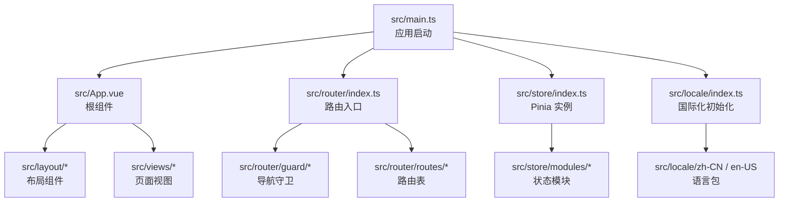
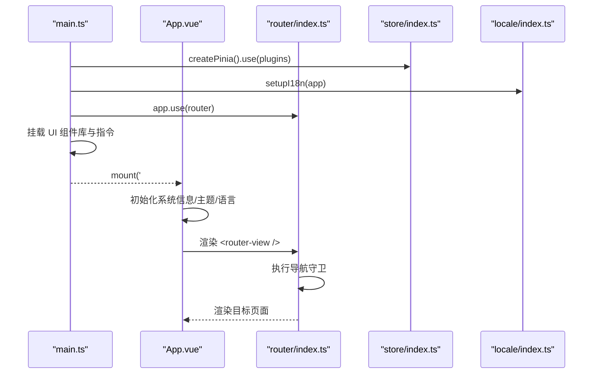
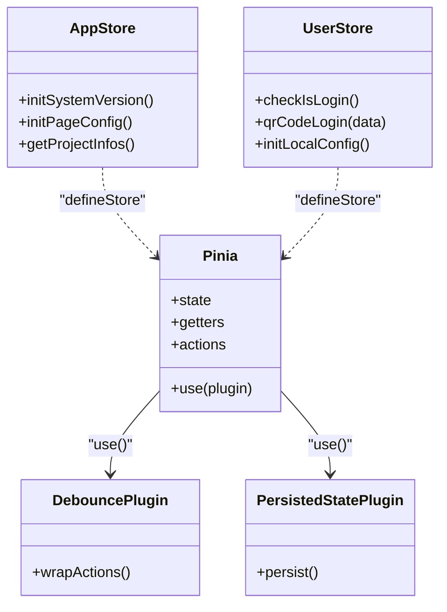
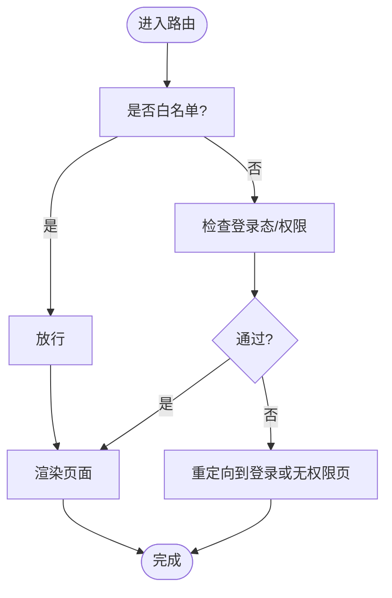
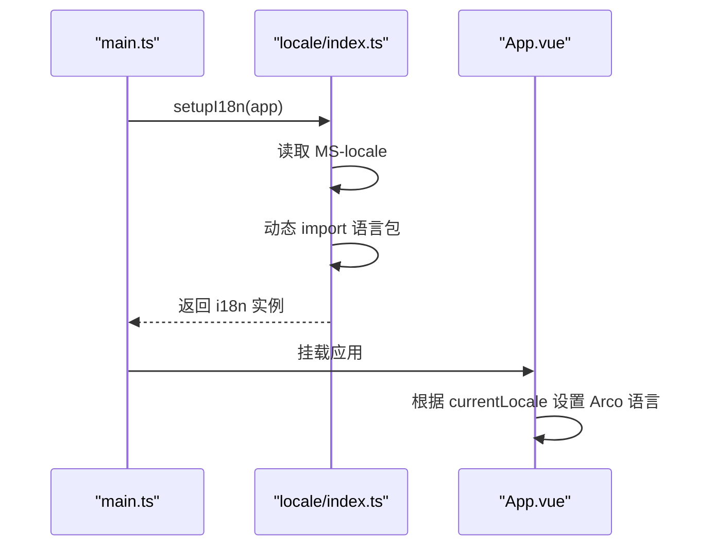
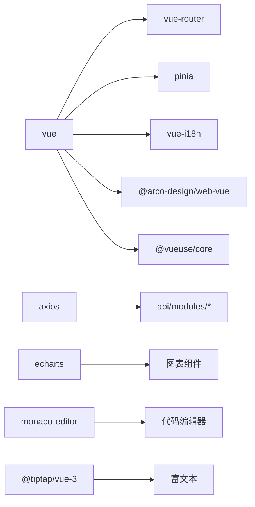

# 前端开发

<cite>
**本文引用的文件**   
- [package.json](file://frontend/package.json)
- [README.md](file://frontend/README.md)
- [main.ts](file://frontend/src/main.ts)
- [App.vue](file://frontend/src/App.vue)
- [router/index.ts](file://frontend/src/router/index.ts)
- [store/index.ts](file://frontend/src/store/index.ts)
- [locale/index.ts](file://frontend/src/locale/index.ts)
</cite>

## 目录
1. [简介](#简介)
2. [项目结构](#项目结构)
3. [核心组件](#核心组件)
4. [架构总览](#架构总览)
5. [详细组件分析](#详细组件分析)
6. [依赖分析](#依赖分析)
7. [性能与构建优化](#性能与构建优化)
8. [浏览器兼容性](#浏览器兼容性)
9. [常见问题排查](#常见问题排查)
10. [结论](#结论)

## 简介
本文件面向 MeterSphere 前端开发者，系统性梳理基于 Vue 3 + TypeScript + Vite 的前端工程。内容覆盖：
- Vue 3 组件架构与页面组织
- TypeScript 类型系统与全局声明
- Pinia 状态管理、路由配置与守卫
- 国际化（i18n）方案与语言切换
- UI 组件库（Arco Design Vue）、业务组件与页面布局
- API 调用封装、错误处理策略
- 构建配置、分包与体积优化
- 浏览器兼容性与本地调试

## 项目结构
前端采用模块化目录组织，核心目录说明如下：
- src/api：HTTP 请求封装与按模块划分的接口方法
- src/components：纯展示型与业务型组件
- src/config：常量与业务配置
- src/directive：自定义指令（权限、校验等）
- src/enums：全局枚举
- src/hooks：组合式函数（useXxx）
- src/layout：应用级布局（默认布局、全屏布局、无权限布局等）
- src/locale：国际化资源与工具
- src/models：数据模型定义
- src/router：路由注册、导航守卫与菜单路由
- src/store：Pinia 状态模块与插件
- src/theme：主题样式
- src/utils：通用工具方法
- src/views：页面视图（按业务模块划分）

图表来源
- [main.ts:27-68](file://frontend/src/main.ts#L27-L68)
- [App.vue:1-5](file://frontend/src/App.vue#L1-L5)
- [router/index.ts:19-46](file://frontend/src/router/index.ts#L19-L46)
- [store/index.ts:1-16](file://frontend/src/store/index.ts#L1-L16)
- [locale/index.ts:16-46](file://frontend/src/locale/index.ts#L16-L46)

章节来源
- [README.md:56-103](file://frontend/README.md#L56-L103)

## 核心组件
- 应用启动与依赖装配：在 main.ts 中创建 Vue 应用，依次挂载 Pinia、i18n、Router、UI 组件库、自定义指令、SVG/MsIcon 全局组件，并初始化本地存储与多语言。
- 根组件 App.vue：提供 Arco 语言上下文、监听系统升级提示、处理第三方登录回调、初始化平台基础信息与用户态。
- 路由 router/index.ts：使用 Hash 模式，集中注册基础路由与业务路由，统一滚动行为，并注入导航守卫。
- 状态 store/index.ts：创建 Pinia 实例，注册防抖与持久化插件，导出常用 Store。
- 国际化 locale/index.ts：动态加载语言包，创建 i18n 实例并挂载到应用。

章节来源
- [main.ts:27-68](file://frontend/src/main.ts#L27-L68)
- [App.vue:1-179](file://frontend/src/App.vue#L1-L179)
- [router/index.ts:19-46](file://frontend/src/router/index.ts#L19-L46)
- [store/index.ts:1-16](file://frontend/src/store/index.ts#L1-L16)
- [locale/index.ts:16-46](file://frontend/src/locale/index.ts#L16-L46)

## 架构总览
下图展示了应用启动、路由、状态与国际化之间的交互关系。

图表来源
- [main.ts:27-68](file://frontend/src/main.ts#L27-L68)
- [App.vue:1-179](file://frontend/src/App.vue#L1-L179)
- [router/index.ts:19-46](file://frontend/src/router/index.ts#L19-L46)
- [store/index.ts:1-16](file://frontend/src/store/index.ts#L1-L16)
- [locale/index.ts:16-46](file://frontend/src/locale/index.ts#L16-L46)

## 详细组件分析

### Vue 3 组件架构与页面组织
- 组件分层
  - 纯展示组件：位于 components/pure，如表格、表单、抽屉、标签等基础能力。
  - 业务组件：位于 components/business，封装领域内可复用逻辑与 UI。
  - 页面视图：位于 views，按业务域划分，配合 layout 实现整体布局。
- 布局体系
  - default-layout、full-page-layout、no-permission-layout、page-layout、share-layout、single-logo-layout 等，用于承载不同场景的页面骨架。
- 组件自动导入
  - 通过 unplugin-auto-import 与 unplugin-vue-components 实现 API 与组件按需引入，减少样板代码。

章节来源
- [README.md:597-628](file://frontend/README.md#L597-L628)

### TypeScript 类型系统
- 全局类型声明：types 目录提供 axios、echarts、window 扩展等类型。
- models 目录：统一的数据模型（请求/响应 DTO、组件 props 类型）。
- enums 目录：集中枚举定义，避免魔法值。
- tsconfig.json：启用严格模式、ESNext 目标、路径别名 @/* 与 #/*。

章节来源
- [README.md:553-593](file://frontend/README.md#L553-L593)

### 状态管理（Pinia）
- 实例与插件
  - 使用 pinia-plugin-persistedstate 进行状态持久化。
  - 自定义 debouncePlugin 对 actions 做防抖控制。
- 模块划分
  - modules/app、modules/user、modules/global、modules/setting/*、modules/testPlan/* 等，按功能域拆分。
- 典型用法
  - 在 App.vue 中读取/更新用户态、系统版本、许可证、页面配置等。
  - 在页面中通过 useUserStore/useAppStore 获取状态与方法。

图表来源
- [store/index.ts:1-16](file://frontend/src/store/index.ts#L1-L16)
- [App.vue:31-143](file://frontend/src/App.vue#L31-L143)

章节来源
- [store/index.ts:1-16](file://frontend/src/store/index.ts#L1-L16)
- [App.vue:31-143](file://frontend/src/App.vue#L31-L143)

### 路由配置与导航守卫
- 路由模式：Hash 模式（createWebHashHistory），便于部署与跨域。
- 路由组织：基础路由（登录、重定向、404 等）+ 业务路由（routes/modules/*）。
- 导航守卫：统一鉴权、登录态检查、白名单放行、第三方登录回调处理。
- 滚动行为：每次跳转滚动至顶部。

图表来源
- [router/index.ts:19-46](file://frontend/src/router/index.ts#L19-L46)
- [App.vue:83-143](file://frontend/src/App.vue#L83-L143)

章节来源
- [router/index.ts:19-46](file://frontend/src/router/index.ts#L19-L46)

### 国际化支持（i18n）
- 动态语言包加载：根据 localStorage 中的 MS-locale 动态 import 对应语言包。
- 应用集成：在 main.ts 中异步 setupI18n，确保语言包加载完成后继续挂载。
- Arco 语言适配：App.vue 中根据当前语言映射 Arco 内置语言包。

图表来源
- [main.ts:27-39](file://frontend/src/main.ts#L27-L39)
- [locale/index.ts:16-46](file://frontend/src/locale/index.ts#L16-L46)
- [App.vue:31-45](file://frontend/src/App.vue#L31-L45)

章节来源
- [locale/index.ts:16-46](file://frontend/src/locale/index.ts#L16-L46)
- [main.ts:27-39](file://frontend/src/main.ts#L27-L39)
- [App.vue:31-45](file://frontend/src/App.vue#L31-L45)

### UI 组件库与业务组件
- UI 组件库：@arco-design/web-vue，配合 arco-themes/vue-metersphere-v3 定制主题。
- 业务组件：components/business 下封装领域相关能力（如关联用例、富文本、上传、树选择等）。
- 纯组件：components/pure 提供通用 UI 能力（表格、表单、分页、抽屉等）。

章节来源
- [package.json:37-95](file://frontend/package.json#L37-L95)

### API 调用与错误处理
- 请求封装：api/http 下封装 Axios，统一拦截器、错误分级提示、Content-Type 处理、取消重复请求等。
- 接口地址：api/requrls 按模块管理 URL，避免硬编码。
- 业务方法：api/modules 按模块暴露方法，解耦 URL 与调用方。
- 错误处理：结合 message/modal 分级提示；App.vue 捕获动态导入失败并提示系统升级。

章节来源
- [README.md:178-274](file://frontend/README.md#L178-L274)
- [App.vue:154-171](file://frontend/src/App.vue#L154-L171)

### 页面布局
- 默认布局：default-layout.vue 作为主框架，承载侧边栏、顶栏与内容区。
- 全屏布局：full-page-layout.vue 用于独立全屏页面。
- 无权限布局：no-permission-layout.vue 用于权限不足时的提示页。
- 分享布局：share-layout.vue 用于无需登录的轻量页面。
- 单 Logo 布局：single-logo-layout.vue 用于登录等简单页面。

章节来源
- [README.md:353-372](file://frontend/README.md#L353-L372)

### 开发示例

#### 如何创建新页面
- 在 views 下新建模块目录与页面文件（例如 views/my-feature/index.vue）。
- 在 router/routes/modules 下新增路由配置，指向该页面组件。
- 如需菜单项，同步在 app-menus 或菜单配置中补充。

章节来源
- [README.md:403-405](file://frontend/README.md#L403-L405)

#### 如何添加组件
- 纯展示组件放入 components/pure，业务组件放入 components/business。
- 借助 unplugin-vue-components 自动按需引入，无需手动 import。

章节来源
- [README.md:601-628](file://frontend/README.md#L601-L628)

#### 如何配置路由
- 在 router/routes/modules 下新增路由文件，导出路由数组。
- 在 router/index.ts 中合并进 routes。
- 如需权限控制，在 meta 中添加 requiresAuth 等字段，并在 guard 中处理。

章节来源
- [router/index.ts:19-46](file://frontend/src/router/index.ts#L19-L46)

#### 如何处理用户交互
- 使用 Pinia Store 管理状态，在组件中通过 useXxxStore 访问 state/getters/actions。
- 使用 hooks（如 useModal、useLoading）封装常见交互逻辑。
- 使用 Arco 组件的事件机制（click、change、submit 等）触发 action。

章节来源
- [store/index.ts:1-16](file://frontend/src/store/index.ts#L1-L16)
- [App.vue:31-143](file://frontend/src/App.vue#L31-L143)

## 依赖分析
- 运行时依赖
  - Vue 3、Vue Router、Pinia、Axios、ECharts、Monaco Editor、TipTap、Day.js、LocalForage 等。
- 开发依赖
  - Vite、TypeScript、ESLint、Stylelint、Prettier、TailwindCSS、unplugin-* 系列、vite-plugin-* 系列。

图表来源
- [package.json:37-95](file://frontend/package.json#L37-L95)

章节来源
- [package.json:37-95](file://frontend/package.json#L37-L95)

## 性能与构建优化
- 组件与 API 自动导入：unplugin-auto-import 与 unplugin-vue-components 提升开发效率并减少冗余代码。
- SVG 图标自动注册：vite-plugin-svg-icons 一键引入 svg。
- 打包分析与分包：rollup-plugin-visualizer 分析体积；manualChunks 将大依赖（如 arco、echarts、vue 生态）拆分为独立 chunk。
- 压缩与图片优化：gzip 压缩、imagemin 插件。
- 环境变量：.env.* 区分环境，VITE_* 变量在运行期注入。

章节来源
- [README.md:597-706](file://frontend/README.md#L597-L706)

## 浏览器兼容性
- Node 版本要求：>= 18。
- 目标浏览器：> 0.5%、最近两个版本、非已停用内核、排除 IE11。
- Polyfill：在 main.ts 中调用 applyPolyfills 以补齐部分浏览器缺失能力（如 Object.hasOwn）。

章节来源
- [package.json:169-177](file://frontend/package.json#L169-L177)
- [main.ts:24-25](file://frontend/src/main.ts#L24-L25)

## 常见问题排查
- 动态导入失败导致空白页
  - 现象：控制台出现“Failed to fetch dynamically imported”相关错误。
  - 处理：App.vue 中监听 window.onerror 与 window.onunhandledrejection，弹出系统升级提示。
- 语言未生效
  - 检查 localStorage 中的 MS-locale 是否正确。
  - 确认 locale/index.ts 动态加载的语言包是否存在。
- 路由白名单与登录态
  - 确认路由 meta.requiresAuth 与守卫逻辑一致。
  - 第三方登录回调参数（code/state）是否正确清理。

章节来源
- [App.vue:154-171](file://frontend/src/App.vue#L154-L171)
- [locale/index.ts:16-46](file://frontend/src/locale/index.ts#L16-L46)
- [router/index.ts:19-46](file://frontend/src/router/index.ts#L19-L46)

## 结论
MeterSphere 前端以 Vue 3 + TypeScript + Vite 为核心，结合 Arco Design Vue 与丰富的生态插件，构建了高内聚、低耦合的前端工程。通过 Pinia 管理状态、Router 统一管理路由与权限、i18n 支持多语言，配合完善的组件体系与构建优化策略，既保证了开发体验，也兼顾了生产环境的性能与稳定性。遵循本文档的组织规范与实践建议，可高效地扩展新功能、维护现有模块并持续优化用户体验。