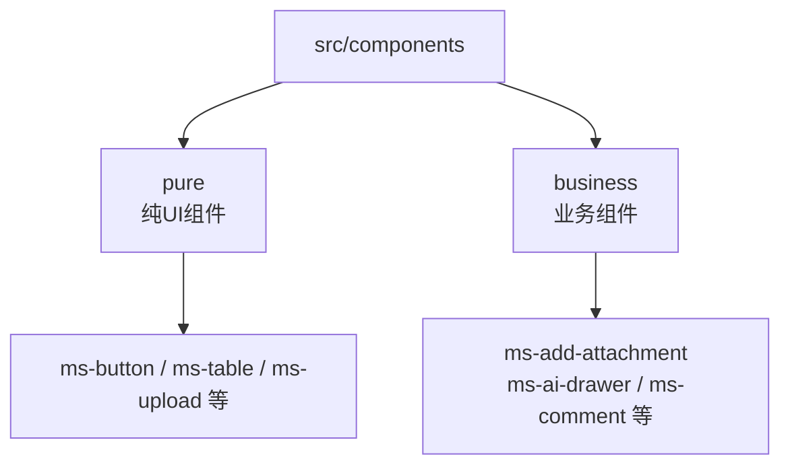
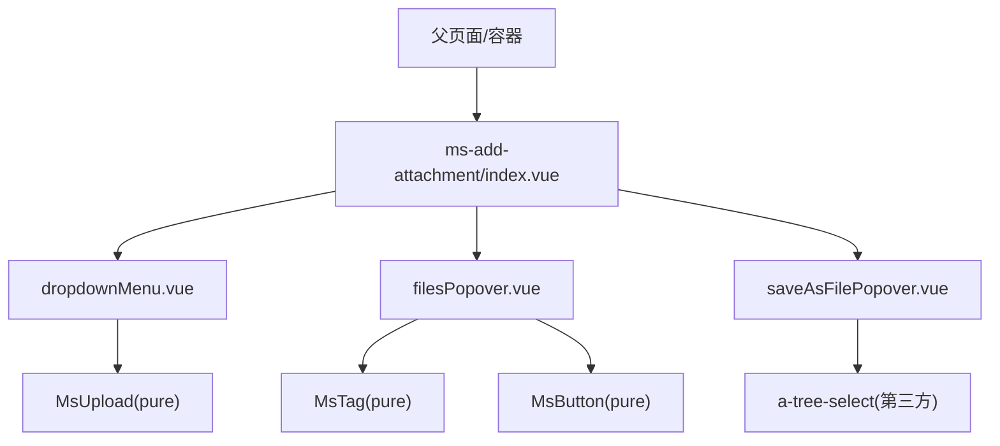
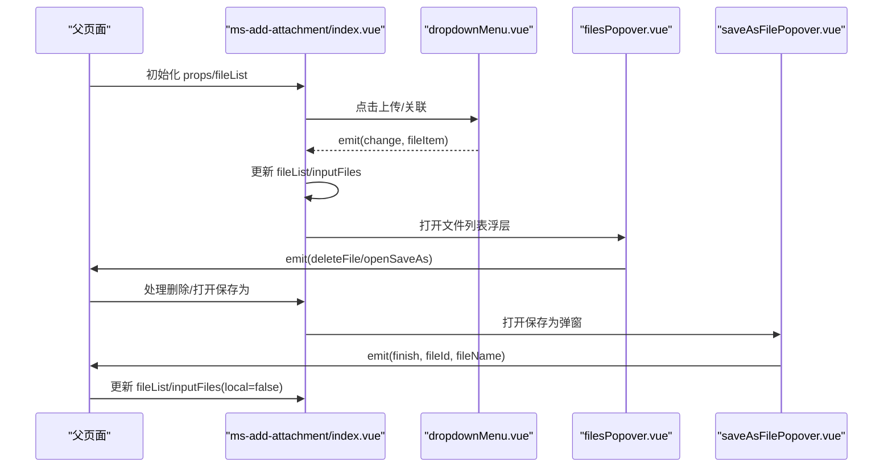
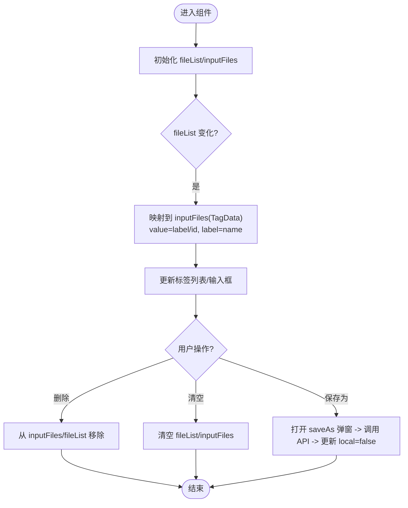
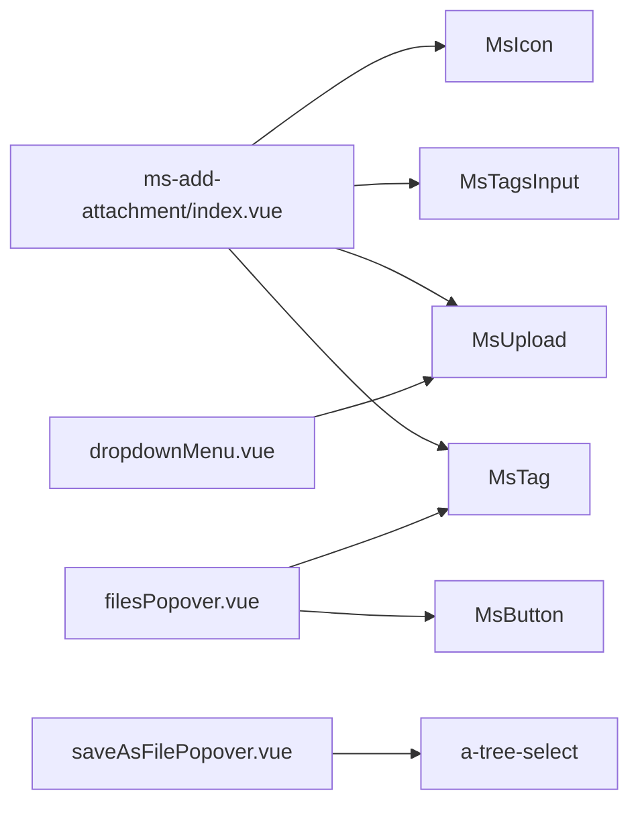

# 组件架构

<cite>
**本文引用的文件**   
- [frontend/README.md](file://frontend/README.md)
- [frontend/src/components/business/ms-add-attachment/index.vue](file://frontend/src/components/business/ms-add-attachment/index.vue)
- [frontend/src/components/business/ms-add-attachment/dropdownMenu.vue](file://frontend/src/components/business/ms-add-attachment/dropdownMenu.vue)
- [frontend/src/components/business/ms-add-attachment/filesPopover.vue](file://frontend/src/components/business/ms-add-attachment/filesPopover.vue)
- [frontend/src/components/business/ms-add-attachment/saveAsFilePopover.vue](file://frontend/src/components/business/ms-add-attachment/saveAsFilePopover.vue)
</cite>

## 目录
1. [引言](#引言)
2. [项目结构](#项目结构)
3. [核心组件](#核心组件)
4. [架构总览](#架构总览)
5. [详细组件分析](#详细组件分析)
6. [依赖关系分析](#依赖关系分析)
7. [性能与优化](#性能与优化)
8. [测试策略](#测试策略)
9. [文档生成](#文档生成)
10. [结论](#结论)

## 引言
本章节面向 MeterSphere 前端（Vue 3 + TypeScript）的组件架构，聚焦以下目标：
- 解释 Vue 3 组件设计模式与职责分层
- 明确纯 UI 组件与业务组件的分类、边界与复用策略
- 梳理组件通信机制（Props、Emits、v-model、defineExpose、事件总线等）
- 规范组件目录结构与命名约定
- 给出可复用的业务组件开发示例与复杂交互流程
- 提供组件测试与文档生成的实践建议

## 项目结构
前端采用按“能力域”划分的目录组织方式，组件集中在 src/components 下，分为两类：
- pure：纯 UI 组件，关注展示与基础交互，尽量无业务耦合
- business：业务组件，封装具体业务场景（如附件上传、关联文件、表单批量操作等），通常组合多个 pure 组件并处理领域逻辑

**图示来源** 
- [frontend/README.md:56-103](file://frontend/README.md#L56-L103)

**章节来源**
- [frontend/README.md:56-103](file://frontend/README.md#L56-L103)

## 核心组件
本节以“附件添加”业务组件为例，说明业务组件如何组合纯 UI 组件、定义 Props/Emits、使用 v-model 双向绑定、通过 defineExpose 暴露方法，以及内部子组件的职责划分。

- 入口组件：ms-add-attachment/index.vue
  - 负责整体布局、模式切换（按钮模式/输入模式）、单/多选、本地上传与关联文件、标签列表展示、删除与清空、文件转存等
  - 通过 withDefaults + defineProps 声明强类型 Props，并通过 defineEmits 声明事件
  - 使用 defineModel 与父组件双向绑定 fileList、visible、inputFiles 等状态
  - 通过 watch/computed 驱动数据回显与过滤，结合 nextTick 保证 DOM 更新后再关闭菜单或触发回调

- 下拉菜单子组件：dropdownMenu.vue
  - 封装上传与关联文件两个动作的下拉菜单
  - 通过 defineModel 与父组件共享 innerFileList，并在 change 后延迟关闭菜单

- 文件列表浮层：filesPopover.vue
  - 展示已删除与正常文件的标签列表，支持快速清理、删除、打开“保存为”弹窗
  - 通过 computed 拆分已删除与其他文件，emit deleteFile/openSaveAs 给父组件

- 保存为弹窗：saveAsFilePopover.vue
  - 选择目录树、填写名称，调用外部传入的 fileSaveAsApi 完成转存
  - 成功后 emit finish，由父组件更新 fileList 与 inputFiles

**章节来源**
- [frontend/src/components/business/ms-add-attachment/index.vue:178-210](file://frontend/src/components/business/ms-add-attachment/index.vue#L178-L210)
- [frontend/src/components/business/ms-add-attachment/index.vue:215-257](file://frontend/src/components/business/ms-add-attachment/index.vue#L215-L257)
- [frontend/src/components/business/ms-add-attachment/index.vue:259-324](file://frontend/src/components/business/ms-add-attachment/index.vue#L259-L324)
- [frontend/src/components/business/ms-add-attachment/dropdownMenu.vue:45-71](file://frontend/src/components/business/ms-add-attachment/dropdownMenu.vue#L45-L71)
- [frontend/src/components/business/ms-add-attachment/filesPopover.vue:107-167](file://frontend/src/components/business/ms-add-attachment/filesPopover.vue#L107-L167)
- [frontend/src/components/business/ms-add-attachment/saveAsFilePopover.vue:71-175](file://frontend/src/components/business/ms-add-attachment/saveAsFilePopover.vue#L71-L175)

## 架构总览
下图展示了“附件添加”组件在视图层与纯 UI 组件之间的协作关系，以及关键的数据流向。

**图示来源** 
- [frontend/src/components/business/ms-add-attachment/index.vue:158-166](file://frontend/src/components/business/ms-add-attachment/index.vue#L158-L166)
- [frontend/src/components/business/ms-add-attachment/dropdownMenu.vue:39-41](file://frontend/src/components/business/ms-add-attachment/dropdownMenu.vue#L39-L41)
- [frontend/src/components/business/ms-add-attachment/filesPopover.vue:99-102](file://frontend/src/components/business/ms-add-attachment/filesPopover.vue#L99-L102)
- [frontend/src/components/business/ms-add-attachment/saveAsFilePopover.vue:25-43](file://frontend/src/components/business/ms-add-attachment/saveAsFilePopover.vue#L25-L43)

## 详细组件分析

### 组件分类与设计模式
- 纯 UI 组件（pure）
  - 职责单一：只负责渲染与基础交互，不感知业务上下文
  - 接口稳定：Props/Emits 清晰，便于跨模块复用
  - 示例：ms-button、ms-table、ms-upload、ms-tag 等
- 业务组件（business）
  - 聚合多个 pure 组件，封装领域逻辑（如权限判断、API 调用、状态同步）
  - 对外暴露稳定的 API（Props/Emits/Methods via defineExpose）
  - 示例：ms-add-attachment、ms-comment、ms-batch-form 等

设计要点：
- 单向数据流为主，必要时用 v-model 双向绑定
- 事件语义化：change、deleteFile、openSaveAs、finish 等
- 通过 defineExpose 暴露方法供父级调用（如表格刷新、校验、提交等）

**章节来源**
- [frontend/README.md:56-103](file://frontend/README.md#L56-L103)

### 组件通信机制
- Props/Emits
  - 使用 defineProps + withDefaults 声明默认值与类型
  - 使用 defineEmits 声明事件签名，确保 TS 类型安全
- v-model
  - 使用 defineModel 实现父子双向绑定（如 visible、fileList、inputFiles）
- defineExpose
  - 暴露组件实例方法，供父组件直接调用（如打开弹窗、重置表单、获取选中项等）
- 事件冒泡与组合
  - 子组件将底层事件（如 MsUpload.change）转换为业务语义事件（如 change/deleteFile）

**章节来源**
- [frontend/src/components/business/ms-add-attachment/index.vue:178-210](file://frontend/src/components/business/ms-add-attachment/index.vue#L178-L210)
- [frontend/src/components/business/ms-add-attachment/index.vue:215-257](file://frontend/src/components/business/ms-add-attachment/index.vue#L215-L257)
- [frontend/src/components/business/ms-add-attachment/dropdownMenu.vue:45-71](file://frontend/src/components/business/ms-add-attachment/dropdownMenu.vue#L45-L71)
- [frontend/src/components/business/ms-add-attachment/filesPopover.vue:107-167](file://frontend/src/components/business/ms-add-attachment/filesPopover.vue#L107-L167)
- [frontend/src/components/business/ms-add-attachment/saveAsFilePopover.vue:71-175](file://frontend/src/components/business/ms-add-attachment/saveAsFilePopover.vue#L71-L175)

### 组件目录结构与命名规范
- 目录结构
  - components/pure：纯 UI 组件，按功能细分（button/table/upload/tag 等）
  - components/business：业务组件，按业务域细分（add-attachment/comment/batch-form 等）
- 命名规范
  - 组件文件夹：小写连字符（kebab-case），如 ms-add-attachment
  - 组件文件：index.vue 作为入口，子组件文件名语义化（dropdownMenu.vue、filesPopover.vue）
  - Props/Emits：使用 TS 泛型与具名事件，避免 any
  - 样式：优先使用 Tailwind 类名，局部样式使用 scoped less

**章节来源**
- [frontend/README.md:56-103](file://frontend/README.md#L56-L103)

### 复杂交互流程：附件添加与转存
该流程涵盖本地上传、关联文件、标签管理、删除与“保存为”转存。

**图示来源** 
- [frontend/src/components/business/ms-add-attachment/index.vue:259-324](file://frontend/src/components/business/ms-add-attachment/index.vue#L259-L324)
- [frontend/src/components/business/ms-add-attachment/dropdownMenu.vue:64-71](file://frontend/src/components/business/ms-add-attachment/dropdownMenu.vue#L64-L71)
- [frontend/src/components/business/ms-add-attachment/filesPopover.vue:151-167](file://frontend/src/components/business/ms-add-attachment/filesPopover.vue#L151-L167)
- [frontend/src/components/business/ms-add-attachment/saveAsFilePopover.vue:148-175](file://frontend/src/components/business/ms-add-attachment/saveAsFilePopover.vue#L148-L175)

### 算法与数据处理流程图（标签与文件映射）

**图示来源** 
- [frontend/src/components/business/ms-add-attachment/index.vue:229-257](file://frontend/src/components/business/ms-add-attachment/index.vue#L229-L257)
- [frontend/src/components/business/ms-add-attachment/index.vue:326-376](file://frontend/src/components/business/ms-add-attachment/index.vue#L326-L376)
- [frontend/src/components/business/ms-add-attachment/filesPopover.vue:144-167](file://frontend/src/components/business/ms-add-attachment/filesPopover.vue#L144-L167)
- [frontend/src/components/business/ms-add-attachment/saveAsFilePopover.vue:148-175](file://frontend/src/components/business/ms-add-attachment/saveAsFilePopover.vue#L148-L175)

## 依赖关系分析
- 组件内依赖
  - ms-add-attachment 依赖 pure 层的 MsUpload/MsTag/MsTagsInput/MsIcon 等
  - dropdownMenu 依赖 MsUpload
  - filesPopover 依赖 MsButton/MsTag/MsIcon
  - saveAsFilePopover 依赖 a-tree-select（第三方）
- 外部依赖
  - i18n：useI18n 用于国际化文案
  - store：useAppStore 获取当前项目信息等全局状态
  - API：通过 api/modules/* 调用后端接口（如 getAssociatedFileListUrl、getModules 等）

**图示来源** 
- [frontend/src/components/business/ms-add-attachment/index.vue:158-166](file://frontend/src/components/business/ms-add-attachment/index.vue#L158-L166)
- [frontend/src/components/business/ms-add-attachment/dropdownMenu.vue:39-41](file://frontend/src/components/business/ms-add-attachment/dropdownMenu.vue#L39-L41)
- [frontend/src/components/business/ms-add-attachment/filesPopover.vue:99-102](file://frontend/src/components/business/ms-add-attachment/filesPopover.vue#L99-L102)
- [frontend/src/components/business/ms-add-attachment/saveAsFilePopover.vue:25-43](file://frontend/src/components/business/ms-add-attachment/saveAsFilePopover.vue#L25-L43)

**章节来源**
- [frontend/src/components/business/ms-add-attachment/index.vue:158-176](file://frontend/src/components/business/ms-add-attachment/index.vue#L158-L176)
- [frontend/src/components/business/ms-add-attachment/dropdownMenu.vue:39-41](file://frontend/src/components/business/ms-add-attachment/dropdownMenu.vue#L39-L41)
- [frontend/src/components/business/ms-add-attachment/filesPopover.vue:99-102](file://frontend/src/components/business/ms-add-attachment/filesPopover.vue#L99-L102)
- [frontend/src/components/business/ms-add-attachment/saveAsFilePopover.vue:25-43](file://frontend/src/components/business/ms-add-attachment/saveAsFilePopover.vue#L25-L43)

## 性能与优化
- 渲染优化
  - 合理使用 v-if/v-show 控制大体积内容显示
  - 对长列表使用虚拟滚动（如 tree-select 的 virtualListProps）
- 计算属性与监听
  - 使用 computed 缓存派生数据（如 alreadyDeleteFiles/otherFiles）
  - 使用 watch 仅在必要时机触发副作用，避免 deep 监听大数据对象
- 事件与 DOM
  - 在 emit 之后使用 nextTick 再关闭弹窗/菜单，避免闪烁
- 网络请求
  - 按需加载目录树选项，避免重复请求（如 initModuleOptions 仅首次加载）
- 构建与打包
  - 利用 Vite/Rollup 的分包策略（manualChunks）减少首屏体积

[本节为通用指导，不直接分析具体文件]

## 测试策略
- 单元测试
  - 针对纯 UI 组件：断言 Props 渲染、Emits 触发、键盘/鼠标交互
  - 针对业务组件：断言数据映射、watch/computed 行为、API 调用与错误分支
- 集成测试
  - 模拟父组件传递 Props 与 v-model 双向绑定，验证父子状态一致性
  - 模拟第三方组件（如 a-tree-select）行为，验证业务流程闭环
- 工具建议
  - Vitest + Vue Test Utils
  - 使用 Mock 服务拦截 API 调用
  - 快照测试用于稳定 UI 结构

[本节为通用指导，不直接分析具体文件]

## 文档生成
- 自动导入与类型声明
  - 使用 unplugin-vue-components 自动生成组件注册与 d.ts（components.d.ts）
  - 使用 unplugin-auto-import 自动导入常用函数/常量
- 文档站点
  - 可使用 Storybook/VitePress 等工具生成组件文档
  - 为每个组件编写 README，包含 Props/Emits/Slots/示例用法

**章节来源**
- [frontend/README.md:597-628](file://frontend/README.md#L597-L628)

## 结论
MeterSphere 前端的组件架构以“纯 UI 组件 + 业务组件”的分层为核心，配合 Vue 3 Composition API、TypeScript 与 Vite 生态，实现了高内聚、低耦合的可复用组件体系。通过清晰的 Props/Emits 契约、v-model 双向绑定与 defineExpose 暴露方法，业务组件能够稳定地组合纯 UI 组件并封装领域逻辑。建议在后续开发中持续遵循目录与命名规范，完善测试与文档，进一步提升组件质量与可维护性。