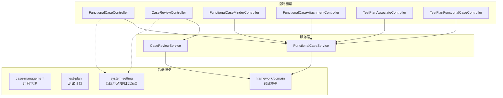
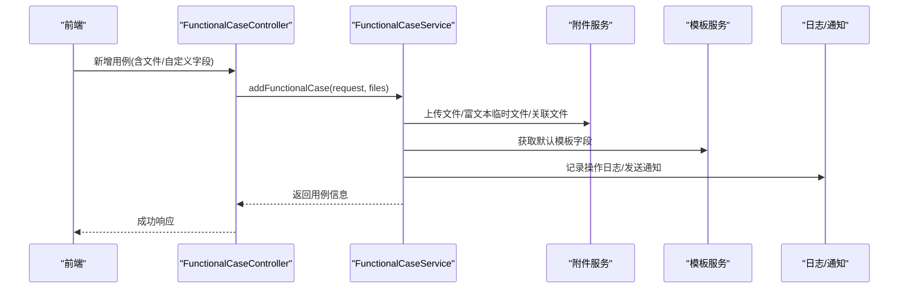
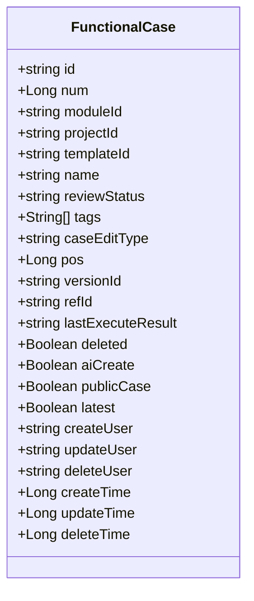
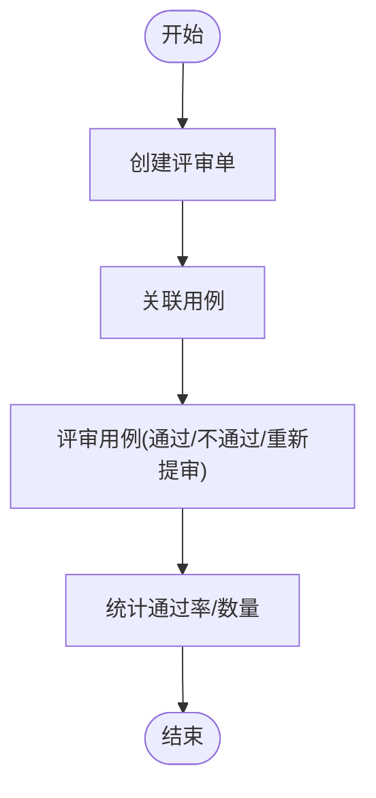
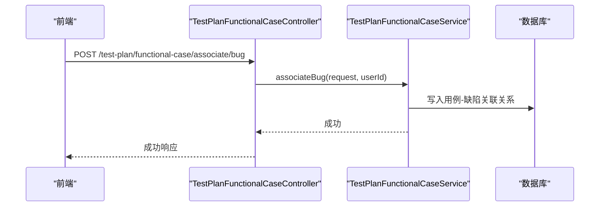
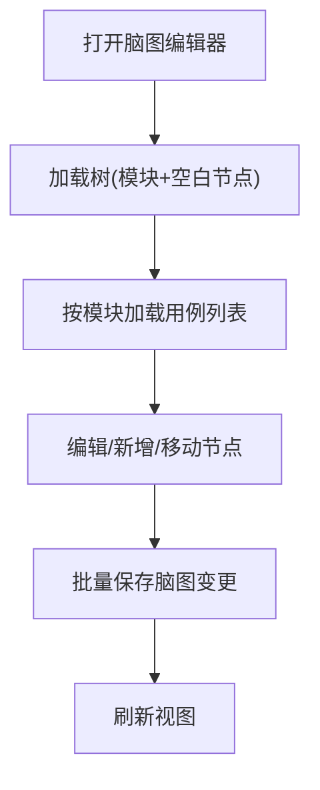
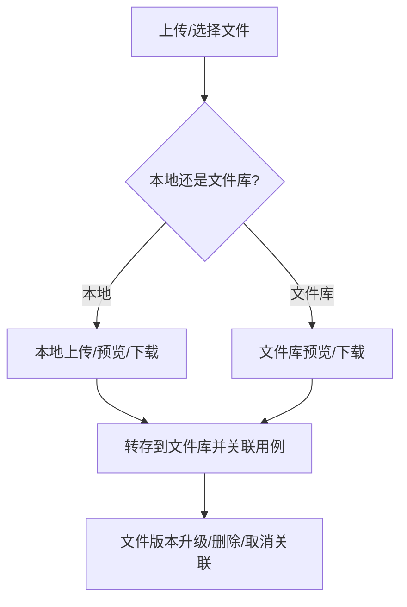
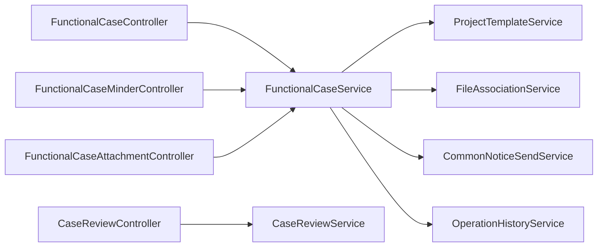

# 功能测试

<cite>
**本文引用的文件**   
- [README.md](file://README.md)
- [FunctionalCaseController.java](file://backend/services/case-management/src/main/java/io/metersphere/functional/controller/FunctionalCaseController.java)
- [CaseReviewController.java](file://backend/services/case-management/src/main/java/io/metersphere/functional/controller/CaseReviewController.java)
- [FunctionalCaseMinderController.java](file://backend/services/case-management/src/main/java/io/metersphere/functional/controller/FunctionalCaseMinderController.java)
- [FunctionalCaseAttachmentController.java](file://backend/services/case-management/src/main/java/io/metersphere/functional/controller/FunctionalCaseAttachmentController.java)
- [FunctionalCase.java](file://backend/framework/domain/src/main/java/io/metersphere/functional/domain/FunctionalCase.java)
- [FunctionalCaseService.java](file://backend/services/case-management/src/main/java/io/metersphere/functional/service/FunctionalCaseService.java)
- [CaseReviewService.java](file://backend/services/case-management/src/main/java/io/metersphere/functional/service/CaseReviewService.java)
- [TestPlanAssociateController.java](file://backend/services/test-plan/src/main/java/io/metersphere/plan/controller/TestPlanAssociateController.java)
- [TestPlanFunctionalCaseController.java](file://backend/services/test-plan/src/main/java/io/metersphere/plan/controller/TestPlanFunctionalCaseController.java)
- [NoticeConstants.java](file://backend/services/system-setting/src/main/java/io/metersphere/system/notice/constants/NoticeConstants.java)
- [OperationLogModule.java](file://backend/services/system-setting/src/main/java/io/metersphere/system/log/constants/OperationLogModule.java)
</cite>

## 目录
1. [简介](#简介)
2. [项目结构](#项目结构)
3. [核心组件](#核心组件)
4. [架构总览](#架构总览)
5. [详细组件分析](#详细组件分析)
6. [依赖关系分析](#依赖关系分析)
7. [性能与扩展性](#性能与扩展性)
8. [故障排查指南](#故障排查指南)
9. [结论](#结论)
10. [附录：使用示例](#附录使用示例)

## 简介
本章节面向 MeterSphere 的功能测试模块，围绕用例管理、用例评审、用例关联机制、模板系统、思维导图编辑、步骤管理、附件关联、版本控制与协作能力进行系统化说明。同时给出创建与管理用例、评审流程、关联缺陷与生成报告的使用示例，并解释与第三方系统的集成点。

## 项目结构
功能测试相关代码主要分布在后端 services 层的 case-management 与 test-plan 模块，以及 framework 层的 domain 模型中；前端在 views/case-management 与 views/test-plan 下提供交互界面。

图表来源
- [FunctionalCaseController.java:51-329](file://backend/services/case-management/src/main/java/io/metersphere/functional/controller/FunctionalCaseController.java#L51-L329)
- [CaseReviewController.java:36-162](file://backend/services/case-management/src/main/java/io/metersphere/functional/controller/CaseReviewController.java#L36-L162)
- [FunctionalCaseMinderController.java:30-98](file://backend/services/case-management/src/main/java/io/metersphere/functional/controller/FunctionalCaseMinderController.java#L30-L98)
- [FunctionalCaseAttachmentController.java:46-205](file://backend/services/case-management/src/main/java/io/metersphere/functional/controller/FunctionalCaseAttachmentController.java#L46-L205)
- [FunctionalCaseService.java:76-182](file://backend/services/case-management/src/main/java/io/metersphere/functional/service/FunctionalCaseService.java#L76-L182)
- [CaseReviewService.java:48-84](file://backend/services/case-management/src/main/java/io/metersphere/functional/service/CaseReviewService.java#L48-L84)
- [FunctionalCase.java:12-108](file://backend/framework/domain/src/main/java/io/metersphere/functional/domain/FunctionalCase.java#L12-L108)

章节来源
- [README.md:16-22](file://README.md#L16-L22)

## 核心组件
- 用例管理控制器与服务：负责用例的增删改查、导入导出、批量操作、排序、关注人、变更历史、模板字段获取等。
- 用例评审控制器与服务：负责评审单创建、复制、编辑、关联/取消关联用例、评审用户选择、拖拽排序、统计与详情。
- 思维导图控制器：提供脑图树、按模块查询用例列表、评审/计划/集合场景下的脑图数据。
- 附件控制器：支持本地/文件库文件的上传、预览、下载、转存、更新、删除与富文本临时资源上传。
- 领域模型：用例主表包含名称、模块、项目、模板、评审状态、编辑模式、排序、版本、执行结果、公共/最新标记等。
- 测试计划集成：测试计划中关联功能用例、关联缺陷、查看用例详情与执行历史。

章节来源
- [FunctionalCaseController.java:69-329](file://backend/services/case-management/src/main/java/io/metersphere/functional/controller/FunctionalCaseController.java#L69-L329)
- [CaseReviewController.java:44-162](file://backend/services/case-management/src/main/java/io/metersphere/functional/controller/CaseReviewController.java#L44-L162)
- [FunctionalCaseMinderController.java:38-95](file://backend/services/case-management/src/main/java/io/metersphere/functional/controller/FunctionalCaseMinderController.java#L38-L95)
- [FunctionalCaseAttachmentController.java:67-205](file://backend/services/case-management/src/main/java/io/metersphere/functional/controller/FunctionalCaseAttachmentController.java#L67-L205)
- [FunctionalCase.java:12-108](file://backend/framework/domain/src/main/java/io/metersphere/functional/domain/FunctionalCase.java#L12-L108)
- [TestPlanAssociateController.java:53-69](file://backend/services/test-plan/src/main/java/io/metersphere/plan/controller/TestPlanAssociateController.java#L53-L69)
- [TestPlanFunctionalCaseController.java:182-196](file://backend/services/test-plan/src/main/java/io/metersphere/plan/controller/TestPlanFunctionalCaseController.java#L182-L196)

## 架构总览
功能测试模块采用典型的 Controller-Service-Domain 分层架构，结合权限校验、审计日志、消息通知与模板系统，形成完整的用例生命周期管理能力。

图表来源
- [FunctionalCaseController.java:78-88](file://backend/services/case-management/src/main/java/io/metersphere/functional/controller/FunctionalCaseController.java#L78-L88)
- [FunctionalCaseService.java:183-200](file://backend/services/case-management/src/main/java/io/metersphere/functional/service/FunctionalCaseService.java#L183-L200)

## 详细组件分析

### 用例管理（CRUD、模板、导入导出、版本与协作）
- 能力要点
  - 新增/更新/删除/分页查询/批量移动/复制/编辑/拖拽排序
  - 获取默认模板自定义字段、表格列自定义字段
  - Excel/XMind 导入预检查与导入、Excel/XMind 导出、导出任务停止与校验
  - 变更历史、关注人、下载文件
- 关键接口路径
  - /functional/case/add, /functional/case/update, /functional/case/delete
  - /functional/case/page, /functional/case/batch/move, /functional/case/batch/copy, /functional/case/batch/edit, /functional/case/edit/pos
  - /functional/case/default/template/field/{projectId}, /functional/case/custom/field/{projectId}
  - /functional/case/import/excel, /functional/case/import/xmind, /functional/case/export/excel, /functional/case/export/xmind
  - /functional/case/operation-history, /functional/case/download/file/{projectId}/{fileId}
- 数据结构
  - FunctionalCase 包含 id、num、moduleId、projectId、templateId、name、reviewStatus、tags、caseEditType、pos、versionId、refId、lastExecuteResult、deleted、aiCreate、publicCase、latest 等字段，支撑多版本、公共用例、AI 生成、执行结果等特性。

图表来源
- [FunctionalCase.java:12-108](file://backend/framework/domain/src/main/java/io/metersphere/functional/domain/FunctionalCase.java#L12-L108)

章节来源
- [FunctionalCaseController.java:69-329](file://backend/services/case-management/src/main/java/io/metersphere/functional/controller/FunctionalCaseController.java#L69-L329)
- [FunctionalCase.java:12-108](file://backend/framework/domain/src/main/java/io/metersphere/functional/domain/FunctionalCase.java#L12-L108)

### 用例评审流程
- 能力要点
  - 评审单创建/复制/编辑/删除
  - 关联/取消关联用例、评审用户选择、拖拽排序
  - 评审统计（通过/不通过/重新提审/未评审等）与详情
- 关键接口路径
  - /case/review/add, /case/review/copy, /case/review/edit, /case/review/delete
  - /case/review/associate, /case/review/disassociate/{reviewId}/{caseId}
  - /case/review/user-option/{projectId}, /case/review/edit/follower, /case/review/edit/pos
  - /case/review/detail/{id}, /case/review/page, /case/review/module/count

图表来源
- [CaseReviewController.java:62-162](file://backend/services/case-management/src/main/java/io/metersphere/functional/controller/CaseReviewController.java#L62-L162)
- [CaseReviewService.java:94-187](file://backend/services/case-management/src/main/java/io/metersphere/functional/service/CaseReviewService.java#L94-L187)

章节来源
- [CaseReviewController.java:44-162](file://backend/services/case-management/src/main/java/io/metersphere/functional/controller/CaseReviewController.java#L44-L162)
- [CaseReviewService.java:94-187](file://backend/services/case-management/src/main/java/io/metersphere/functional/service/CaseReviewService.java#L94-L187)

### 用例关联机制（缺陷、其他用例、测试计划）
- 能力要点
  - 测试计划中功能用例关联缺陷、取消关联
  - 测试计划中关联功能用例列表（项目维度），支持重复用例检测
- 关键接口路径
  - /test-plan/functional-case/associate/bug, /test-plan/functional-case/disassociate/bug/{id}
  - /test-plan/associate/page（功能用例列表）

图表来源
- [TestPlanFunctionalCaseController.java:182-196](file://backend/services/test-plan/src/main/java/io/metersphere/plan/controller/TestPlanFunctionalCaseController.java#L182-L196)
- [TestPlanAssociateController.java:53-69](file://backend/services/test-plan/src/main/java/io/metersphere/plan/controller/TestPlanAssociateController.java#L53-L69)

章节来源
- [TestPlanFunctionalCaseController.java:182-196](file://backend/services/test-plan/src/main/java/io/metersphere/plan/controller/TestPlanFunctionalCaseController.java#L182-L196)
- [TestPlanAssociateController.java:53-69](file://backend/services/test-plan/src/main/java/io/metersphere/plan/controller/TestPlanAssociateController.java#L53-L69)

### 模板系统
- 能力要点
  - 获取默认模板自定义字段（用于用例表单渲染）
  - 获取表格列自定义字段（用于高级搜索与列表展示）
- 关键接口路径
  - /functional/case/default/template/field/{projectId}
  - /functional/case/custom/field/{projectId}

章节来源
- [FunctionalCaseController.java:69-75](file://backend/services/case-management/src/main/java/io/metersphere/functional/controller/FunctionalCaseController.java#L69-L75)
- [FunctionalCaseController.java:171-177](file://backend/services/case-management/src/main/java/io/metersphere/functional/controller/FunctionalCaseController.java#L171-L177)

### 思维导图编辑
- 能力要点
  - 获取空白节点与模块组合树
  - 根据模块ID查询用例列表（支持评审/计划/集合场景）
  - 批量保存脑图变更
- 关键接口路径
  - /functional/mind/case/tree
  - /functional/mind/case/list
  - /functional/mind/case/edit
  - /functional/mind/case/review/list
  - /functional/mind/case/plan/list
  - /functional/mind/case/collection/list

图表来源
- [FunctionalCaseMinderController.java:38-95](file://backend/services/case-management/src/main/java/io/metersphere/functional/controller/FunctionalCaseMinderController.java#L38-L95)

章节来源
- [FunctionalCaseMinderController.java:38-95](file://backend/services/case-management/src/main/java/io/metersphere/functional/controller/FunctionalCaseMinderController.java#L38-L95)

### 步骤管理与富文本
- 能力要点
  - 用例编辑模式支持“步骤模式/文本模式”
  - 富文本内可插入图片/文件，支持临时文件上传与预览
- 关键接口路径
  - /attachment/upload/temp/file（富文本临时资源上传）
  - /attachment/download/file/{projectId}/{fileId}/{compressed}（富文本原图/压缩图下载）

章节来源
- [FunctionalCaseAttachmentController.java:190-202](file://backend/services/case-management/src/main/java/io/metersphere/functional/controller/FunctionalCaseAttachmentController.java#L190-L202)
- [FunctionalCase.java:50-53](file://backend/framework/domain/src/main/java/io/metersphere/functional/domain/FunctionalCase.java#L50-L53)

### 附件关联与文件管理
- 能力要点
  - 本地/文件库文件上传、预览、下载
  - 文件转存至项目文件库并关联用例
  - 文件更新（版本升级）、删除并取消关联
  - 文件库目录下拉选项
- 关键接口路径
  - /attachment/page, /attachment/preview, /attachment/download
  - /attachment/transfer, /attachment/check-update, /attachment/update/{projectId}/{id}
  - /attachment/upload/file, /attachment/delete/file
  - /attachment/options/{projectId}

图表来源
- [FunctionalCaseAttachmentController.java:67-188](file://backend/services/case-management/src/main/java/io/metersphere/functional/controller/FunctionalCaseAttachmentController.java#L67-L188)

章节来源
- [FunctionalCaseAttachmentController.java:67-188](file://backend/services/case-management/src/main/java/io/metersphere/functional/controller/FunctionalCaseAttachmentController.java#L67-L188)

### 版本控制与协作
- 能力要点
  - 用例版本信息（是否多版本）、变更历史
  - 关注/取消关注用例
  - 操作日志与通知（创建/更新/删除/关联等事件）
- 关键接口路径
  - /functional/case/version/{id}
  - /functional/case/operation-history
  - /functional/case/edit/follower

章节来源
- [FunctionalCaseController.java:123-129](file://backend/services/case-management/src/main/java/io/metersphere/functional/controller/FunctionalCaseController.java#L123-L129)
- [FunctionalCaseController.java:264-272](file://backend/services/case-management/src/main/java/io/metersphere/functional/controller/FunctionalCaseController.java#L264-L272)
- [FunctionalCaseController.java:113-120](file://backend/services/case-management/src/main/java/io/metersphere/functional/controller/FunctionalCaseController.java#L113-L120)
- [NoticeConstants.java:264-282](file://backend/services/system-setting/src/main/java/io/metersphere/system/notice/constants/NoticeConstants.java#L264-L282)
- [OperationLogModule.java:133-155](file://backend/services/system-setting/src/main/java/io/metersphere/system/log/constants/OperationLogModule.java#L133-L155)

## 依赖关系分析
- 控制器依赖服务：用例、评审、脑图、附件控制器均依赖对应 Service 实现业务逻辑。
- 服务依赖领域模型与外部服务：FunctionalCaseService 依赖 ProjectTemplateService、FileAssociationService、CommonNoticeSendService、OperationHistoryService 等。
- 权限与审计：统一通过 Shiro 权限注解与系统日志/通知常量进行控制与追踪。

图表来源
- [FunctionalCaseController.java:56-64](file://backend/services/case-management/src/main/java/io/metersphere/functional/controller/FunctionalCaseController.java#L56-L64)
- [CaseReviewController.java:41-42](file://backend/services/case-management/src/main/java/io/metersphere/functional/controller/CaseReviewController.java#L41-L42)
- [FunctionalCaseMinderController.java:35-36](file://backend/services/case-management/src/main/java/io/metersphere/functional/controller/FunctionalCaseMinderController.java#L35-L36)
- [FunctionalCaseAttachmentController.java:51-64](file://backend/services/case-management/src/main/java/io/metersphere/functional/controller/FunctionalCaseAttachmentController.java#L51-L64)
- [FunctionalCaseService.java:96-182](file://backend/services/case-management/src/main/java/io/metersphere/functional/service/FunctionalCaseService.java#L96-L182)

章节来源
- [FunctionalCaseService.java:96-182](file://backend/services/case-management/src/main/java/io/metersphere/functional/service/FunctionalCaseService.java#L96-L182)

## 性能与扩展性
- 分页与排序：用例列表与脑图列表广泛使用 PageHelper 分页，默认按 pos 倒序，支持自定义排序字符串。
- 批量操作：批量移动/复制/编辑减少往返次数，提升效率。
- 异步导出：Excel/XMind 导出支持任务校验与停止，避免阻塞请求。
- 扩展点
  - 模板系统：通过 ProjectTemplateService 注入自定义字段，适配不同项目需求。
  - 插件体系：MeterSphere 提供插件 SPI，便于对接第三方系统（如缺陷管理、CI/CD）。

[本节为通用指导，不涉及具体文件分析]

## 故障排查指南
- 常见问题定位
  - 权限不足：确认当前用户具备 FUNCTIONAL_CASE_READ/UPDATE/DELETE/IMPORT/EXPORT 等权限。
  - 模板字段缺失：检查项目模板配置是否正确加载。
  - 附件无法预览/下载：区分本地与文件库路径，确认 fileId 与 projectId 正确。
  - 评审统计异常：核对用例评审状态枚举与关联关系是否完整。
- 日志与通知
  - 操作日志模块常量：CASE_MANAGEMENT_CASE_* 系列用于用例相关审计。
  - 通知类型常量：FUNCTIONAL_CASE_TASK_* 与 CASE_REVIEW_TASK_* 覆盖用例与评审的关键事件。

章节来源
- [OperationLogModule.java:133-155](file://backend/services/system-setting/src/main/java/io/metersphere/system/log/constants/OperationLogModule.java#L133-L155)
- [NoticeConstants.java:264-282](file://backend/services/system-setting/src/main/java/io/metersphere/system/notice/constants/NoticeConstants.java#L264-L282)

## 结论
MeterSphere 功能测试模块以清晰的层次结构与完善的控制器/服务/模型设计，提供了从用例创建、模板驱动、思维导图编辑、附件管理、评审协作到测试计划集成的全链路能力。借助模板系统与插件体系，可灵活扩展以满足企业级测试管理需求。

[本节为总结性内容，不涉及具体文件分析]

## 附录：使用示例
- 创建与管理测试用例
  - 调用 /functional/case/add 提交用例基本信息、自定义字段与附件，系统自动处理文件上传、富文本临时文件与模板字段。
  - 使用 /functional/case/page 分页查询用例，支持按模块、标签、状态筛选。
  - 使用 /functional/case/version/{id} 查看版本信息，使用 /functional/case/operation-history 查看变更历史。
- 进行用例评审
  - 通过 /case/review/add 创建评审单，使用 /case/review/associate 关联用例，评审完成后查看统计与详情。
- 关联缺陷与生成报告
  - 在测试计划中使用 /test-plan/functional-case/associate/bug 将缺陷关联到功能用例，随后执行测试计划并查看执行历史与报告。
- 思维导图编辑
  - 通过 /functional/mind/case/tree 加载树结构，使用 /functional/mind/case/edit 批量保存脑图变更。
- 与第三方系统集成
  - 利用模板系统对接外部字段定义，结合插件 SPI 扩展缺陷管理、流水线集成等能力。

[本节为使用示例说明，不涉及具体文件分析]