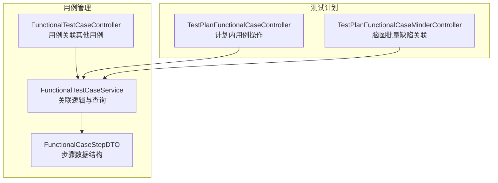
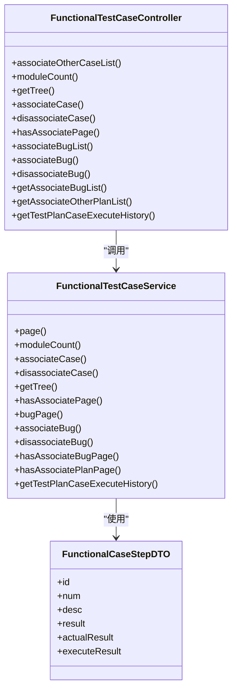
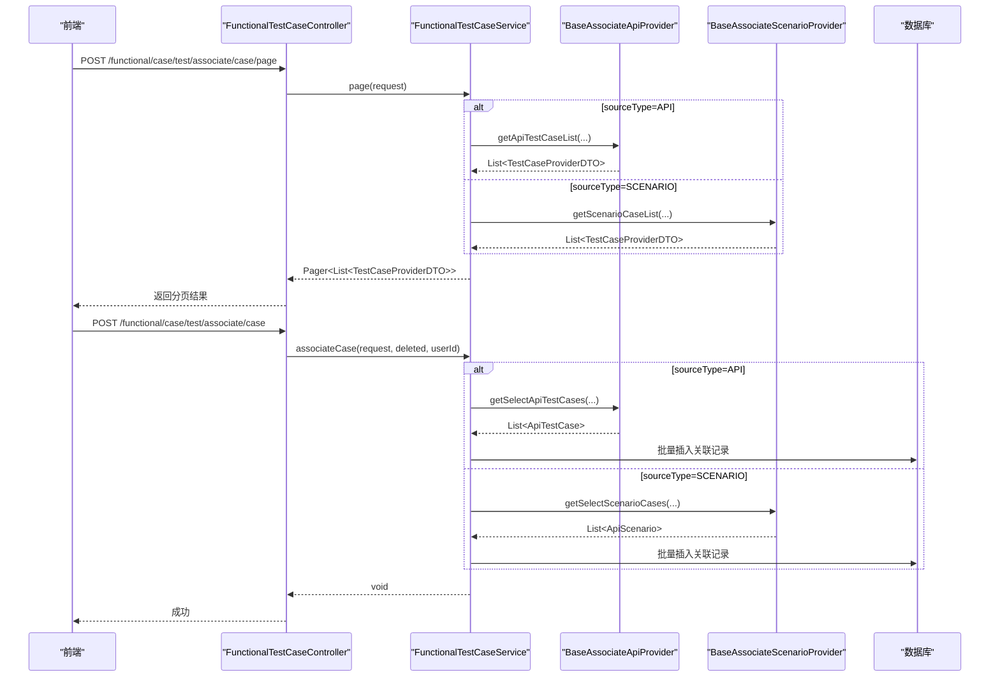
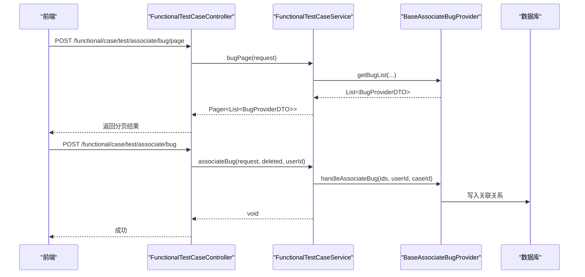
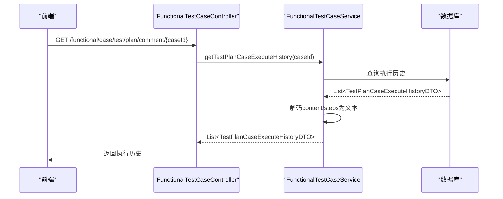
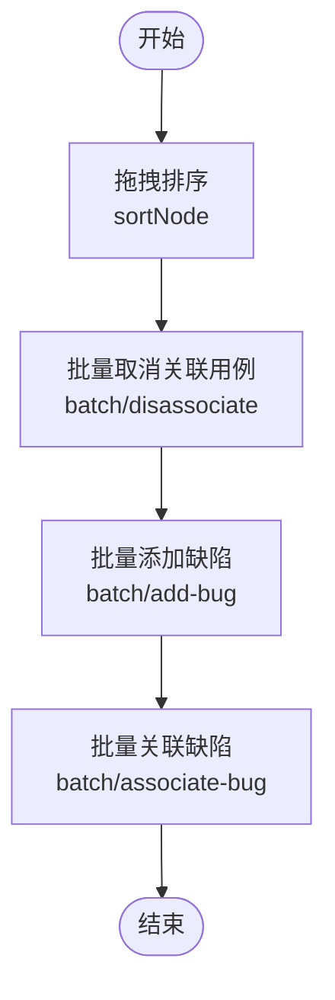
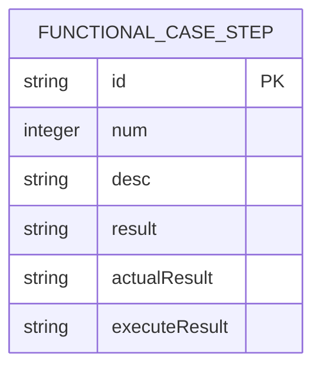
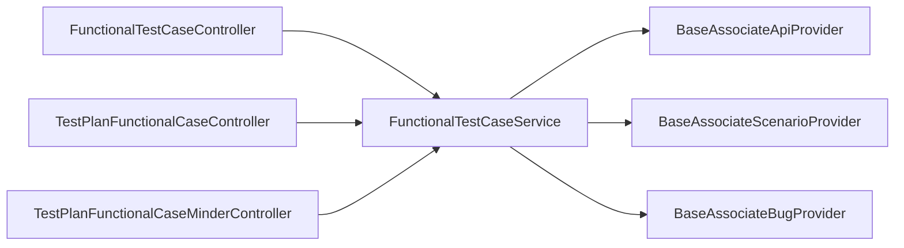

# 用例管理

<cite>
**本文引用的文件**   
- [FunctionalTestCaseController.java](file://backend/services/case-management/src/main/java/io/metersphere/functional/controller/FunctionalTestCaseController.java)
- [FunctionalTestCaseService.java](file://backend/services/case-management/src/main/java/io/metersphere/functional/service/FunctionalTestCaseService.java)
- [TestPlanFunctionalCaseController.java](file://backend/services/test-plan/src/main/java/io/metersphere/plan/controller/TestPlanFunctionalCaseController.java)
- [TestPlanFunctionalCaseMinderController.java](file://backend/services/test-plan/src/main/java/io/metersphere/plan/controller/TestPlanFunctionalCaseMinderController.java)
- [FunctionalCaseStepDTO.java](file://backend/services/case-management/src/main/java/io/metersphere/functional/dto/FunctionalCaseStepDTO.java)
</cite>

## 目录
1. [简介](#简介)
2. [项目结构](#项目结构)
3. [核心组件](#核心组件)
4. [架构总览](#架构总览)
5. [详细组件分析](#详细组件分析)
6. [依赖关系分析](#依赖关系分析)
7. [性能考量](#性能考量)
8. [故障排查指南](#故障排查指南)
9. [结论](#结论)
10. [附录：API与数据模型](#附录api与数据模型)

## 简介
本章节面向MeterSphere的用例管理功能，聚焦功能用例的创建、编辑、删除与批量操作；用例结构设计（步骤、参数、断言、附件）、版本管理、执行与结果查看；状态流转、优先级管理与标签系统；以及与测试计划、缺陷、接口/场景用例等的关联。文档同时给出相关后端API与数据模型的说明，帮助读者快速上手并深入理解实现细节。

## 项目结构
用例管理在后端主要位于 services/case-management 模块，控制器与服务层负责用例及其关联关系的处理；测试计划模块提供用例在计划中的排序、关联/取消关联、批量关联缺陷等能力；前端通过REST API进行交互。

图表来源
- [FunctionalTestCaseController.java:35-148](file://backend/services/case-management/src/main/java/io/metersphere/functional/controller/FunctionalTestCaseController.java#L35-L148)
- [FunctionalTestCaseService.java:47-311](file://backend/services/case-management/src/main/java/io/metersphere/functional/service/FunctionalTestCaseService.java#L47-L311)
- [TestPlanFunctionalCaseController.java:46-239](file://backend/services/test-plan/src/main/java/io/metersphere/plan/controller/TestPlanFunctionalCaseController.java#L46-L239)
- [TestPlanFunctionalCaseMinderController.java:36-56](file://backend/services/test-plan/src/main/java/io/metersphere/plan/controller/TestPlanFunctionalCaseMinderController.java#L36-L56)
- [FunctionalCaseStepDTO.java:6-27](file://backend/services/case-management/src/main/java/io/metersphere/functional/dto/FunctionalCaseStepDTO.java#L6-L27)

章节来源
- [FunctionalTestCaseController.java:35-148](file://backend/services/case-management/src/main/java/io/metersphere/functional/controller/FunctionalTestCaseController.java#L35-L148)
- [FunctionalTestCaseService.java:47-311](file://backend/services/case-management/src/main/java/io/metersphere/functional/service/FunctionalTestCaseService.java#L47-L311)
- [TestPlanFunctionalCaseController.java:46-239](file://backend/services/test-plan/src/main/java/io/metersphere/plan/controller/TestPlanFunctionalCaseController.java#L46-L239)
- [TestPlanFunctionalCaseMinderController.java:36-56](file://backend/services/test-plan/src/main/java/io/metersphere/plan/controller/TestPlanFunctionalCaseMinderController.java#L36-L56)
- [FunctionalCaseStepDTO.java:6-27](file://backend/services/case-management/src/main/java/io/metersphere/functional/dto/FunctionalCaseStepDTO.java#L6-L27)

## 核心组件
- FunctionalTestCaseController：暴露“用例管理-功能用例-关联其他用例”的REST接口，包括关联/取消关联用例、缺陷、获取已关联列表、获取测试计划执行历史等。
- FunctionalTestCaseService：封装用例关联的核心业务逻辑，支持按类型（接口用例/场景用例）批量关联、模块树统计、分页查询、缺陷关联与解绑、测试计划关联查询与执行历史解析。
- TestPlanFunctionalCaseController：测试计划维度下的功能用例操作，如拖拽排序、批量取消关联、批量添加/关联缺陷等。
- TestPlanFunctionalCaseMinderController：脑图模式下的批量缺陷关联能力。
- FunctionalCaseStepDTO：用例步骤的数据结构，包含步骤序号、描述、预期结果、实际结果、执行结果等字段。

章节来源
- [FunctionalTestCaseController.java:35-148](file://backend/services/case-management/src/main/java/io/metersphere/functional/controller/FunctionalTestCaseController.java#L35-L148)
- [FunctionalTestCaseService.java:47-311](file://backend/services/case-management/src/main/java/io/metersphere/functional/service/FunctionalTestCaseService.java#L47-L311)
- [TestPlanFunctionalCaseController.java:46-239](file://backend/services/test-plan/src/main/java/io/metersphere/plan/controller/TestPlanFunctionalCaseController.java#L46-L239)
- [TestPlanFunctionalCaseMinderController.java:36-56](file://backend/services/test-plan/src/main/java/io/metersphere/plan/controller/TestPlanFunctionalCaseMinderController.java#L36-L56)
- [FunctionalCaseStepDTO.java:6-27](file://backend/services/case-management/src/main/java/io/metersphere/functional/dto/FunctionalCaseStepDTO.java#L6-L27)

## 架构总览
用例管理以“功能用例”为中心，向外扩展出三类关联：
- 与其他用例关联：接口用例、场景用例
- 与缺陷关联：用于问题追踪与回归验证
- 与测试计划关联：用于计划编排与执行跟踪

图表来源
- [FunctionalTestCaseController.java:35-148](file://backend/services/case-management/src/main/java/io/metersphere/functional/controller/FunctionalTestCaseController.java#L35-L148)
- [FunctionalTestCaseService.java:47-311](file://backend/services/case-management/src/main/java/io/metersphere/functional/service/FunctionalTestCaseService.java#L47-L311)
- [FunctionalCaseStepDTO.java:6-27](file://backend/services/case-management/src/main/java/io/metersphere/functional/dto/FunctionalCaseStepDTO.java#L6-L27)

## 详细组件分析

### 用例关联其他用例（接口/场景）
- 能力概述
  - 获取可关联的用例列表（按项目、模块、搜索条件分页）
  - 获取模块树及数量统计
  - 批量关联接口用例或场景用例
  - 取消关联
  - 查询已关联的用例列表
- 关键流程
  - 根据 sourceType 路由到接口用例或场景用例提供者
  - 批量插入关联记录，使用批处理会话提升写入性能
  - 支持排除已选ID的全量选择

图表来源
- [FunctionalTestCaseController.java:43-74](file://backend/services/case-management/src/main/java/io/metersphere/functional/controller/FunctionalTestCaseController.java#L43-L74)
- [FunctionalTestCaseService.java:89-179](file://backend/services/case-management/src/main/java/io/metersphere/functional/service/FunctionalTestCaseService.java#L89-L179)

章节来源
- [FunctionalTestCaseController.java:43-74](file://backend/services/case-management/src/main/java/io/metersphere/functional/controller/FunctionalTestCaseController.java#L43-L74)
- [FunctionalTestCaseService.java:89-179](file://backend/services/case-management/src/main/java/io/metersphere/functional/service/FunctionalTestCaseService.java#L89-L179)

### 用例关联缺陷
- 能力概述
  - 获取未关联缺陷列表
  - 关联缺陷
  - 取消关联缺陷
  - 查询已关联缺陷列表
- 关键点
  - 通过 BaseAssociateBugProvider 统一处理缺陷关联/解绑
  - 支持分页与过滤

图表来源
- [FunctionalTestCaseController.java:96-119](file://backend/services/case-management/src/main/java/io/metersphere/functional/controller/FunctionalTestCaseController.java#L96-L119)
- [FunctionalTestCaseService.java:237-258](file://backend/services/case-management/src/main/java/io/metersphere/functional/service/FunctionalTestCaseService.java#L237-L258)

章节来源
- [FunctionalTestCaseController.java:96-119](file://backend/services/case-management/src/main/java/io/metersphere/functional/controller/FunctionalTestCaseController.java#L96-L119)
- [FunctionalTestCaseService.java:237-258](file://backend/services/case-management/src/main/java/io/metersphere/functional/service/FunctionalTestCaseService.java#L237-L258)

### 用例关联测试计划与执行历史
- 能力概述
  - 查询已关联的测试计划列表
  - 获取用例在测试计划中的执行评论历史（含步骤与实际结果）
- 关键点
  - 对测试计划状态过滤进行默认处理（排除归档）
  - 将二进制内容解码为文本，便于前端展示

图表来源
- [FunctionalTestCaseController.java:141-147](file://backend/services/case-management/src/main/java/io/metersphere/functional/controller/FunctionalTestCaseController.java#L141-L147)
- [FunctionalTestCaseService.java:291-309](file://backend/services/case-management/src/main/java/io/metersphere/functional/service/FunctionalTestCaseService.java#L291-L309)

章节来源
- [FunctionalTestCaseController.java:141-147](file://backend/services/case-management/src/main/java/io/metersphere/functional/controller/FunctionalTestCaseController.java#L141-L147)
- [FunctionalTestCaseService.java:291-309](file://backend/services/case-management/src/main/java/io/metersphere/functional/service/FunctionalTestCaseService.java#L291-L309)

### 测试计划维度的用例操作
- 能力概述
  - 用例拖拽排序
  - 批量取消关联用例
  - 批量添加缺陷并关联
  - 批量关联缺陷
- 关键点
  - 权限校验与资源归属检查
  - 与缺陷服务集成，完成缺陷创建与日志记录

图表来源
- [TestPlanFunctionalCaseController.java:64-119](file://backend/services/test-plan/src/main/java/io/metersphere/plan/controller/TestPlanFunctionalCaseController.java#L64-L119)
- [TestPlanFunctionalCaseController.java:217-237](file://backend/services/test-plan/src/main/java/io/metersphere/plan/controller/TestPlanFunctionalCaseController.java#L217-L237)
- [TestPlanFunctionalCaseMinderController.java:36-56](file://backend/services/test-plan/src/main/java/io/metersphere/plan/controller/TestPlanFunctionalCaseMinderController.java#L36-L56)

章节来源
- [TestPlanFunctionalCaseController.java:64-119](file://backend/services/test-plan/src/main/java/io/metersphere/plan/controller/TestPlanFunctionalCaseController.java#L64-L119)
- [TestPlanFunctionalCaseController.java:217-237](file://backend/services/test-plan/src/main/java/io/metersphere/plan/controller/TestPlanFunctionalCaseController.java#L217-L237)
- [TestPlanFunctionalCaseMinderController.java:36-56](file://backend/services/test-plan/src/main/java/io/metersphere/plan/controller/TestPlanFunctionalCaseMinderController.java#L36-L56)

### 用例结构与步骤管理
- 用例步骤数据结构
  - id：步骤标识
  - num：步骤序号
  - desc：步骤描述
  - result：预期结果
  - actualResult：实际结果
  - executeResult：执行结果（失败/成功/阻塞）
- 用途
  - 在执行历史中展示步骤级结果，辅助定位问题

图表来源
- [FunctionalCaseStepDTO.java:6-27](file://backend/services/case-management/src/main/java/io/metersphere/functional/dto/FunctionalCaseStepDTO.java#L6-L27)

章节来源
- [FunctionalCaseStepDTO.java:6-27](file://backend/services/case-management/src/main/java/io/metersphere/functional/dto/FunctionalCaseStepDTO.java#L6-L27)

## 依赖关系分析
- 控制器与服务层解耦：控制器仅做请求校验、权限控制与日志记录，具体逻辑下沉至服务层。
- 外部提供者抽象：通过 BaseAssociateApiProvider、BaseAssociateScenarioProvider、BaseAssociateBugProvider 抽象不同资源的关联能力，增强可扩展性。
- 事务与批处理：关联用例时采用批处理会话减少IO次数，提高批量写入性能。
- 测试计划与用例管理的协作：测试计划控制器复用用例服务的关联与查询能力，保持领域边界清晰。

图表来源
- [FunctionalTestCaseController.java:35-148](file://backend/services/case-management/src/main/java/io/metersphere/functional/controller/FunctionalTestCaseController.java#L35-L148)
- [FunctionalTestCaseService.java:47-311](file://backend/services/case-management/src/main/java/io/metersphere/functional/service/FunctionalTestCaseService.java#L47-L311)
- [TestPlanFunctionalCaseController.java:46-239](file://backend/services/test-plan/src/main/java/io/metersphere/plan/controller/TestPlanFunctionalCaseController.java#L46-L239)
- [TestPlanFunctionalCaseMinderController.java:36-56](file://backend/services/test-plan/src/main/java/io/metersphere/plan/controller/TestPlanFunctionalCaseMinderController.java#L36-L56)

章节来源
- [FunctionalTestCaseController.java:35-148](file://backend/services/case-management/src/main/java/io/metersphere/functional/controller/FunctionalTestCaseController.java#L35-L148)
- [FunctionalTestCaseService.java:47-311](file://backend/services/case-management/src/main/java/io/metersphere/functional/service/FunctionalTestCaseService.java#L47-L311)
- [TestPlanFunctionalCaseController.java:46-239](file://backend/services/test-plan/src/main/java/io/metersphere/plan/controller/TestPlanFunctionalCaseController.java#L46-L239)
- [TestPlanFunctionalCaseMinderController.java:36-56](file://backend/services/test-plan/src/main/java/io/metersphere/plan/controller/TestPlanFunctionalCaseMinderController.java#L36-L56)

## 性能考量
- 批量写入优化：在关联接口/场景用例时使用批处理会话，减少数据库往返次数。
- 分页查询：所有列表接口均基于分页，避免一次性加载大量数据。
- 模块树构建：通过扩展Mapper与工具方法构建模块树并统计资源数量，降低前端计算压力。
- 建议
  - 对高频查询增加缓存（如模块树、用例列表）
  - 对大体积附件与步骤内容采用异步加载或分片传输

[本节为通用指导，不直接分析具体文件]

## 故障排查指南
- 权限与资源归属错误
  - 现象：接口返回无权限或资源不属于当前用户/项目
  - 排查：确认请求携带的项目ID、用例ID是否正确；检查角色权限是否满足 READ/READ_UPDATE/READ_DELETE 等要求
- 关联失败
  - 现象：关联用例/缺陷后列表未更新
  - 排查：检查关联请求参数（sourceType、projectId、caseId）；查看服务层是否抛出异常；确认数据库关联表是否有写入
- 执行历史为空或乱码
  - 现象：执行历史内容无法显示或编码异常
  - 排查：确认后端是否正确解码二进制内容为UTF-8文本；检查步骤JSON结构是否完整

章节来源
- [FunctionalTestCaseController.java:43-147](file://backend/services/case-management/src/main/java/io/metersphere/functional/controller/FunctionalTestCaseController.java#L43-L147)
- [FunctionalTestCaseService.java:123-309](file://backend/services/case-management/src/main/java/io/metersphere/functional/service/FunctionalTestCaseService.java#L123-L309)

## 结论
用例管理以功能用例为核心，围绕“关联其他用例、关联缺陷、关联测试计划”三大方向提供完整的后端能力。通过控制器与服务层的清晰分层、对外部资源的抽象与批处理优化，系统在易用性与性能之间取得平衡。结合步骤数据结构与执行历史，用户可在用例编写、版本管理、执行与结果查看的全生命周期中获得良好体验。

[本节为总结性内容，不直接分析具体文件]

## 附录：API与数据模型

### 用例管理-功能用例-关联其他用例（REST）
- 获取需要关联的用例列表
  - 路径：POST /functional/case/test/associate/case/page
  - 说明：按 sourceType（接口/场景）分页返回可关联用例
- 统计需要关联用例模块数量
  - 路径：POST /functional/case/test/associate/case/module/count
  - 说明：返回模块维度的计数
- 获取需要关联的用例模块树
  - 路径：POST /functional/case/test/associate/case/module/tree
  - 说明：返回模块树结构
- 关联用例
  - 路径：POST /functional/case/test/associate/case
  - 说明：批量关联接口/场景用例
- 取消关联用例
  - 路径：POST /functional/case/test/disassociate/case
  - 说明：取消已关联的用例
- 获取已关联的用例列表
  - 路径：POST /functional/case/test/has/associate/case/page
  - 说明：分页返回已关联用例
- 获取缺陷列表
  - 路径：POST /functional/case/test/associate/bug/page
  - 说明：分页返回可关联缺陷
- 关联缺陷
  - 路径：POST /functional/case/test/associate/bug
  - 说明：批量关联缺陷
- 取消关联缺陷
  - 路径：GET /functional/case/test/disassociate/bug/{id}
  - 说明：解除指定缺陷关联
- 获取已关联的缺陷列表
  - 路径：POST /functional/case/test/has/associate/bug/page
  - 说明：分页返回已关联缺陷
- 获取已关联的测试计划列表
  - 路径：POST /functional/case/test/has/associate/plan/page
  - 说明：分页返回已关联测试计划
- 获取执行评论历史
  - 路径：GET /functional/case/test/plan/comment/{caseId}
  - 说明：返回用例在测试计划中的执行历史（含步骤与实际结果）

章节来源
- [FunctionalTestCaseController.java:43-147](file://backend/services/case-management/src/main/java/io/metersphere/functional/controller/FunctionalTestCaseController.java#L43-L147)

### 测试计划-功能用例（REST）
- 用例拖拽排序
  - 路径：POST /test-plan/functional/case/sort
  - 说明：调整用例在计划中的顺序
- 批量取消关联用例
  - 路径：POST /test-plan/functional/case/batch/disassociate
  - 说明：从计划中批量移除用例
- 获取待关联缺陷列表
  - 路径：POST /test-plan/functional/case/associate/bug/page
  - 说明：分页返回待关联缺陷
- 关联缺陷
  - 路径：POST /test-plan/functional/case/associate/bug
  - 说明：为用例关联缺陷
- 取消关联缺陷
  - 路径：GET /test-plan/functional/case/disassociate/bug/{id}
  - 说明：解除缺陷关联
- 批量添加缺陷
  - 路径：POST /test-plan/functional/case/batch/add-bug
  - 说明：创建缺陷并关联到用例
- 批量关联缺陷
  - 路径：POST /test-plan/functional/case/batch/associate-bug
  - 说明：批量关联已有缺陷

章节来源
- [TestPlanFunctionalCaseController.java:64-237](file://backend/services/test-plan/src/main/java/io/metersphere/plan/controller/TestPlanFunctionalCaseController.java#L64-L237)
- [TestPlanFunctionalCaseMinderController.java:36-56](file://backend/services/test-plan/src/main/java/io/metersphere/plan/controller/TestPlanFunctionalCaseMinderController.java#L36-L56)

### 数据模型要点
- 用例步骤（FunctionalCaseStepDTO）
  - 字段：id、num、desc、result、actualResult、executeResult
  - 用途：记录步骤的预期与实际结果，以及执行判定

章节来源
- [FunctionalCaseStepDTO.java:6-27](file://backend/services/case-management/src/main/java/io/metersphere/functional/dto/FunctionalCaseStepDTO.java#L6-L27)