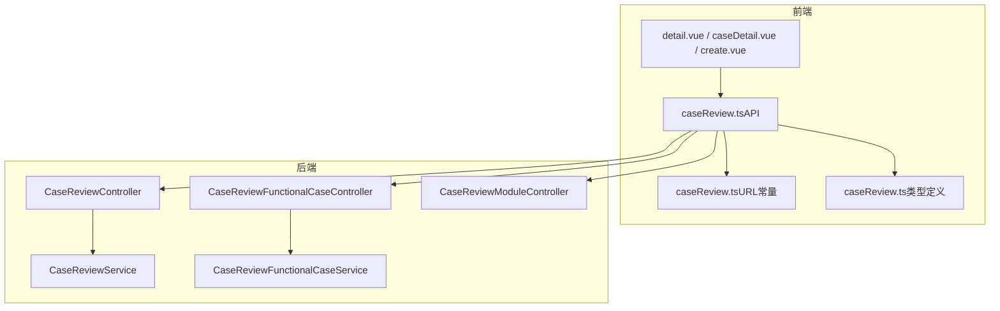
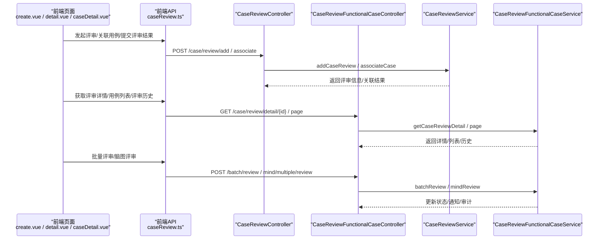
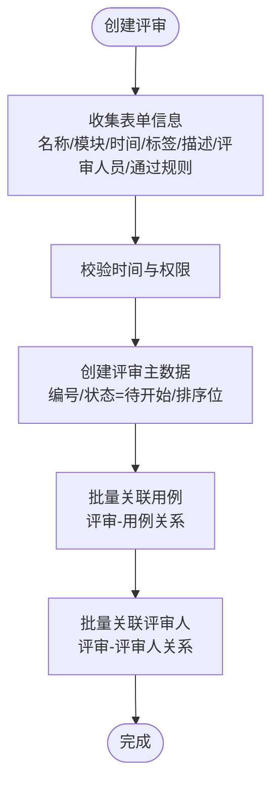
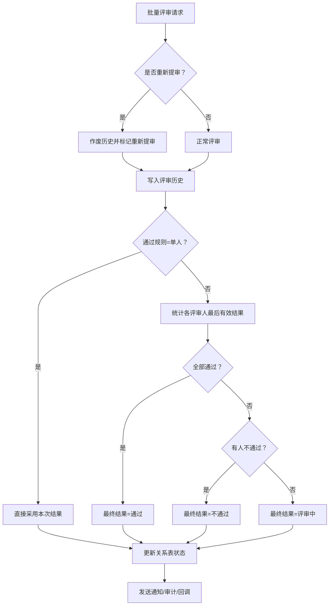
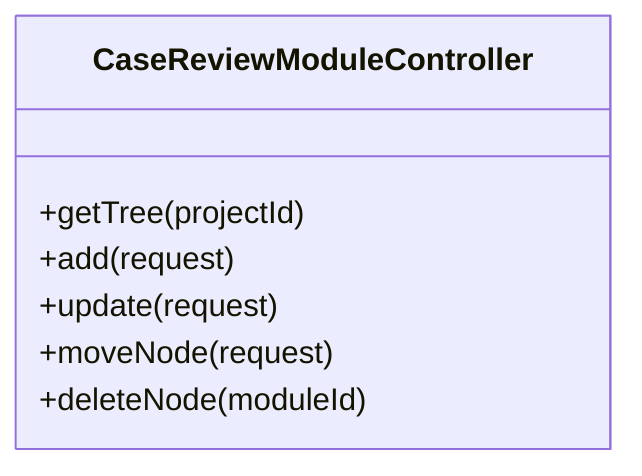
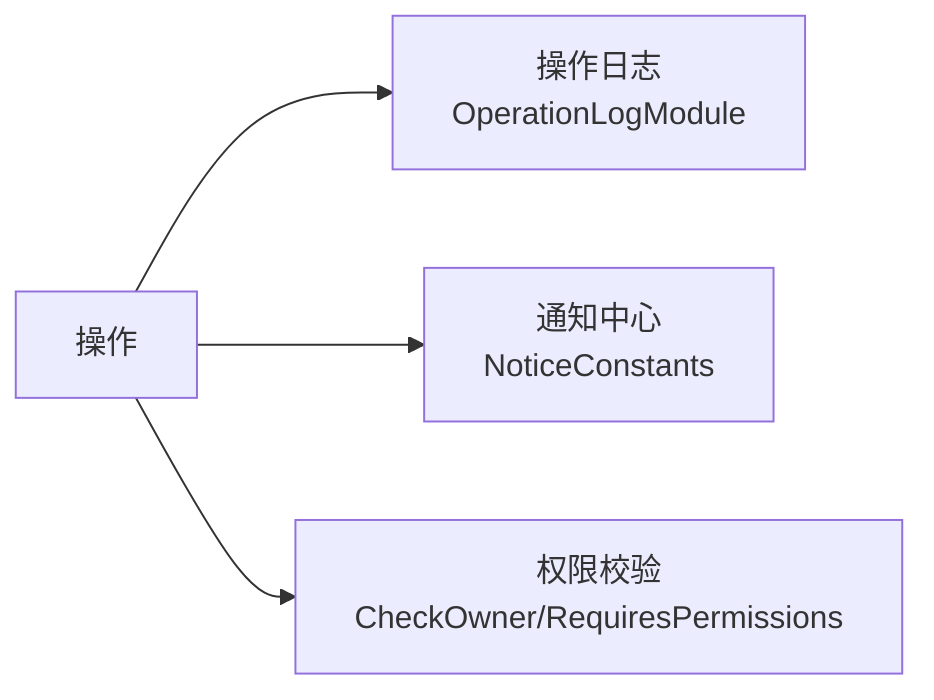
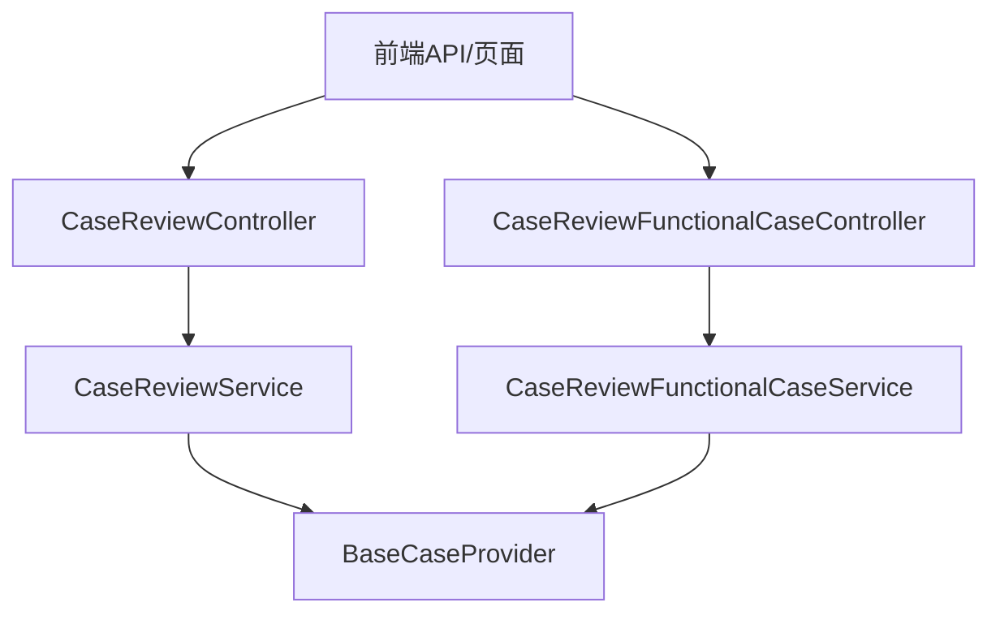

# 用例评审

<cite>
**本文引用的文件**   
- [CaseReviewController.java](file://backend/services/case-management/src/main/java/io/metersphere/functional/controller/CaseReviewController.java)
- [CaseReviewFunctionalCaseController.java](file://backend/services/case-management/src/main/java/io/metersphere/functional/controller/CaseReviewFunctionalCaseController.java)
- [CaseReviewModuleController.java](file://backend/services/case-management/src/main/java/io/metersphere/functional/controller/CaseReviewModuleController.java)
- [CaseReviewService.java](file://backend/services/case-management/src/main/java/io/metersphere/functional/service/CaseReviewService.java)
- [CaseReviewFunctionalCaseService.java](file://backend/services/case-management/src/main/java/io/metersphere/functional/service/CaseReviewFunctionalCaseService.java)
- [caseReview.ts（前端API）](file://frontend/src/api/modules/case-management/caseReview.ts)
- [caseReview.ts（URL常量）](file://frontend/src/api/requrls/case-management/caseReview.ts)
- [caseReview.ts（类型定义）](file://frontend/src/models/caseManagement/caseReview.ts)
- [detail.vue（评审详情）](file://frontend/src/views/case-management/caseReview/detail.vue)
- [caseDetail.vue（单用例评审详情）](file://frontend/src/views/case-management/caseReview/caseDetail.vue)
- [create.vue（创建/编辑评审）](file://frontend/src/views/case-management/caseReview/create.vue)
- [OperationLogModule.java（操作日志模块常量）](file://backend/services/system-setting/src/main/java/io/metersphere/system/log/constants/OperationLogModule.java)
- [NoticeConstants.java（通知常量）](file://backend/services/system-setting/src/main/java/io/metersphere/system/notice/constants/NoticeConstants.java)
</cite>

## 目录
1. [简介](#简介)
2. [项目结构](#项目结构)
3. [核心组件](#核心组件)
4. [架构总览](#架构总览)
5. [详细组件分析](#详细组件分析)
6. [依赖关系分析](#依赖关系分析)
7. [性能与扩展性](#性能与扩展性)
8. [故障排查指南](#故障排查指南)
9. [结论](#结论)
10. [附录：使用示例](#附录使用示例)

## 简介
本章节面向MeterSphere的用例评审功能，系统性说明评审流程配置、评审任务创建与分配、评审意见收集与反馈机制、评审状态管理、评审报告与统计能力，以及评审与缺陷系统的集成关系。文档同时提供端到端的使用示例，帮助快速上手发起评审、参与评审、处理评审意见和跟踪评审进度。

## 项目结构
用例评审功能由前后端协同实现：
- 后端以控制器暴露REST接口，服务层封装业务逻辑，持久化通过Mapper完成；同时结合权限校验、操作日志与通知体系。
- 前端通过API模块调用后端接口，页面组件负责交互与展示，类型定义统一在models中维护。

**图表来源** 
- [CaseReviewController.java:36-162](file://backend/services/case-management/src/main/java/io/metersphere/functional/controller/CaseReviewController.java#L36-L162)
- [CaseReviewFunctionalCaseController.java:34-164](file://backend/services/case-management/src/main/java/io/metersphere/functional/controller/CaseReviewFunctionalCaseController.java#L34-L164)
- [CaseReviewModuleController.java:20-69](file://backend/services/case-management/src/main/java/io/metersphere/functional/controller/CaseReviewModuleController.java#L20-L69)
- [CaseReviewService.java:48-661](file://backend/services/case-management/src/main/java/io/metersphere/functional/service/CaseReviewService.java#L48-L661)
- [CaseReviewFunctionalCaseService.java:54-800](file://backend/services/case-management/src/main/java/io/metersphere/functional/service/CaseReviewFunctionalCaseService.java#L54-L800)
- [caseReview.ts（前端API）:1-239](file://frontend/src/api/modules/case-management/caseReview.ts#L1-L239)
- [caseReview.ts（URL常量）:1-35](file://frontend/src/api/requrls/case-management/caseReview.ts#L1-L35)
- [caseReview.ts（类型定义）:1-287](file://frontend/src/models/caseManagement/caseReview.ts#L1-L287)

**章节来源**
- [CaseReviewController.java:36-162](file://backend/services/case-management/src/main/java/io/metersphere/functional/controller/CaseReviewController.java#L36-L162)
- [CaseReviewFunctionalCaseController.java:34-164](file://backend/services/case-management/src/main/java/io/metersphere/functional/controller/CaseReviewFunctionalCaseController.java#L34-L164)
- [CaseReviewModuleController.java:20-69](file://backend/services/case-management/src/main/java/io/metersphere/functional/controller/CaseReviewModuleController.java#L20-L69)
- [caseReview.ts（前端API）:1-239](file://frontend/src/api/modules/case-management/caseReview.ts#L1-L239)
- [caseReview.ts（URL常量）:1-35](file://frontend/src/api/requrls/case-management/caseReview.ts#L1-L35)
- [caseReview.ts（类型定义）:1-287](file://frontend/src/models/caseManagement/caseReview.ts#L1-L287)

## 核心组件
- 评审主数据与生命周期
  - 评审列表、详情、复制、移动、排序、删除、关注/取消关注、关联/取消关联用例等。
- 评审用例明细与评审结果
  - 已关联用例分页、模块树、批量评审、批量修改评审人、脑图评审、评审历史、最终结果聚合。
- 评审模块组织
  - 评审模块的增删改查、拖拽移动、统计数量。
- 权限与审计
  - 基于项目的资源归属校验、角色权限控制、操作日志记录。
- 通知与消息
  - 评审创建/更新/删除/完成等事件的通知发送，支持@提醒。

**章节来源**
- [CaseReviewController.java:44-162](file://backend/services/case-management/src/main/java/io/metersphere/functional/controller/CaseReviewController.java#L44-L162)
- [CaseReviewFunctionalCaseController.java:46-164](file://backend/services/case-management/src/main/java/io/metersphere/functional/controller/CaseReviewFunctionalCaseController.java#L46-L164)
- [CaseReviewModuleController.java:28-69](file://backend/services/case-management/src/main/java/io/metersphere/functional/controller/CaseReviewModuleController.java#L28-L69)
- [OperationLogModule.java:133-155](file://backend/services/system-setting/src/main/java/io/metersphere/system/log/constants/OperationLogModule.java#L133-L155)
- [NoticeConstants.java:250-282](file://backend/services/system-setting/src/main/java/io/metersphere/system/notice/constants/NoticeConstants.java#L250-L282)

## 架构总览
评审流程从前端触发，经API层路由到后端控制器，再由服务层执行业务逻辑，涉及权限校验、事务处理、批量写入、通知与审计。

**图表来源**
- [CaseReviewController.java:62-162](file://backend/services/case-management/src/main/java/io/metersphere/functional/controller/CaseReviewController.java#L62-L162)
- [CaseReviewFunctionalCaseController.java:57-164](file://backend/services/case-management/src/main/java/io/metersphere/functional/controller/CaseReviewFunctionalCaseController.java#L57-L164)
- [CaseReviewService.java:218-537](file://backend/services/case-management/src/main/java/io/metersphere/functional/service/CaseReviewService.java#L218-L537)
- [CaseReviewFunctionalCaseService.java:409-604](file://backend/services/case-management/src/main/java/io/metersphere/functional/service/CaseReviewFunctionalCaseService.java#L409-L604)

## 详细组件分析

### 评审主流程（创建、关联、编辑、删除）
- 创建评审
  - 前端表单收集项目名称、模块、时间范围、标签、描述、评审人员、通过规则（单人/多人），并选择要关联的用例。
  - 后端生成评审编号、初始状态为“待开始”，计算排序位置，保存评审主数据，并批量建立评审-用例、评审-评审人的关系。
- 关联用例
  - 支持按条件筛选、全选排除、模块维度选择；去重后批量插入关联关系，并同步更新用例侧的评审计数与状态。
- 编辑与复制
  - 编辑可调整基本信息、时间范围、标签、评审人员；复制会复用原评审的用例集合，并可覆盖评审人员。
- 删除
  - 软删除或物理删除评审及其关联数据，触发通知与审计日志。

**图表来源**
- [CaseReviewService.java:218-243](file://backend/services/case-management/src/main/java/io/metersphere/functional/service/CaseReviewService.java#L218-L243)
- [CaseReviewService.java:361-387](file://backend/services/case-management/src/main/java/io/metersphere/functional/service/CaseReviewService.java#L361-L387)
- [CaseReviewService.java:461-493](file://backend/services/case-management/src/main/java/io/metersphere/functional/service/CaseReviewService.java#L461-L493)

**章节来源**
- [CaseReviewController.java:62-162](file://backend/services/case-management/src/main/java/io/metersphere/functional/controller/CaseReviewController.java#L62-L162)
- [CaseReviewService.java:218-537](file://backend/services/case-management/src/main/java/io/metersphere/functional/service/CaseReviewService.java#L218-L537)
- [create.vue:368-423](file://frontend/src/views/case-management/caseReview/create.vue#L368-L423)

### 评审用例明细与评审结果
- 已关联用例列表
  - 分页查询、模块树过滤、自定义字段渲染、版本名称映射、评审人及评审人姓名列表。
- 批量评审
  - 支持批量设置评审结果（未评审/评审中/通过/不通过/重新提审），根据通过规则计算最终状态；支持@提醒与附件上传。
- 单人/多人评审规则
  - 单人评审：最后一次评审结果为最终结果。
  - 多人评审：所有评审人均通过后才判定为通过，否则为评审中；若存在不通过则直接不通过。
- 评审历史
  - 每次评审动作均落库历史记录，支持查看历史轨迹与我的评审状态。

**图表来源**
- [CaseReviewFunctionalCaseService.java:409-505](file://backend/services/case-management/src/main/java/io/metersphere/functional/service/CaseReviewFunctionalCaseService.java#L409-L505)
- [CaseReviewFunctionalCaseService.java:607-652](file://backend/services/case-management/src/main/java/io/metersphere/functional/service/CaseReviewFunctionalCaseService.java#L607-L652)

**章节来源**
- [CaseReviewFunctionalCaseController.java:57-164](file://backend/services/case-management/src/main/java/io/metersphere/functional/controller/CaseReviewFunctionalCaseController.java#L57-L164)
- [CaseReviewFunctionalCaseService.java:133-225](file://backend/services/case-management/src/main/java/io/metersphere/functional/service/CaseReviewFunctionalCaseService.java#L133-L225)
- [CaseReviewFunctionalCaseService.java:409-604](file://backend/services/case-management/src/main/java/io/metersphere/functional/service/CaseReviewFunctionalCaseService.java#L409-L604)
- [caseDetail.vue:310-581](file://frontend/src/views/case-management/caseReview/caseDetail.vue#L310-L581)

### 评审模块组织
- 模块树
  - 获取评审模块树、新增/更新/移动/删除模块。
- 模块统计
  - 统计每个模块下的评审数量，支持“全部”汇总。

**图表来源**
- [CaseReviewModuleController.java:28-69](file://backend/services/case-management/src/main/java/io/metersphere/functional/controller/CaseReviewModuleController.java#L28-L69)

**章节来源**
- [CaseReviewModuleController.java:28-69](file://backend/services/case-management/src/main/java/io/metersphere/functional/controller/CaseReviewModuleController.java#L28-L69)

### 权限、审计与通知
- 权限
  - 所有接口均进行项目级资源归属校验与角色权限校验，如读取、新增、更新、删除、关联等。
- 审计
  - 关键操作（新增、更新、删除、关联、取消关联、排序）均记录操作日志，便于追溯。
- 通知
  - 评审创建/更新/删除/完成等事件触发通知；支持@提醒与评审通过/不通过通知。

**图表来源**
- [OperationLogModule.java:133-155](file://backend/services/system-setting/src/main/java/io/metersphere/system/log/constants/OperationLogModule.java#L133-L155)
- [NoticeConstants.java:250-282](file://backend/services/system-setting/src/main/java/io/metersphere/system/notice/constants/NoticeConstants.java#L250-L282)
- [CaseReviewController.java:44-162](file://backend/services/case-management/src/main/java/io/metersphere/functional/controller/CaseReviewController.java#L44-L162)

**章节来源**
- [OperationLogModule.java:133-155](file://backend/services/system-setting/src/main/java/io/metersphere/system/log/constants/OperationLogModule.java#L133-L155)
- [NoticeConstants.java:250-282](file://backend/services/system-setting/src/main/java/io/metersphere/system/notice/constants/NoticeConstants.java#L250-L282)

## 依赖关系分析
- 控制器与服务
  - CaseReviewController 依赖 CaseReviewService 处理评审主数据与关联关系。
  - CaseReviewFunctionalCaseController 依赖 CaseReviewFunctionalCaseService 处理用例明细、评审结果与历史。
- 外部提供者
  - BaseCaseProvider 用于在评审变更时更新用例侧的评审计数与状态，保持用例与评审的一致性。
- 前端依赖
  - 前端API模块依赖URL常量与类型定义，页面组件调用API完成交互。

**图表来源**
- [CaseReviewController.java:36-162](file://backend/services/case-management/src/main/java/io/metersphere/functional/controller/CaseReviewController.java#L36-L162)
- [CaseReviewFunctionalCaseController.java:34-164](file://backend/services/case-management/src/main/java/io/metersphere/functional/controller/CaseReviewFunctionalCaseController.java#L34-L164)
- [CaseReviewService.java:48-661](file://backend/services/case-management/src/main/java/io/metersphere/functional/service/CaseReviewService.java#L48-L661)
- [CaseReviewFunctionalCaseService.java:54-800](file://backend/services/case-management/src/main/java/io/metersphere/functional/service/CaseReviewFunctionalCaseService.java#L54-L800)

**章节来源**
- [CaseReviewService.java:48-661](file://backend/services/case-management/src/main/java/io/metersphere/functional/service/CaseReviewService.java#L48-L661)
- [CaseReviewFunctionalCaseService.java:54-800](file://backend/services/case-management/src/main/java/io/metersphere/functional/service/CaseReviewFunctionalCaseService.java#L54-L800)

## 性能与扩展性
- 批量写入优化
  - 使用批处理SqlSession减少数据库往返，提升关联、评审历史写入的性能。
- 分页与统计
  - 列表查询使用分页，模块统计按需聚合，避免全量扫描。
- 异步通知
  - 通知发送与附件上传分离，降低主流程阻塞。
- 可扩展点
  - 通过BaseCaseProvider扩展用例侧的状态同步策略。
  - 通过通知常量扩展更多评审相关通知场景。

[本节为通用指导，无需具体文件引用]

## 故障排查指南
- 无法创建评审
  - 检查时间范围是否合法（不能早于当前零点）、项目权限是否具备新增评审权限。
- 关联用例失败
  - 确认用例是否存在、是否已关联、是否满足筛选条件；检查评审人与用例的关系是否正确写入。
- 评审结果异常
  - 核对通过规则（单人/多人）、评审人名单与历史评审记录；确认是否有系统管理员介入导致状态变化。
- 通知未送达
  - 检查@提醒参数格式、通知模板配置、用户订阅情况。

**章节来源**
- [CaseReviewService.java:390-402](file://backend/services/case-management/src/main/java/io/metersphere/functional/service/CaseReviewService.java#L390-L402)
- [CaseReviewFunctionalCaseService.java:409-505](file://backend/services/case-management/src/main/java/io/metersphere/functional/service/CaseReviewFunctionalCaseService.java#L409-L505)

## 结论
用例评审功能提供了完整的评审生命周期管理能力，涵盖评审创建与配置、用例关联与分配、评审意见收集与反馈、状态管理与统计、以及通知与审计。通过单人/多人评审规则与评审历史追踪，确保评审过程透明可控；借助BaseCaseProvider与通知体系，实现与用例系统与消息系统的无缝集成。

[本节为总结性内容，无需具体文件引用]

## 附录：使用示例

### 发起评审
- 步骤
  - 进入“用例管理-用例评审”，点击“新增评审”。
  - 填写评审名称、选择模块、设置时间范围、标签、描述。
  - 选择评审人员与通过规则（单人/多人）。
  - 选择要关联的用例（支持按条件筛选、全选排除、模块维度选择）。
  - 提交后跳转到评审详情页或直接返回列表。
- 关键点
  - 时间范围需晚于当前零点。
  - 评审人员将自动成为用例的评审人。
  - 通过规则决定最终结果的计算方式。

**章节来源**
- [create.vue:368-423](file://frontend/src/views/case-management/caseReview/create.vue#L368-L423)
- [CaseReviewController.java:62-80](file://backend/services/case-management/src/main/java/io/metersphere/functional/controller/CaseReviewController.java#L62-L80)
- [CaseReviewService.java:218-243](file://backend/services/case-management/src/main/java/io/metersphere/functional/service/CaseReviewService.java#L218-L243)

### 参与评审
- 步骤
  - 在评审详情中查看已关联用例列表，选择需要评审的用例。
  - 填写评审意见（不通过时必须填写），可选择@相关人员。
  - 提交评审结果（通过/不通过/评审中/重新提审）。
  - 查看评审历史与我的评审状态。
- 关键点
  - 单人评审：最后一次评审结果为最终结果。
  - 多人评审：所有评审人均通过后才判定为通过。
  - 重新提审会作废之前的评审历史。

**章节来源**
- [caseDetail.vue:310-581](file://frontend/src/views/case-management/caseReview/caseDetail.vue#L310-L581)
- [CaseReviewFunctionalCaseController.java:106-164](file://backend/services/case-management/src/main/java/io/metersphere/functional/controller/CaseReviewFunctionalCaseController.java#L106-L164)
- [CaseReviewFunctionalCaseService.java:409-604](file://backend/services/case-management/src/main/java/io/metersphere/functional/service/CaseReviewFunctionalCaseService.java#L409-L604)

### 处理评审意见
- 步骤
  - 在评审历史中查看他人意见，必要时回复或补充附件。
  - 对不通过用例进行修复后，可重新提审。
- 关键点
  - 重新提审会将用例状态置为“重新提审”，并作废之前历史。
  - 附件上传与评审意见绑定，便于追溯。

**章节来源**
- [CaseReviewFunctionalCaseService.java:323-392](file://backend/services/case-management/src/main/java/io/metersphere/functional/service/CaseReviewFunctionalCaseService.java#L323-L392)

### 跟踪评审进度
- 指标
  - 通过率、通过数、不通过数、评审中数、未评审数、重新提审数。
- 视图
  - 评审列表展示通过率与统计卡片；评审详情展示用例状态与模块统计。
- 导出与报表
  - 可通过前端导出或对接报表系统进行汇总分析。

**章节来源**
- [CaseReviewService.java:94-187](file://backend/services/case-management/src/main/java/io/metersphere/functional/service/CaseReviewService.java#L94-L187)
- [detail.vue:142-167](file://frontend/src/views/case-management/caseReview/detail.vue#L142-L167)

### 评审与缺陷系统的集成关系
- 用例与缺陷
  - 用例评审中发现的问题可关联缺陷，测试计划与用例均可进行缺陷关联与解关联。
- 评审与缺陷联动
  - 当用例被标记为“重新提审”或评审不通过时，建议同步创建或关联缺陷，以便跟踪修复闭环。
- 数据一致性
  - 通过BaseCaseProvider在评审变更时更新用例侧的评审计数与状态，保证用例与评审、缺陷之间的一致性。

**章节来源**
- [TestPlanFunctionalCaseController.java:121-144](file://backend/services/test-plan/src/main/java/io/metersphere/plan/controller/TestPlanFunctionalCaseController.java#L121-L144)
- [TestPlanApiScenarioController.java:172-195](file://backend/services/test-plan/src/main/java/io/metersphere/plan/controller/TestPlanApiScenarioController.java#L172-L195)
- [CaseReviewService.java:531-537](file://backend/services/case-management/src/main/java/io/metersphere/functional/service/CaseReviewService.java#L531-L537)