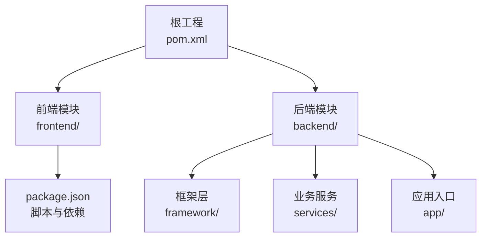
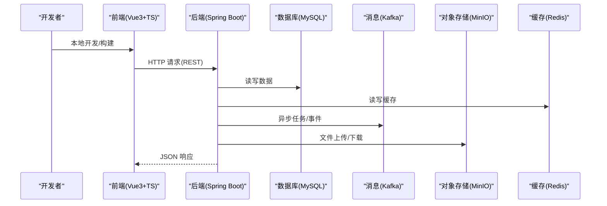
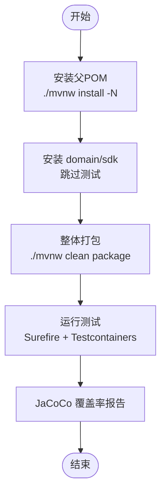
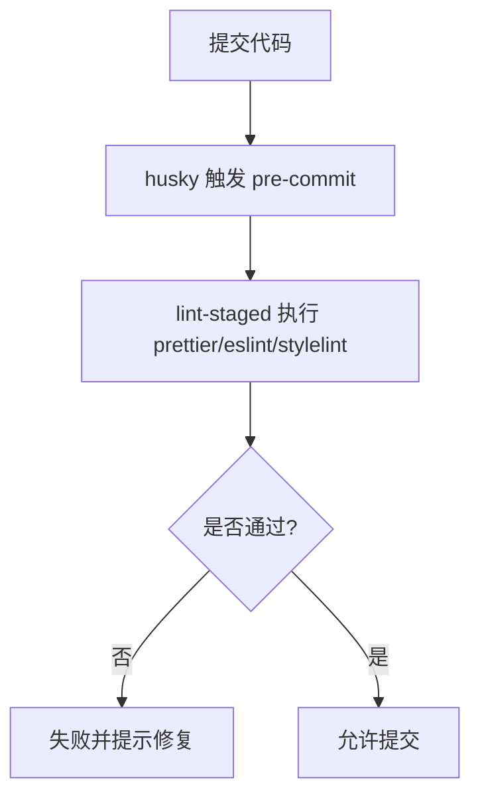
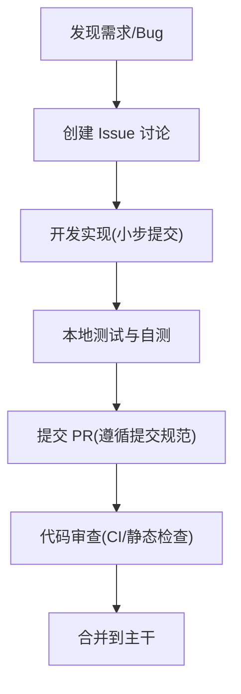
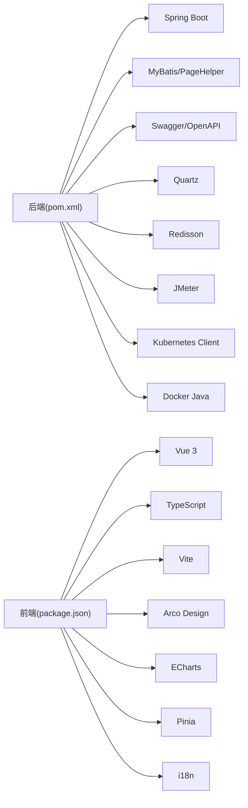

# 开发指南

<cite>
**本文引用的文件**   
- [README.md](file://README.md)
- [CONTRIBUTING.md](file://CONTRIBUTING.md)
- [PULL_REQUEST_TEMPLATE.md](file://.github/PULL_REQUEST_TEMPLATE.md)
- [pom.xml（根）](file://pom.xml)
- [build.md](file://build.md)
- [backend/pom.xml](file://backend/pom.xml)
- [frontend/package.json](file://frontend/package.json)
- [frontend/README.md](file://frontend/README.md)
- [frontend/tsconfig.json](file://frontend/tsconfig.json)
</cite>

## 目录
1. [简介](#简介)
2. [项目结构](#项目结构)
3. [核心组件](#核心组件)
4. [架构总览](#架构总览)
5. [详细组件分析](#详细组件分析)
6. [依赖关系分析](#依赖关系分析)
7. [性能考虑](#性能考虑)
8. [故障排查指南](#故障排查指南)
9. [结论](#结论)
10. [附录](#附录)

## 简介
本指南面向 MeterSphere 3.x 的贡献者与开发者，覆盖开发环境搭建、代码规范、测试策略与贡献流程。内容基于仓库现有配置与文档整理，帮助你在前后端统一的技术栈下高效协作与交付。

- 技术栈概览：后端 Spring Boot + Java 21；前端 Vue 3 + TypeScript + Vite；中间件 MySQL/Kafka/MinIO/Redis；测试引擎 JMeter；容器化 Docker。
- 产品定位：新一代开源持续测试工具，内置 AI 助手，提供用例管理、接口调试、场景自动化、缺陷管理与报告等能力。

章节来源
- [README.md:16-66](file://README.md#L16-L66)

## 项目结构
仓库采用前后端分离的多模块 Maven 工程：
- 根目录 pom.xml 聚合 frontend 与 backend 两个子模块，统一管理版本与插件。
- backend 包含 framework（领域模型、SDK、AI 引擎、插件 SDK）、services（按业务域划分的微服务式模块）、app（应用启动入口）。
- frontend 为 Vue 3 + TS + Vite 工程，遵循模块化组织（api、components、views、store、router、locale 等），并通过 husky、lint-staged、commitlint 进行提交前检查。

图表来源
- [pom.xml（根）:97-100](file://pom.xml#L97-L100)
- [backend/pom.xml:16-20](file://backend/pom.xml#L16-L20)
- [frontend/package.json:9-21](file://frontend/package.json#L9-L21)

章节来源
- [pom.xml（根）:97-100](file://pom.xml#L97-L100)
- [backend/pom.xml:16-20](file://backend/pom.xml#L16-L20)
- [frontend/README.md:56-103](file://frontend/README.md#L56-L103)

## 核心组件
- 后端
  - 应用入口：Spring Boot 应用主类位于 backend/app，负责装配各 services 与 framework 能力。
  - 框架层：domain（领域模型与迁移脚本）、sdk（通用 SDK）、ai-engine（AI 对话与工具链）、plugin（插件 SPI）。
  - 业务服务：api-test、bug-management、case-management、dashboard、project-management、system-setting、test-plan 等。
- 前端
  - 构建与脚本：Vite 多环境配置，TypeScript 严格模式，ESLint/Prettier/Stylelint 统一风格。
  - 状态与网络：Pinia 状态管理，Axios 封装，API 按模块拆分。
  - 路由与国际化：Vue Router 模块化路由，vue-i18n 多语言支持。

章节来源
- [backend/pom.xml:16-20](file://backend/pom.xml#L16-L20)
- [frontend/README.md:178-230](file://frontend/README.md#L178-L230)
- [frontend/README.md:403-450](file://frontend/README.md#L403-L450)

## 架构总览
下图展示从前端到后端的请求链路以及关键基础设施的交互。

图表来源
- [README.md:59-66](file://README.md#L59-L66)
- [backend/pom.xml:21-106](file://backend/pom.xml#L21-L106)

## 详细组件分析

### 后端构建与测试
- 构建
  - 使用 Maven Wrapper 执行命令，根 pom 聚合 frontend 与 backend。
  - 通过 build.md 提供的命令安装父 POM 并打包。
- 测试
  - 集成 Testcontainers 与 MockServer，支持嵌入式 MySQL/Redis/MinIO/Kafka/MockServer 用于单元测试与集成测试。
  - Surefire 插件启用字母顺序执行，统一编码 UTF-8。
  - JaCoCo 统计覆盖率，排除 mapper/domain/dto/config/constants/utils 等纯数据或工具类。

图表来源
- [build.md:1-19](file://build.md#L1-L19)
- [backend/pom.xml:107-119](file://backend/pom.xml#L107-L119)
- [pom.xml（根）:157-195](file://pom.xml#L157-L195)

章节来源
- [build.md:1-19](file://build.md#L1-L19)
- [backend/pom.xml:21-106](file://backend/pom.xml#L21-L106)
- [backend/pom.xml:107-119](file://backend/pom.xml#L107-L119)
- [pom.xml（根）:157-195](file://pom.xml#L157-L195)

### 前端工程与规范
- 脚本与依赖
  - dev/build/preview/type:check/lint 等脚本在 package.json 中定义。
  - 依赖 Vue3、TypeScript、Vite、Arco Design、ECharts、Pinia、i18n 等。
- 代码质量
  - ESLint + Prettier + Stylelint 统一代码风格，husky + lint-staged 在提交时自动修复。
  - commitlint 校验提交信息格式。
- 类型与路径
  - tsconfig.json 开启严格模式，配置路径别名 @/* 与 #/*。

图表来源
- [frontend/package.json:9-36](file://frontend/package.json#L9-L36)
- [frontend/README.md:1-54](file://frontend/README.md#L1-L54)
- [frontend/tsconfig.json:18-51](file://frontend/tsconfig.json#L18-L51)

章节来源
- [frontend/package.json:9-36](file://frontend/package.json#L9-L36)
- [frontend/README.md:1-54](file://frontend/README.md#L1-L54)
- [frontend/tsconfig.json:18-51](file://frontend/tsconfig.json#L18-L51)

### Git 工作流与贡献流程
- 分支与 PR
  - 鼓励小步提交，PR 尽量拆分为小的变更，避免一次性大改动。
  - 每个 PR 需确保测试通过，必要时补充测试覆盖。
- 提交信息
  - 遵循 Conventional Commits 规范，类型包括 feat/fix/docs/style/refactor/test/chore/perf/ci/revert。
- Issue 与反馈
  - 报告问题需提供版本、复现步骤、日志/截图，注意脱敏敏感信息。

图表来源
- [CONTRIBUTING.md:9-16](file://CONTRIBUTING.md#L9-L16)
- [CONTRIBUTING.md:18-31](file://CONTRIBUTING.md#L18-L31)
- [PULL_REQUEST_TEMPLATE.md:1-9](file://.github/PULL_REQUEST_TEMPLATE.md#L1-L9)

章节来源
- [CONTRIBUTING.md:9-16](file://CONTRIBUTING.md#L9-L16)
- [CONTRIBUTING.md:18-31](file://CONTRIBUTING.md#L18-L31)
- [PULL_REQUEST_TEMPLATE.md:1-9](file://.github/PULL_REQUEST_TEMPLATE.md#L1-L9)

### 命名约定与注释规范
- 后端
  - 包名与类名遵循 Java 规范；DTO/Request/Response 分层清晰；常量集中定义于 constants 包。
  - 注释建议说明业务意图与边界条件，避免无意义注释。
- 前端
  - 组件与页面按功能模块划分；枚举以“类型+Enum”命名；公共方法按功能类型命名文件。
  - 变量与函数语义明确，避免缩写歧义。

章节来源
- [frontend/README.md:408-444](file://frontend/README.md#L408-L444)
- [frontend/README.md:483-490](file://frontend/README.md#L483-L490)

### 文档编写要求
- 新增或修改功能时，若影响用户可见行为或配置项，应同步更新相关文档或提出文档 PR。
- 提交 PR 模板中包含“考虑文档影响”的检查项，提醒作者评估文档变更。

章节来源
- [PULL_REQUEST_TEMPLATE.md:1-9](file://.github/PULL_REQUEST_TEMPLATE.md#L1-L9)

## 依赖关系分析
- 后端依赖
  - Spring Boot 3.5.7，Java 21；MyBatis、PageHelper、Swagger/OpenAPI、Quartz、Redisson、JMeter、Kubernetes Client、Docker Java 等。
  - 测试依赖：Testcontainers、MockServer、Embedded MySQL/Redis/MinIO/Kafka。
- 前端依赖
  - Vue 3、TypeScript、Vite、Arco Design、ECharts、Pinia、i18n、Monaco Editor 等。
  - 构建与质量：ESLint、Prettier、Stylelint、Husky、Commitlint、Rollup Visualizer。

图表来源
- [pom.xml（根）:20-95](file://pom.xml#L20-L95)
- [backend/pom.xml:21-106](file://backend/pom.xml#L21-L106)
- [frontend/package.json:37-167](file://frontend/package.json#L37-L167)

章节来源
- [pom.xml（根）:20-95](file://pom.xml#L20-L95)
- [backend/pom.xml:21-106](file://backend/pom.xml#L21-L106)
- [frontend/package.json:37-167](file://frontend/package.json#L37-L167)

## 性能考虑
- 后端
  - 合理使用缓存（Redis）减少热点查询压力；对批量操作与长耗时任务使用异步处理（Kafka）。
  - 控制 SQL 复杂度，利用分页与索引优化查询；避免 N+1 查询。
  - 使用 JaCoCo 监控测试覆盖，结合压测定位瓶颈。
- 前端
  - 按需加载组件与样式（unplugin-vue-components），减少首屏体积。
  - 使用 Rollup Visualizer 分析打包产物，拆分第三方库（如 arco、echarts、vue 生态）为独立 chunk。
  - 图片与静态资源压缩（vite-plugin-imagemin），启用 gzip/brotli 压缩。

章节来源
- [backend/pom.xml:107-119](file://backend/pom.xml#L107-L119)
- [frontend/README.md:597-706](file://frontend/README.md#L597-L706)

## 故障排查指南
- 常见问题
  - 环境变量未生效：确认 .env.* 文件命名与 VITE_ 前缀，并在 vite.config.ts 中使用 loadEnv 读取。
  - 端口冲突：检查 docker 映射端口与本地服务占用。
  - 依赖解析失败：检查镜像源与私有仓库配置（metersphere-public）。
- 调试技巧
  - 后端：启用 Spring Boot DevTools 与 Logback 输出；使用 Testcontainers 快速拉起依赖服务。
  - 前端：使用浏览器开发者工具 Network/Console；通过 vite preview 模拟生产环境。
- 日志与错误
  - 后端日志由 logback-spring.xml 管理；前端可通过全局错误拦截器收集异常上报。

章节来源
- [frontend/README.md:500-523](file://frontend/README.md#L500-L523)
- [backend/app/src/main/resources/logback-spring.xml](file://backend/app/src/main/resources/logback-spring.xml)

## 结论
MeterSphere 3.x 采用成熟的前后端技术栈与清晰的模块化设计，配合完善的代码质量工具链与测试基础设施，便于团队协作与持续交付。遵循本指南中的环境搭建、代码规范、测试策略与贡献流程，可显著提升开发与维护效率。

## 附录
- 快速开始
  - 参考 README 的安装与部署指引，优先使用 1Panel 或离线安装包。
- 构建命令
  - 安装父 POM 与 domain/sdk：见 build.md。
  - 整体打包：见 build.md。

章节来源
- [README.md:24-30](file://README.md#L24-L30)
- [build.md:1-19](file://build.md#L1-L19)