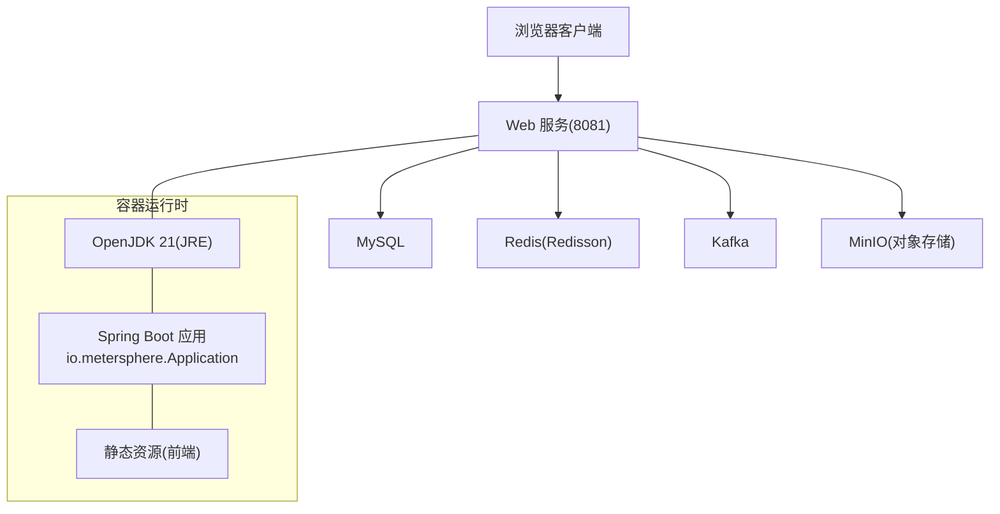

# 快速开始

<cite>
**本文引用的文件**   
- [README.md](file://README.md)
- [Dockerfile](file://Dockerfile)
- [pom.xml](file://pom.xml)
- [commons.properties](file://backend/app/src/main/resources/commons.properties)
- [Application.java](file://backend/app/src/main/java/io/metersphere/Application.java)
</cite>

## 目录
1. [简介](#简介)
2. [环境要求](#环境要求)
3. [安装部署](#安装部署)
4. [基础配置说明](#基础配置说明)
5. [首次使用指导](#首次使用指导)
6. [常见问题与排查](#常见问题与排查)
7. [架构总览](#架构总览)
8. [结论](#结论)

## 简介
MeterSphere 是新一代开源持续测试工具，内置 AI 助手，覆盖用例管理、接口调试与自动化、缺陷管理、测试计划与报告等能力，支持“系统-组织-项目”分层协作与插件扩展。V3 版本为当前维护主线，分为社区版与企业版。

- 官方仓库首页提供快速开始入口与产品对比说明
- 技术栈包含 Spring Boot、Vue.js，中间件包括 MySQL、Kafka、MinIO、Redis，基础设施推荐 Docker，测试引擎基于 JMeter

**章节来源**
- [README.md:16-22](file://README.md#L16-L22)
- [README.md:59-65](file://README.md#L59-L65)

## 环境要求
本节梳理运行 MeterSphere 3.x 所需的基础环境与中间件依赖。

- Java 运行时
  - 镜像基础镜像为 OpenJDK 21（Alpine + JRE），应用主类由容器启动脚本加载
  - 构建与 CI 也统一使用 Java 21
- 数据库：MySQL
- 缓存与会话：Redis（通过 Redisson）
- 消息队列：Kafka
- 对象存储：MinIO
- 容器化：Docker（用于打包与运行）
- 测试引擎：JMeter（路径在配置中指定）

关键依据
- 后端应用主类加载外部配置文件，默认端口 8081，日志路径 /opt/metersphere/logs/metersphere
- 数据源连接池使用 HikariCP，Quartz 任务调度启用
- Kafka 客户端已集成，消费者组 ID 固定
- Redisson 会话与分布式锁相关配置指向 /opt/metersphere/conf/redisson.yml
- MinIO 客户端在启动时初始化存储仓库
- JMeter 根目录配置为 /opt/jmeter

**章节来源**
- [Dockerfile:1-25](file://Dockerfile#L1-L25)
- [pom.xml:22-22](file://pom.xml#L22-L22)
- [commons.properties:1-11](file://backend/app/src/main/resources/commons.properties#L1-L11)
- [commons.properties:15-36](file://backend/app/src/main/resources/commons.properties#L15-L36)
- [commons.properties:38-47](file://backend/app/src/main/resources/commons.properties#L38-L47)
- [commons.properties:68-72](file://backend/app/src/main/resources/commons.properties#L68-L72)
- [commons.properties:78-81](file://backend/app/src/main/resources/commons.properties#L78-L81)
- [Application.java:14-27](file://backend/app/src/main/java/io/metersphere/Application.java#L14-L27)

## 安装部署
以下提供两种常用方式：1Panel 应用商店一键部署与离线安装包部署。生产环境推荐使用离线安装包。

- 1Panel 应用商店
  - 适合快速体验与开发测试环境
  - 通过 1Panel 应用商店搜索并安装 MeterSphere，按向导完成中间件与网络配置
  - 参考链接见 README 中的快速开始部分

- 离线安装包
  - 适合生产环境部署
  - 下载对应版本的离线安装包后，按照官方文档指引执行安装脚本或命令
  - 安装过程中会准备 MySQL、Redis、Kafka、MinIO 等依赖服务，并完成 MeterSphere 服务的启动

提示
- 若需安装插件，请访问 MeterSphere 插件市场进行扩展
- 如需自定义端口、存储路径、中间件地址等，可在安装完成后修改 /opt/metersphere/conf 下的配置文件

**章节来源**
- [README.md:24-30](file://README.md#L24-L30)

## 基础配置说明
本节聚焦首次部署后需要关注的关键配置项与默认行为。

- 应用端口与监控端口
  - Web 服务默认监听 8081
  - Actuator 监控端口为 7071
- 日志路径
  - 默认日志输出到 /opt/metersphere/logs/metersphere
- 数据库连接
  - 使用 HikariCP 连接池，Quartz 表结构与业务库共用同一数据源
- Kafka
  - 消费者组 ID 固定为 metersphere_group_id
  - 未找到主题不会导致启动失败（missing-topics-false）
- Redis
  - 会话超时默认 43200s
  - Redisson 配置文件位于 /opt/metersphere/conf/redisson.yml
- 文件上传大小
  - 单文件与请求体最大均为 1024MB
- JMeter
  - 根目录默认 /opt/jmeter
- 国际化
  - 默认语言 zh_CN
- 外部配置加载顺序
  - 优先加载 classpath:commons.properties
  - 其次加载 file:/opt/metersphere/conf/metersphere.properties（允许不存在）

建议
- 将 MySQL、Redis、Kafka、MinIO 的地址与凭据写入 /opt/metersphere/conf/metersphere.properties
- 根据实际资源规模调整 HikariCP 连接池参数与 Kafka 缓冲区大小
- 如需关闭 Swagger 文档，保持默认关闭状态即可

**章节来源**
- [commons.properties:1-11](file://backend/app/src/main/resources/commons.properties#L1-L11)
- [commons.properties:15-36](file://backend/app/src/main/resources/commons.properties#L15-L36)
- [commons.properties:38-47](file://backend/app/src/main/resources/commons.properties#L38-L47)
- [commons.properties:68-72](file://backend/app/src/main/resources/commons.properties#L68-L72)
- [commons.properties:78-81](file://backend/app/src/main/resources/commons.properties#L78-L81)
- [commons.properties:92-92](file://backend/app/src/main/resources/commons.properties#L92-L92)
- [Application.java:19-22](file://backend/app/src/main/java/io/metersphere/Application.java#L19-L22)

## 首次使用指导
完成安装后，按以下步骤验证系统是否正常运行：

- 访问 Web 界面
  - 浏览器打开 http://<服务器IP>:8081
  - 若使用反向代理或域名，请确保端口映射正确
- 登录系统
  - 使用安装时创建的初始管理员账号登录
- 创建组织与项目
  - 进入“系统设置”，创建组织与项目，分配成员与权限
- 配置中间件
  - 在“系统设置”中核对数据库、Redis、Kafka、MinIO 的连接信息
- 导入或创建用例
  - 从“接口测试”模块创建接口定义与调试用例
  - 从“功能测试”模块创建用例集
- 执行测试
  - 选择资源池（本地或远程节点）执行接口或场景自动化
- 查看报告
  - 在“测试报告”中查看执行结果与性能指标

验证要点
- 页面可正常加载且无白屏
- 能成功登录并看到工作台
- 能创建组织与项目
- 能保存用例并执行一次简单接口调用

**章节来源**
- [commons.properties:1-3](file://backend/app/src/main/resources/commons.properties#L1-L3)

## 常见问题与排查
- 无法访问 8081 端口
  - 检查防火墙与安全组是否放行 8081
  - 确认应用进程已启动且监听 8081
- 登录后出现空白页或静态资源 404
  - 确认静态资源目录已正确挂载或复制
  - 检查前端构建产物是否随应用一起发布
- 数据库连接失败
  - 检查 MySQL 地址、端口、用户名、密码是否正确
  - 确认数据库字符集与 collation 符合预期
- Kafka 消费异常
  - 检查 bootstrap-servers 连通性
  - 确认消费者组 ID 未被其他实例占用
- Redis 会话丢失
  - 检查 Redisson 配置文件路径与 Redis 连通性
- MinIO 上传失败
  - 检查 MinIO 端点、AccessKey、SecretKey 与桶策略
- 日志位置
  - 默认日志位于 /opt/metersphere/logs/metersphere，可按天或按文件大小滚动

定位建议
- 先确认应用端口与进程状态
- 再检查各中间件连通性与权限
- 最后结合日志与 Actuator 端点（7071）进行诊断

**章节来源**
- [commons.properties:1-3](file://backend/app/src/main/resources/commons.properties#L1-L3)
- [commons.properties:14-14](file://backend/app/src/main/resources/commons.properties#L14-L14)
- [commons.properties:38-47](file://backend/app/src/main/resources/commons.properties#L38-L47)
- [commons.properties:78-81](file://backend/app/src/main/resources/commons.properties#L78-L81)

## 架构总览
下图展示 MeterSphere 3.x 的核心组件与依赖关系，以及容器化运行时的关键要素。

图示来源
- [Dockerfile:1-25](file://Dockerfile#L1-L25)
- [Application.java:14-27](file://backend/app/src/main/java/io/metersphere/Application.java#L14-L27)
- [commons.properties:1-3](file://backend/app/src/main/resources/commons.properties#L1-L3)
- [commons.properties:38-47](file://backend/app/src/main/resources/commons.properties#L38-L47)
- [commons.properties:78-81](file://backend/app/src/main/resources/commons.properties#L78-L81)

## 结论
通过本指南，您可以在满足 Java 21 与 MySQL、Redis、Kafka、MinIO 等中间件的前提下，使用 1Panel 应用商店或离线安装包快速部署 MeterSphere 3.x，并在首次登录后完成组织与项目的初始化、用例的创建与执行，最终获得完整的测试管理与报告能力。如遇问题，可依据常见故障排查清单逐步定位。