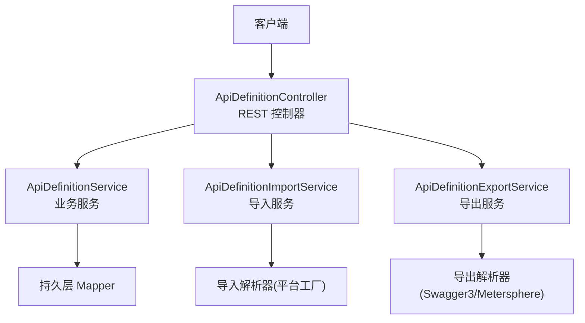
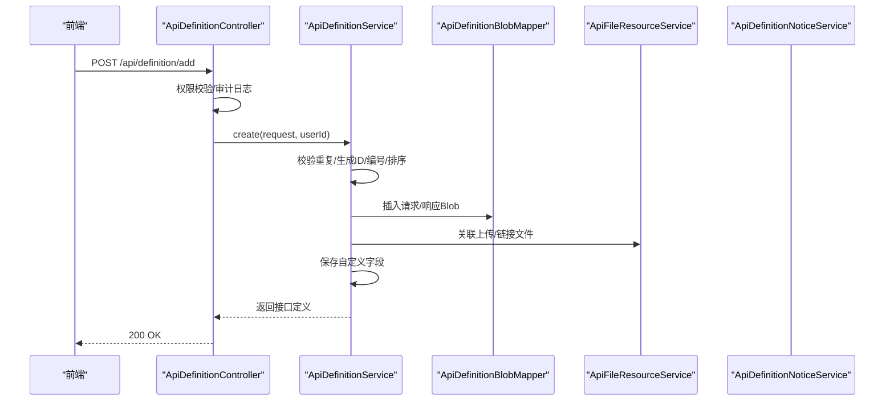
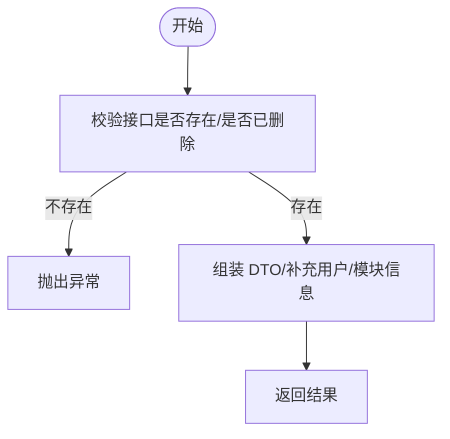
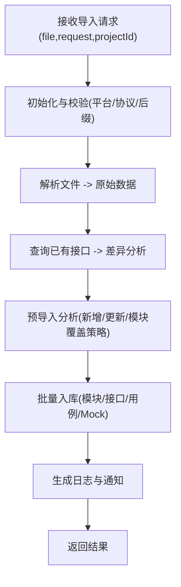
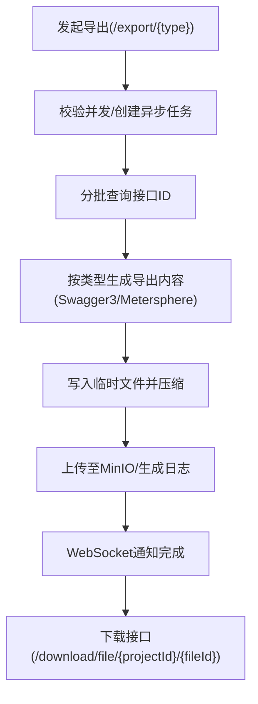
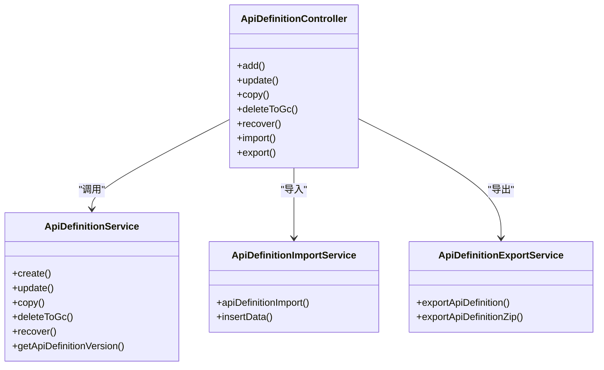

# 接口定义管理

<cite>
**本文引用的文件**   
- [ApiDefinitionController.java](file://backend/services/api-test/src/main/java/io/metersphere/api/controller/definition/ApiDefinitionController.java)
- [ApiDefinitionService.java](file://backend/services/api-test/src/main/java/io/metersphere/api/service/definition/ApiDefinitionService.java)
- [ApiDefinitionImportService.java](file://backend/services/api-test/src/main/java/io/metersphere/api/service/definition/ApiDefinitionImportService.java)
- [ApiDefinitionExportService.java](file://backend/services/api-test/src/main/java/io/metersphere/api/service/definition/ApiDefinitionExportService.java)
</cite>

## 目录
1. [简介](#简介)
2. [项目结构](#项目结构)
3. [核心组件](#核心组件)
4. [架构总览](#架构总览)
5. [详细组件分析](#详细组件分析)
6. [依赖关系分析](#依赖关系分析)
7. [性能与扩展性](#性能与扩展性)
8. [故障排查指南](#故障排查指南)
9. [结论](#结论)
10. [附录：API 使用示例](#附录api-使用示例)

## 简介
本章节面向“接口定义管理”功能，覆盖接口的创建、编辑、删除、版本管理、导入导出、模块化管理、权限控制与共享机制。后端以 REST API 暴露能力，控制器负责鉴权与日志记录，服务层封装业务逻辑（含多版本、变更历史、批量操作、文件资源关联等），导入导出通过解析器实现 Swagger/OpenAPI 等格式支持。

## 项目结构
围绕接口定义管理的后端代码主要位于 api-test 服务的 controller 与 service 包中：
- 控制器：统一对外暴露接口定义相关 REST 端点，包含增删改查、分页、复制、移动、回收站、文档列表、调试、引用关系、导入导出等。
- 服务层：封装接口定义的领域逻辑，包括 CRUD、版本管理、变更历史、批量处理、文件资源关联、Mock/用例联动等。
- 导入服务：基于工厂模式选择不同平台的解析器，完成数据解析、增量分析、批量入库与通知。
- 导出服务：将接口定义及可选的用例/Mock 导出为 Metersphere 内部格式或 Swagger 3 规范，并异步生成压缩包供下载。

**图示来源**
- [ApiDefinitionController.java:56-62](file://backend/services/api-test/src/main/java/io/metersphere/api/controller/definition/ApiDefinitionController.java#L56-L62)
- [ApiDefinitionService.java:72-74](file://backend/services/api-test/src/main/java/io/metersphere/api/service/definition/ApiDefinitionService.java#L72-L74)
- [ApiDefinitionImportService.java:65-66](file://backend/services/api-test/src/main/java/io/metersphere/api/service/definition/ApiDefinitionImportService.java#L65-L66)
- [ApiDefinitionExportService.java:49-50](file://backend/services/api-test/src/main/java/io/metersphere/api/service/definition/ApiDefinitionExportService.java#L49-L50)

**章节来源**
- [ApiDefinitionController.java:56-62](file://backend/services/api-test/src/main/java/io/metersphere/api/controller/definition/ApiDefinitionController.java#L56-L62)
- [ApiDefinitionService.java:72-74](file://backend/services/api-test/src/main/java/io/metersphere/api/service/definition/ApiDefinitionService.java#L72-L74)
- [ApiDefinitionImportService.java:65-66](file://backend/services/api-test/src/main/java/io/metersphere/api/service/definition/ApiDefinitionImportService.java#L65-L66)
- [ApiDefinitionExportService.java:49-50](file://backend/services/api-test/src/main/java/io/metersphere/api/service/definition/ApiDefinitionExportService.java#L49-L50)

## 核心组件
- ApiDefinitionController：提供接口定义的所有 REST 端点，承载权限校验、审计日志、通知发送、文件上传、分页查询、调试、引用关系、导入导出等。
- ApiDefinitionService：实现接口定义的核心业务逻辑，包括新增、更新、复制、批量更新/移动、回收站、恢复、版本查询、关注、排序、JSON Schema 预览/自动生成、调试、变更历史等。
- ApiDefinitionImportService：负责从外部平台（如 Jmeter、Swagger 等）导入接口定义，支持模块树构建、存在性判断、增量分析、批量入库、通知与日志。
- ApiDefinitionExportService：负责将接口定义导出为 Swagger 3 或 Metersphere 自定义格式，支持异步任务、分片写入、压缩与下载。

**章节来源**
- [ApiDefinitionController.java:56-62](file://backend/services/api-test/src/main/java/io/metersphere/api/controller/definition/ApiDefinitionController.java#L56-L62)
- [ApiDefinitionService.java:72-74](file://backend/services/api-test/src/main/java/io/metersphere/api/service/definition/ApiDefinitionService.java#L72-L74)
- [ApiDefinitionImportService.java:65-66](file://backend/services/api-test/src/main/java/io/metersphere/api/service/definition/ApiDefinitionImportService.java#L65-L66)
- [ApiDefinitionExportService.java:49-50](file://backend/services/api-test/src/main/java/io/metersphere/api/service/definition/ApiDefinitionExportService.java#L49-L50)

## 架构总览
以下序列图展示“创建接口定义”的调用链：前端调用控制器，控制器进行权限校验与审计，随后委托服务层完成实体创建、Blob 存储、文件资源关联、自定义字段保存与通知。

**图示来源**
- [ApiDefinitionController.java:128-136](file://backend/services/api-test/src/main/java/io/metersphere/api/controller/definition/ApiDefinitionController.java#L128-L136)
- [ApiDefinitionService.java:270-315](file://backend/services/api-test/src/main/java/io/metersphere/api/service/definition/ApiDefinitionService.java#L270-L315)

**章节来源**
- [ApiDefinitionController.java:128-136](file://backend/services/api-test/src/main/java/io/metersphere/api/controller/definition/ApiDefinitionController.java#L128-L136)
- [ApiDefinitionService.java:270-315](file://backend/services/api-test/src/main/java/io/metersphere/api/service/definition/ApiDefinitionService.java#L270-L315)

## 详细组件分析

### 接口定义控制器（ApiDefinitionController）
职责与要点：
- 权限控制：所有关键端点均使用 @RequiresPermissions 注解，结合 @CheckOwner 进行资源归属校验。
- 审计与通知：通过 @Log 与 @SendNotice 自动记录操作日志与发送通知。
- 核心端点：
  - 列表与分页：/page、/page-doc
  - 详情与调试：/get-detail/{id}、/debug
  - 增删改：/add、/update、/batch-update、/copy、/batch-move
  - 回收站：/delete-to-gc/{id}、/batch/delete-to-gc、/delete/{id}、/batch/delete、/recover、/batch-recover
  - 版本与历史：/version/{id}、/operation-history、/operation-history/recover、/operation-history/save
  - 文档与分享：/doc、/json-schema/preview、/json-schema/auto-generate
  - 导入导出：/import、/export/{type}、/stop/{taskId}、/download/file/{projectId}/{fileId}
  - 其他：/follow/{id}、/edit/pos、/transfer、/upload/temp/file、/get-reference

权限与可见性：
- 读：PROJECT_API_DEFINITION_READ、PROJECT_API_DEFINITION_DOC_READ
- 写：PROJECT_API_DEFINITION_ADD、PROJECT_API_DEFINITION_UPDATE、PROJECT_API_DEFINITION_DELETE
- 导入/导出：PROJECT_API_DEFINITION_IMPORT、PROJECT_API_DEFINITION_EXPORT
- 执行：PROJECT_API_DEFINITION_EXECUTE

**章节来源**
- [ApiDefinitionController.java:97-126](file://backend/services/api-test/src/main/java/io/metersphere/api/controller/definition/ApiDefinitionController.java#L97-L126)
- [ApiDefinitionController.java:128-179](file://backend/services/api-test/src/main/java/io/metersphere/api/controller/definition/ApiDefinitionController.java#L128-L179)
- [ApiDefinitionController.java:181-259](file://backend/services/api-test/src/main/java/io/metersphere/api/controller/definition/ApiDefinitionController.java#L181-L259)
- [ApiDefinitionController.java:269-336](file://backend/services/api-test/src/main/java/io/metersphere/api/controller/definition/ApiDefinitionController.java#L269-L336)
- [ApiDefinitionController.java:338-407](file://backend/services/api-test/src/main/java/io/metersphere/api/controller/definition/ApiDefinitionController.java#L338-L407)

### 接口定义服务（ApiDefinitionService）
职责与要点：
- 基础 CRUD：create/update/copy/batchUpdate
- 列表与文档：getApiDefinitionPage/getDocPage，填充用户名称、模块名、用例数等
- 版本管理：getApiDefinitionVersion 获取同一 refId 下的多版本
- 回收站与恢复：deleteToGc/batchDeleteToGc/delete/batchDelete/recover/batchRecover
- 批量移动：batchMove（同时处理多版本的引用数据）
- 关注与排序：follow/editPos
- JSON Schema：preview/jsonSchemaAutoGenerate
- 调试：debug（异步任务）
- 引用关系：getReference
- 变更历史：list/recoverOperationHistory/saveOperationHistory

数据结构与流程：
- 接口主表 ApiDefinition 与扩展表 ApiDefinitionBlob（请求/响应大对象）分离存储
- 文件资源通过 ApiFileResourceService 关联到接口定义目录
- 自定义字段通过 ApiDefinitionCustomField 维护
- 更新时触发用例参数变更处理，保持用例与接口一致性

**图示来源**
- [ApiDefinitionService.java:147-154](file://backend/services/api-test/src/main/java/io/metersphere/api/service/definition/ApiDefinitionService.java#L147-L154)
- [ApiDefinitionService.java:231-262](file://backend/services/api-test/src/main/java/io/metersphere/api/service/definition/ApiDefinitionService.java#L231-L262)
- [ApiDefinitionService.java:264-315](file://backend/services/api-test/src/main/java/io/metersphere/api/service/definition/ApiDefinitionService.java#L264-L315)

**章节来源**
- [ApiDefinitionService.java:147-154](file://backend/services/api-test/src/main/java/io/metersphere/api/service/definition/ApiDefinitionService.java#L147-L154)
- [ApiDefinitionService.java:231-315](file://backend/services/api-test/src/main/java/io/metersphere/api/service/definition/ApiDefinitionService.java#L231-L315)
- [ApiDefinitionService.java:338-407](file://backend/services/api-test/src/main/java/io/metersphere/api/service/definition/ApiDefinitionService.java#L338-L407)
- [ApiDefinitionService.java:484-514](file://backend/services/api-test/src/main/java/io/metersphere/api/service/definition/ApiDefinitionService.java#L484-L514)
- [ApiDefinitionService.java:516-540](file://backend/services/api-test/src/main/java/io/metersphere/api/service/definition/ApiDefinitionService.java#L516-L540)
- [ApiDefinitionService.java:542-579](file://backend/services/api-test/src/main/java/io/metersphere/api/service/definition/ApiDefinitionService.java#L542-L579)
- [ApiDefinitionService.java:688-705](file://backend/services/api-test/src/main/java/io/metersphere/api/service/definition/ApiDefinitionService.java#L688-L705)
- [ApiDefinitionService.java:753-800](file://backend/services/api-test/src/main/java/io/metersphere/api/service/definition/ApiDefinitionService.java#L753-L800)

### 导入服务（ApiDefinitionImportService）
职责与要点：
- 平台解析：通过 ImportParserFactory 根据 platform 选择具体解析器（如 Swagger3、Jmeter 等）
- 文件校验：检查后缀名与协议类型
- 增量分析：对比已有接口，决定新增/更新/仅更新模块
- 批量入库：使用批处理 SqlSession 提升性能，分别处理模块、接口、用例、Mock
- 通知与日志：统一生成操作日志与通知消息

导入流程概览：

**图示来源**
- [ApiDefinitionImportService.java:97-116](file://backend/services/api-test/src/main/java/io/metersphere/api/service/definition/ApiDefinitionImportService.java#L97-L116)
- [ApiDefinitionImportService.java:118-160](file://backend/services/api-test/src/main/java/io/metersphere/api/service/definition/ApiDefinitionImportService.java#L118-L160)
- [ApiDefinitionImportService.java:187-320](file://backend/services/api-test/src/main/java/io/metersphere/api/service/definition/ApiDefinitionImportService.java#L187-L320)

**章节来源**
- [ApiDefinitionImportService.java:97-160](file://backend/services/api-test/src/main/java/io/metersphere/api/service/definition/ApiDefinitionImportService.java#L97-L160)
- [ApiDefinitionImportService.java:187-320](file://backend/services/api-test/src/main/java/io/metersphere/api/service/definition/ApiDefinitionImportService.java#L187-L320)
- [ApiDefinitionImportService.java:513-537](file://backend/services/api-test/src/main/java/io/metersphere/api/service/definition/ApiDefinitionImportService.java#L513-L537)
- [ApiDefinitionImportService.java:549-596](file://backend/services/api-test/src/main/java/io/metersphere/api/service/definition/ApiDefinitionImportService.java#L549-L596)
- [ApiDefinitionImportService.java:603-619](file://backend/services/api-test/src/main/java/io/metersphere/api/service/definition/ApiDefinitionImportService.java#L603-L619)
- [ApiDefinitionImportService.java:621-731](file://backend/services/api-test/src/main/java/io/metersphere/api/service/definition/ApiDefinitionImportService.java#L621-L731)
- [ApiDefinitionImportService.java:749-784](file://backend/services/api-test/src/main/java/io/metersphere/api/service/definition/ApiDefinitionImportService.java#L749-L784)

### 导出服务（ApiDefinitionExportService）
职责与要点：
- 导出类型：swagger、metersphere
- 异步任务：通过 ExportTaskManager 管理导出任务状态，WebSocket 推送进度
- 分片处理：按 1000 条分批写入临时文件，最终打包为 zip
- 下载：从 MinIO 读取文件流并以 zip 形式返回

导出流程概览：

**图示来源**
- [ApiDefinitionExportService.java:95-115](file://backend/services/api-test/src/main/java/io/metersphere/api/service/definition/ApiDefinitionExportService.java#L95-L115)
- [ApiDefinitionExportService.java:117-171](file://backend/services/api-test/src/main/java/io/metersphere/api/service/definition/ApiDefinitionExportService.java#L117-L171)
- [ApiDefinitionExportService.java:196-221](file://backend/services/api-test/src/main/java/io/metersphere/api/service/definition/ApiDefinitionExportService.java#L196-L221)
- [ApiDefinitionExportService.java:227-245](file://backend/services/api-test/src/main/java/io/metersphere/api/service/definition/ApiDefinitionExportService.java#L227-L245)

**章节来源**
- [ApiDefinitionExportService.java:95-171](file://backend/services/api-test/src/main/java/io/metersphere/api/service/definition/ApiDefinitionExportService.java#L95-L171)
- [ApiDefinitionExportService.java:196-221](file://backend/services/api-test/src/main/java/io/metersphere/api/service/definition/ApiDefinitionExportService.java#L196-L221)
- [ApiDefinitionExportService.java:227-245](file://backend/services/api-test/src/main/java/io/metersphere/api/service/definition/ApiDefinitionExportService.java#L227-L245)

## 依赖关系分析
- 控制器与服务：控制器依赖服务完成业务逻辑；服务依赖 Mapper、工具类与子系统服务（环境、项目、文件、通知、操作历史等）。
- 导入/导出：导入依赖解析器工厂与平台解析器；导出依赖 Swagger3/Metersphere 解析器与文件服务。
- 权限与审计：控制器统一使用 Shiro 权限注解与系统审计/通知注解。

**图示来源**
- [ApiDefinitionController.java:56-62](file://backend/services/api-test/src/main/java/io/metersphere/api/controller/definition/ApiDefinitionController.java#L56-L62)
- [ApiDefinitionService.java:72-74](file://backend/services/api-test/src/main/java/io/metersphere/api/service/definition/ApiDefinitionService.java#L72-L74)
- [ApiDefinitionImportService.java:65-66](file://backend/services/api-test/src/main/java/io/metersphere/api/service/definition/ApiDefinitionImportService.java#L65-L66)
- [ApiDefinitionExportService.java:49-50](file://backend/services/api-test/src/main/java/io/metersphere/api/service/definition/ApiDefinitionExportService.java#L49-L50)

**章节来源**
- [ApiDefinitionController.java:56-62](file://backend/services/api-test/src/main/java/io/metersphere/api/controller/definition/ApiDefinitionController.java#L56-L62)
- [ApiDefinitionService.java:72-74](file://backend/services/api-test/src/main/java/io/metersphere/api/service/definition/ApiDefinitionService.java#L72-L74)
- [ApiDefinitionImportService.java:65-66](file://backend/services/api-test/src/main/java/io/metersphere/api/service/definition/ApiDefinitionImportService.java#L65-L66)
- [ApiDefinitionExportService.java:49-50](file://backend/services/api-test/src/main/java/io/metersphere/api/service/definition/ApiDefinitionExportService.java#L49-L50)

## 性能与扩展性
- 批量操作：导入/更新采用批处理 SqlSession，减少数据库往返次数。
- 分片处理：导出按 1000 条分片写入临时文件，避免内存溢出。
- 异步任务：导出通过 ExportTaskManager 异步执行，WebSocket 推送进度，降低阻塞。
- 可扩展性：导入解析器通过工厂模式扩展新平台；导出解析器可新增新格式。

[本节为通用指导，不直接分析具体文件]

## 故障排查指南
常见问题与建议：
- 导入失败：检查文件格式与后缀、平台标识是否正确；查看解析异常日志。
- 导出失败：确认导出任务状态，检查 WebSocket 连接与 MinIO 可用性；查看任务日志。
- 权限不足：确认当前用户具备对应权限（读/写/导入/导出/执行）。
- 版本冲突：更新接口时若路径+方法冲突会抛异常；注意多版本场景下 refId 的使用。

**章节来源**
- [ApiDefinitionImportService.java:135-142](file://backend/services/api-test/src/main/java/io/metersphere/api/service/definition/ApiDefinitionImportService.java#L135-L142)
- [ApiDefinitionExportService.java:158-167](file://backend/services/api-test/src/main/java/io/metersphere/api/service/definition/ApiDefinitionExportService.java#L158-L167)
- [ApiDefinitionService.java:619-675](file://backend/services/api-test/src/main/java/io/metersphere/api/service/definition/ApiDefinitionService.java#L619-L675)

## 结论
接口定义管理提供了完整的生命周期管理能力，涵盖创建、编辑、删除、版本管理、导入导出、模块组织、权限控制与共享。通过控制器-服务分层、解析器工厂与异步任务机制，系统在易用性与可扩展性之间取得平衡，适合团队协作与持续集成场景。

[本节为总结性内容，不直接分析具体文件]

## 附录：API 使用示例
以下为常用接口的调用方式说明（不含具体代码内容，仅提供路径与用途）：
- 创建接口定义
  - 方法：POST
  - 路径：/api/definition/add
  - 权限：PROJECT_API_DEFINITION_ADD
  - 说明：提交接口基本信息与请求/响应体，系统将生成 ID、编号、排序，并保存 Blob 与文件资源。
- 更新接口定义
  - 方法：POST
  - 路径：/api/definition/update
  - 权限：PROJECT_API_DEFINITION_UPDATE
  - 说明：支持部分字段更新，变更请求体时将同步处理用例参数变更。
- 复制接口定义
  - 方法：POST
  - 路径：/api/definition/copy
  - 权限：PROJECT_API_DEFINITION_UPDATE
  - 说明：复制接口及其 Blob 与文件资源。
- 删除到回收站
  - 方法：GET
  - 路径：/api/definition/delete-to-gc/{id}
  - 权限：PROJECT_API_DEFINITION_DELETE
  - 说明：支持是否删除全部版本。
- 恢复接口定义
  - 方法：POST
  - 路径：/api/definition/recover
  - 权限：PROJECT_API_DEFINITION_DELETE
  - 说明：从回收站恢复指定接口。
- 获取版本信息
  - 方法：GET
  - 路径：/api/definition/version/{id}
  - 权限：PROJECT_API_DEFINITION_READ
  - 说明：返回同一 refId 下的多版本列表。
- 导入接口定义
  - 方法：POST
  - 路径：/api/definition/import
  - 权限：PROJECT_API_DEFINITION_IMPORT
  - 说明：支持多种平台（如 Swagger/Jmeter），需携带 file 与 request。
- 导出接口定义
  - 方法：POST
  - 路径：/api/definition/export/{type}
  - 权限：PROJECT_API_DEFINITION_EXPORT
  - 说明：type 可为 swagger 或 metersphere；返回任务 ID。
- 停止导出
  - 方法：GET
  - 路径：/api/definition/stop/{taskId}
  - 权限：PROJECT_API_DEFINITION_EXPORT
- 下载导出文件
  - 方法：GET
  - 路径：/api/definition/download/file/{projectId}/{fileId}
  - 权限：PROJECT_API_DEFINITION_EXPORT

**章节来源**
- [ApiDefinitionController.java:128-136](file://backend/services/api-test/src/main/java/io/metersphere/api/controller/definition/ApiDefinitionController.java#L128-L136)
- [ApiDefinitionController.java:138-146](file://backend/services/api-test/src/main/java/io/metersphere/api/controller/definition/ApiDefinitionController.java#L138-L146)
- [ApiDefinitionController.java:164-171](file://backend/services/api-test/src/main/java/io/metersphere/api/controller/definition/ApiDefinitionController.java#L164-L171)
- [ApiDefinitionController.java:217-225](file://backend/services/api-test/src/main/java/io/metersphere/api/controller/definition/ApiDefinitionController.java#L217-L225)
- [ApiDefinitionController.java:252-259](file://backend/services/api-test/src/main/java/io/metersphere/api/controller/definition/ApiDefinitionController.java#L252-L259)
- [ApiDefinitionController.java:181-187](file://backend/services/api-test/src/main/java/io/metersphere/api/controller/definition/ApiDefinitionController.java#L181-L187)
- [ApiDefinitionController.java:295-301](file://backend/services/api-test/src/main/java/io/metersphere/api/controller/definition/ApiDefinitionController.java#L295-L301)
- [ApiDefinitionController.java:386-399](file://backend/services/api-test/src/main/java/io/metersphere/api/controller/definition/ApiDefinitionController.java#L386-L399)
- [ApiDefinitionController.java:401-407](file://backend/services/api-test/src/main/java/io/metersphere/api/controller/definition/ApiDefinitionController.java#L401-L407)