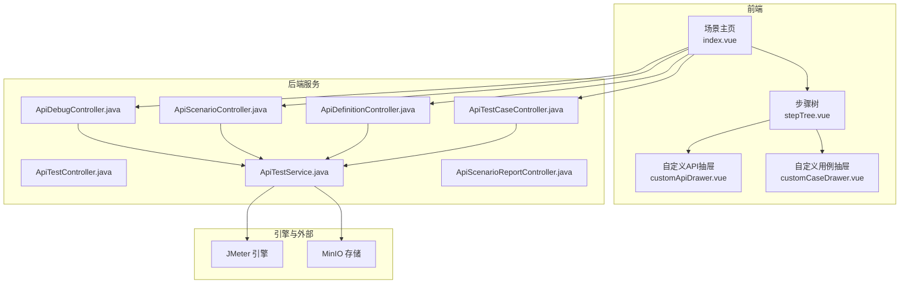
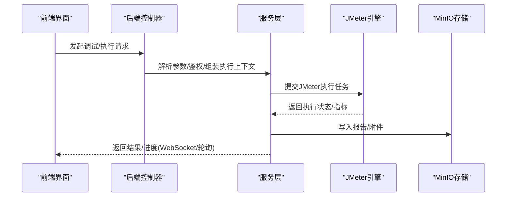
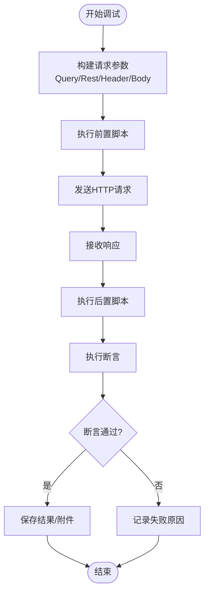
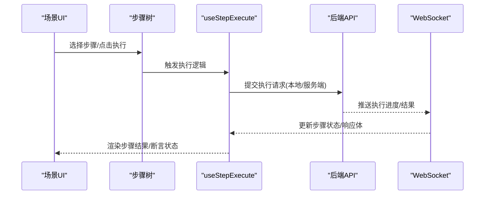
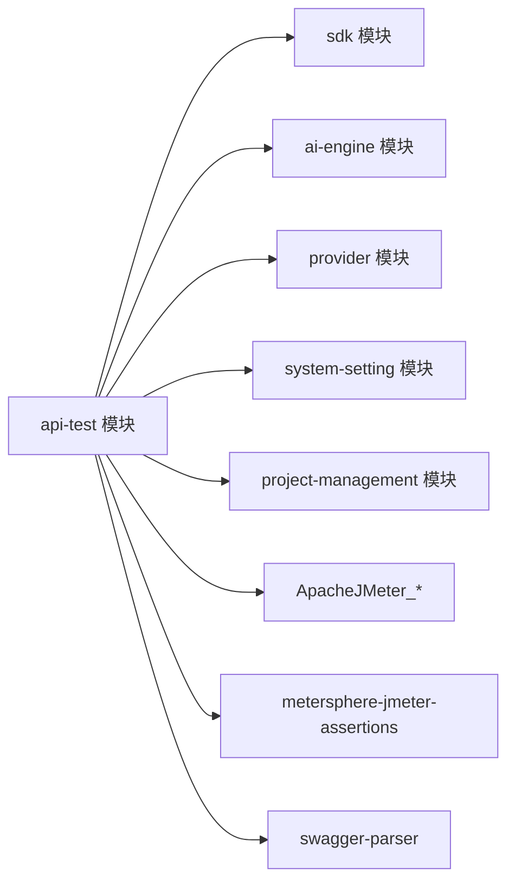

# 接口测试

<cite>
**本文引用的文件**   
- [README.md](file://README.md)
- [pom.xml（根）](file://pom.xml)
- [api-test/pom.xml](file://backend/services/api-test/pom.xml)
- [ApiTestController.java](file://backend/services/api-test/src/main/java/io/metersphere/api/controller/ApiTestController.java)
- [ApiTestService.java](file://backend/services/api-test/src/main/java/io/metersphere/api/service/ApiTestService.java)
- [ApiDefinitionController.java](file://backend/services/api-test/src/main/java/io/metersphere/api/controller/definition/ApiDefinitionController.java)
- [ApiTestCaseController.java](file://backend/services/api-test/src/main/java/io/metersphere/api/controller/definition/ApiTestCaseController.java)
- [ApiDebugController.java](file://backend/services/api-test/src/main/java/io/metersphere/api/controller/debug/ApiDebugController.java)
- [ApiScenarioController.java](file://backend/services/api-test/src/main/java/io/metersphere/api/controller/scenario/ApiScenarioController.java)
- [ApiScenarioReportController.java](file://backend/services/api-test/src/main/java/io/metersphere/api/controller/scenario/ApiScenarioReportController.java)
- [index.vue（场景主页）](file://frontend/src/views/api-test/scenario/index.vue)
- [stepTree.vue（步骤树）](file://frontend/src/views/api-test/scenario/components/step/stepTree.vue)
- [useStepExecute.ts（步骤执行逻辑）](file://frontend/src/views/api-test/scenario/components/step/useStepExecute.ts)
- [customApiDrawer.vue（自定义API抽屉）](file://frontend/src/views/api-test/scenario/components/common/customApiDrawer.vue)
- [customCaseDrawer.vue（自定义用例抽屉）](file://frontend/src/views/api-test/scenario/components/common/customCaseDrawer.vue)
</cite>

## 目录
1. [简介](#简介)
2. [项目结构](#项目结构)
3. [核心组件](#核心组件)
4. [架构总览](#架构总览)
5. [详细组件分析](#详细组件分析)
6. [依赖关系分析](#依赖关系分析)
7. [性能与优化](#性能与优化)
8. [故障排查指南](#故障排查指南)
9. [结论](#结论)
10. [附录：使用示例](#附录使用示例)

## 简介
本章节面向MeterSphere的接口测试模块，覆盖接口定义管理、调试与测试、场景编排与执行、批量执行与报告生成等能力。同时说明数据结构、请求响应处理、断言机制、Mock功能与自动化流程，并给出与JMeter引擎的集成方式与性能优化策略。

## 项目结构
后端采用Spring Boot多模块组织，接口测试能力集中在 services/api-test 模块；前端位于 frontend/src/views/api-test，包含调试、定义、场景与报告等页面与组件。

图表来源
- [ApiTestController.java:35-167](file://backend/services/api-test/src/main/java/io/metersphere/api/controller/ApiTestController.java#L35-L167)
- [ApiTestService.java:51-193](file://backend/services/api-test/src/main/java/io/metersphere/api/service/ApiTestService.java#L51-L193)
- [index.vue:117-137](file://frontend/src/views/api-test/scenario/index.vue#L117-L137)
- [stepTree.vue:240-274](file://frontend/src/views/api-test/scenario/components/step/stepTree.vue#L240-L274)

章节来源
- [README.md:16-22](file://README.md#L16-L22)
- [pom.xml（根）:20-44](file://pom.xml#L20-L44)
- [api-test/pom.xml:15-109](file://backend/services/api-test/pom.xml#L15-L109)

## 核心组件
- 接口定义管理：提供接口定义、模块、定时任务、分享与报告等能力。
- 调试与测试：支持HTTP/REST参数编辑、前置/后置脚本、断言、Mock数据生成与下载附件。
- 场景编排与执行：可视化编排步骤，支持本地/服务端执行、WebSocket实时结果、批量执行。
- 批量执行与报告：批量运行场景/用例，生成并持久化报告，支持分享与下载。
- 环境与资源：环境配置、资源池选择、公共脚本与插件协议扩展。

章节来源
- [ApiDefinitionController.java](file://backend/services/api-test/src/main/java/io/metersphere/api/controller/definition/ApiDefinitionController.java)
- [ApiTestCaseController.java](file://backend/services/api-test/src/main/java/io/metersphere/api/controller/definition/ApiTestCaseController.java)
- [ApiDebugController.java](file://backend/services/api-test/src/main/java/io/metersphere/api/controller/debug/ApiDebugController.java)
- [ApiScenarioController.java](file://backend/services/api-test/src/main/java/io/metersphere/api/controller/scenario/ApiScenarioController.java)
- [ApiScenarioReportController.java](file://backend/services/api-test/src/main/java/io/metersphere/api/controller/scenario/ApiScenarioReportController.java)

## 架构总览
接口测试整体由“前端交互层 + 后端控制器/服务层 + JMeter引擎 + 存储与中间件”构成。前端负责UI与交互，后端通过控制器暴露REST API，服务层协调环境、插件、资源池与JMeter执行，结果与附件落盘至MinIO，并通过WebSocket或轮询将进度与结果推送给前端。

图表来源
- [ApiTestController.java:35-167](file://backend/services/api-test/src/main/java/io/metersphere/api/controller/ApiTestController.java#L35-L167)
- [ApiTestService.java:51-193](file://backend/services/api-test/src/main/java/io/metersphere/api/service/ApiTestService.java#L51-L193)

## 详细组件分析

### 接口定义管理
- 职责：接口CRUD、模块管理、定时任务、文档分享、报告查看。
- 关键点：
  - 协议插件扩展：通过插件体系动态加载协议脚本与表单选项。
  - 环境隔离：按项目维度读取环境配置与数据源。
  - 权限控制：基于角色的访问控制与项目级资源校验。

章节来源
- [ApiDefinitionController.java](file://backend/services/api-test/src/main/java/io/metersphere/api/controller/definition/ApiDefinitionController.java)
- [ApiTestCaseController.java](file://backend/services/api-test/src/main/java/io/metersphere/api/controller/definition/ApiTestCaseController.java)

### 调试与测试
- 职责：单接口调试、参数编辑（Query/Rest/Form/Headers）、前置/后置脚本、断言、Mock、附件下载。
- 关键点：
  - Mock数据：提供Mock计算接口，便于快速构造响应。
  - 脚本执行：支持公共脚本与自定义函数执行。
  - 环境参数：从环境配置中注入变量与数据源。

图表来源
- [ApiDebugController.java](file://backend/services/api-test/src/main/java/io/metersphere/api/controller/debug/ApiDebugController.java)
- [ApiTestController.java:52-66](file://backend/services/api-test/src/main/java/io/metersphere/api/controller/ApiTestController.java#L52-L66)
- [ApiTestController.java:140-154](file://backend/services/api-test/src/main/java/io/metersphere/api/controller/ApiTestController.java#L140-L154)

章节来源
- [ApiDebugController.java](file://backend/services/api-test/src/main/java/io/metersphere/api/controller/debug/ApiDebugController.java)
- [ApiTestController.java:52-66](file://backend/services/api-test/src/main/java/io/metersphere/api/controller/ApiTestController.java#L52-L66)
- [ApiTestController.java:140-154](file://backend/services/api-test/src/main/java/io/metersphere/api/controller/ApiTestController.java#L140-L154)

### 场景编排与执行
- 职责：可视化编排多个步骤（调用接口、脚本、条件分支等），支持本地与服务端执行，实时展示步骤结果。
- 关键点：
  - 步骤树与详情：左侧步骤树，右侧步骤详情编辑器。
  - 执行模式：优先本地执行或服务端执行，支持停止调试。
  - WebSocket：实时推送步骤执行状态与结果。

图表来源
- [index.vue:117-137](file://frontend/src/views/api-test/scenario/index.vue#L117-L137)
- [stepTree.vue:240-274](file://frontend/src/views/api-test/scenario/components/step/stepTree.vue#L240-L274)
- [useStepExecute.ts:1-41](file://frontend/src/views/api-test/scenario/components/step/useStepExecute.ts#L1-L41)

章节来源
- [index.vue:117-137](file://frontend/src/views/api-test/scenario/index.vue#L117-L137)
- [stepTree.vue:240-274](file://frontend/src/views/api-test/scenario/components/step/stepTree.vue#L240-L274)
- [useStepExecute.ts:1-41](file://frontend/src/views/api-test/scenario/components/step/useStepExecute.ts#L1-L41)

### 批量执行与报告生成
- 职责：批量运行场景/用例，统一调度执行，聚合结果并生成报告，支持分享与下载。
- 关键点：
  - 批量入口：场景/用例列表页提供批量执行按钮。
  - 报告中心：集中查看历史报告、统计指标与明细。
  - 附件下载：安全校验后从MinIO下载执行产物。

章节来源
- [ApiScenarioController.java](file://backend/services/api-test/src/main/java/io/metersphere/api/controller/scenario/ApiScenarioController.java)
- [ApiScenarioReportController.java](file://backend/services/api-test/src/main/java/io/metersphere/api/controller/scenario/ApiScenarioReportController.java)
- [ApiTestController.java:140-154](file://backend/services/api-test/src/main/java/io/metersphere/api/controller/ApiTestController.java#L140-L154)

### 数据结构与处理要点
- 接口定义/用例：包含基本信息、请求模板、断言规则、关联文件与环境引用。
- 场景步骤：步骤类型（接口/脚本/条件等）、入参、前后置处理器、断言、子步骤。
- 请求/响应：支持Query/Rest/Form/Headers/Body，响应体解析与断言匹配。
- 环境变量：项目级环境配置，含HTTP配置、公共变量、数据源、全局前后置处理器。
- 资源池：为执行分配计算资源，支持默认资源池配置。

章节来源
- [ApiTestService.java:115-149](file://backend/services/api-test/src/main/java/io/metersphere/api/service/ApiTestService.java#L115-L149)

### Mock功能
- 能力：根据表达式或模板生成Mock数据，用于调试与占位。
- 集成点：通过Mock接口计算并返回数据，便于在调试与场景中直接引用。

章节来源
- [ApiTestController.java:52-59](file://backend/services/api-test/src/main/java/io/metersphere/api/controller/ApiTestController.java#L52-L59)

### 断言机制
- 能力：内置JSONPath/正则/字段对比等断言能力，结合JMeter断言插件实现高性能断言。
- 集成点：通过自定义JMeter断言插件扩展断言规则，提升可观测性与稳定性。

章节来源
- [api-test/pom.xml:75-86](file://backend/services/api-test/pom.xml#L75-L86)

## 依赖关系分析
- 后端模块依赖：
  - api-test 依赖 sdk、ai-engine、provider、system-setting、project-management。
  - 引入JMeter核心组件与自定义断言插件。
  - 引入Swagger解析器用于OpenAPI导入。
- 前端依赖：
  - 场景页与步骤组件通过API模块与后端交互，WebSocket用于实时反馈。

图表来源
- [api-test/pom.xml:15-109](file://backend/services/api-test/pom.xml#L15-L109)

章节来源
- [api-test/pom.xml:15-109](file://backend/services/api-test/pom.xml#L15-L109)

## 性能与优化
- 执行引擎
  - 使用JMeter作为底层执行引擎，利用其成熟的并发模型与采样器生态。
  - 通过自定义断言插件减少序列化与解析开销，提高断言吞吐。
- 资源调度
  - 支持资源池配置与默认资源池，避免热点节点过载。
  - 批量执行时建议分片并行，结合队列与限流控制。
- I/O与存储
  - 报告与附件落盘MinIO，避免阻塞主线程；下载接口进行路径校验与权限控制。
- 前端体验
  - 步骤执行采用WebSocket实时推送，降低轮询开销。
  - 大响应体分页/懒加载，减少首屏压力。

[本节为通用指导，不直接分析具体文件]

## 故障排查指南
- Mock数据为空
  - 检查Mock表达式是否正确，确认传入键值有效。
  - 参考Mock接口行为与日志定位问题。
- 附件下载失败
  - 校验下载路径是否属于当前项目，确保权限正确。
  - 检查MinIO连接与对象是否存在。
- 执行超时/失败
  - 检查目标服务连通性、证书与代理配置。
  - 查看JMeter执行日志与断言失败详情。
- 环境配置异常
  - 确认环境ID与项目关联正确，敏感信息已脱敏。
  - 核对数据源与公共变量是否生效。

章节来源
- [ApiTestController.java:52-59](file://backend/services/api-test/src/main/java/io/metersphere/api/controller/ApiTestController.java#L52-L59)
- [ApiTestController.java:140-154](file://backend/services/api-test/src/main/java/io/metersphere/api/controller/ApiTestController.java#L140-L154)
- [ApiTestService.java:119-129](file://backend/services/api-test/src/main/java/io/metersphere/api/service/ApiTestService.java#L119-L129)

## 结论
MeterSphere接口测试模块以“易用+灵活”为核心，前端提供直观的调试与编排体验，后端通过控制器与服务层协调环境、插件与JMeter引擎，形成端到端的接口测试闭环。借助Mock、断言、资源池与MinIO存储，满足从开发调试到持续集成的全链路需求。

[本节为总结性内容，不直接分析具体文件]

## 附录：使用示例
以下示例仅描述操作步骤与关键配置项，不包含代码片段。

- 创建接口
  - 在“接口定义”中新建接口，填写名称、路径、方法与协议。
  - 在“请求参数”中配置Query/Rest/Header/Body，必要时添加前置脚本。
  - 在“断言”中添加期望条件（如状态码、JSON字段、耗时阈值）。
  - 保存并切换到“调试”页签进行验证。

- 编写测试脚本
  - 在“公共脚本”中维护可复用的脚本（如签名、加密、数据准备）。
  - 在接口或场景步骤中引用公共脚本，传入必要参数。
  - 使用环境变量替换敏感信息（如域名、密钥）。

- 设置环境变量
  - 在项目“环境管理”中创建环境，配置HTTP基础信息与公共变量。
  - 在接口/场景中选择对应环境，确保变量生效。
  - 如需数据库操作，配置数据源并在脚本中引用。

- 执行测试
  - 单接口：在调试页点击“执行”，查看响应与断言结果。
  - 场景：在“场景”页编排步骤，选择“本地执行”或“服务端执行”。
  - 批量：在场景/用例列表勾选多条，点击“批量执行”，在任务中心查看进度。
  - 报告：在“报告”中心查看汇总与明细，支持分享与下载附件。

章节来源
- [ApiDefinitionController.java](file://backend/services/api-test/src/main/java/io/metersphere/api/controller/definition/ApiDefinitionController.java)
- [ApiDebugController.java](file://backend/services/api-test/src/main/java/io/metersphere/api/controller/debug/ApiDebugController.java)
- [ApiScenarioController.java](file://backend/services/api-test/src/main/java/io/metersphere/api/controller/scenario/ApiScenarioController.java)
- [ApiScenarioReportController.java](file://backend/services/api-test/src/main/java/io/metersphere/api/controller/scenario/ApiScenarioReportController.java)