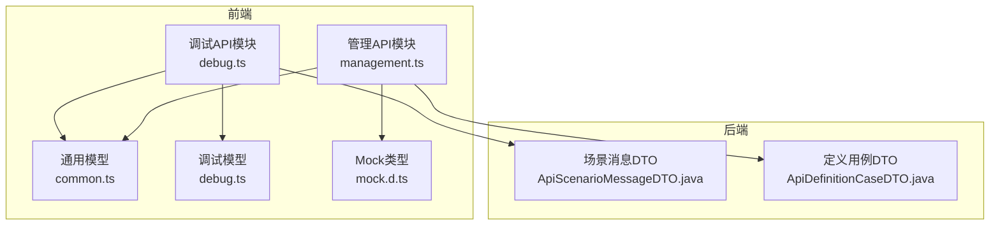
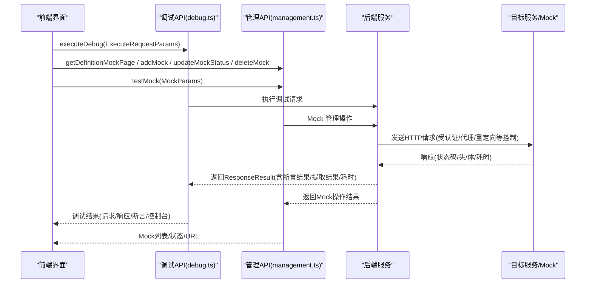
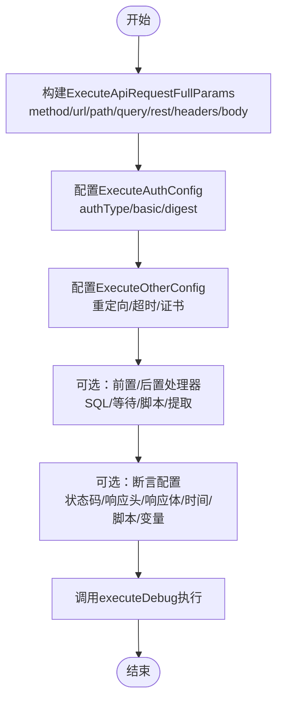
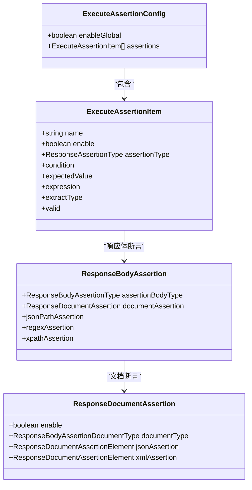
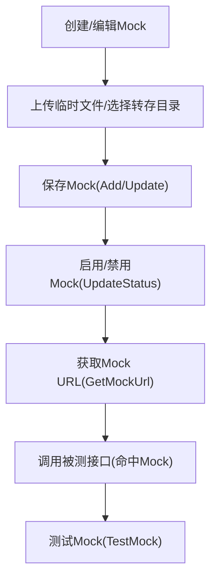
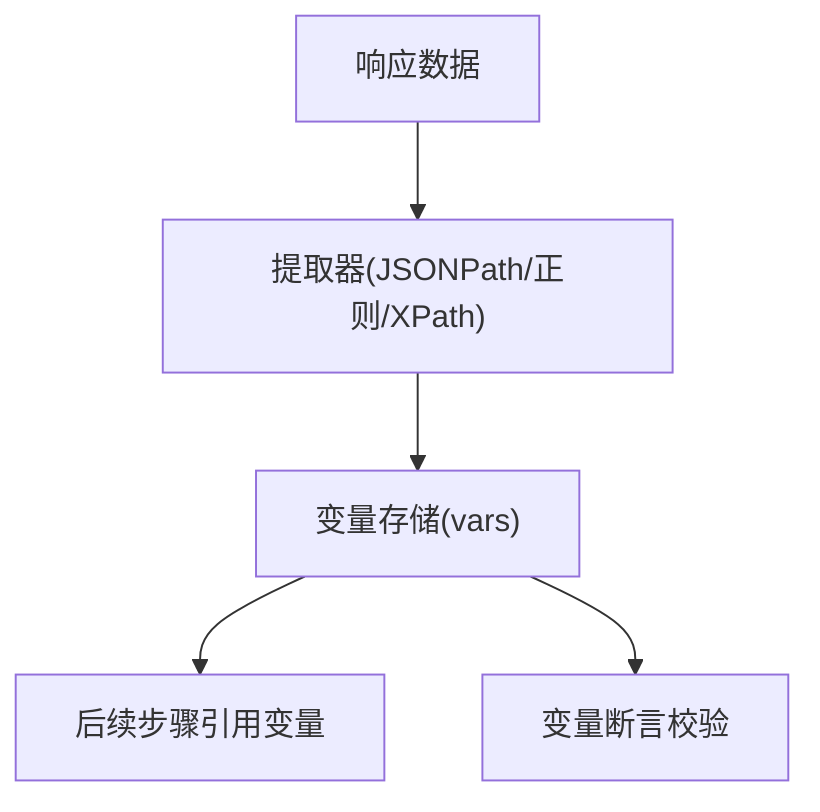
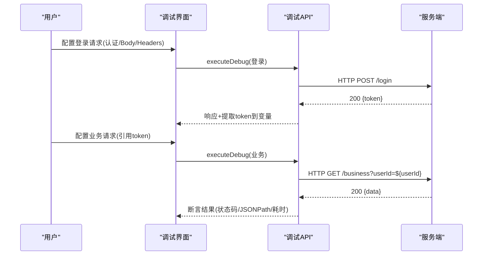
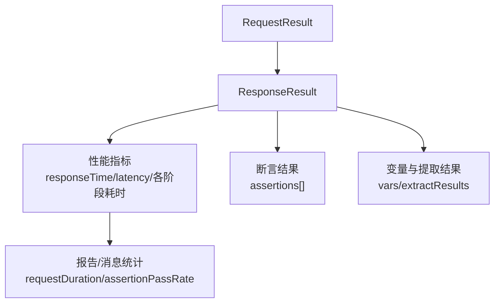
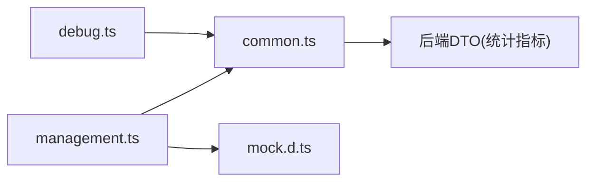

# 接口调试测试

<cite>
**本文引用的文件**   
- [frontend/src/api/modules/api-test/debug.ts](file://frontend/src/api/modules/api-test/debug.ts)
- [frontend/src/api/modules/api-test/management.ts](file://frontend/src/api/modules/api-test/management.ts)
- [frontend/src/models/apiTest/common.ts](file://frontend/src/models/apiTest/common.ts)
- [frontend/src/models/apiTest/debug.ts](file://frontend/src/models/apiTest/debug.ts)
- [frontend/types/mock.d.ts](file://frontend/types/mock.d.ts)
- [backend/services/system-setting/src/main/java/io/metersphere/system/dto/sdk/ApiScenarioMessageDTO.java](file://backend/services/system-setting/src/main/java/io/metersphere/system/dto/sdk/ApiScenarioMessageDTO.java)
- [backend/services/system-setting/src/main/java/io/metersphere/system/dto/sdk/ApiDefinitionCaseDTO.java](file://backend/services/system-setting/src/main/java/io/metersphere/system/dto/sdk/ApiDefinitionCaseDTO.java)
</cite>

## 目录
1. [简介](#简介)
2. [项目结构](#项目结构)
3. [核心组件](#核心组件)
4. [架构总览](#架构总览)
5. [详细组件分析](#详细组件分析)
6. [依赖关系分析](#依赖关系分析)
7. [性能考量](#性能考量)
8. [故障排查指南](#故障排查指南)
9. [结论](#结论)
10. [附录](#附录)

## 简介
本章节面向接口调试与测试功能，系统性说明以下能力：
- 接口调试器的使用方法：请求参数设置、请求头配置、认证方式设置
- 断言功能的实现：状态码断言、响应数据断言（JSONPath/正则/XPath/文档）、性能断言等
- Mock 功能：静态 Mock 与动态 Mock 的配置和使用
- 环境变量与全局变量的使用方式
- 实际调试案例：复杂接口调用场景的调试步骤
- 调试结果的查看与分析方法

## 项目结构
围绕“接口调试测试”相关的前后端关键位置如下：
- 前端 API 模块
  - 调试相关接口封装：[frontend/src/api/modules/api-test/debug.ts](file://frontend/src/api/modules/api-test/debug.ts)
  - 定义与用例管理、Mock 管理接口封装：[frontend/src/api/modules/api-test/management.ts](file://frontend/src/api/modules/api-test/management.ts)
- 前端类型模型
  - 执行请求、断言、提取、前后置处理器等通用模型：[frontend/src/models/apiTest/common.ts](file://frontend/src/models/apiTest/common.ts)
  - 调试保存/更新/详情模型：[frontend/src/models/apiTest/debug.ts](file://frontend/src/models/apiTest/debug.ts)
  - Mock 入参类型：[frontend/types/mock.d.ts](file://frontend/types/mock.d.ts)
- 后端统计 DTO（用于报告/消息中的断言与请求指标）
  - 场景消息统计字段：[backend/services/system-setting/src/main/java/io/metersphere/system/dto/sdk/ApiScenarioMessageDTO.java](file://backend/services/system-setting/src/main/java/io/metersphere/system/dto/sdk/ApiScenarioMessageDTO.java)
  - 定义用例统计字段：[backend/services/system-setting/src/main/java/io/metersphere/system/dto/sdk/ApiDefinitionCaseDTO.java](file://backend/services/system-setting/src/main/java/io/metersphere/system/dto/sdk/ApiDefinitionCaseDTO.java)

**图表来源** 
- [frontend/src/api/modules/api-test/debug.ts:1-110](file://frontend/src/api/modules/api-test/debug.ts#L1-L110)
- [frontend/src/api/modules/api-test/management.ts:393-459](file://frontend/src/api/modules/api-test/management.ts#L393-L459)
- [frontend/src/models/apiTest/common.ts:346-417](file://frontend/src/models/apiTest/common.ts#L346-L417)
- [frontend/src/models/apiTest/debug.ts:1-62](file://frontend/src/models/apiTest/debug.ts#L1-L62)
- [frontend/types/mock.d.ts:1-5](file://frontend/types/mock.d.ts#L1-L5)
- [backend/services/system-setting/src/main/java/io/metersphere/system/dto/sdk/ApiScenarioMessageDTO.java:85-113](file://backend/services/system-setting/src/main/java/io/metersphere/system/dto/sdk/ApiScenarioMessageDTO.java#L85-L113)
- [backend/services/system-setting/src/main/java/io/metersphere/system/dto/sdk/ApiDefinitionCaseDTO.java:97-145](file://backend/services/system-setting/src/main/java/io/metersphere/system/dto/sdk/ApiDefinitionCaseDTO.java#L97-L145)

**章节来源**
- [frontend/src/api/modules/api-test/debug.ts:1-110](file://frontend/src/api/modules/api-test/debug.ts#L1-L110)
- [frontend/src/api/modules/api-test/management.ts:393-459](file://frontend/src/api/modules/api-test/management.ts#L393-L459)
- [frontend/src/models/apiTest/common.ts:346-417](file://frontend/src/models/apiTest/common.ts#L346-L417)
- [frontend/src/models/apiTest/debug.ts:1-62](file://frontend/src/models/apiTest/debug.ts#L1-L62)
- [frontend/types/mock.d.ts:1-5](file://frontend/types/mock.d.ts#L1-L5)
- [backend/services/system-setting/src/main/java/io/metersphere/system/dto/sdk/ApiScenarioMessageDTO.java:85-113](file://backend/services/system-setting/src/main/java/io/metersphere/system/dto/sdk/ApiScenarioMessageDTO.java#L85-L113)
- [backend/services/system-setting/src/main/java/io/metersphere/system/dto/sdk/ApiDefinitionCaseDTO.java:97-145](file://backend/services/system-setting/src/main/java/io/metersphere/system/dto/sdk/ApiDefinitionCaseDTO.java#L97-L145)

## 核心组件
- 调试执行入口
  - 执行调试：executeDebug，接收 ExecuteRequestParams，返回调试结果
  - 新增/更新/删除调试项，获取调试详情
- 定义/用例调试
  - debugDefinition、debugCase：以 ExecuteRequestParams 驱动执行
- Mock 管理
  - 列表、启用/禁用、删除、上传临时文件、转存、批量编辑/删除、复制、添加、获取 URL
  - 测试 Mock：testMock
- 通用模型
  - ExecuteRequestParams：环境、项目、请求体、认证、前置/后置处理器、断言、文件关联等
  - ExecuteApiRequestFullParams：HTTP 请求全量参数（URL、方法、查询、路径、请求头、Body、其他配置等）
  - 断言模型：状态码、响应头、响应体（JSONPath/正则/XPath/文档）、脚本、变量、时间等
  - 提取器：正则/JSONPath/XPath 提取表达式
  - 前后置处理器：SQL、等待、脚本、提取等

**章节来源**
- [frontend/src/api/modules/api-test/debug.ts:61-94](file://frontend/src/api/modules/api-test/debug.ts#L61-L94)
- [frontend/src/api/modules/api-test/management.ts:343-346](file://frontend/src/api/modules/api-test/management.ts#L343-L346)
- [frontend/src/api/modules/api-test/management.ts:393-459](file://frontend/src/api/modules/api-test/management.ts#L393-L459)
- [frontend/src/models/apiTest/common.ts:346-417](file://frontend/src/models/apiTest/common.ts#L346-L417)
- [frontend/src/models/apiTest/common.ts:212-312](file://frontend/src/models/apiTest/common.ts#L212-L312)
- [frontend/src/models/apiTest/common.ts:254-281](file://frontend/src/models/apiTest/common.ts#L254-L281)

## 架构总览
下图展示从前端到后端的调试与 Mock 流程。前端通过调试与管理 API 发起请求；后端根据环境、认证、前置/后置处理器、断言规则执行并返回结果；Mock 可拦截或模拟目标服务。

**图表来源** 
- [frontend/src/api/modules/api-test/debug.ts:61-94](file://frontend/src/api/modules/api-test/debug.ts#L61-L94)
- [frontend/src/api/modules/api-test/management.ts:393-459](file://frontend/src/api/modules/api-test/management.ts#L393-L459)
- [frontend/src/models/apiTest/common.ts:346-417](file://frontend/src/models/apiTest/common.ts#L346-L417)

## 详细组件分析

### 接口调试器使用方法
- 请求参数设置
  - 支持 query、rest、path、headers、body（raw/json/xml/form-data/binary）
  - 通过 ExecuteApiRequestFullParams 组织请求全量参数
- 请求头配置
  - headers 为键值对集合，支持编码、是否必填、描述等元信息
- 认证方式设置
  - 通过 ExecuteAuthConfig 配置 authType、basicAuth、digestAuth
- 其他网络配置
  - 自动重定向、跟随重定向、连接/响应超时、证书别名等

**图表来源** 
- [frontend/src/models/apiTest/common.ts:320-359](file://frontend/src/models/apiTest/common.ts#L320-L359)
- [frontend/src/models/apiTest/common.ts:212-312](file://frontend/src/models/apiTest/common.ts#L212-L312)
- [frontend/src/api/modules/api-test/debug.ts:61-69](file://frontend/src/api/modules/api-test/debug.ts#L61-L69)

**章节来源**
- [frontend/src/models/apiTest/common.ts:320-359](file://frontend/src/models/apiTest/common.ts#L320-L359)
- [frontend/src/models/apiTest/common.ts:212-312](file://frontend/src/models/apiTest/common.ts#L212-L312)
- [frontend/src/api/modules/api-test/debug.ts:61-69](file://frontend/src/api/modules/api-test/debug.ts#L61-L69)

### 断言功能实现
- 断言类型
  - 状态码断言：ResponseCodeAssertion
  - 响应头断言：ResponseHeaderAssertionItem
  - 响应体断言：ResponseBodyAssertion（包含 JSONPath/正则/XPath/文档断言）
  - 响应时间断言：ResponseTimeAssertion
  - 脚本断言：ResponseScriptAssertion
  - 变量断言：ResponseVariableAssertion
- 断言配置
  - ExecuteAssertionConfig 聚合 assertions 列表，支持全局开关
- 断言结果
  - ResponseResult.assertions 提供每条断言的实际值、期望值、条件、消息、是否通过等

**图表来源** 
- [frontend/src/models/apiTest/common.ts:212-312](file://frontend/src/models/apiTest/common.ts#L212-L312)
- [frontend/src/models/apiTest/common.ts:379-417](file://frontend/src/models/apiTest/common.ts#L379-L417)

**章节来源**
- [frontend/src/models/apiTest/common.ts:212-312](file://frontend/src/models/apiTest/common.ts#L212-L312)
- [frontend/src/models/apiTest/common.ts:379-417](file://frontend/src/models/apiTest/common.ts#L379-L417)

### Mock 功能配置与使用
- Mock 管理
  - 列表分页、启用/禁用、删除、批量编辑/删除、复制、添加、获取 Mock URL
  - 上传临时文件、转存文件、转存目录选项
- 测试 Mock
  - testMock 传入字符串（如 URL），用于快速验证 Mock 是否生效
- Mock 入参类型
  - MockParams：url、type、body

**图表来源** 
- [frontend/src/api/modules/api-test/management.ts:393-459](file://frontend/src/api/modules/api-test/management.ts#L393-L459)
- [frontend/types/mock.d.ts:1-5](file://frontend/types/mock.d.ts#L1-L5)

**章节来源**
- [frontend/src/api/modules/api-test/management.ts:393-459](file://frontend/src/api/modules/api-test/management.ts#L393-L459)
- [frontend/types/mock.d.ts:1-5](file://frontend/types/mock.d.ts#L1-L5)

### 环境变量与全局变量
- 执行请求参数中包含 environmentId，表示当前调试使用的运行环境
- 提取器支持将响应内容提取为变量，供后续步骤复用
- 变量断言可对已设置的变量进行校验
- 变量类型与匹配规则由模型字段表达（见 ExtractProcessor、ExpressionCommonConfig）

**图表来源** 
- [frontend/src/models/apiTest/common.ts:254-281](file://frontend/src/models/apiTest/common.ts#L254-L281)
- [frontend/src/models/apiTest/common.ts:368-378](file://frontend/src/models/apiTest/common.ts#L368-L378)
- [frontend/src/models/apiTest/common.ts:390-417](file://frontend/src/models/apiTest/common.ts#L390-L417)

**章节来源**
- [frontend/src/models/apiTest/common.ts:254-281](file://frontend/src/models/apiTest/common.ts#L254-L281)
- [frontend/src/models/apiTest/common.ts:368-378](file://frontend/src/models/apiTest/common.ts#L368-L378)
- [frontend/src/models/apiTest/common.ts:390-417](file://frontend/src/models/apiTest/common.ts#L390-L417)

### 实际调试案例（复杂接口调用）
- 场景概述
  - 登录获取 Token -> 携带 Token 调用业务接口 -> 对响应数据进行 JSONPath 断言 -> 提取用户ID作为变量 -> 再次调用下游接口
- 步骤要点
  - 第一步：配置认证（Basic/Digest 或自定义 Header），设置请求体（JSON/Form），添加前置脚本（如需）
  - 第二步：在响应中提取 Token（JSONPath/正则），保存到变量
  - 第三步：在后续请求中引用变量，构造 Authorization 头
  - 第四步：添加断言（状态码=200、JSONPath 校验关键字段、响应时间阈值）
  - 第五步：查看调试结果（请求/响应/断言/控制台/耗时）

**图表来源** 
- [frontend/src/api/modules/api-test/debug.ts:61-69](file://frontend/src/api/modules/api-test/debug.ts#L61-L69)
- [frontend/src/models/apiTest/common.ts:346-417](file://frontend/src/models/apiTest/common.ts#L346-L417)

**章节来源**
- [frontend/src/api/modules/api-test/debug.ts:61-69](file://frontend/src/api/modules/api-test/debug.ts#L61-L69)
- [frontend/src/models/apiTest/common.ts:346-417](file://frontend/src/models/apiTest/common.ts#L346-L417)

### 调试结果的查看与分析
- 请求与响应
  - RequestResult 包含 url/method/headers/body/responseResult/isSuccessful/console/status/fakeErrorCode 等
- 响应详情
  - ResponseResult 包含 responseCode/contentType/body/headers/responseSize/responseTime/各阶段耗时/vars/extractResults/assertions/imageUrl 等
- 断言结果
  - ResponseResult.assertions 提供每条断言的名称、类型、条件、期望值、实际值、消息、是否通过
- 性能指标
  - 后端 DTO 暴露 requestDuration、requestErrorRate、assertionPassRate 等指标，便于报告汇总

**图表来源** 
- [frontend/src/models/apiTest/common.ts:397-417](file://frontend/src/models/apiTest/common.ts#L397-L417)
- [backend/services/system-setting/src/main/java/io/metersphere/system/dto/sdk/ApiDefinitionCaseDTO.java:97-145](file://backend/services/system-setting/src/main/java/io/metersphere/system/dto/sdk/ApiDefinitionCaseDTO.java#L97-L145)
- [backend/services/system-setting/src/main/java/io/metersphere/system/dto/sdk/ApiScenarioMessageDTO.java:85-113](file://backend/services/system-setting/src/main/java/io/metersphere/system/dto/sdk/ApiScenarioMessageDTO.java#L85-L113)

**章节来源**
- [frontend/src/models/apiTest/common.ts:397-417](file://frontend/src/models/apiTest/common.ts#L397-L417)
- [backend/services/system-setting/src/main/java/io/metersphere/system/dto/sdk/ApiDefinitionCaseDTO.java:97-145](file://backend/services/system-setting/src/main/java/io/metersphere/system/dto/sdk/ApiDefinitionCaseDTO.java#L97-L145)
- [backend/services/system-setting/src/main/java/io/metersphere/system/dto/sdk/ApiScenarioMessageDTO.java:85-113](file://backend/services/system-setting/src/main/java/io/metersphere/system/dto/sdk/ApiScenarioMessageDTO.java#L85-L113)

## 依赖关系分析
- 前端模块耦合
  - debug.ts 依赖 common.ts 的 ExecuteRequestParams、ExecuteApiRequestFullParams、断言与提取模型
  - management.ts 依赖 common.ts 的 ExecuteRequestParams 以及 mock.d.ts 的 MockParams
- 后端 DTO 与前端报告的映射
  - ApiDefinitionCaseDTO 与 ApiScenarioMessageDTO 提供请求时长、错误率、断言通过率等指标，支撑报告与消息展示

**图表来源** 
- [frontend/src/api/modules/api-test/debug.ts:1-110](file://frontend/src/api/modules/api-test/debug.ts#L1-L110)
- [frontend/src/api/modules/api-test/management.ts:393-459](file://frontend/src/api/modules/api-test/management.ts#L393-L459)
- [frontend/src/models/apiTest/common.ts:346-417](file://frontend/src/models/apiTest/common.ts#L346-L417)
- [frontend/types/mock.d.ts:1-5](file://frontend/types/mock.d.ts#L1-L5)
- [backend/services/system-setting/src/main/java/io/metersphere/system/dto/sdk/ApiDefinitionCaseDTO.java:97-145](file://backend/services/system-setting/src/main/java/io/metersphere/system/dto/sdk/ApiDefinitionCaseDTO.java#L97-L145)
- [backend/services/system-setting/src/main/java/io/metersphere/system/dto/sdk/ApiScenarioMessageDTO.java:85-113](file://backend/services/system-setting/src/main/java/io/metersphere/system/dto/sdk/ApiScenarioMessageDTO.java#L85-L113)

**章节来源**
- [frontend/src/api/modules/api-test/debug.ts:1-110](file://frontend/src/api/modules/api-test/debug.ts#L1-L110)
- [frontend/src/api/modules/api-test/management.ts:393-459](file://frontend/src/api/modules/api-test/management.ts#L393-L459)
- [frontend/src/models/apiTest/common.ts:346-417](file://frontend/src/models/apiTest/common.ts#L346-L417)
- [frontend/types/mock.d.ts:1-5](file://frontend/types/mock.d.ts#L1-L5)
- [backend/services/system-setting/src/main/java/io/metersphere/system/dto/sdk/ApiDefinitionCaseDTO.java:97-145](file://backend/services/system-setting/src/main/java/io/metersphere/system/dto/sdk/ApiDefinitionCaseDTO.java#L97-L145)
- [backend/services/system-setting/src/main/java/io/metersphere/system/dto/sdk/ApiScenarioMessageDTO.java:85-113](file://backend/services/system-setting/src/main/java/io/metersphere/system/dto/sdk/ApiScenarioMessageDTO.java#L85-L113)

## 性能考量
- 合理设置连接/响应超时，避免长时间阻塞
- 谨慎使用前置/后置脚本与 SQL 处理器，减少额外开销
- 断言尽量精准，避免过度复杂的正则或 XPath 表达式
- 利用 Mock 隔离外部依赖，降低不稳定因素对性能的影响
- 关注后端统计指标（requestDuration、assertionPassRate）定位瓶颈

[本节为通用指导，不直接分析具体文件]

## 故障排查指南
- 常见问题
  - 认证失败：检查 authType、用户名/密码、Digest 算法、Token 注入是否正确
  - 重定向问题：确认 followRedirects/autoRedirects 配置是否符合预期
  - 超时：调整 connectTimeout/responseTimeout
  - 断言失败：核对 condition/expectedValue/expression，确认响应格式（JSON/XML）与解析器匹配
  - Mock 未命中：确认 Mock URL 与请求路径一致，Mock 状态为启用
- 定位手段
  - 查看 RequestResult.console 输出
  - 检查 ResponseResult.assertions 的错误消息
  - 通过 testMock 快速验证 Mock 可用性
  - 结合后端统计指标（错误率、断言通过率）定位问题范围

**章节来源**
- [frontend/src/models/apiTest/common.ts:397-417](file://frontend/src/models/apiTest/common.ts#L397-L417)
- [frontend/src/api/modules/api-test/management.ts:426-459](file://frontend/src/api/modules/api-test/management.ts#L426-L459)

## 结论
本系统提供了完整的接口调试与测试能力：
- 灵活的请求构造与认证机制
- 丰富的断言类型与可视化结果
- 完善的 Mock 管理与测试能力
- 环境变量与变量提取/断言支持
- 清晰的调试结果与性能指标

建议在实际项目中：
- 优先使用 Mock 隔离外部依赖
- 建立常用断言模板与公共脚本
- 定期复盘断言通过率与性能指标，持续优化

[本节为总结性内容，不直接分析具体文件]

## 附录
- 术语
  - 调试：针对单个接口的即时执行与结果查看
  - 断言：对响应状态码、头、体、时间等进行校验
  - Mock：模拟目标服务的响应，用于解耦与稳定测试
  - 提取：从响应中抽取数据并保存为变量供后续使用
  - 前后置处理器：在执行请求前/后进行脚本、SQL、等待等操作

[本节为概念性内容，不直接分析具体文件]