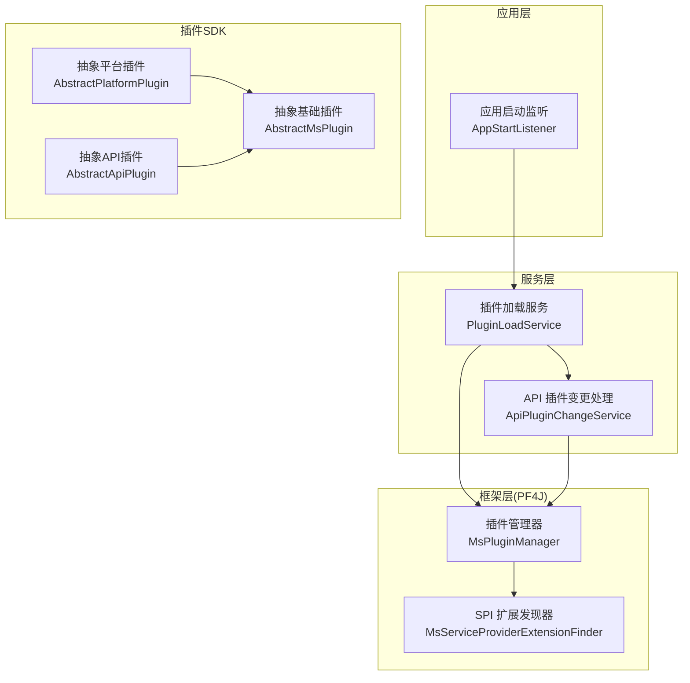
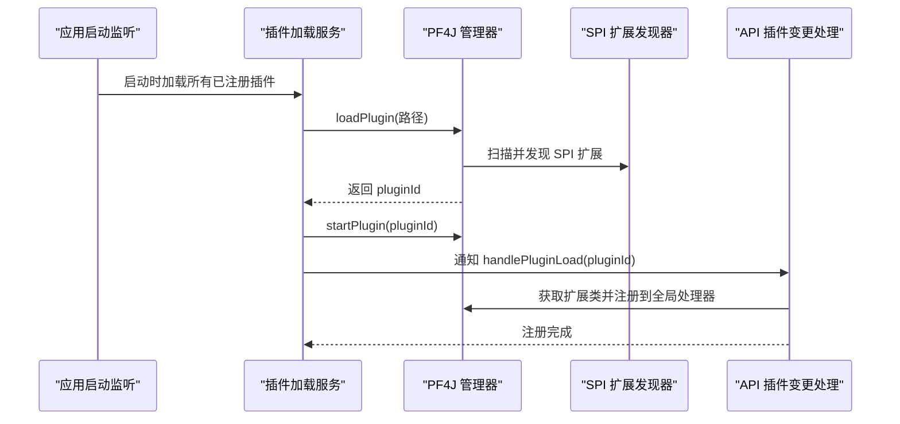
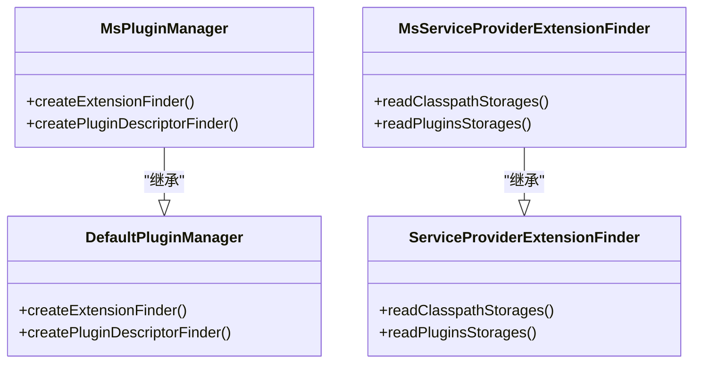
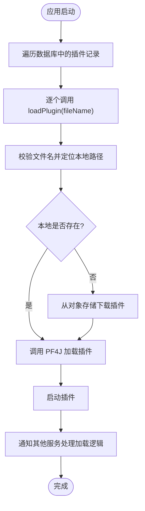
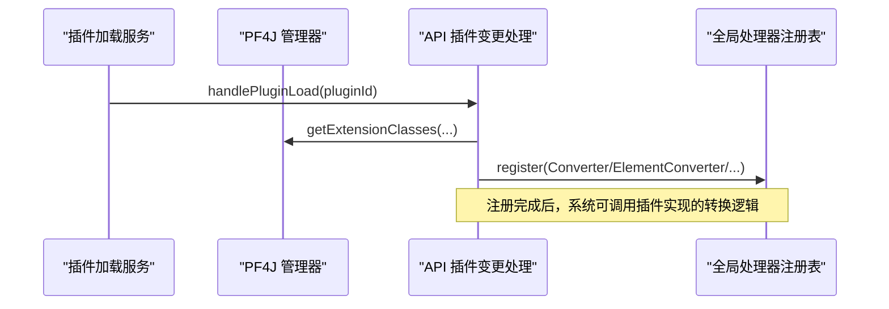
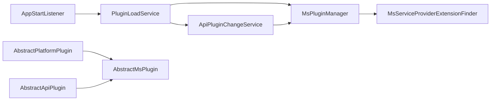

# 插件架构设计

<cite>
**本文引用的文件**   
- [MsPluginManager.java](file://backend/framework/sdk/src/main/java/io/metersphere/sdk/plugin/MsPluginManager.java)
- [MsServiceProviderExtensionFinder.java](file://backend/framework/sdk/src/main/java/io/metersphere/sdk/plugin/MsServiceProviderExtensionFinder.java)
- [PluginLoadService.java](file://backend/services/system-setting/src/main/java/io/metersphere/system/service/PluginLoadService.java)
- [ApiPluginChangeService.java](file://backend/services/api-test/src/main/java/io/metersphere/api/service/ApiPluginChangeService.java)
- [AbstractApiPlugin.java](file://backend/framework/plugin/plugin-api-sdk/src/main/java/io/metersphere/plugin/api/spi/AbstractApiPlugin.java)
- [AbstractPlatformPlugin.java](file://backend/framework/plugin/plugin-platform-sdk/src/main/java/io/metersphere/plugin/platform/spi/AbstractPlatformPlugin.java)
- [AbstractMsPlugin.java](file://backend/framework/plugin/plugin-sdk/src/main/java/io/metersphere/plugin/sdk/spi/AbstractMsPlugin.java)
- [AppStartListener.java](file://backend/app/src/main/java/io/metersphere/listener/AppStartListener.java)
</cite>

## 目录
1. [简介](#简介)
2. [项目结构](#项目结构)
3. [核心组件](#核心组件)
4. [架构总览](#架构总览)
5. [详细组件分析](#详细组件分析)
6. [依赖关系分析](#依赖关系分析)
7. [性能与扩展性考虑](#性能与扩展性考虑)
8. [故障排查指南](#故障排查指南)
9. [结论](#结论)
10. [附录：自定义插件基类与扩展点示例](#附录自定义插件基类与扩展点示例)

## 简介
本文件系统性阐述 MeterSphere 的插件架构设计，围绕 PF4J 框架集成、插件生命周期管理、SPI 接口设计与插件通信机制展开。重点说明插件加载器、类隔离机制、依赖管理与版本控制，并通过架构图展示核心组件关系，解释插件发现机制、热重载支持与沙箱安全模型。文末提供基于现有代码路径的具体实现指引，帮助开发者快速构建自定义插件基类与扩展点。

## 项目结构
后端插件相关代码主要分布在以下模块：
- framework/sdk：PF4J 管理器扩展与 SPI 发现增强
- services/system-setting：插件安装、卸载、启动与脚本资源访问
- services/api-test：API 协议插件在运行时的注册与注销
- framework/plugin/*-sdk：面向插件开发者的 SDK（SPI 抽象基类）

图表来源
- [AppStartListener.java:54-54](file://backend/app/src/main/java/io/metersphere/listener/AppStartListener.java#L54-L54)
- [PluginLoadService.java:196-206](file://backend/services/system-setting/src/main/java/io/metersphere/system/service/PluginLoadService.java#L196-L206)
- [MsPluginManager.java:10-27](file://backend/framework/sdk/src/main/java/io/metersphere/sdk/plugin/MsPluginManager.java#L10-L27)
- [MsServiceProviderExtensionFinder.java:30-41](file://backend/framework/sdk/src/main/java/io/metersphere/sdk/plugin/MsServiceProviderExtensionFinder.java#L30-L41)
- [AbstractPlatformPlugin.java:5-17](file://backend/framework/plugin/plugin-platform-sdk/src/main/java/io/metersphere/plugin/platform/spi/AbstractPlatformPlugin.java#L5-L17)
- [AbstractApiPlugin.java:15-27](file://backend/framework/plugin/plugin-api-sdk/src/main/java/io/metersphere/plugin/api/spi/AbstractApiPlugin.java#L15-L27)
- [AbstractMsPlugin.java:3-14](file://backend/framework/plugin/plugin-sdk/src/main/java/io/metersphere/plugin/sdk/spi/AbstractMsPlugin.java#L3-L14)

章节来源
- [AppStartListener.java:54-54](file://backend/app/src/main/java/io/metersphere/listener/AppStartListener.java#L54-L54)
- [PluginLoadService.java:196-206](file://backend/services/system-setting/src/main/java/io/metersphere/system/service/PluginLoadService.java#L196-L206)

## 核心组件
- MsPluginManager：继承 PF4J 默认管理器，注入自定义 SPI 扩展发现器与插件描述符查找器，支持 JDBC Driver 与 XStream Converter 等 SPI 资源的发现。
- MsServiceProviderExtensionFinder：扩展 PF4J 的 ServiceProviderExtensionFinder，针对特定 SPI 文件（如 java.sql.Driver、XStream Converter）进行更精确的资源扫描与读取。
- PluginLoadService：封装插件的安装、卸载、启动、停止、脚本资源读取、扩展类获取与实例化等能力；通过事件通知其他服务完成运行时注册/注销。
- ApiPluginChangeService：监听插件加载/卸载事件，负责将插件提供的解析器、转换器、序列化器等注册到全局处理器中，并在卸载时清理。
- AbstractMsPlugin / AbstractApiPlugin / AbstractPlatformPlugin：为插件开发者提供的抽象基类，统一脚本目录约定、平台集成元数据与 API 插件选项反射调用入口。

章节来源
- [MsPluginManager.java:10-27](file://backend/framework/sdk/src/main/java/io/metersphere/sdk/plugin/MsPluginManager.java#L10-L27)
- [MsServiceProviderExtensionFinder.java:30-41](file://backend/framework/sdk/src/main/java/io/metersphere/sdk/plugin/MsServiceProviderExtensionFinder.java#L30-L41)
- [PluginLoadService.java:47-76](file://backend/services/system-setting/src/main/java/io/metersphere/system/service/PluginLoadService.java#L47-L76)
- [ApiPluginChangeService.java:26-57](file://backend/services/api-test/src/main/java/io/metersphere/api/service/ApiPluginChangeService.java#L26-L57)
- [AbstractMsPlugin.java:3-14](file://backend/framework/plugin/plugin-sdk/src/main/java/io/metersphere/plugin/sdk/spi/AbstractMsPlugin.java#L3-L14)
- [AbstractApiPlugin.java:15-39](file://backend/framework/plugin/plugin-api-sdk/src/main/java/io/metersphere/plugin/api/spi/AbstractApiPlugin.java#L15-L39)
- [AbstractPlatformPlugin.java:5-59](file://backend/framework/plugin/plugin-platform-sdk/src/main/java/io/metersphere/plugin/platform/spi/AbstractPlatformPlugin.java#L5-L59)

## 架构总览
下图展示了从应用启动到插件加载、扩展发现与运行时注册的完整流程。

图表来源
- [AppStartListener.java:54-54](file://backend/app/src/main/java/io/metersphere/listener/AppStartListener.java#L54-L54)
- [PluginLoadService.java:63-76](file://backend/services/system-setting/src/main/java/io/metersphere/system/service/PluginLoadService.java#L63-L76)
- [MsPluginManager.java:10-27](file://backend/framework/sdk/src/main/java/io/metersphere/sdk/plugin/MsPluginManager.java#L10-L27)
- [MsServiceProviderExtensionFinder.java:70-99](file://backend/framework/sdk/src/main/java/io/metersphere/sdk/plugin/MsServiceProviderExtensionFinder.java#L70-L99)
- [ApiPluginChangeService.java:28-57](file://backend/services/api-test/src/main/java/io/metersphere/api/service/ApiPluginChangeService.java#L28-L57)

## 详细组件分析

### PF4J 集成与 SPI 扩展发现
- MsPluginManager 重写扩展发现器与插件描述符查找器，确保 JDBC Driver 与 XStream Converter 等资源能被正确发现。
- MsServiceProviderExtensionFinder 针对特定 SPI 文件进行增强扫描，解决默认实现无法识别某些第三方库 SPI 的问题。

图表来源
- [MsPluginManager.java:10-27](file://backend/framework/sdk/src/main/java/io/metersphere/sdk/plugin/MsPluginManager.java#L10-L27)
- [MsServiceProviderExtensionFinder.java:30-41](file://backend/framework/sdk/src/main/java/io/metersphere/sdk/plugin/MsServiceProviderExtensionFinder.java#L30-L41)

章节来源
- [MsPluginManager.java:10-27](file://backend/framework/sdk/src/main/java/io/metersphere/sdk/plugin/MsPluginManager.java#L10-L27)
- [MsServiceProviderExtensionFinder.java:43-99](file://backend/framework/sdk/src/main/java/io/metersphere/sdk/plugin/MsServiceProviderExtensionFinder.java#L43-L99)

### 插件生命周期管理
- 启动阶段：应用启动监听触发批量加载已注册插件。
- 加载阶段：PluginLoadService 校验文件名、从对象存储下载（若缺失）、调用 PF4J 加载并启动插件，随后通知其他服务完成运行时注册。
- 卸载阶段：先通知其他服务清理扩展，再删除插件。

图表来源
- [AppStartListener.java:54-54](file://backend/app/src/main/java/io/metersphere/listener/AppStartListener.java#L54-L54)
- [PluginLoadService.java:196-206](file://backend/services/system-setting/src/main/java/io/metersphere/system/service/PluginLoadService.java#L196-L206)
- [PluginLoadService.java:63-76](file://backend/services/system-setting/src/main/java/io/metersphere/system/service/PluginLoadService.java#L63-L76)

章节来源
- [PluginLoadService.java:63-76](file://backend/services/system-setting/src/main/java/io/metersphere/system/service/PluginLoadService.java#L63-L76)
- [PluginLoadService.java:196-206](file://backend/services/system-setting/src/main/java/io/metersphere/system/service/PluginLoadService.java#L196-L206)

### 插件通信机制与运行时扩展注册
- 插件加载后，ApiPluginChangeService 根据插件类型（如 AbstractApiPlugin）动态获取其扩展类，并将 JMeter 元素转换器、MS 元素转换器、XStream 序列化器等注册到全局处理器。
- 插件卸载时，执行反向操作以清理全局状态，避免内存泄漏或冲突。

图表来源
- [ApiPluginChangeService.java:28-57](file://backend/services/api-test/src/main/java/io/metersphere/api/service/ApiPluginChangeService.java#L28-L57)

章节来源
- [ApiPluginChangeService.java:28-57](file://backend/services/api-test/src/main/java/io/metersphere/api/service/ApiPluginChangeService.java#L28-L57)

### 类隔离机制与依赖管理
- 每个插件由 PF4J 分配独立的 ClassLoader，插件类与宿主应用类隔离，避免类冲突。
- 通过 MsPluginManager.getPluginClassLoader(pluginId) 访问插件类加载器，按需加载插件内部资源与类。
- 依赖管理由 PF4J 与 Maven/Gradle 生态共同承担，插件打包为独立 Jar，宿主仅暴露必要 SPI 接口。

章节来源
- [MsPluginManager.java:10-27](file://backend/framework/sdk/src/main/java/io/metersphere/sdk/plugin/MsPluginManager.java#L10-L27)
- [PluginLoadService.java:250-251](file://backend/services/system-setting/src/main/java/io/metersphere/system/service/PluginLoadService.java#L250-L251)

### 版本控制与脚本资源
- 插件脚本资源（前端表单定义、配置脚本等）位于插件 Jar 内指定目录（默认 script），通过 PluginLoadService.getFrontendScripts 读取并返回给前端渲染。
- 插件元数据（名称、描述、Logo、脚本 ID 等）由 AbstractPlatformPlugin 提供默认值，插件可实现自定义。

章节来源
- [PluginLoadService.java:166-191](file://backend/services/system-setting/src/main/java/io/metersphere/system/service/PluginLoadService.java#L166-L191)
- [AbstractPlatformPlugin.java:13-59](file://backend/framework/plugin/plugin-platform-sdk/src/main/java/io/metersphere/plugin/platform/spi/AbstractPlatformPlugin.java#L13-L59)

### 热重载支持
- 通过 unloadPlugin 与 loadPlugin 的组合，实现在线卸载与重新加载插件的能力。
- 卸载前会通知其他服务清理扩展，避免全局状态污染；加载后再次注册扩展，达到“热重载”效果。

章节来源
- [PluginLoadService.java:211-216](file://backend/services/system-setting/src/main/java/io/metersphere/system/service/PluginLoadService.java#L211-L216)
- [ApiPluginChangeService.java:60-80](file://backend/services/api-test/src/main/java/io/metersphere/api/service/ApiPluginChangeService.java#L60-L80)

### 沙箱安全模型
- 插件运行于独立 ClassLoader 中，限制对宿主类的直接访问，降低安全风险。
- 通过 SPI 接口限定插件能力边界，插件只能使用宿主暴露的接口与资源。
- 建议结合权限控制与资源白名单进一步加固（例如限制网络访问、文件系统访问）。

[本节为概念性说明，不直接分析具体文件]

## 依赖关系分析
- 应用层依赖服务层：AppStartListener 触发 PluginLoadService 的批量加载。
- 服务层依赖框架层：PluginLoadService 通过 MsPluginManager 与 PF4J 交互；ApiPluginChangeService 通过 MsPluginManager 获取扩展类。
- 插件 SDK 层被插件实现依赖：AbstractMsPlugin/AbstractApiPlugin/AbstractPlatformPlugin 作为插件基类，提供统一行为。

图表来源
- [AppStartListener.java:54-54](file://backend/app/src/main/java/io/metersphere/listener/AppStartListener.java#L54-L54)
- [PluginLoadService.java:47-76](file://backend/services/system-setting/src/main/java/io/metersphere/system/service/PluginLoadService.java#L47-L76)
- [ApiPluginChangeService.java:26-57](file://backend/services/api-test/src/main/java/io/metersphere/api/service/ApiPluginChangeService.java#L26-L57)
- [MsPluginManager.java:10-27](file://backend/framework/sdk/src/main/java/io/metersphere/sdk/plugin/MsPluginManager.java#L10-L27)
- [MsServiceProviderExtensionFinder.java:30-41](file://backend/framework/sdk/src/main/java/io/metersphere/sdk/plugin/MsServiceProviderExtensionFinder.java#L30-L41)
- [AbstractPlatformPlugin.java:5-17](file://backend/framework/plugin/plugin-platform-sdk/src/main/java/io/metersphere/plugin/platform/spi/AbstractPlatformPlugin.java#L5-L17)
- [AbstractApiPlugin.java:15-27](file://backend/framework/plugin/plugin-api-sdk/src/main/java/io/metersphere/plugin/api/spi/AbstractApiPlugin.java#L15-L27)
- [AbstractMsPlugin.java:3-14](file://backend/framework/plugin/plugin-sdk/src/main/java/io/metersphere/plugin/sdk/spi/AbstractMsPlugin.java#L3-L14)

章节来源
- [AppStartListener.java:54-54](file://backend/app/src/main/java/io/metersphere/listener/AppStartListener.java#L54-L54)
- [PluginLoadService.java:47-76](file://backend/services/system-setting/src/main/java/io/metersphere/system/service/PluginLoadService.java#L47-L76)
- [ApiPluginChangeService.java:26-57](file://backend/services/api-test/src/main/java/io/metersphere/api/service/ApiPluginChangeService.java#L26-L57)

## 性能与扩展性考虑
- 插件加载与扩展注册应尽量避免重复扫描，建议在首次加载时缓存扩展类列表。
- 对于大型插件，建议拆分 Jar 包，减少 ClassLoader 初始化开销。
- 使用异步方式处理插件脚本资源读取与前端渲染，避免阻塞主线程。
- 扩展点设计应保持最小接口契约，便于后续演进与兼容。

[本节为通用指导，不直接分析具体文件]

## 故障排查指南
- 插件未加载：检查本地仓库是否缺失插件 Jar，确认对象存储下载逻辑是否正常。
- SPI 扩展未生效：确认插件 Jar 内 META-INF/services 下是否存在对应 SPI 文件，且内容正确。
- 扩展类获取失败：核对插件是否实现了预期扩展点，并确保插件已启动。
- 热重载异常：确认卸载流程是否正确清理全局注册，避免残留引用导致内存泄漏。

章节来源
- [PluginLoadService.java:136-146](file://backend/services/system-setting/src/main/java/io/metersphere/system/service/PluginLoadService.java#L136-L146)
- [ApiPluginChangeService.java:60-80](file://backend/services/api-test/src/main/java/io/metersphere/api/service/ApiPluginChangeService.java#L60-L80)

## 结论
MeterSphere 的插件架构基于 PF4J，通过自定义管理器与 SPI 发现器实现对 JDBC Driver 与 XStream Converter 等第三方 SPI 的支持。PluginLoadService 统一管理插件生命周期，ApiPluginChangeService 负责运行时扩展注册与清理。插件 SDK 提供统一的抽象基类，简化插件开发。该架构具备良好的类隔离、依赖管理与热重载能力，适合扩展多种协议与平台集成场景。

[本节为总结性内容，不直接分析具体文件]

## 附录：自定义插件基类与扩展点示例
- 自定义 API 插件基类：继承 AbstractApiPlugin，实现 getPluginOptions 等方法以支持动态下拉选项。
  - 参考路径：[AbstractApiPlugin.java:15-39](file://backend/framework/plugin/plugin-api-sdk/src/main/java/io/metersphere/plugin/api/spi/AbstractApiPlugin.java#L15-L39)
- 自定义平台插件基类：继承 AbstractPlatformPlugin，实现 getDescription、getLogo 等方法以提供平台元数据。
  - 参考路径：[AbstractPlatformPlugin.java:13-59](file://backend/framework/plugin/plugin-platform-sdk/src/main/java/io/metersphere/plugin/platform/spi/AbstractPlatformPlugin.java#L13-L59)
- 基础插件抽象：继承 AbstractMsPlugin，统一脚本目录约定。
  - 参考路径：[AbstractMsPlugin.java:3-14](file://backend/framework/plugin/plugin-sdk/src/main/java/io/metersphere/plugin/sdk/spi/AbstractMsPlugin.java#L3-L14)
- 扩展点注册：在插件中实现 MsTestElement、JmeterElementConverter、MsElementConverter、Converter 等扩展点，并在加载时被 ApiPluginChangeService 自动注册。
  - 参考路径：[ApiPluginChangeService.java:34-52](file://backend/services/api-test/src/main/java/io/metersphere/api/service/ApiPluginChangeService.java#L34-L52)

章节来源
- [AbstractApiPlugin.java:15-39](file://backend/framework/plugin/plugin-api-sdk/src/main/java/io/metersphere/plugin/api/spi/AbstractApiPlugin.java#L15-L39)
- [AbstractPlatformPlugin.java:13-59](file://backend/framework/plugin/plugin-platform-sdk/src/main/java/io/metersphere/plugin/platform/spi/AbstractPlatformPlugin.java#L13-L59)
- [AbstractMsPlugin.java:3-14](file://backend/framework/plugin/plugin-sdk/src/main/java/io/metersphere/plugin/sdk/spi/AbstractMsPlugin.java#L3-L14)
- [ApiPluginChangeService.java:34-52](file://backend/services/api-test/src/main/java/io/metersphere/api/service/ApiPluginChangeService.java#L34-L52)