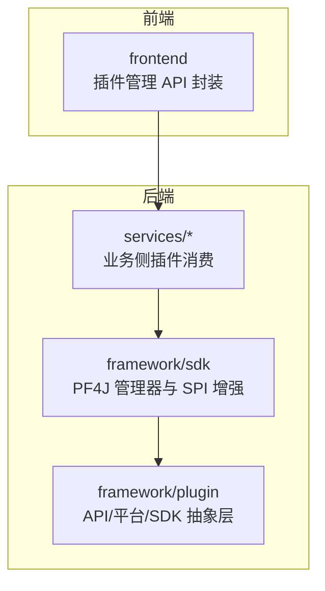
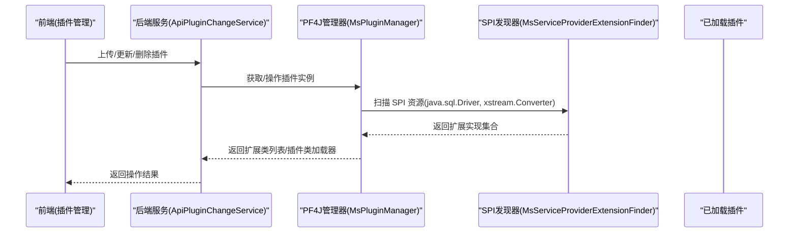
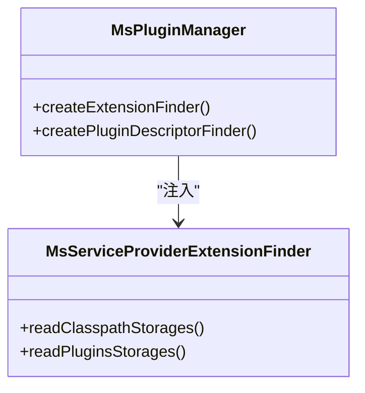
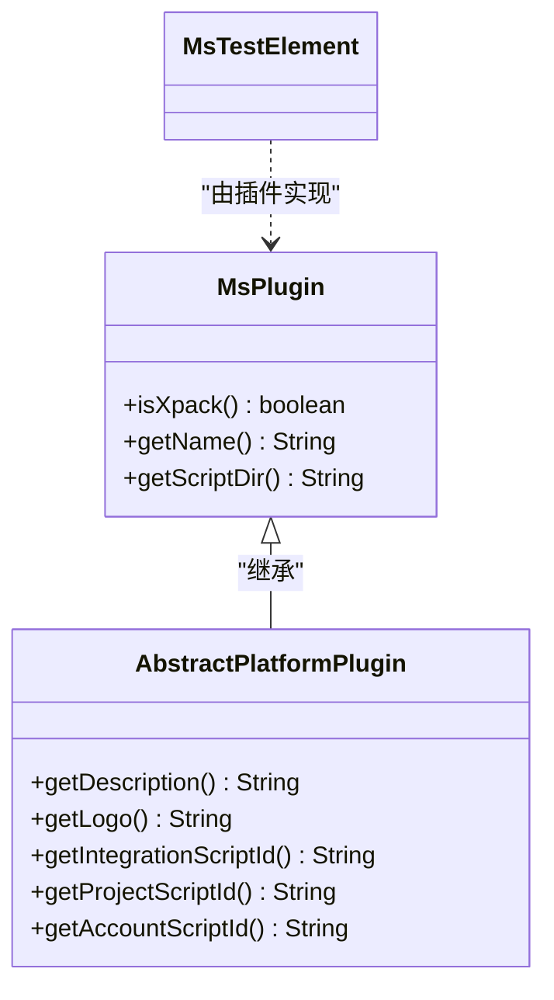
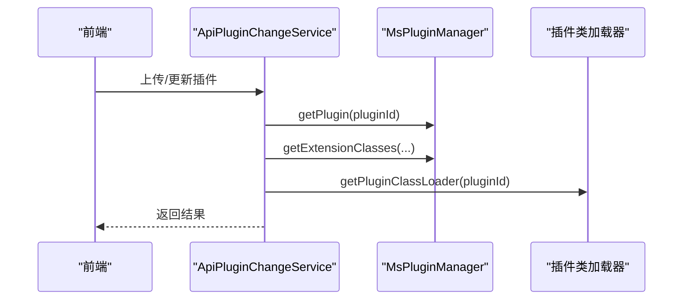
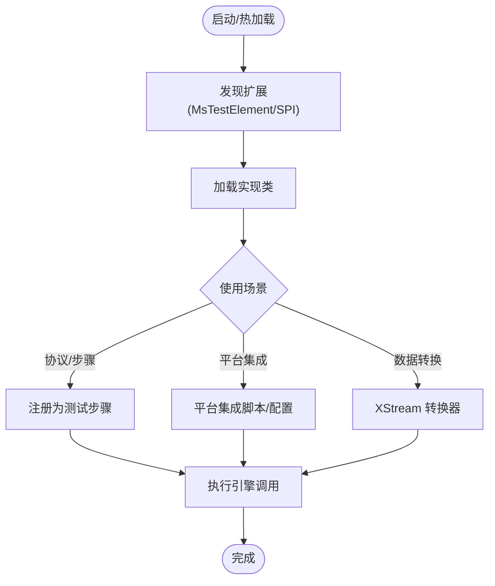
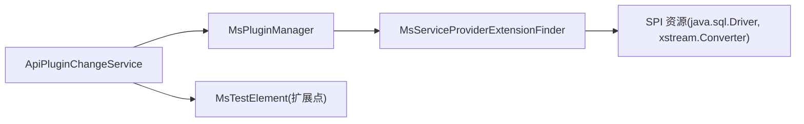

# 插件系统

<cite>
**本文引用的文件**   
- [MsPluginManager.java](file://backend/framework/sdk/src/main/java/io/metersphere/sdk/plugin/MsPluginManager.java)
- [MsServiceProviderExtensionFinder.java](file://backend/framework/sdk/src/main/java/io/metersphere/sdk/plugin/MsServiceProviderExtensionFinder.java)
- [MsTestElement.java](file://backend/framework/plugin/plugin-api-sdk/src/main/java/io/metersphere/plugin/api/spi/MsTestElement.java)
- [AbstractPlatformPlugin.java](file://backend/framework/plugin/plugin-platform-sdk/src/main/java/io/metersphere/plugin/platform/spi/AbstractPlatformPlugin.java)
- [MsPlugin.java](file://backend/framework/plugin/plugin-sdk/src/main/java/io/metersphere/plugin/sdk/spi/MsPlugin.java)
- [ApiPluginChangeService.java](file://backend/services/api-test/src/main/java/io/metersphere/api/service/ApiPluginChangeService.java)
- [pluginManger.ts](file://frontend/src/api/modules/setting/pluginManger.ts)
</cite>

## 目录
1. [简介](#简介)
2. [项目结构](#项目结构)
3. [核心组件](#核心组件)
4. [架构总览](#架构总览)
5. [详细组件分析](#详细组件分析)
6. [依赖关系分析](#依赖关系分析)
7. [性能与扩展性](#性能与扩展性)
8. [故障排查指南](#故障排查指南)
9. [结论](#结论)
10. [附录](#附录)

## 简介
本文件系统性阐述 MeterSphere 的插件体系，包括基于 PF4J 的插件框架集成、SPI 接口定义、插件生命周期管理、插件通信机制与安全隔离策略。文档同时给出面向开发者的实践指引：如何扩展测试步骤（自定义协议）、如何接入第三方平台（服务集成），以及前端插件管理与后端加载流程的端到端说明。

## 项目结构
MeterSphere 插件相关代码主要分布在以下模块：
- backend/framework/sdk：PF4J 管理器扩展与 SPI 发现增强
- backend/framework/plugin：插件 SDK/API/平台 SDK 三层抽象
- backend/services/*：业务侧对插件能力的消费与编排
- frontend：插件管理的前端 API 封装

图表来源
- [MsPluginManager.java:10-26](file://backend/framework/sdk/src/main/java/io/metersphere/sdk/plugin/MsPluginManager.java#L10-L26)
- [MsServiceProviderExtensionFinder.java:30-100](file://backend/framework/sdk/src/main/java/io/metersphere/sdk/plugin/MsServiceProviderExtensionFinder.java#L30-L100)
- [pluginManger.ts:20-38](file://frontend/src/api/modules/setting/pluginManger.ts#L20-L38)

章节来源
- [MsPluginManager.java:10-26](file://backend/framework/sdk/src/main/java/io/metersphere/sdk/plugin/MsPluginManager.java#L10-L26)
- [MsServiceProviderExtensionFinder.java:30-100](file://backend/framework/sdk/src/main/java/io/metersphere/sdk/plugin/MsServiceProviderExtensionFinder.java#L30-L100)
- [pluginManger.ts:20-38](file://frontend/src/api/modules/setting/pluginManger.ts#L20-L38)

## 核心组件
- PF4J 管理器扩展 MsPluginManager：在默认扩展发现器基础上注入自定义 SPI 发现器，并调整插件描述符查找顺序以支持 JDBC Driver 等场景。
- SPI 发现器 MsServiceProviderExtensionFinder：扩展 PF4J 的 ServiceProviderExtensionFinder，支持读取特定 SPI 资源（如 java.sql.Driver、xstream Converter）。
- 插件基础类型：
  - MsPlugin：插件元信息（是否企业版、名称、脚本目录）
  - AbstractPlatformPlugin：平台集成类插件基类（描述、Logo、脚本 ID 约定）
  - MsTestElement：测试步骤/协议组件的扩展点（ExtensionPoint）

章节来源
- [MsPluginManager.java:10-26](file://backend/framework/sdk/src/main/java/io/metersphere/sdk/plugin/MsPluginManager.java#L10-L26)
- [MsServiceProviderExtensionFinder.java:30-100](file://backend/framework/sdk/src/main/java/io/metersphere/sdk/plugin/MsServiceProviderExtensionFinder.java#L30-L100)
- [MsPlugin.java:10-28](file://backend/framework/plugin/plugin-sdk/src/main/java/io/metersphere/plugin/sdk/spi/MsPlugin.java#L10-L28)
- [AbstractPlatformPlugin.java:5-60](file://backend/framework/plugin/plugin-platform-sdk/src/main/java/io/metersphere/plugin/platform/spi/AbstractPlatformPlugin.java#L5-L60)
- [MsTestElement.java:10-12](file://backend/framework/plugin/plugin-api-sdk/src/main/java/io/metersphere/plugin/api/spi/MsTestElement.java#L10-L12)

## 架构总览
下图展示从前端到后端的插件管理调用链，以及 PF4J 在运行期加载与发现扩展的关键路径。

图表来源
- [ApiPluginChangeService.java:29-52](file://backend/services/api-test/src/main/java/io/metersphere/api/service/ApiPluginChangeService.java#L29-L52)
- [MsPluginManager.java:10-26](file://backend/framework/sdk/src/main/java/io/metersphere/sdk/plugin/MsPluginManager.java#L10-L26)
- [MsServiceProviderExtensionFinder.java:43-100](file://backend/framework/sdk/src/main/java/io/metersphere/sdk/plugin/MsServiceProviderExtensionFinder.java#L43-L100)

## 详细组件分析

### PF4J 管理器与 SPI 增强
- MsPluginManager
  - 重写扩展发现器创建逻辑，注入 MsServiceProviderExtensionFinder
  - 组合多个插件描述符查找器，确保 JDBC Driver 描述符优先于 Manifest 解析
- MsServiceProviderExtensionFinder
  - 显式声明支持的 SPI 文件清单（java.sql.Driver、com.thoughtworks.xstream.converters.Converter）
  - 分别处理 classpath 与插件 Jar 中的 SPI 资源，统一收集扩展实现类名

图表来源
- [MsPluginManager.java:10-26](file://backend/framework/sdk/src/main/java/io/metersphere/sdk/plugin/MsPluginManager.java#L10-L26)
- [MsServiceProviderExtensionFinder.java:30-100](file://backend/framework/sdk/src/main/java/io/metersphere/sdk/plugin/MsServiceProviderExtensionFinder.java#L30-L100)

章节来源
- [MsPluginManager.java:10-26](file://backend/framework/sdk/src/main/java/io/metersphere/sdk/plugin/MsPluginManager.java#L10-L26)
- [MsServiceProviderExtensionFinder.java:30-100](file://backend/framework/sdk/src/main/java/io/metersphere/sdk/plugin/MsServiceProviderExtensionFinder.java#L30-L100)

### 插件基础类型与扩展点
- MsPlugin：定义插件基本信息（是否企业版、名称、脚本目录）
- AbstractPlatformPlugin：平台集成插件基类，提供描述、Logo、脚本 ID 等约定
- MsTestElement：测试步骤/协议组件的扩展点，用于扩展 JMeter 执行模型

图表来源
- [MsPlugin.java:10-28](file://backend/framework/plugin/plugin-sdk/src/main/java/io/metersphere/plugin/sdk/spi/MsPlugin.java#L10-L28)
- [AbstractPlatformPlugin.java:5-60](file://backend/framework/plugin/plugin-platform-sdk/src/main/java/io/metersphere/plugin/platform/spi/AbstractPlatformPlugin.java#L5-L60)
- [MsTestElement.java:10-12](file://backend/framework/plugin/plugin-api-sdk/src/main/java/io/metersphere/plugin/api/spi/MsTestElement.java#L10-L12)

章节来源
- [MsPlugin.java:10-28](file://backend/framework/plugin/plugin-sdk/src/main/java/io/metersphere/plugin/sdk/spi/MsPlugin.java#L10-L28)
- [AbstractPlatformPlugin.java:5-60](file://backend/framework/plugin/plugin-platform-sdk/src/main/java/io/metersphere/plugin/platform/spi/AbstractPlatformPlugin.java#L5-L60)
- [MsTestElement.java:10-12](file://backend/framework/plugin/plugin-api-sdk/src/main/java/io/metersphere/plugin/api/spi/MsTestElement.java#L10-L12)

### 插件生命周期与运行时调用链
- 前端通过插件管理 API 进行上传、更新、删除等操作
- 后端 ApiPluginChangeService 调用 PF4J 管理器获取插件与扩展类，必要时刷新类加载器或重新加载扩展

图表来源
- [ApiPluginChangeService.java:29-52](file://backend/services/api-test/src/main/java/io/metersphere/api/service/ApiPluginChangeService.java#L29-L52)

章节来源
- [ApiPluginChangeService.java:29-52](file://backend/services/api-test/src/main/java/io/metersphere/api/service/ApiPluginChangeService.java#L29-L52)

### 插件通信机制与数据流
- 扩展点驱动：通过 MsTestElement 等 ExtensionPoint 暴露能力，业务侧通过 PF4J 的扩展发现机制获取具体实现
- SPI 驱动：通过 MsServiceProviderExtensionFinder 支持 JDBC Driver 与 XStream Converter 的动态发现
- 脚本与配置：AbstractPlatformPlugin 提供脚本 ID 约定，便于前后端联动加载配置与初始化脚本

图表来源
- [MsTestElement.java:10-12](file://backend/framework/plugin/plugin-api-sdk/src/main/java/io/metersphere/plugin/api/spi/MsTestElement.java#L10-L12)
- [MsServiceProviderExtensionFinder.java:30-100](file://backend/framework/sdk/src/main/java/io/metersphere/sdk/plugin/MsServiceProviderExtensionFinder.java#L30-L100)
- [AbstractPlatformPlugin.java:5-60](file://backend/framework/plugin/plugin-platform-sdk/src/main/java/io/metersphere/plugin/platform/spi/AbstractPlatformPlugin.java#L5-L60)

## 依赖关系分析
- 组件耦合
  - ApiPluginChangeService 强依赖 MsPluginManager 提供的扩展与类加载能力
  - MsPluginManager 依赖 MsServiceProviderExtensionFinder 完成 SPI 发现
  - 业务侧通过 MsTestElement 扩展点解耦具体协议/步骤实现
- 外部依赖
  - PF4J 框架：插件容器、扩展点、类加载器
  - JDBC/XStream：通过 SPI 动态发现驱动与转换器

图表来源
- [ApiPluginChangeService.java:29-52](file://backend/services/api-test/src/main/java/io/metersphere/api/service/ApiPluginChangeService.java#L29-L52)
- [MsPluginManager.java:10-26](file://backend/framework/sdk/src/main/java/io/metersphere/sdk/plugin/MsPluginManager.java#L10-L26)
- [MsServiceProviderExtensionFinder.java:30-100](file://backend/framework/sdk/src/main/java/io/metersphere/sdk/plugin/MsServiceProviderExtensionFinder.java#L30-L100)
- [MsTestElement.java:10-12](file://backend/framework/plugin/plugin-api-sdk/src/main/java/io/metersphere/plugin/api/spi/MsTestElement.java#L10-L12)

章节来源
- [ApiPluginChangeService.java:29-52](file://backend/services/api-test/src/main/java/io/metersphere/api/service/ApiPluginChangeService.java#L29-L52)
- [MsPluginManager.java:10-26](file://backend/framework/sdk/src/main/java/io/metersphere/sdk/plugin/MsPluginManager.java#L10-L26)
- [MsServiceProviderExtensionFinder.java:30-100](file://backend/framework/sdk/src/main/java/io/metersphere/sdk/plugin/MsServiceProviderExtensionFinder.java#L30-L100)
- [MsTestElement.java:10-12](file://backend/framework/plugin/plugin-api-sdk/src/main/java/io/metersphere/plugin/api/spi/MsTestElement.java#L10-L12)

## 性能与扩展性
- 扩展发现优化
  - 仅扫描指定的 SPI 文件，避免全量反射带来的开销
  - 将 JDBC Driver 描述符查找置于 Manifest 之前，减少不必要的解析
- 类加载隔离
  - 每个插件拥有独立类加载器，避免依赖冲突
- 可扩展性建议
  - 新增扩展点时，优先采用 ExtensionPoint 模式，保持业务与实现的松耦合
  - 对重型扩展（如网络 IO、数据库连接）建议在插件内做连接池与缓存，避免阻塞主线程

[本节为通用指导，不直接分析具体文件]

## 故障排查指南
- 插件未生效
  - 检查插件是否正确实现 MsTestElement 或其他扩展点
  - 确认 SPI 资源文件是否存在且命名正确（如 java.sql.Driver、xstream.Converter）
- 扩展类无法发现
  - 查看 MsServiceProviderExtensionFinder 的日志输出，确认 SPI 资源是否被扫描
  - 校验插件版本与宿主系统兼容性
- 类加载异常
  - 检查插件依赖是否与宿主系统存在版本冲突
  - 确认插件类加载器未被错误共享

章节来源
- [MsServiceProviderExtensionFinder.java:43-100](file://backend/framework/sdk/src/main/java/io/metersphere/sdk/plugin/MsServiceProviderExtensionFinder.java#L43-L100)

## 结论
MeterSphere 的插件体系以 PF4J 为核心，结合自研的 SPI 发现增强与清晰的扩展点设计，实现了协议扩展、平台集成与数据转换等多维度的可插拔能力。前端插件管理 API 与后端加载流程形成闭环，既保证了系统的稳定性，又提供了良好的扩展性与可维护性。

[本节为总结性内容，不直接分析具体文件]

## 附录

### 插件开发指南（示例要点）
- 自定义协议/测试步骤
  - 实现 MsTestElement 扩展点，并在插件中注册
  - 通过 PF4J 扩展发现机制让业务侧自动装配
- 扩展 UI 组件
  - 在插件中提供脚本目录（参考 MsPlugin.getScriptDir），按约定放置前端脚本
  - 使用 AbstractPlatformPlugin 的脚本 ID 约定，配合前端 API 加载配置
- 集成第三方系统
  - 继承 AbstractPlatformPlugin，提供描述、Logo 与脚本 ID
  - 通过服务集成脚本与账号脚本对接第三方 API

章节来源
- [MsTestElement.java:10-12](file://backend/framework/plugin/plugin-api-sdk/src/main/java/io/metersphere/plugin/api/spi/MsTestElement.java#L10-L12)
- [MsPlugin.java:10-28](file://backend/framework/plugin/plugin-sdk/src/main/java/io/metersphere/plugin/sdk/spi/MsPlugin.java#L10-L28)
- [AbstractPlatformPlugin.java:5-60](file://backend/framework/plugin/plugin-platform-sdk/src/main/java/io/metersphere/plugin/platform/spi/AbstractPlatformPlugin.java#L5-L60)

### 插件市场、版本管理与更新机制
- 前端插件管理 API
  - 提供获取插件列表、上传、更新、删除、脚本详情与选项查询等接口
- 后端插件变更服务
  - 根据插件 ID 获取插件实例与扩展类，必要时刷新类加载器
- 版本与更新
  - 通过前端上传新包触发后端重载；建议遵循语义化版本，保证向后兼容

章节来源
- [pluginManger.ts:20-38](file://frontend/src/api/modules/setting/pluginManger.ts#L20-L38)
- [ApiPluginChangeService.java:29-52](file://backend/services/api-test/src/main/java/io/metersphere/api/service/ApiPluginChangeService.java#L29-L52)