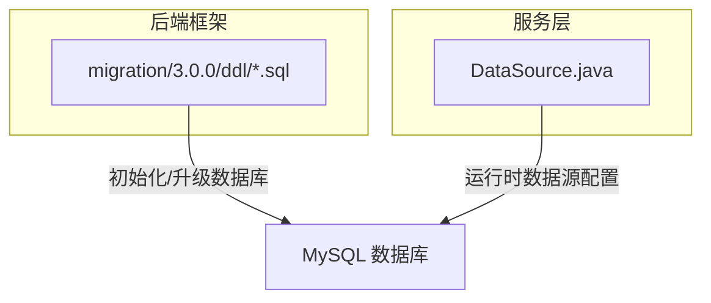
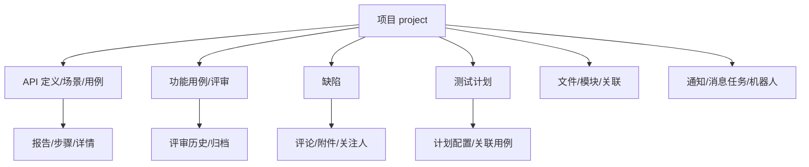

# 数据库设计

<cite>
**本文引用的文件**   
- [V3.0.0_4__project_management.sql](file://backend/framework/domain/src/main/resources/migration/3.0.0/ddl/V3.0.0_4__project_management.sql)
- [V3.0.0_5__api_test.sql](file://backend/framework/domain/src/main/resources/migration/3.0.0/ddl/V3.0.0_5__api_test.sql)
- [V3.0.0_7__bug_management.sql](file://backend/framework/domain/src/main/resources/migration/3.0.0/ddl/V3.0.0_7__bug_management.sql)
- [V3.0.0_10__functional_case.sql](file://backend/framework/domain/src/main/resources/migration/3.0.0/ddl/V3.0.0_10__functional_case.sql)
- [V3.0.0_3__test_plan.sql](file://backend/framework/domain/src/main/resources/migration/3.0.0/ddl/V3.0.0_3__test_plan.sql)
- [V3.0.0_6__qrtz_schema.sql](file://backend/framework/domain/src/main/resources/migration/3.0.0/ddl/V3.0.0_6__qrtz_schema.sql)
- [DataSource.java](file://backend/services/project-management/src/main/java/io/metersphere/project/dto/environment/datasource/DataSource.java)
</cite>

## 目录
1. [引言](#引言)
2. [项目结构](#项目结构)
3. [核心组件](#核心组件)
4. [架构总览](#架构总览)
5. [详细组件分析](#详细组件分析)
6. [依赖关系分析](#依赖关系分析)
7. [性能与索引优化](#性能与索引优化)
8. [数据访问模式与缓存策略](#数据访问模式与缓存策略)
9. [数据生命周期、保留与归档](#数据生命周期保留与归档)
10. [数据安全、隐私与访问控制](#数据安全隐私与访问控制)
11. [数据迁移路径与版本管理](#数据迁移路径与版本管理)
12. [故障排查指南](#故障排查指南)
13. [结论](#结论)

## 引言
本文件为 MeterSphere 的数据库设计文档，覆盖核心表结构、实体关系、字段定义与数据类型、主外键与约束、索引设计与完整性规则；并提供 ER 图、样例数据说明、数据访问模式、缓存策略、性能优化方案、数据生命周期与归档策略、安全与隐私要求、以及数据迁移路径与版本管理。读者无需深入代码即可理解系统的数据模型与运维要点。

## 项目结构
数据库脚本集中位于后端框架模块的资源目录下，按版本号组织迁移脚本：
- 业务域 DDL：项目、API 测试、缺陷、功能用例、测试计划等
- 调度器 DDL：Quartz 调度表
- 环境配置：前端提供数据源连接参数表单，后端 DTO 定义数据源属性

图表来源
- [V3.0.0_4__project_management.sql:1-366](file://backend/framework/domain/src/main/resources/migration/3.0.0/ddl/V3.0.0_4__project_management.sql#L1-L366)
- [V3.0.0_5__api_test.sql:1-643](file://backend/framework/domain/src/main/resources/migration/3.0.0/ddl/V3.0.0_5__api_test.sql#L1-L643)
- [V3.0.0_7__bug_management.sql:1-120](file://backend/framework/domain/src/main/resources/migration/3.0.0/ddl/V3.0.0_7__bug_management.sql#L1-L120)
- [V3.0.0_10__functional_case.sql:1-405](file://backend/framework/domain/src/main/resources/migration/3.0.0/ddl/V3.0.0_10__functional_case.sql#L1-L405)
- [V3.0.0_3__test_plan.sql:1-148](file://backend/framework/domain/src/main/resources/migration/3.0.0/ddl/V3.0.0_3__test_plan.sql#L1-L148)
- [V3.0.0_6__qrtz_schema.sql:1-190](file://backend/framework/domain/src/main/resources/migration/3.0.0/ddl/V3.0.0_6__qrtz_schema.sql#L1-L190)
- [DataSource.java:1-33](file://backend/services/project-management/src/main/java/io/metersphere/project/dto/environment/datasource/DataSource.java#L1-L33)

章节来源
- [V3.0.0_4__project_management.sql:1-366](file://backend/framework/domain/src/main/resources/migration/3.0.0/ddl/V3.0.0_4__project_management.sql#L1-L366)
- [V3.0.0_5__api_test.sql:1-643](file://backend/framework/domain/src/main/resources/migration/3.0.0/ddl/V3.0.0_5__api_test.sql#L1-L643)
- [V3.0.0_7__bug_management.sql:1-120](file://backend/framework/domain/src/main/resources/migration/3.0.0/ddl/V3.0.0_7__bug_management.sql#L1-L120)
- [V3.0.0_10__functional_case.sql:1-405](file://backend/framework/domain/src/main/resources/migration/3.0.0/ddl/V3.0.0_10__functional_case.sql#L1-L405)
- [V3.0.0_3__test_plan.sql:1-148](file://backend/framework/domain/src/main/resources/migration/3.0.0/ddl/V3.0.0_3__test_plan.sql#L1-L148)
- [V3.0.0_6__qrtz_schema.sql:1-190](file://backend/framework/domain/src/main/resources/migration/3.0.0/ddl/V3.0.0_6__qrtz_schema.sql#L1-L190)
- [DataSource.java:1-33](file://backend/services/project-management/src/main/java/io/metersphere/project/dto/environment/datasource/DataSource.java#L1-L33)

## 核心组件
- 项目与资源管理：项目、项目应用、项目版本、文件元数据、文件模块、文件关联、消息任务、通知、机器人、项目资源池映射
- API 测试：接口调试、接口定义、场景、报告、步骤、CSV 数据、Mock、Swagger 同步、自定义字段
- 缺陷管理：缺陷、缺陷内容、关注人、本地附件、评论、自定义字段、用例关联
- 功能用例：用例、模块、评论、附件、前后置关系、需求关联、脑图节点、自定义字段、评审流程（含归档）
- 测试计划：计划、模块、计划配置、与功能用例/接口用例/场景用例的关联、关注人
- 调度器：Quartz 标准表

章节来源
- [V3.0.0_4__project_management.sql:1-366](file://backend/framework/domain/src/main/resources/migration/3.0.0/ddl/V3.0.0_4__project_management.sql#L1-L366)
- [V3.0.0_5__api_test.sql:1-643](file://backend/framework/domain/src/main/resources/migration/3.0.0/ddl/V3.0.0_5__api_test.sql#L1-L643)
- [V3.0.0_7__bug_management.sql:1-120](file://backend/framework/domain/src/main/resources/migration/3.0.0/ddl/V3.0.0_7__bug_management.sql#L1-L120)
- [V3.0.0_10__functional_case.sql:1-405](file://backend/framework/domain/src/main/resources/migration/3.0.0/ddl/V3.0.0_10__functional_case.sql#L1-L405)
- [V3.0.0_3__test_plan.sql:1-148](file://backend/framework/domain/src/main/resources/migration/3.0.0/ddl/V3.0.0_3__test_plan.sql#L1-L148)
- [V3.0.0_6__qrtz_schema.sql:1-190](file://backend/framework/domain/src/main/resources/migration/3.0.0/ddl/V3.0.0_6__qrtz_schema.sql#L1-L190)

## 架构总览
下图展示核心实体之间的关系，包括项目、API、场景、用例、缺陷、功能用例、测试计划、文件与通知等。

```mermaid
erDiagram
PROJECT ||--o{ API_DEFINITION : "拥有"
PROJECT ||--o{ API_SCENARIO : "拥有"
PROJECT ||--o{ FUNCTIONAL_CASE : "拥有"
PROJECT ||--o{ BUG : "拥有"
PROJECT ||--o{ TEST_PLAN : "拥有"
PROJECT ||--o{ FILE_METADATA : "拥有"
PROJECT ||--o{ MESSAGE_TASK : "拥有"
PROJECT ||--o{ NOTIFICATION : "拥有"
PROJECT ||--o{ PROJECT_VERSION : "拥有"
API_DEFINITION ||--o{ API_TEST_CASE : "包含"
API_DEFINITION ||--o{ API_DEFINITION_MOCK : "包含"
API_DEFINITION ||--o{ API_DEFINITION_CUSTOM_FIELD : "扩展"
API_DEFINITION ||--o{ API_DEBUG : "调试"
API_SCENARIO ||--o{ API_SCENARIO_STEP : "包含"
API_SCENARIO ||--o{ API_SCENARIO_CSV : "使用"
API_SCENARIO ||--o{ API_SCENARIO_REPORT : "产生"
API_TEST_CASE ||--o{ API_TEST_CASE_RECORD : "执行记录"
FUNCTIONAL_CASE ||--o{ FUNCTIONAL_CASE_COMMENT : "评论"
FUNCTIONAL_CASE ||--o{ FUNCTIONAL_CASE_ATTACHMENT : "附件"
FUNCTIONAL_CASE ||--o{ FUNCTIONAL_CASE_DEMAND : "需求关联"
FUNCTIONAL_CASE ||--o{ FUNCTIONAL_CASE_TEST : "关联其他用例"
FUNCTIONAL_CASE ||--o{ CASE_REVIEW_FUNCTIONAL_CASE : "评审关联"
TEST_PLAN ||--o{ TEST_PLAN_FUNCTIONAL_CASE : "关联功能用例"
TEST_PLAN ||--o{ TEST_PLAN_API_CASE : "关联接口用例"
TEST_PLAN ||--o{ TEST_PLAN_API_SCENARIO : "关联场景"
FILE_METADATA ||--o{ FILE_ASSOCIATION : "被引用"
FILE_MODULE ||--o{ FILE_METADATA : "归属"
BUG ||--o{ BUG_CONTENT : "详情"
BUG ||--o{ BUG_FOLLOWER : "关注"
BUG ||--o{ BUG_LOCAL_ATTACHMENT : "附件"
BUG ||--o{ BUG_COMMENT : "评论"
BUG ||--o{ BUG_RELATION_CASE : "关联用例"
CASE_REVIEW ||--o{ CASE_REVIEW_USER : "评审人"
CASE_REVIEW ||--o{ CASE_REVIEW_HISTORY : "历史"
CASE_REVIEW ||--o{ CASE_REVIEW_FUNCTIONAL_CASE_ARCHIVE : "归档"
```

图表来源
- [V3.0.0_4__project_management.sql:158-362](file://backend/framework/domain/src/main/resources/migration/3.0.0/ddl/V3.0.0_4__project_management.sql#L158-L362)
- [V3.0.0_5__api_test.sql:60-640](file://backend/framework/domain/src/main/resources/migration/3.0.0/ddl/V3.0.0_5__api_test.sql#L60-L640)
- [V3.0.0_7__bug_management.sql:4-116](file://backend/framework/domain/src/main/resources/migration/3.0.0/ddl/V3.0.0_7__bug_management.sql#L4-L116)
- [V3.0.0_10__functional_case.sql:4-401](file://backend/framework/domain/src/main/resources/migration/3.0.0/ddl/V3.0.0_10__functional_case.sql#L4-L401)
- [V3.0.0_3__test_plan.sql:4-144](file://backend/framework/domain/src/main/resources/migration/3.0.0/ddl/V3.0.0_3__test_plan.sql#L4-L144)

## 详细组件分析

### 项目与资源管理
- 项目 project：项目级主实体，包含项目编号、组织ID、名称、描述、启用状态、软删除标记、创建/更新/删除信息
- 项目应用 project_application：项目级键值配置
- 项目版本 project_version：版本管理，支持最新标记、时间范围
- 文件元数据 file_metadata：文件基础信息，支持存储方式、标签、描述、模块、最新版本标记、同版本 ref_id、版本号
- 文件模块 file_module：文件树形模块，支持排序 pos、模块类型 module_type
- 文件关联 file_association：将业务资源与文件建立关联，支持 source_type/source_id/file_id/ref_id/version
- 消息任务 message_task / 通知 notification：项目内消息通知与日志
- 项目机器人 project_robot：集成飞书/钉钉/企微等平台
- 项目资源池映射 project_test_resource_pool：项目与资源池多对多

关键索引与约束
- project.num 唯一索引
- file_module.project_id,name,module_type,parent_id 唯一索引
- file_metadata.latest/ref_id/storage/module_id/project_id 索引
- file_association.file_id/source_type/source_id 索引
- message_task/notification/project_robot 常用查询字段索引

样例数据说明
- project：id=proj-001, num=1001, organization_id=org-001, name="测试项目", enable=1
- file_metadata：id=file-001, name="data.csv", size=1024, storage="MINIO", latest=1, ref_id=file-001, project_id=proj-001
- file_association：source_type="API_SCENARIO", source_id=scenario-001, file_id=file-001, file_ref_id=file-001, file_version="v1"

章节来源
- [V3.0.0_4__project_management.sql:4-362](file://backend/framework/domain/src/main/resources/migration/3.0.0/ddl/V3.0.0_4__project_management.sql#L4-L362)

### API 测试
- 接口调试 api_debug：临时调试接口，含请求/响应大字段分离
- 接口定义 api_definition：接口元数据，支持版本 ref_id/version_id、latest、num、status、tags、pos
- 接口用例 api_test_case：基于接口的用例，支持优先级、状态、环境、版本、编号
- 场景 api_scenario：编排多个步骤的场景，支持优先级、状态、环境、版本、ref_id、latest
- 场景步骤 api_scenario_step：步骤明细，支持循环/条件等配置 config
- 报告 api_report / api_scenario_report：执行结果汇总，统计成功/失败/误报/未执行数、通过率等
- 报告步骤/详情/api_report_detail / api_scenario_report_detail：步骤级结果与内容
- Mock api_definition_mock / api_definition_mock_config：匹配规则与响应
- Swagger 同步 api_definition_swagger：定时导入外部接口
- CSV 数据 api_scenario_csv / api_scenario_csv_step：场景数据驱动
- 自定义字段 api_definition_custom_field：接口扩展字段

关键索引与约束
- api_definition.project_id/module_id/ref_id/version_id/status/pos/name 索引
- api_scenario.project_id/module_id/ref_id/version_id/status/report_status/num/priority/name 索引
- api_test_case.api_definition_id/project_id/status/version_id/priority/name/num 索引
- 报告类表 report_id/start_time/update_time/status/pool_id/integrated/test_plan_id 索引
- api_scenario_csv.scenario_id/name/file_name/project_id 索引

样例数据说明
- api_definition：id=api-001, name="用户登录", protocol="HTTP", method="POST", path="/auth/login", project_id=proj-001, version_id=v1, ref_id=api-001, latest=1
- api_scenario：id=scenario-001, name="登录流程", priority="P1", status="已完成", project_id=proj-001, environment_id=env-001, version_id=v1, ref_id=scenario-001, latest=1
- api_report：id=rpt-001, name="登录报告", status="SUCCESS", trigger_mode="MANUAL", run_mode="STANDALONE", pool_id=pool-001, project_id=proj-001, success_count=10, error_count=0

章节来源
- [V3.0.0_5__api_test.sql:4-640](file://backend/framework/domain/src/main/resources/migration/3.0.0/ddl/V3.0.0_5__api_test.sql#L4-L640)

### 缺陷管理
- 缺陷 bug：标题、处理人、平台、状态、标签、第三方平台ID、软删除、排序 pos
- 缺陷内容 bug_content：长文本描述
- 缺陷关注人 bug_follower：多对多
- 缺陷本地附件 bug_local_attachment：本地上传附件
- 缺陷评论 bug_comment：支持父评论嵌套
- 缺陷自定义字段 bug_custom_field：扩展字段
- 用例和缺陷关联 bug_relation_case：跨用例类型关联

关键索引与约束
- bug.num/title/handle_user/create_user/create_time/update_user/update_time/project_id/platform/status/deleted/pos 索引
- bug_follower.user_id 索引
- bug_local_attachment.bug_id/file_id/source 索引
- bug_comment.bug_id/parent_id 索引
- bug_relation_case.bug_id/case_id/case_type/test_plan_id,test_plan_case_id 索引

样例数据说明
- bug：id=bug-001, num=10001, title="登录异常", handle_user=user-001, platform="LOCAL", status="OPEN", project_id=proj-001
- bug_relation_case：id=rel-001, case_id=case-001, bug_id=bug-001, case_type="functional", test_plan_id=plan-001, test_plan_case_id=tpc-001

章节来源
- [V3.0.0_7__bug_management.sql:4-116](file://backend/framework/domain/src/main/resources/migration/3.0.0/ddl/V3.0.0_7__bug_management.sql#L4-L116)

### 功能用例与评审
- 功能用例 functional_case：名称、模板、编辑模式、版本 ref_id/version_id、最近执行结果、公共用例、最新版本、软删除
- 功能用例 blob functional_case_blob：步骤 JSON、文本描述、预期结果、前置条件、备注
- 功能用例模块 functional_case_module：树形模块，支持排序 pos
- 功能用例评论 functional_case_comment：支持父评论、资源上下文（评审/测试计划）
- 功能用例附件 functional_case_attachment：附件元数据
- 功能用例前后置关系 functional_case_relationship_edge：用例依赖图边
- 功能用例与其他用例关联 functional_case_test：跨用例类型关联
- 功能用例需求关联 functional_case_demand：需求平台、地址、标题
- 脑图额外节点 functional_minder_extra_node：脑图临时节点
- 自定义字段 functional_case_custom_field：扩展字段
- 评审 case_review：评审状态、通过规则、通过率、标签、描述
- 评审人员 case_review_user：评审人与评审的多对多
- 评审用例关联 case_review_functional_case：用例在评审中的状态与排序
- 评审归档 case_review_functional_case_archive：用例快照 LONGBLOB
- 评审历史 case_review_history：评审意见、状态、通知人、废弃标记

关键索引与约束
- functional_case.module_id/project_id/public_case/ref_id/version_id/create_time/delete_time/update_time/num/pos 索引
- functional_case_module.project_id/name/pos/parent_id/create_user/update_user 索引，唯一 (project_id,name,parent_id)
- functional_case_attachment.case_id/local/file_id/file_name/file_source 索引
- functional_case_relationship_edge.source_id/target_id 索引
- functional_case_test.case_id/source_id/source_type/project_id 索引
- functional_case_demand.case_id/demand_platform 索引
- case_review.create_user/project_id/name/status/review_pass_rule/create_time/update_time/update_user/module_id/pos/case_count/pass_rate/num 索引
- case_review_functional_case.case_id/review_id/status/pos 索引，唯一 (review_id,case_id)
- case_review_functional_case_archive.review_id/case_id 索引，复合 (review_id,case_id)
- case_review_history.case_id/review_id/status/deleted/abandoned 索引，复合 (review_id,case_id)

样例数据说明
- functional_case：id=fc-001, num=20001, module_id=mod-001, project_id=proj-001, template_id=tpl-001, name="登录用例", review_status="UN_REVIEWED", case_edit_type="STEP", version_id=v1, ref_id=fc-001, latest=1
- case_review：id=rev-001, num=30001, name="Q3评审", module_id=mod-001, project_id=proj-001, status="PREPARE", review_pass_rule="SINGLE"
- case_review_functional_case：id=rcf-001, review_id=rev-001, case_id=fc-001, status="UNDERWAY", pos=1

章节来源
- [V3.0.0_10__functional_case.sql:4-401](file://backend/framework/domain/src/main/resources/migration/3.0.0/ddl/V3.0.0_10__functional_case.sql#L4-L401)

### 测试计划
- 测试计划模块 test_plan_module：树形模块，支持排序 pos
- 测试计划 test_plan：名称、状态、类型（group/testPlan）、标签、计划与实际起止时间、描述
- 测试计划配置 test_plan_config：运行模式、自动更新功能用例状态、允许重复添加用例、通过阈值
- 测试计划关联功能用例 test_plan_functional_case：用例加入计划的执行信息与排序
- 测试计划关联接口用例 test_plan_api_case：接口用例加入计划的执行信息与排序
- 测试计划关联场景用例 test_plan_api_scenario：场景用例加入计划的执行信息与排序
- 测试计划关注人 test_plan_follower：多对多

关键索引与约束
- test_plan_module.project_id/name/pos 索引，唯一 (project_id,name,parent_id)
- test_plan.group_id/project_id/name 唯一 (project_id,name)，module_id 索引
- test_plan_functional_case.functional_case_id/test_plan_id/create_user 索引
- test_plan_api_case.api_case_id/test_plan_id/create_user 索引
- test_plan_api_scenario.api_scenario_id/test_plan_id/create_user 索引

样例数据说明
- test_plan：id=plan-001, num=40001, project_id=proj-001, group_id=none, module_id=mod-001, name="Q3回归", status="进行中", type="testPlan"
- test_plan_functional_case：id=tpfc-001, test_plan_id=plan-001, functional_case_id=fc-001, execute_user=user-001, last_exec_result="PASS", pos=1

章节来源
- [V3.0.0_3__test_plan.sql:4-144](file://backend/framework/domain/src/main/resources/migration/3.0.0/ddl/V3.0.0_3__test_plan.sql#L4-L144)

### 调度器 Quartz
- QRTZ_JOB_DETAILS / QRTZ_TRIGGERS / QRTZ_BLOB_TRIGGERS / QRTZ_CALENDARS / QRTZ_CRON_TRIGGERS / QRTZ_FIRED_TRIGGERS / QRTZ_LOCKS / QRTZ_PAUSED_TRIGGER_GRPS / QRTZ_SCHEDULER_STATE / QRTZ_SIMPLE_TRIGGERS / QRTZ_SIMPROP_TRIGGERS
- 提供任务调度、触发器、日历、锁、实例状态等能力

章节来源
- [V3.0.0_6__qrtz_schema.sql:5-186](file://backend/framework/domain/src/main/resources/migration/3.0.0/ddl/V3.0.0_6__qrtz_schema.sql#L5-L186)

## 依赖关系分析
- 项目为中心：API、场景、用例、缺陷、计划、文件、通知等均通过 project_id 进行隔离
- 版本与引用：API、场景、用例均使用 version_id 与 ref_id 实现版本化与引用语义，latest 标记当前活跃版本
- 大字段分离：请求/响应、JSON 配置、步骤内容等使用 *_blob 或 LONGBLOB 分离，避免热点行膨胀
- 多对多关系：关注人、附件、评审人员、用例关联等通过中间表实现
- 软删除：多处使用 deleted 标志位，便于审计与恢复

图表来源
- [V3.0.0_4__project_management.sql:158-362](file://backend/framework/domain/src/main/resources/migration/3.0.0/ddl/V3.0.0_4__project_management.sql#L158-L362)
- [V3.0.0_5__api_test.sql:60-640](file://backend/framework/domain/src/main/resources/migration/3.0.0/ddl/V3.0.0_5__api_test.sql#L60-L640)
- [V3.0.0_7__bug_management.sql:4-116](file://backend/framework/domain/src/main/resources/migration/3.0.0/ddl/V3.0.0_7__bug_management.sql#L4-L116)
- [V3.0.0_10__functional_case.sql:4-401](file://backend/framework/domain/src/main/resources/migration/3.0.0/ddl/V3.0.0_10__functional_case.sql#L4-L401)
- [V3.0.0_3__test_plan.sql:4-144](file://backend/framework/domain/src/main/resources/migration/3.0.0/ddl/V3.0.0_3__test_plan.sql#L4-L144)

## 性能与索引优化
- 高频查询字段建索引：如 project_id、module_id、version_id、ref_id、status、create_time、update_time、name、num、pos 等
- 组合索引优化：如 test_plan_module(project_id,name,parent_id)、api_definition(project_id,module_id)、api_scenario(project_id,module_id)
- 大字段分离：避免热行膨胀，提升写入吞吐
- 软删除过滤：deleted 字段加索引，提高回收站与逻辑删除查询效率
- 排序优化：pos 字段用于界面排序，配合 project_id 限定范围，减少全表扫描
- 报告与日志表：report_id、step_id、start_time、update_time 索引，支撑报表与回溯

章节来源
- [V3.0.0_4__project_management.sql:23-353](file://backend/framework/domain/src/main/resources/migration/3.0.0/ddl/V3.0.0_4__project_management.sql#L23-L353)
- [V3.0.0_5__api_test.sql:22-640](file://backend/framework/domain/src/main/resources/migration/3.0.0/ddl/V3.0.0_5__api_test.sql#L22-L640)
- [V3.0.0_7__bug_management.sql:28-116](file://backend/framework/domain/src/main/resources/migration/3.0.0/ddl/V3.0.0_7__bug_management.sql#L28-L116)
- [V3.0.0_10__functional_case.sql:33-401](file://backend/framework/domain/src/main/resources/migration/3.0.0/ddl/V3.0.0_10__functional_case.sql#L33-L401)
- [V3.0.0_3__test_plan.sql:21-144](file://backend/framework/domain/src/main/resources/migration/3.0.0/ddl/V3.0.0_3__test_plan.sql#L21-L144)

## 数据访问模式与缓存策略
- 数据访问模式
  - 读写分离建议：报告与日志表以写为主，可考虑异步落库与分片归档
  - 批量操作：场景步骤、CSV 数据、报告步骤详情适合批量插入
  - 分页与排序：优先使用 pos + project_id 组合排序，减少回表
- 缓存策略
  - 字典与配置：项目应用 project_application、模块树 file_module/functional_case_module/test_plan_module 可缓存
  - 热点对象：接口定义、场景元数据、评审元数据可短期缓存
  - 大字段不缓存：*_blob/LONGBLOB 不建议进入缓存，避免内存压力
- 连接池与超时
  - 前端数据源表单提供 driverId/dbUrl/username/password/poolMax/timeout 等参数，用于运行时连接配置

章节来源
- [V3.0.0_4__project_management.sql:189-197](file://backend/framework/domain/src/main/resources/migration/3.0.0/ddl/V3.0.0_4__project_management.sql#L189-L197)
- [V3.0.0_4__project_management.sql:130-156](file://backend/framework/domain/src/main/resources/migration/3.0.0/ddl/V3.0.0_4__project_management.sql#L130-L156)
- [V3.0.0_10__functional_case.sql:82-107](file://backend/framework/domain/src/main/resources/migration/3.0.0/ddl/V3.0.0_10__functional_case.sql#L82-L107)
- [V3.0.0_3__test_plan.sql:4-24](file://backend/framework/domain/src/main/resources/migration/3.0.0/ddl/V3.0.0_3__test_plan.sql#L4-L24)
- [DataSource.java:10-33](file://backend/services/project-management/src/main/java/io/metersphere/project/dto/environment/datasource/DataSource.java#L10-L33)

## 数据生命周期、保留与归档
- 报告与日志
  - api_report / api_report_log / api_scenario_report / api_scenario_report_log：建议按时间分表或归档至冷存储
  - 保留策略：近 30 天在线，超期归档至历史库或对象存储
- 用例与评审
  - functional_case / case_review / case_review_history / case_review_functional_case_archive：历史评审快照已归档，旧版本可通过 ref_id 追溯
- 缺陷与附件
  - bug / bug_local_attachment：附件建议走对象存储，数据库仅存元数据
- 文件与模块
  - file_metadata / file_association：文件元数据长期保留，关联关系随资源生命周期变化
- 软删除与回收站
  - 多处 deleted 字段支持回收站机制，便于恢复与审计

章节来源
- [V3.0.0_5__api_test.sql:101-435](file://backend/framework/domain/src/main/resources/migration/3.0.0/ddl/V3.0.0_5__api_test.sql#L101-L435)
- [V3.0.0_10__functional_case.sql:234-374](file://backend/framework/domain/src/main/resources/migration/3.0.0/ddl/V3.0.0_10__functional_case.sql#L234-L374)
- [V3.0.0_7__bug_management.sql:58-73](file://backend/framework/domain/src/main/resources/migration/3.0.0/ddl/V3.0.0_7__bug_management.sql#L58-L73)
- [V3.0.0_4__project_management.sql:94-128](file://backend/framework/domain/src/main/resources/migration/3.0.0/ddl/V3.0.0_4__project_management.sql#L94-L128)

## 数据安全、隐私与访问控制
- 敏感信息
  - 数据库密码、Token、Webhook 等敏感字段应加密存储（如 project_robot.webhook/token/app_secret）
  - 环境变量与连接串不应明文入库，建议使用密钥管理服务
- 权限控制
  - 所有业务表均带 project_id，结合 RBAC 实现项目级隔离
  - 关注人、评审人员、附件等通过中间表限制可见范围
- 审计与追踪
  - create_user/update_user/delete_user、create_time/update_time/delete_time 提供完整审计线索
  - 通知与消息任务记录操作轨迹

章节来源
- [V3.0.0_4__project_management.sql:329-353](file://backend/framework/domain/src/main/resources/migration/3.0.0/ddl/V3.0.0_4__project_management.sql#L329-L353)
- [V3.0.0_4__project_management.sql:296-327](file://backend/framework/domain/src/main/resources/migration/3.0.0/ddl/V3.0.0_4__project_management.sql#L296-L327)
- [V3.0.0_5__api_test.sql:60-100](file://backend/framework/domain/src/main/resources/migration/3.0.0/ddl/V3.0.0_5__api_test.sql#L60-L100)
- [V3.0.0_10__functional_case.sql:4-31](file://backend/framework/domain/src/main/resources/migration/3.0.0/ddl/V3.0.0_10__functional_case.sql#L4-L31)

## 数据迁移路径与版本管理
- 迁移脚本组织
  - 按版本号划分：3.0.0、3.0.1、3.1.0、3.2.0、3.3.0、3.4.0、3.5.0、3.6.0
  - 每个版本下分 ddl/dml 子目录，DDL 负责结构变更，DML 负责数据初始化/修复
- 命名规范
  - V{版本}_{序号}__{主题}.sql，保证顺序执行与可读性
- 执行策略
  - 启动时校验并执行未应用的迁移脚本
  - 大表变更建议在低峰期执行，必要时设置 innodb_lock_wait_timeout

章节来源
- [V3.0.0_4__project_management.sql:1-2](file://backend/framework/domain/src/main/resources/migration/3.0.0/ddl/V3.0.0_4__project_management.sql#L1-L2)
- [V3.0.0_5__api_test.sql:1-2](file://backend/framework/domain/src/main/resources/migration/3.0.0/ddl/V3.0.0_5__api_test.sql#L1-L2)
- [V3.0.0_7__bug_management.sql:1-2](file://backend/framework/domain/src/main/resources/migration/3.0.0/ddl/V3.0.0_7__bug_management.sql#L1-L2)
- [V3.0.0_10__functional_case.sql:1-2](file://backend/framework/domain/src/main/resources/migration/3.0.0/ddl/V3.0.0_10__functional_case.sql#L1-L2)
- [V3.0.0_3__test_plan.sql:1-2](file://backend/framework/domain/src/main/resources/migration/3.0.0/ddl/V3.0.0_3__test_plan.sql#L1-L2)
- [V3.0.0_6__qrtz_schema.sql:1-2](file://backend/framework/domain/src/main/resources/migration/3.0.0/ddl/V3.0.0_6__qrtz_schema.sql#L1-L2)

## 故障排查指南
- 连接问题
  - 检查 DataSource.driverId/dbUrl/username/password/poolMax/timeout 配置是否正确
  - 确认数据库可达性与账号权限
- 性能问题
  - 查看慢查询日志，补充缺失索引（project_id、module_id、version_id、ref_id、status、create_time）
  - 避免在大字段表上进行频繁全表扫描
- 数据一致性
  - 检查 ref_id/version_id/latest 是否一致，确保版本链正确
  - 核对 file_association 中 file_id/file_ref_id/file_version 是否与 file_metadata 一致
- 调度问题
  - 检查 QRTZ_* 表状态，确认触发器状态与锁竞争情况

章节来源
- [DataSource.java:10-33](file://backend/services/project-management/src/main/java/io/metersphere/project/dto/environment/datasource/DataSource.java#L10-L33)
- [V3.0.0_5__api_test.sql:60-100](file://backend/framework/domain/src/main/resources/migration/3.0.0/ddl/V3.0.0_5__api_test.sql#L60-L100)
- [V3.0.0_4__project_management.sql:94-128](file://backend/framework/domain/src/main/resources/migration/3.0.0/ddl/V3.0.0_4__project_management.sql#L94-L128)
- [V3.0.0_6__qrtz_schema.sql:5-186](file://backend/framework/domain/src/main/resources/migration/3.0.0/ddl/V3.0.0_6__qrtz_schema.sql#L5-L186)

## 结论
MeterSphere 的数据库设计以项目为中心，围绕 API 测试、功能用例、缺陷与测试计划构建完整的质量保障体系。通过版本化与引用机制、大字段分离、广泛索引与软删除，兼顾了扩展性、性能与可维护性。结合 Quartz 调度与通知体系，形成闭环的自动化质量平台。建议在部署与运维中遵循本文的索引优化、缓存策略、生命周期管理与安全规范，以确保系统稳定高效运行。