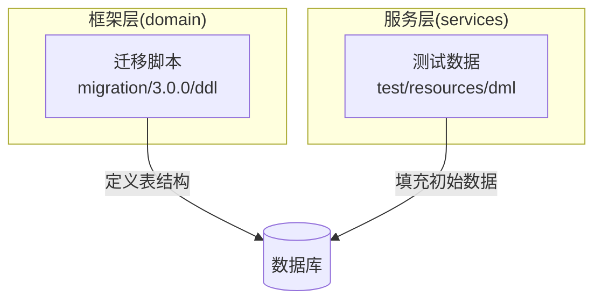
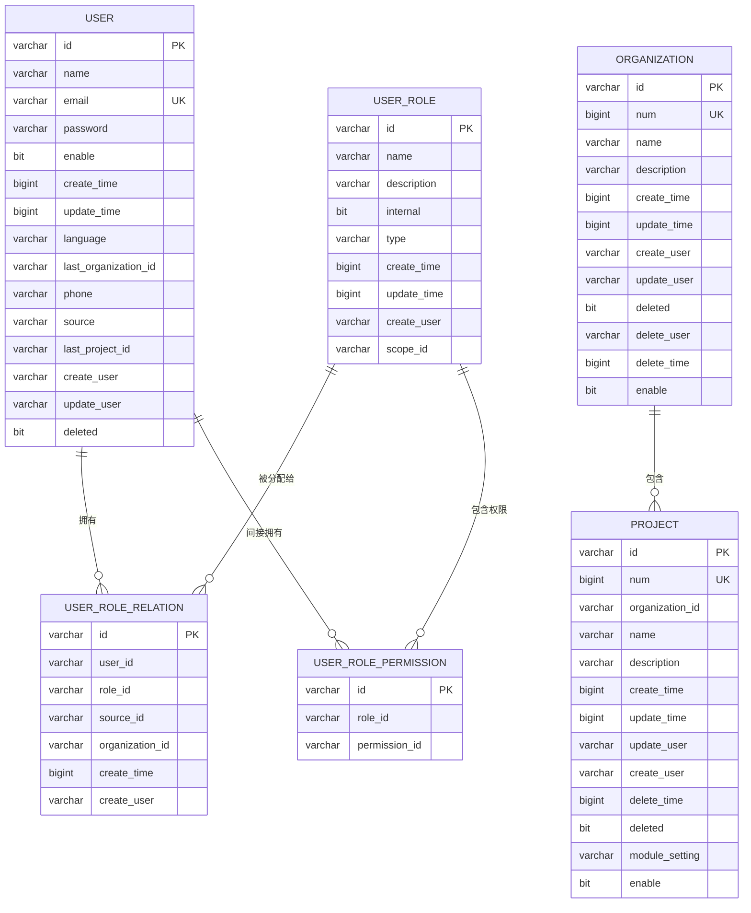
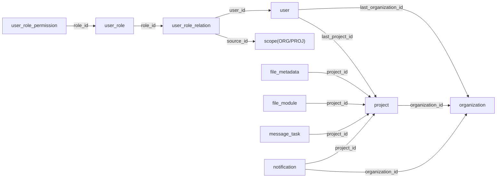

# 核心表结构

<cite>
**本文引用的文件**   
- [V3.0.0_4__project_management.sql](file://backend/framework/domain/src/main/resources/migration/3.0.0/ddl/V3.0.0_4__project_management.sql)
- [V3.0.0_11__system_setting.sql](file://backend/framework/domain/src/main/resources/migration/3.0.0/ddl/V3.0.0_11__system_setting.sql)
- [init_project_member.sql](file://backend/services/project-management/src/test/resources/dml/init_project_member.sql)
- [init_user_org_project.sql](file://backend/services/system-setting/src/test/resources/dml/init_user_org_project.sql)
- [init_organization_user_role.sql](file://backend/services/system-setting/src/test/resources/dml/init_organization_user_role.sql)
</cite>

## 目录
1. [引言](#引言)
2. [项目结构](#项目结构)
3. [核心实体与表概览](#核心实体与表概览)
4. [架构总览](#架构总览)
5. [详细表结构说明](#详细表结构说明)
6. [依赖关系分析](#依赖关系分析)
7. [性能与索引策略](#性能与索引策略)
8. [数据完整性与校验规则](#数据完整性与校验规则)
9. [常见问题排查](#常见问题排查)
10. [结论](#结论)

## 引言
本文聚焦 MeterSphere 的核心基础实体（用户、组织、项目）及其相关支撑表，基于数据库迁移脚本与测试数据，梳理字段定义、数据类型、约束条件、主键设计、外键关系与索引策略，并提供 ER 图、样例数据与建表语句参考路径。文档旨在帮助读者快速理解系统的基础数据模型与业务含义，便于二次开发、运维排障与数据治理。

## 项目结构
MeterSphere 的数据库结构以 Flyway 风格的迁移脚本管理，核心 DDL 位于 framework/domain 模块的 migration 目录下；测试数据位于 services 各子模块的 test/resources/dml 下。本次文档重点引用以下文件：
- 项目与文件等核心表 DDL：[V3.0.0_4__project_management.sql](file://backend/framework/domain/src/main/resources/migration/3.0.0/ddl/V3.0.0_4__project_management.sql)
- 用户、组织、角色、权限、模板、状态流等系统设置 DDL：[V3.0.0_11__system_setting.sql](file://backend/framework/domain/src/main/resources/migration/3.0.0/ddl/V3.0.0_11__system_setting.sql)
- 项目成员与用户/组织/项目初始化测试数据：[init_project_member.sql](file://backend/services/project-management/src/test/resources/dml/init_project_member.sql)
- 多组织多项目测试数据：[init_user_org_project.sql](file://backend/services/system-setting/src/test/resources/dml/init_user_org_project.sql)
- 组织角色与用户初始化测试数据：[init_organization_user_role.sql](file://backend/services/system-setting/src/test/resources/dml/init_organization_user_role.sql)

图表来源
- [V3.0.0_4__project_management.sql:1-366](file://backend/framework/domain/src/main/resources/migration/3.0.0/ddl/V3.0.0_4__project_management.sql#L1-L366)
- [V3.0.0_11__system_setting.sql:1-497](file://backend/framework/domain/src/main/resources/migration/3.0.0/ddl/V3.0.0_11__system_setting.sql#L1-L497)
- [init_project_member.sql:1-25](file://backend/services/project-management/src/test/resources/dml/init_project_member.sql#L1-L25)
- [init_user_org_project.sql:16-45](file://backend/services/system-setting/src/test/resources/dml/init_user_org_project.sql#L16-L45)
- [init_organization_user_role.sql:1-10](file://backend/services/system-setting/src/test/resources/dml/init_organization_user_role.sql#L1-L10)

章节来源
- [V3.0.0_4__project_management.sql:1-366](file://backend/framework/domain/src/main/resources/migration/3.0.0/ddl/V3.0.0_4__project_management.sql#L1-L366)
- [V3.0.0_11__system_setting.sql:1-497](file://backend/framework/domain/src/main/resources/migration/3.0.0/ddl/V3.0.0_11__system_setting.sql#L1-L497)

## 核心实体与表概览
围绕“用户-组织-项目”这一核心骨架，系统提供了如下关键表：
- 用户域
  - user：用户基本信息与登录态
  - user_extend：用户扩展信息（头像、第三方平台信息等）
  - user_key：API Key 管理
  - user_local_config：本地执行配置
  - user_invite：邀请记录
  - user_role：用户组（角色）
  - user_role_relation：用户与用户组的关系
  - user_role_permission：用户组与权限的关系
- 组织域
  - organization：组织基本信息
  - organization_parameter：组织级参数
- 项目域
  - project：项目基本信息
  - project_application：项目应用配置
  - project_version：版本管理
  - project_robot：项目机器人
  - project_test_resource_pool：项目与资源池关联
- 文件与模块
  - file_metadata：文件元数据
  - file_module：文件模块树
  - file_association：文件与业务资源关联
  - file_metadata_repository：存储库拓展信息
  - file_module_repository：存储库模块配置
- 其他支撑
  - custom_function / custom_function_blob：自定义函数
  - fake_error：误报库
  - message_task / message_task_blob：消息通知任务
  - notification：通知日志
  - template / template_custom_field：模板与字段映射
  - status_item / status_definition / status_flow：状态项与流转
  - schedule：定时任务
  - plugin / plugin_script / plugin_organization：插件体系
  - service_integration：服务集成
  - system_parameter：系统参数
  - test_resource_pool / test_resource_pool_blob / test_resource_pool_organization：测试资源池

章节来源
- [V3.0.0_11__system_setting.sql:207-497](file://backend/framework/domain/src/main/resources/migration/3.0.0/ddl/V3.0.0_11__system_setting.sql#L207-L497)
- [V3.0.0_4__project_management.sql:4-188](file://backend/framework/domain/src/main/resources/migration/3.0.0/ddl/V3.0.0_4__project_management.sql#L4-L188)

## 架构总览
下图展示用户、组织、项目以及角色权限之间的核心关系。为简化表达，图中仅保留与“用户-组织-项目”强相关的实体与关系。

图表来源
- [V3.0.0_11__system_setting.sql:207-273](file://backend/framework/domain/src/main/resources/migration/3.0.0/ddl/V3.0.0_11__system_setting.sql#L207-L273)
- [V3.0.0_11__system_setting.sql:295-321](file://backend/framework/domain/src/main/resources/migration/3.0.0/ddl/V3.0.0_11__system_setting.sql#L295-L321)
- [V3.0.0_4__project_management.sql:158-188](file://backend/framework/domain/src/main/resources/migration/3.0.0/ddl/V3.0.0_4__project_management.sql#L158-L188)

## 详细表结构说明

### 用户表 user
- 业务含义：系统用户主表，承载登录认证、语言偏好、最近访问的组织与项目等信息。
- 关键字段
  - id：主键，字符串ID
  - name：用户名
  - email：邮箱，唯一索引
  - password：密码（加密存储）
  - enable：是否启用
  - last_organization_id：最近组织ID（用于上下文切换）
  - last_project_id：最近项目ID
  - source：来源（LOCAL/OIDC/CAS/OAUTH2）
  - create/update/delete 审计字段
- 索引策略
  - 唯一索引：email
  - 普通索引：name, create_time, update_time, last_organization_id, last_project_id, create_user, update_user, deleted

章节来源
- [V3.0.0_11__system_setting.sql:207-239](file://backend/framework/domain/src/main/resources/migration/3.0.0/ddl/V3.0.0_11__system_setting.sql#L207-L239)

### 用户扩展 user_extend
- 业务含义：用户扩展属性，如头像、第三方平台对接信息等。
- 关键字段
  - id：主键，与 user.id 对应
  - platform_info：第三方平台信息（BLOB）
  - avatar：头像URL或标识

章节来源
- [V3.0.0_11__system_setting.sql:323-331](file://backend/framework/domain/src/main/resources/migration/3.0.0/ddl/V3.0.0_11__system_setting.sql#L323-L331)

### 用户 API Key user_key
- 业务含义：为用户生成 API Key，支持永久或过期控制。
- 关键字段
  - id：主键
  - access_key：访问密钥（唯一索引）
  - secret_key：密钥
  - enable：是否启用
  - forever：是否永久有效
  - expire_time：到期时间
  - create_user：创建人

章节来源
- [V3.0.0_11__system_setting.sql:275-294](file://backend/framework/domain/src/main/resources/migration/3.0.0/ddl/V3.0.0_11__system_setting.sql#L275-L294)

### 用户本地配置 user_local_config
- 业务含义：本地执行器相关配置，如 URL、类型（API/UI）、优先级等。
- 关键字段
  - id：主键
  - user_url：本地执行程序URL
  - enable：是否优先本地执行
  - type：API/UI
  - create_user：创建人

章节来源
- [V3.0.0_11__system_setting.sql:479-491](file://backend/framework/domain/src/main/resources/migration/3.0.0/ddl/V3.0.0_11__system_setting.sql#L479-L491)

### 用户邀请记录 user_invite
- 业务含义：记录通过邮件邀请的用户及角色信息。
- 关键字段
  - id：主键
  - email：邀请邮箱
  - roles：所属权限（JSON文本）
  - invite_user：邀请人
  - invite_time：邀请时间

章节来源
- [V3.0.0_11__system_setting.sql:467-477](file://backend/framework/domain/src/main/resources/migration/3.0.0/ddl/V3.0.0_11__system_setting.sql#L467-L477)

### 用户组 user_role
- 业务含义：用户组（角色），支持 SYSTEM/ORGANIZATION/PROJECT 三种作用域。
- 关键字段
  - id：主键
  - name：组名
  - description：描述
  - internal：是否内置
  - type：作用域类型
  - scope_id：作用域ID（组织或项目ID）
  - create/update 审计字段

章节来源
- [V3.0.0_11__system_setting.sql:24-46](file://backend/framework/domain/src/main/resources/migration/3.0.0/ddl/V3.0.0_11__system_setting.sql#L24-L46)

### 用户组关系 user_role_relation
- 业务含义：用户与用户组的关联，同时记录所在组织与作用域ID。
- 关键字段
  - id：主键
  - user_id：用户ID
  - role_id：用户组ID
  - source_id：组织或项目ID
  - organization_id：记录所在组织ID
  - create_time/create_user：审计字段

章节来源
- [V3.0.0_11__system_setting.sql:241-259](file://backend/framework/domain/src/main/resources/migration/3.0.0/ddl/V3.0.0_11__system_setting.sql#L241-L259)

### 用户组权限 user_role_permission
- 业务含义：用户组与权限点的映射。
- 关键字段
  - id：主键
  - role_id：用户组ID
  - permission_id：权限ID

章节来源
- [V3.0.0_11__system_setting.sql:261-273](file://backend/framework/domain/src/main/resources/migration/3.0.0/ddl/V3.0.0_11__system_setting.sql#L261-L273)

### 组织 organization
- 业务含义：组织是项目的容器，具备独立编号、名称、描述与启用状态。
- 关键字段
  - id：主键
  - num：组织编号（唯一）
  - name：组织名
  - description：描述
  - enable：是否启用
  - create/update/delete 审计字段

章节来源
- [V3.0.0_11__system_setting.sql:295-321](file://backend/framework/domain/src/main/resources/migration/3.0.0/ddl/V3.0.0_11__system_setting.sql#L295-L321)

### 组织参数 organization_parameter
- 业务含义：组织级别的键值对配置。
- 关键字段
  - organization_id：组织ID（复合主键的一部分）
  - param_key：参数键（复合主键的一部分）
  - param_value：参数值

章节来源
- [V3.0.0_11__system_setting.sql:457-464](file://backend/framework/domain/src/main/resources/migration/3.0.0/ddl/V3.0.0_11__system_setting.sql#L457-L464)

### 项目 project
- 业务含义：项目是功能与资源的隔离单元，隶属于某个组织。
- 关键字段
  - id：主键
  - num：项目编号（唯一）
  - organization_id：所属组织ID
  - name：项目名称
  - description：描述
  - enable：是否启用
  - module_setting：模块设置（JSON或配置串）
  - create/update/delete 审计字段

章节来源
- [V3.0.0_4__project_management.sql:158-188](file://backend/framework/domain/src/main/resources/migration/3.0.0/ddl/V3.0.0_4__project_management.sql#L158-L188)

### 项目应用 project_application
- 业务含义：项目维度的应用开关或配置项（Key-Value）。
- 关键字段
  - project_id：项目ID（复合主键的一部分）
  - type：配置项类型（复合主键的一部分）
  - type_value：配置值

章节来源
- [V3.0.0_4__project_management.sql:189-200](file://backend/framework/domain/src/main/resources/migration/3.0.0/ddl/V3.0.0_4__project_management.sql#L189-L200)

### 版本管理 project_version
- 业务含义：项目维度的版本管理，支持发布周期与最新标记。
- 关键字段
  - id：主键
  - project_id：项目ID
  - name：版本名
  - description：描述
  - status：状态
  - latest：是否最新版
  - publish_time/start_time/end_time：时间窗口
  - create_time/create_user：审计字段

章节来源
- [V3.0.0_4__project_management.sql:202-225](file://backend/framework/domain/src/main/resources/migration/3.0.0/ddl/V3.0.0_4__project_management.sql#L202-L225)

### 项目机器人 project_robot
- 业务含义：项目维度的消息机器人（飞书/钉钉/企微/自定义）。
- 关键字段
  - id：主键
  - project_id：项目ID
  - name：名称
  - platform：平台
  - webhook：回调地址
  - type：自定义或内部
  - app_key/app_secret：平台凭证
  - enable：是否启用
  - create/update 审计字段

章节来源
- [V3.0.0_4__project_management.sql:329-352](file://backend/framework/domain/src/main/resources/migration/3.0.0/ddl/V3.0.0_4__project_management.sql#L329-L352)

### 项目与资源池关联 project_test_resource_pool
- 业务含义：项目与测试资源池的多对多关系。
- 关键字段
  - project_id：项目ID（复合主键的一部分）
  - test_resource_pool_id：资源池ID（复合主键的一部分）

章节来源
- [V3.0.0_4__project_management.sql:355-362](file://backend/framework/domain/src/main/resources/migration/3.0.0/ddl/V3.0.0_4__project_management.sql#L355-L362)

### 文件与模块（与项目强相关）
- file_metadata：文件元数据，含项目ID、存储方式、标签、描述、模块ID、路径、最新版本标记、ref_id 等。
- file_module：文件模块树，含项目ID、父ID、排序、模块类型（module/repository）。
- file_association：文件与业务资源关联（source_type/source_id/file_id/file_ref_id/file_version）。
- file_metadata_repository：存储库拓展（branch/commit_id/commit_message）。
- file_module_repository：存储库模块配置（platform/url/token/user_name）。

章节来源
- [V3.0.0_4__project_management.sql:53-156](file://backend/framework/domain/src/main/resources/migration/3.0.0/ddl/V3.0.0_4__project_management.sql#L53-L156)

### 消息通知与日志
- message_task：消息通知任务（事件、接收人、机器人、任务类型、测试ID、项目ID、模板开关、标题等）。
- message_task_blob：消息模板大字段。
- notification：通知日志（类型、接收人、标题、状态、操作人、操作、资源ID/类型/名称、内容等）。

章节来源
- [V3.0.0_4__project_management.sql:254-327](file://backend/framework/domain/src/main/resources/migration/3.0.0/ddl/V3.0.0_4__project_management.sql#L254-L327)

### 模板与状态流
- template：模板定义（名称、备注、作用域、场景、第三方API字段开关、ref_id）。
- template_custom_field：模板与字段的关联（必填、系统字段、排序、API字段名、默认值）。
- status_item：状态项（名称、场景、备注、作用域、ref_id、排序）。
- status_definition：状态定义（status_id/definition_id）。
- status_flow：状态流转（from_id/to_id）。

章节来源
- [V3.0.0_11__system_setting.sql:382-454](file://backend/framework/domain/src/main/resources/migration/3.0.0/ddl/V3.0.0_11__system_setting.sql#L382-L454)

### 定时任务与系统参数
- schedule：定时任务（cron表达式、Job类名、资源类型、资源ID、项目ID、名称、配置）。
- system_parameter：系统参数（param_key/param_value/type）。

章节来源
- [V3.0.0_11__system_setting.sql:112-167](file://backend/framework/domain/src/main/resources/migration/3.0.0/ddl/V3.0.0_11__system_setting.sql#L112-L167)

### 插件与服务集成
- plugin：插件定义（名称、plugin_id、文件名、启用、全局、企业版、场景）。
- plugin_script：插件前端脚本（plugin_id/script_id/script）。
- plugin_organization：插件与组织关联。
- service_integration：服务集成（插件ID、启用、配置、组织ID）。

章节来源
- [V3.0.0_11__system_setting.sql:73-157](file://backend/framework/domain/src/main/resources/migration/3.0.0/ddl/V3.0.0_11__system_setting.sql#L73-L157)

### 测试资源池
- test_resource_pool：资源池定义（名称、类型、描述、启用、适用场景、服务器地址、全组织可用、删除标记）。
- test_resource_pool_blob：资源节点配置大字段。
- test_resource_pool_organization：资源池与组织关联。

章节来源
- [V3.0.0_11__system_setting.sql:169-205](file://backend/framework/domain/src/main/resources/migration/3.0.0/ddl/V3.0.0_11__system_setting.sql#L169-L205)

## 依赖关系分析
- 用户与组织/项目
  - user.last_organization_id 与 user.last_project_id 作为上下文指针，指向最近使用的组织与项目。
  - user_role_relation.source_id 表示该角色授予的作用域（组织或项目），organization_id 表示该关系记录所在的组织范围。
- 组织与项目
  - project.organization_id 指向 organization.id，体现“组织包含项目”的层级关系。
- 角色与权限
  - user_role 与 user_role_permission 构成“角色-权限”映射；user_role_relation 将用户与角色关联起来，形成“用户-角色-权限”的授权链。
- 文件与项目
  - file_metadata.project_id 指向 project.id，文件属于项目。
  - file_module.project_id 指向 project.id，模块属于项目。
- 消息与项目
  - message_task.project_id 指向 project.id，消息任务属于项目。
  - notification.project_id 与 notification.organization_id 分别记录资源所属的项目与组织。

图表来源
- [V3.0.0_11__system_setting.sql:207-273](file://backend/framework/domain/src/main/resources/migration/3.0.0/ddl/V3.0.0_11__system_setting.sql#L207-L273)
- [V3.0.0_4__project_management.sql:158-188](file://backend/framework/domain/src/main/resources/migration/3.0.0/ddl/V3.0.0_4__project_management.sql#L158-L188)
- [V3.0.0_4__project_management.sql:53-156](file://backend/framework/domain/src/main/resources/migration/3.0.0/ddl/V3.0.0_4__project_management.sql#L53-L156)
- [V3.0.0_4__project_management.sql:254-327](file://backend/framework/domain/src/main/resources/migration/3.0.0/ddl/V3.0.0_4__project_management.sql#L254-L327)

## 性能与索引策略
- 高频查询字段均建立索引
  - 用户：email（唯一）、name、create_time、update_time、last_organization_id、last_project_id、create_user、update_user、deleted
  - 组织：name、create_time、update_time、create_user、update_user、deleted
  - 项目：organization_id、create_user、create_time、update_time、name、deleted、update_user
  - 文件：name、latest、ref_id、storage、module_id、project_id
  - 模块：project_id、name、create_time、update_time、pos、create_user，且存在联合唯一索引（project_id,name,module_type,parent_id）
  - 消息任务：project_id、create_time、test_id、task_type、project_robot_id、event、enable、use_default_subject、use_default_template
  - 通知：receiver、create_time、type、subject、resource_type、operator、resource_id、project_id、organization_id
  - 资源池：name、type、deleted、enable、create_time、update_time、create_user、all_org
- 大字段分离
  - 自定义函数、消息模板、资源池配置等大字段使用 *_blob 表拆分，避免主表膨胀。
- 时间倒序索引
  - 多处采用 create_time desc / update_time desc 索引，优化按时间倒序分页查询。

章节来源
- [V3.0.0_11__system_setting.sql:231-239](file://backend/framework/domain/src/main/resources/migration/3.0.0/ddl/V3.0.0_11__system_setting.sql#L231-L239)
- [V3.0.0_11__system_setting.sql:316-321](file://backend/framework/domain/src/main/resources/migration/3.0.0/ddl/V3.0.0_11__system_setting.sql#L316-L321)
- [V3.0.0_4__project_management.sql:181-187](file://backend/framework/domain/src/main/resources/migration/3.0.0/ddl/V3.0.0_4__project_management.sql#L181-L187)
- [V3.0.0_4__project_management.sql:122-127](file://backend/framework/domain/src/main/resources/migration/3.0.0/ddl/V3.0.0_4__project_management.sql#L122-L127)
- [V3.0.0_4__project_management.sql:149-155](file://backend/framework/domain/src/main/resources/migration/3.0.0/ddl/V3.0.0_4__project_management.sql#L149-L155)
- [V3.0.0_4__project_management.sql:277-285](file://backend/framework/domain/src/main/resources/migration/3.0.0/ddl/V3.0.0_4__project_management.sql#L277-L285)
- [V3.0.0_4__project_management.sql:318-326](file://backend/framework/domain/src/main/resources/migration/3.0.0/ddl/V3.0.0_4__project_management.sql#L318-L326)
- [V3.0.0_11__system_setting.sql:198-205](file://backend/framework/domain/src/main/resources/migration/3.0.0/ddl/V3.0.0_11__system_setting.sql#L198-L205)

## 数据完整性与校验规则
- 唯一性约束
  - user.email：唯一索引，保证邮箱唯一
  - organization.num：唯一约束，组织编号唯一
  - project.num：唯一约束，项目编号唯一
  - file_module：联合唯一索引（project_id,name,module_type,parent_id），防止同项目下同名模块重复
  - user_key.access_key：唯一索引，确保API Key唯一
- 主键设计
  - 所有核心表均以 id 为主键（VARCHAR(50)），部分表使用复合主键（如 project_application、project_test_resource_pool、custom_field_option、status_definition、plugin_script）。
- 软删除与审计
  - 多数表包含 deleted、delete_user、delete_time 与 create/update 审计字段，便于追踪数据生命周期。
- 作用域与范围
  - user_role.type 限定作用域（SYSTEM/ORGANIZATION/PROJECT），scope_id 指定具体作用域ID。
  - user_role_relation.organization_id 明确记录归属组织，便于跨组织权限计算。
- 启用/禁用控制
  - 多处使用 enable 位字段控制功能开关（如 user.enable、project.enable、test_resource_pool.enable、schedule.enable 等）。

章节来源
- [V3.0.0_11__system_setting.sql:231-239](file://backend/framework/domain/src/main/resources/migration/3.0.0/ddl/V3.0.0_11__system_setting.sql#L231-L239)
- [V3.0.0_11__system_setting.sql:309-310](file://backend/framework/domain/src/main/resources/migration/3.0.0/ddl/V3.0.0_11__system_setting.sql#L309-L310)
- [V3.0.0_4__project_management.sql:174-176](file://backend/framework/domain/src/main/resources/migration/3.0.0/ddl/V3.0.0_4__project_management.sql#L174-L176)
- [V3.0.0_4__project_management.sql:155](file://backend/framework/domain/src/main/resources/migration/3.0.0/ddl/V3.0.0_4__project_management.sql#L155)
- [V3.0.0_11__system_setting.sql:292-293](file://backend/framework/domain/src/main/resources/migration/3.0.0/ddl/V3.0.0_11__system_setting.sql#L292-L293)
- [V3.0.0_11__system_setting.sql:24-46](file://backend/framework/domain/src/main/resources/migration/3.0.0/ddl/V3.0.0_11__system_setting.sql#L24-L46)
- [V3.0.0_11__system_setting.sql:241-259](file://backend/framework/domain/src/main/resources/migration/3.0.0/ddl/V3.0.0_11__system_setting.sql#L241-L259)

## 常见问题排查
- 无法登录或提示邮箱已存在
  - 检查 user.email 是否已被占用，确认新增用户时邮箱唯一性。
- 项目创建失败
  - 检查 project.num 是否冲突（唯一约束），确认 organization_id 是否存在。
- 模块命名冲突
  - 检查 file_module 的联合唯一索引（project_id,name,module_type,parent_id），避免同项目下同名模块重复。
- 权限不生效
  - 检查 user_role_relation 是否正确关联 user_id、role_id、source_id 与 organization_id；确认 user_role.type 与 scope_id 匹配。
- 消息通知未触发
  - 检查 message_task 的 enable、use_default_template、use_default_subject 等开关，以及 project_robot 是否启用并配置正确 webhook。

章节来源
- [V3.0.0_11__system_setting.sql:231-239](file://backend/framework/domain/src/main/resources/migration/3.0.0/ddl/V3.0.0_11__system_setting.sql#L231-L239)
- [V3.0.0_4__project_management.sql:174-176](file://backend/framework/domain/src/main/resources/migration/3.0.0/ddl/V3.0.0_4__project_management.sql#L174-L176)
- [V3.0.0_4__project_management.sql:155](file://backend/framework/domain/src/main/resources/migration/3.0.0/ddl/V3.0.0_4__project_management.sql#L155)
- [V3.0.0_11__system_setting.sql:241-259](file://backend/framework/domain/src/main/resources/migration/3.0.0/ddl/V3.0.0_11__system_setting.sql#L241-L259)
- [V3.0.0_4__project_management.sql:277-285](file://backend/framework/domain/src/main/resources/migration/3.0.0/ddl/V3.0.0_4__project_management.sql#L277-L285)

## 结论
MeterSphere 的核心表结构以“用户-组织-项目”为主线，辅以角色权限、文件模块、消息通知、模板状态流、定时任务与插件体系等支撑表，形成了清晰的数据分层与职责边界。通过合理的主键设计、唯一约束、软删除与审计字段，以及针对高频查询的索引策略，系统在可扩展性与性能之间取得平衡。建议在二次开发中严格遵循现有约束与索引规范，并在涉及权限与作用域的场景中谨慎维护 user_role_relation 与 user_role 的配置一致性。