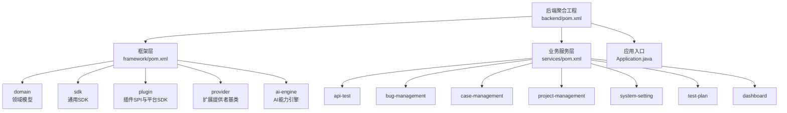
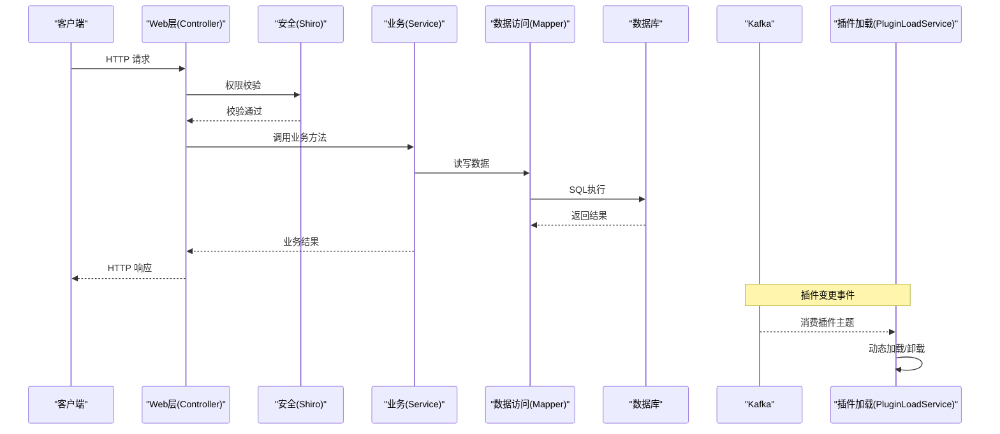
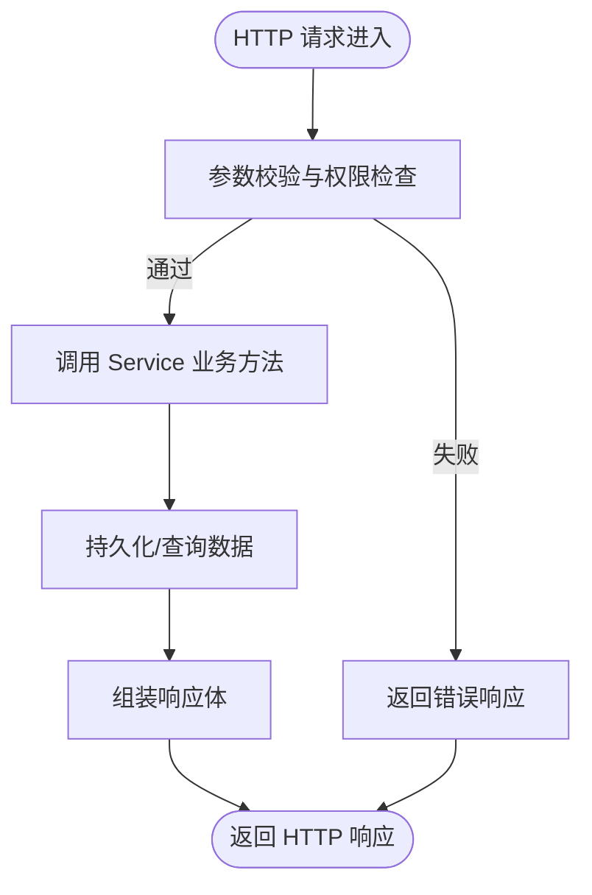
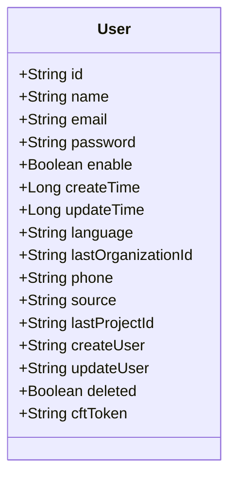
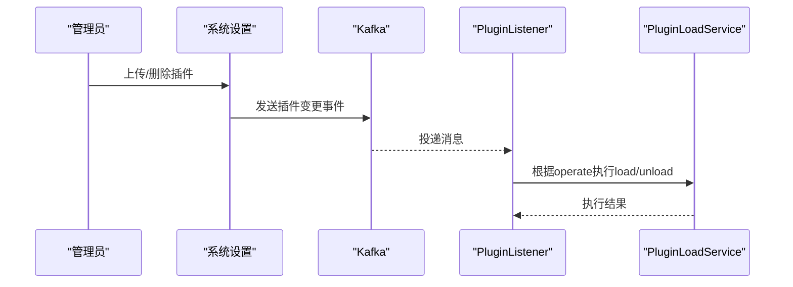
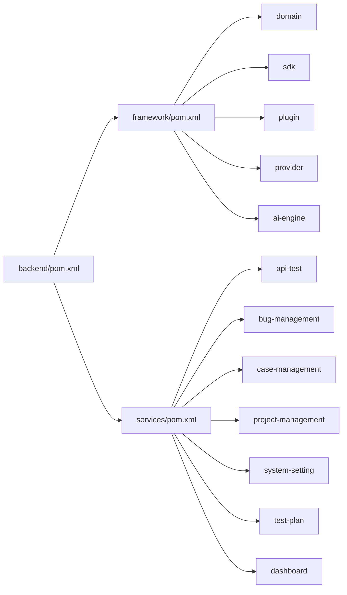

# 后端架构设计

<cite>
**本文引用的文件**   
- [Application.java](file://backend/app/src/main/java/io/metersphere/Application.java)
- [pom.xml（后端聚合）](file://backend/pom.xml)
- [framework/pom.xml](file://backend/framework/pom.xml)
- [services/pom.xml](file://backend/services/pom.xml)
- [MybatisConfig.java](file://backend/services/system-setting/src/main/java/io/metersphere/system/config/MybatisConfig.java)
- [ShiroConfig.java](file://backend/services/system-setting/src/main/java/io/metersphere/system/config/ShiroConfig.java)
- [UserController.java](file://backend/services/system-setting/src/main/java/io/metersphere/system/controller/UserController.java)
- [User.java](file://backend/framework/domain/src/main/java/io/metersphere/system/domain/User.java)
- [PluginListener.java](file://backend/services/system-setting/src/main/java/io/metersphere/system/listener/PluginListener.java)
</cite>

## 目录
1. [引言](#引言)
2. [项目结构](#项目结构)
3. [核心组件](#核心组件)
4. [架构总览](#架构总览)
5. [详细组件分析](#详细组件分析)
6. [依赖关系分析](#依赖关系分析)
7. [性能与可扩展性](#性能与可扩展性)
8. [故障排查指南](#故障排查指南)
9. [结论](#结论)

## 引言
本文件面向 MeterSphere 3.x 后端，系统性阐述基于 Spring Boot 3.x + Java 21 的架构设计与实现要点。文档覆盖 MVC 分层、模块化服务划分、框架层能力封装、领域模型设计、插件化架构、事件驱动与异步消息、配置管理、安全认证与事务管理等横切关注点，帮助读者快速理解系统整体结构与关键流程。

## 项目结构
后端采用多模块 Maven 工程，顶层聚合模块将 framework、services、app 三个子模块统一构建：
- app：应用启动入口与基础资源装配
- framework：框架与领域能力沉淀（domain、sdk、plugin、provider、ai-engine）
- services：按业务域拆分的微服务式模块（api-test、bug-management、case-management、project-management、system-setting、test-plan、dashboard）

图表来源
- [pom.xml（后端聚合）:16-20](file://backend/pom.xml#L16-L20)
- [framework/pom.xml:16-22](file://backend/framework/pom.xml#L16-L22)
- [services/pom.xml:22-30](file://backend/services/pom.xml#L22-L30)

章节来源
- [pom.xml（后端聚合）:1-20](file://backend/pom.xml#L1-L20)
- [framework/pom.xml:1-22](file://backend/framework/pom.xml#L1-L22)
- [services/pom.xml:1-30](file://backend/services/pom.xml#L1-L30)

## 核心组件
- 应用启动与配置加载
  - 通过 @SpringBootApplication 排除不需要的自动装配，启用 Servlet 扫描与自定义属性源，并开启外部配置文件与内置 MinIO/JMeter 等配置项绑定。
- 数据访问与多数据源
  - 使用 MyBatis + HikariCP，提供主数据源与 Quartz 独立数据源，支持用户信息脱敏拦截器。
- 安全与权限
  - 基于 Shiro 的会话管理与缓存集成，结合 Realm 进行本地认证；通过注解进行权限控制。
- 控制器与服务
  - 以 UserController 为例，展示 Controller → Service → Mapper 的分层调用与参数校验、日志记录、权限控制等横切逻辑。
- 领域模型
  - User 实体包含字段校验分组、Swagger 描述、列映射枚举等，体现领域建模规范。
- 插件化与事件驱动
  - 通过 Kafka 监听插件变更事件，触发插件动态加载/卸载，支撑多实例一致性。

章节来源
- [Application.java:14-27](file://backend/app/src/main/java/io/metersphere/Application.java#L14-L27)
- [MybatisConfig.java:53-95](file://backend/services/system-setting/src/main/java/io/metersphere/system/config/MybatisConfig.java#L53-L95)
- [ShiroConfig.java:62-97](file://backend/services/system-setting/src/main/java/io/metersphere/system/config/ShiroConfig.java#L62-L97)
- [UserController.java:48-204](file://backend/services/system-setting/src/main/java/io/metersphere/system/controller/UserController.java#L48-L204)
- [User.java:11-159](file://backend/framework/domain/src/main/java/io/metersphere/system/domain/User.java#L11-L159)
- [PluginListener.java:14-41](file://backend/services/system-setting/src/main/java/io/metersphere/system/listener/PluginListener.java#L14-L41)

## 架构总览
下图展示了从请求进入、权限校验、业务处理到数据持久化的典型链路，以及插件化与事件驱动的横向扩展点。

图表来源
- [UserController.java:48-204](file://backend/services/system-setting/src/main/java/io/metersphere/system/controller/UserController.java#L48-L204)
- [ShiroConfig.java:62-97](file://backend/services/system-setting/src/main/java/io/metersphere/system/config/ShiroConfig.java#L62-L97)
- [MybatisConfig.java:53-95](file://backend/services/system-setting/src/main/java/io/metersphere/system/config/MybatisConfig.java#L53-L95)
- [PluginListener.java:14-41](file://backend/services/system-setting/src/main/java/io/metersphere/system/listener/PluginListener.java#L14-L41)

## 详细组件分析

### 应用启动与配置管理
- 启动类排除不必要的自动装配，避免引入未使用的特性（如 Quartz/LDAP/Neo4j）。
- 通过 @PropertySource 加载默认与外部配置文件，支持容器化部署时的外部化配置。
- 使用 @EnableConfigurationProperties 暴露 MinIO 与 JMeter 的配置项，便于集中管理。

章节来源
- [Application.java:14-27](file://backend/app/src/main/java/io/metersphere/Application.java#L14-L27)

### 数据访问与多数据源
- 主数据源与 Quartz 数据源分离，分别绑定不同配置前缀，避免调度任务与业务数据互相影响。
- 注入用户信息脱敏拦截器，保障敏感字段在查询时自动脱敏。
- 使用 HikariCP 作为连接池，提升并发性能与稳定性。

章节来源
- [MybatisConfig.java:53-95](file://backend/services/system-setting/src/main/java/io/metersphere/system/config/MybatisConfig.java#L53-L95)

### 安全认证与权限控制
- 基于 Shiro 的 DefaultWebSecurityManager，集成 SessionManager 与 CacheManager。
- 通过 LocalRealm 完成本地认证，配合 LifecycleBeanPostProcessor 与 AdvisorAutoProxyCreator 保证 AOP 与生命周期正确。
- 控制器层使用 @RequiresPermissions 进行细粒度权限控制。

章节来源
- [ShiroConfig.java:62-97](file://backend/services/system-setting/src/main/java/io/metersphere/system/config/ShiroConfig.java#L62-L97)
- [UserController.java:67-204](file://backend/services/system-setting/src/main/java/io/metersphere/system/controller/UserController.java#L67-L204)

### 控制器与服务分层（MVC）
- Controller 负责入参校验、权限校验、日志记录与结果封装。
- Service 承载业务编排与跨域协调。
- Mapper 对接数据库，遵循 MyBatis 约定。
- 示例接口涵盖用户新增、更新、分页、批量操作、邀请注册等场景。

图表来源
- [UserController.java:67-204](file://backend/services/system-setting/src/main/java/io/metersphere/system/controller/UserController.java#L67-L204)

章节来源
- [UserController.java:48-204](file://backend/services/system-setting/src/main/java/io/metersphere/system/controller/UserController.java#L48-L204)

### 领域模型设计（Domain）
- User 实体包含基础身份信息、来源、状态、审计字段等，并提供 Column 枚举用于动态 SQL 生成与排序。
- 使用 Bean Validation 分组校验（Created/Updated），结合 Swagger 注解完善 API 文档。

图表来源
- [User.java:11-159](file://backend/framework/domain/src/main/java/io/metersphere/system/domain/User.java#L11-L159)

章节来源
- [User.java:11-159](file://backend/framework/domain/src/main/java/io/metersphere/system/domain/User.java#L11-L159)

### 插件化架构与事件驱动
- 插件消费者通过 Kafka 监听插件主题，根据操作类型（新增/删除）调用插件加载服务进行动态加载或卸载。
- 该机制支持集群环境下插件状态的最终一致性与弹性扩缩容。

图表来源
- [PluginListener.java:14-41](file://backend/services/system-setting/src/main/java/io/metersphere/system/listener/PluginListener.java#L14-L41)

章节来源
- [PluginListener.java:14-41](file://backend/services/system-setting/src/main/java/io/metersphere/system/listener/PluginListener.java#L14-L41)

### 模块化服务设计
- api-test：API 测试用例、场景编排、报告等
- bug-management：缺陷管理
- case-management：功能用例管理
- project-management：项目管理、成员、环境、脚本等
- system-setting：系统设置、组织/项目/用户/角色/插件/通知等
- test-plan：测试计划与执行
- dashboard：数据看板

章节来源
- [services/pom.xml:22-30](file://backend/services/pom.xml#L22-L30)

## 依赖关系分析
- 顶层 backend 聚合工程统一管理版本与公共依赖，包含测试容器、MockServer、嵌入式中间件等测试基础设施。
- framework 聚合 domain/sdk/plugin/provider/ai-engine，沉淀可复用能力。
- services 聚合各业务模块，并依赖 ai-engine 提供 AI 能力。

图表来源
- [pom.xml（后端聚合）:16-20](file://backend/pom.xml#L16-L20)
- [framework/pom.xml:16-22](file://backend/framework/pom.xml#L16-L22)
- [services/pom.xml:22-30](file://backend/services/pom.xml#L22-L30)

章节来源
- [pom.xml（后端聚合）:1-121](file://backend/pom.xml#L1-L121)
- [framework/pom.xml:1-22](file://backend/framework/pom.xml#L1-L22)
- [services/pom.xml:1-30](file://backend/services/pom.xml#L1-L30)

## 性能与可扩展性
- 连接池与数据源
  - HikariCP 高吞吐连接池，主库与 Quartz 库分离，降低调度对业务的抖动影响。
- 异步与解耦
  - 通过 Kafka 实现插件变更的异步解耦，支持水平扩展与多实例一致性。
- 安全与鉴权
  - Shiro 会话与缓存结合，减少重复认证开销；细粒度权限注解降低越权风险。
- 可观测性与可维护性
  - 控制器层统一日志注解与操作审计，便于问题定位与合规审计。

[本节为通用指导，无需代码引用]

## 故障排查指南
- 启动阶段
  - 检查外部配置文件路径与编码是否正确，确认 MinIO/JMeter 配置是否生效。
- 数据访问
  - 核对 Hikari 连接池配置与主/Quartz 数据源区分，确认脱敏拦截器是否生效。
- 权限与安全
  - 若出现无权限异常，检查 Shiro Realm 配置与控制器权限注解是否匹配。
- 插件相关
  - 若插件未生效，检查 Kafka 主题与消费者 groupId 唯一性，确认 PluginListener 是否消费到消息。

章节来源
- [Application.java:14-27](file://backend/app/src/main/java/io/metersphere/Application.java#L14-L27)
- [MybatisConfig.java:53-95](file://backend/services/system-setting/src/main/java/io/metersphere/system/config/MybatisConfig.java#L53-L95)
- [ShiroConfig.java:62-97](file://backend/services/system-setting/src/main/java/io/metersphere/system/config/ShiroConfig.java#L62-L97)
- [PluginListener.java:14-41](file://backend/services/system-setting/src/main/java/io/metersphere/system/listener/PluginListener.java#L14-L41)

## 结论
MeterSphere 3.x 后端以 Spring Boot 3.x + Java 21 为基础，采用清晰的 MVC 分层与模块化服务拆分，沉淀了框架层能力与领域模型，并通过插件化与事件驱动增强扩展性。在多数据源、安全认证、异步消息与可观测性等横切关注点上提供了稳定可靠的实现，为持续演进与规模化使用奠定了坚实基础。