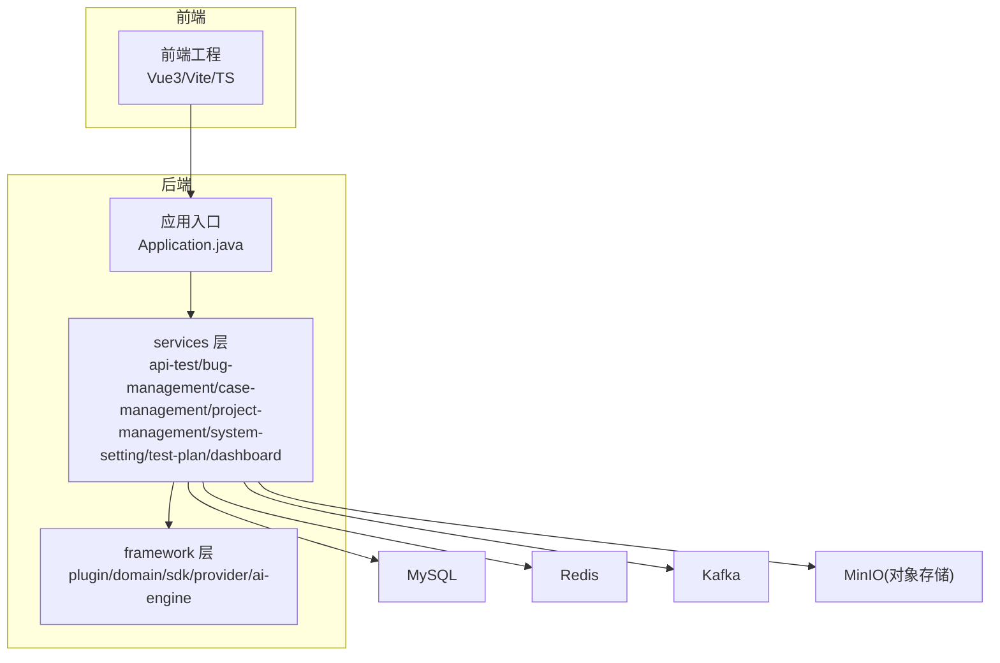
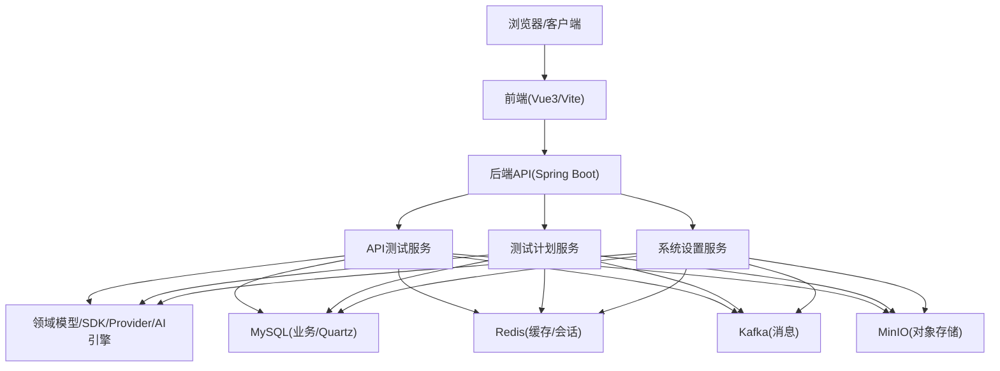
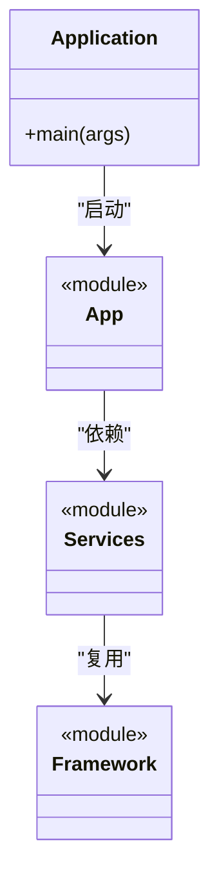
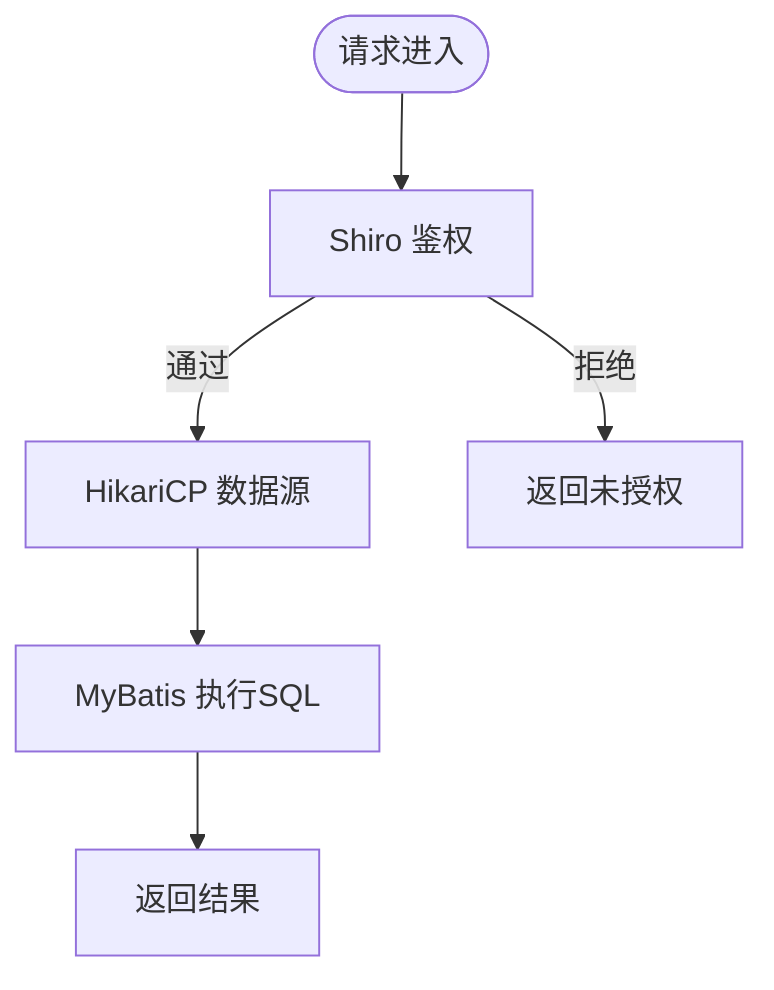
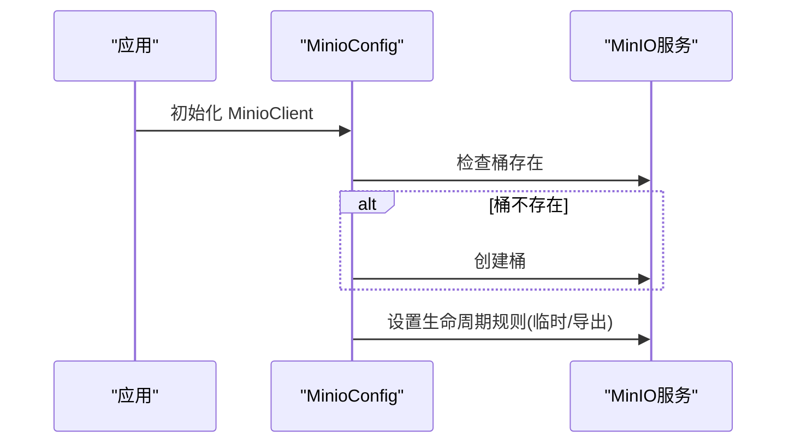
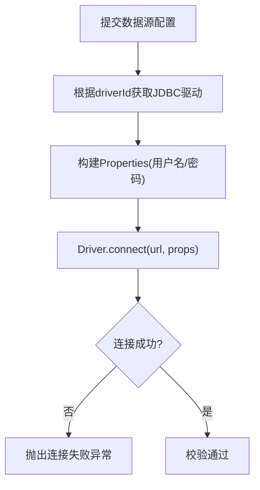
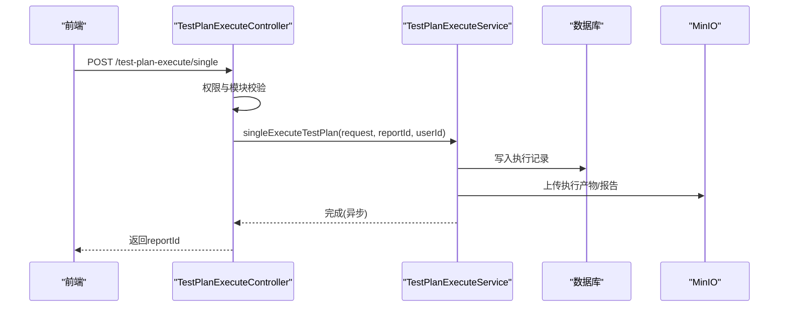
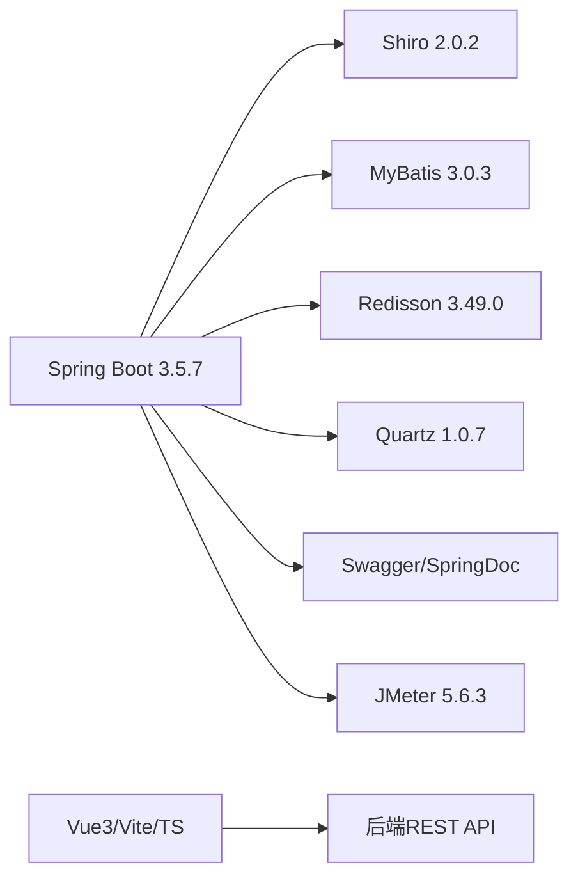
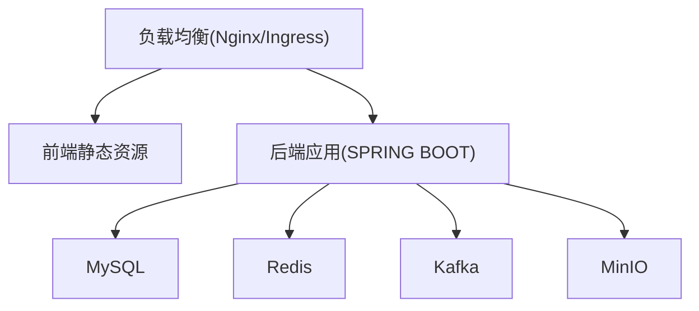

# 整体架构概览

<cite>
**本文引用的文件**   
- [README.md](file://README.md)
- [pom.xml](file://pom.xml)
- [backend/pom.xml](file://backend/pom.xml)
- [backend/framework/pom.xml](file://backend/framework/pom.xml)
- [backend/services/pom.xml](file://backend/services/pom.xml)
- [Application.java](file://backend/app/src/main/java/io/metersphere/Application.java)
- [MybatisConfig.java](file://backend/services/system-setting/src/main/java/io/metersphere/system/config/MybatisConfig.java)
- [ShiroConfig.java](file://backend/services/system-setting/src/main/java/io/metersphere/system/config/ShiroConfig.java)
- [MinioProperties.java](file://backend/services/system-setting/src/main/java/io/metersphere/system/config/MinioProperties.java)
- [MinioConfig.java](file://backend/services/system-setting/src/main/java/io/metersphere/system/config/MinioConfig.java)
- [EnvironmentService.java](file://backend/services/project-management/src/main/java/io/metersphere/project/service/EnvironmentService.java)
- [TestPlanExecuteController.java](file://backend/services/test-plan/src/main/java/io/metersphere/plan/controller/TestPlanExecuteController.java)
- [package.json](file://frontend/package.json)
</cite>

## 目录
1. [引言](#引言)
2. [项目结构](#项目结构)
3. [核心组件](#核心组件)
4. [架构总览](#架构总览)
5. [详细组件分析](#详细组件分析)
6. [依赖关系分析](#依赖关系分析)
7. [性能与可扩展性](#性能与可扩展性)
8. [部署与基础设施](#部署与基础设施)
9. [故障排查指南](#故障排查指南)
10. [结论](#结论)

## 引言
本文件为 MeterSphere 3.x 的整体架构概览，面向产品、研发与运维读者，系统阐述前后端分离架构、后端模块化分层（services、framework、domain）、微服务友好设计原则、核心组件交互与数据流向、技术选型与权衡、系统边界与基础设施要求，以及主要技术栈版本与第三方依赖。

MeterSphere 是新一代开源持续测试工具，内置 AI 助手，覆盖用例管理、接口调试与自动化、测试计划执行、缺陷管理与报告等能力，强调团队协作与插件扩展。

**章节来源**
- [README.md:16-22](file://README.md#L16-L22)

## 项目结构
仓库采用前后端分离的双工程结构：
- 前端：Vue 3 + Vite + TypeScript，提供 Web UI 与业务页面
- 后端：Spring Boot 多模块 Maven 工程，包含 framework（基础框架与领域模型）、services（业务能力域）、app（应用启动与装配）

**图表来源**
- [Application.java:14-30](file://backend/app/src/main/java/io/metersphere/Application.java#L14-L30)
- [backend/pom.xml:16-20](file://backend/pom.xml#L16-L20)
- [backend/framework/pom.xml:16-22](file://backend/framework/pom.xml#L16-L22)
- [backend/services/pom.xml:22-30](file://backend/services/pom.xml#L22-L30)

**章节来源**
- [pom.xml:97-100](file://pom.xml#L97-L100)
- [backend/pom.xml:16-20](file://backend/pom.xml#L16-L20)
- [backend/framework/pom.xml:16-22](file://backend/framework/pom.xml#L16-L22)
- [backend/services/pom.xml:22-30](file://backend/services/pom.xml#L22-L30)

## 核心组件
- 应用入口与装配
  - Spring Boot 主类负责排除不必要的自动配置、加载外部配置文件、启用 MinIO 与 JMeter 属性绑定，并扫描 Servlet 组件。
- 安全与认证
  - Shiro 集成用于会话管理与权限控制，结合缓存管理器与自定义 Realm。
- 数据访问
  - MyBatis + HikariCP 双数据源（业务库与 Quartz），支持连接池与拦截器。
- 对象存储
  - MinIO 客户端初始化、桶生命周期策略配置（临时文件与导出文件过期）。
- 环境数据源校验
  - 通过 JDBC 驱动动态校验用户配置的数据库连接可用性。
- 测试计划执行
  - 异步虚拟线程触发执行流程，返回报告 ID，便于前端轮询或 WebSocket 推送结果。

**章节来源**
- [Application.java:14-30](file://backend/app/src/main/java/io/metersphere/Application.java#L14-L30)
- [ShiroConfig.java:62-97](file://backend/services/system-setting/src/main/java/io/metersphere/system/config/ShiroConfig.java#L62-L97)
- [MybatisConfig.java:53-95](file://backend/services/system-setting/src/main/java/io/metersphere/system/config/MybatisConfig.java#L53-L95)
- [MinioProperties.java:7-16](file://backend/services/system-setting/src/main/java/io/metersphere/system/config/MinioProperties.java#L7-L16)
- [MinioConfig.java:16-38](file://backend/services/system-setting/src/main/java/io/metersphere/system/config/MinioConfig.java#L16-L38)
- [EnvironmentService.java:99-116](file://backend/services/project-management/src/main/java/io/metersphere/project/service/EnvironmentService.java#L99-L116)
- [TestPlanExecuteController.java:43-55](file://backend/services/test-plan/src/main/java/io/metersphere/plan/controller/TestPlanExecuteController.java#L43-L55)

## 架构总览
MeterSphere 3.x 采用“前后端分离 + 后端模块化分层”的架构模式：
- 前端通过 REST/WebSocket 与后端交互，负责展示与交互逻辑
- 后端以 Spring Boot 单体应用承载多个业务域（services），并通过 framework 层沉淀通用能力与领域模型
- 中间件包括 MySQL、Redis、Kafka、MinIO，分别承担持久化、缓存、消息与对象存储职责
- 测试引擎基于 JMeter，配合脚本与断言扩展

**图表来源**
- [backend/services/pom.xml:22-30](file://backend/services/pom.xml#L22-L30)
- [backend/framework/pom.xml:16-22](file://backend/framework/pom.xml#L16-L22)
- [MybatisConfig.java:53-95](file://backend/services/system-setting/src/main/java/io/metersphere/system/config/MybatisConfig.java#L53-L95)
- [MinioConfig.java:16-38](file://backend/services/system-setting/src/main/java/io/metersphere/system/config/MinioConfig.java#L16-L38)

## 详细组件分析

### 后端分层与模块划分
- services 层：按业务域拆分（API测试、缺陷管理、用例管理、项目管理、系统设置、测试计划、看板），每个模块内包含 controller/service/mapper/dto 等标准分层
- framework 层：沉淀跨域能力，包括 plugin SDK、domain 模型、sdk 工具、provider 抽象与 AI 引擎
- app 层：应用装配、配置加载、启动入口

**图表来源**
- [backend/pom.xml:16-20](file://backend/pom.xml#L16-L20)
- [backend/framework/pom.xml:16-22](file://backend/framework/pom.xml#L16-L22)
- [backend/services/pom.xml:22-30](file://backend/services/pom.xml#L22-L30)
- [Application.java:14-30](file://backend/app/src/main/java/io/metersphere/Application.java#L14-L30)

**章节来源**
- [backend/pom.xml:16-20](file://backend/pom.xml#L16-L20)
- [backend/framework/pom.xml:16-22](file://backend/framework/pom.xml#L16-L22)
- [backend/services/pom.xml:22-30](file://backend/services/pom.xml#L22-L30)

### 数据访问与安全
- 数据源
  - 使用 HikariCP 作为连接池，配置主数据源与 Quartz 数据源
  - 通过 MyBatis 进行 ORM 映射
- 安全
  - Shiro 提供会话管理与权限控制，结合缓存与自定义 Realm

**图表来源**
- [ShiroConfig.java:62-97](file://backend/services/system-setting/src/main/java/io/metersphere/system/config/ShiroConfig.java#L62-L97)
- [MybatisConfig.java:53-95](file://backend/services/system-setting/src/main/java/io/metersphere/system/config/MybatisConfig.java#L53-L95)

**章节来源**
- [ShiroConfig.java:62-97](file://backend/services/system-setting/src/main/java/io/metersphere/system/config/ShiroConfig.java#L62-L97)
- [MybatisConfig.java:53-95](file://backend/services/system-setting/src/main/java/io/metersphere/system/config/MybatisConfig.java#L53-L95)

### 对象存储与生命周期
- MinIO 客户端在启动时创建，自动检测桶是否存在并创建
- 配置桶生命周期规则，对临时文件与导出文件设置过期策略，降低存储占用

**图表来源**
- [MinioProperties.java:7-16](file://backend/services/system-setting/src/main/java/io/metersphere/system/config/MinioProperties.java#L7-L16)
- [MinioConfig.java:16-38](file://backend/services/system-setting/src/main/java/io/metersphere/system/config/MinioConfig.java#L16-L38)

**章节来源**
- [MinioProperties.java:7-16](file://backend/services/system-setting/src/main/java/io/metersphere/system/config/MinioProperties.java#L7-L16)
- [MinioConfig.java:16-38](file://backend/services/system-setting/src/main/java/io/metersphere/system/config/MinioConfig.java#L16-L38)

### 环境数据源校验流程
- 前端提交数据库连接信息
- 后端通过 JDBC 驱动动态获取连接并校验连通性
- 失败抛出异常提示

**图表来源**
- [EnvironmentService.java:99-116](file://backend/services/project-management/src/main/java/io/metersphere/project/service/EnvironmentService.java#L99-L116)

**章节来源**
- [EnvironmentService.java:99-116](file://backend/services/project-management/src/main/java/io/metersphere/project/service/EnvironmentService.java#L99-L116)

### 测试计划执行时序
- 控制器接收执行请求，校验权限与模块开关
- 生成报告ID，使用虚拟线程异步执行
- 返回报告ID供前端查询或订阅

**图表来源**
- [TestPlanExecuteController.java:43-55](file://backend/services/test-plan/src/main/java/io/metersphere/plan/controller/TestPlanExecuteController.java#L43-L55)

**章节来源**
- [TestPlanExecuteController.java:43-55](file://backend/services/test-plan/src/main/java/io/metersphere/plan/controller/TestPlanExecuteController.java#L43-L55)

## 依赖关系分析
- 后端技术栈
  - Java 21、Spring Boot 3.5.7
  - Shiro 2.0.2、MyBatis Starter 3.0.3、PageHelper 6.1.0
  - Redisson 3.49.0、Quartz Starter 1.0.7
  - Swagger/SpringDoc、EasyExcel、Guava、Commons-* 系列
  - JMeter 5.6.3、ScriptEngine、MockServer、Docker Java、Kubernetes Client
- 前端技术栈
  - Vue 3、Vite、TypeScript、Pinia、Vue Router、ECharts、Monaco Editor
- 中间件
  - MySQL、Redis、Kafka、MinIO

**图表来源**
- [pom.xml:20-95](file://pom.xml#L20-L95)
- [package.json:37-95](file://frontend/package.json#L37-L95)

**章节来源**
- [pom.xml:20-95](file://pom.xml#L20-L95)
- [package.json:37-95](file://frontend/package.json#L37-L95)

## 性能与可扩展性
- 并发与异步
  - 测试计划执行使用虚拟线程异步处理，提升吞吐与响应速度
- 缓存与会话
  - Shiro 会话与缓存由 Redis 支撑，减少数据库压力
- 存储优化
  - MinIO 桶生命周期策略自动清理临时与导出文件，避免存储膨胀
- 可扩展性
  - framework 层提供插件 SDK 与 Provider 抽象，便于扩展第三方能力
  - services 层按业务域解耦，利于独立演进与未来拆分为微服务

[本节为通用指导，不直接分析具体文件]

## 部署与基础设施
- 系统边界
  - 前端静态资源由 Nginx 或容器内 Web 服务器托管
  - 后端以 Spring Boot 应用运行，暴露 HTTP API
  - 中间件需独立部署或容器化运行
- 基础设施要求
  - MySQL：业务数据与任务调度表
  - Redis：缓存与会话
  - Kafka：异步消息与事件总线
  - MinIO：对象存储（报告、附件、导出文件）
- 部署拓扑

[本节为概念性拓扑，不直接映射到具体源码文件]

## 故障排查指南
- 数据库连接失败
  - 检查 Hikari 配置与网络连通性；确认驱动与 URL 参数正确
  - 参考数据源配置与校验逻辑
- 对象存储不可用
  - 检查 MinIO endpoint、accessKey、secretKey 配置
  - 确认桶存在且生命周期规则生效
- 权限与认证问题
  - 检查 Shiro 配置与 Realm 实现；确认缓存可用
- 测试计划执行无结果
  - 检查异步执行是否抛异常；查看日志与 MinIO 产物路径

**章节来源**
- [MybatisConfig.java:53-95](file://backend/services/system-setting/src/main/java/io/metersphere/system/config/MybatisConfig.java#L53-L95)
- [MinioProperties.java:7-16](file://backend/services/system-setting/src/main/java/io/metersphere/system/config/MinioProperties.java#L7-L16)
- [MinioConfig.java:16-38](file://backend/services/system-setting/src/main/java/io/metersphere/system/config/MinioConfig.java#L16-L38)
- [ShiroConfig.java:62-97](file://backend/services/system-setting/src/main/java/io/metersphere/system/config/ShiroConfig.java#L62-L97)

## 结论
MeterSphere 3.x 以“前后端分离 + 后端模块化分层”为核心，借助 Spring Boot 生态与主流中间件，构建了稳定、可扩展的持续测试平台。通过 services 层按业务域解耦、framework 层沉淀通用能力，既满足当前单体高效交付，也为未来向微服务演进预留空间。AI 引擎与插件体系进一步增强了平台的智能化与可定制性。

[本节为总结性内容，不直接分析具体文件]