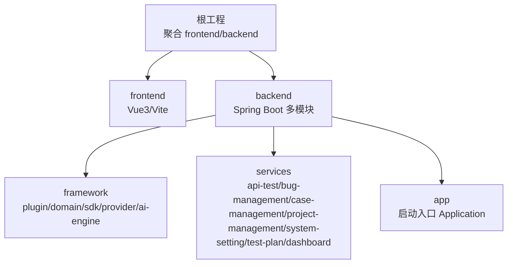
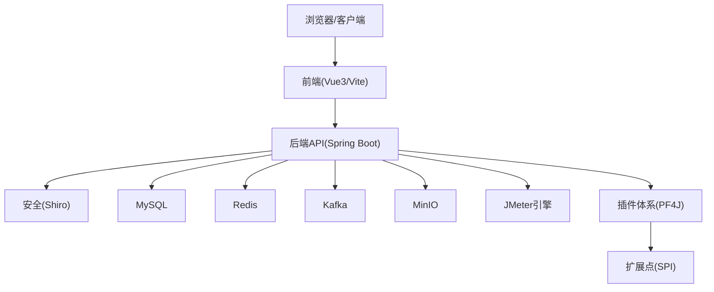
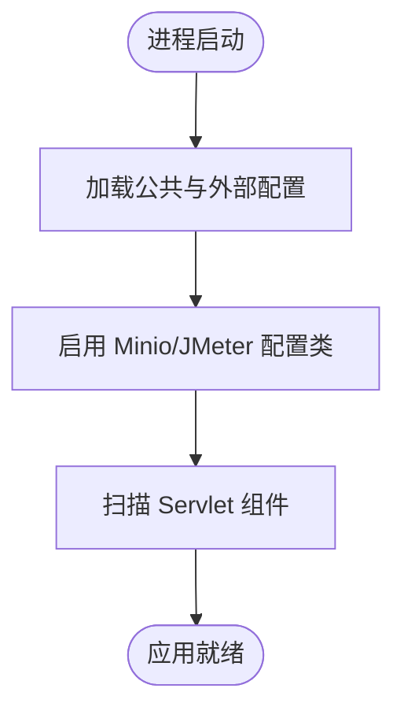
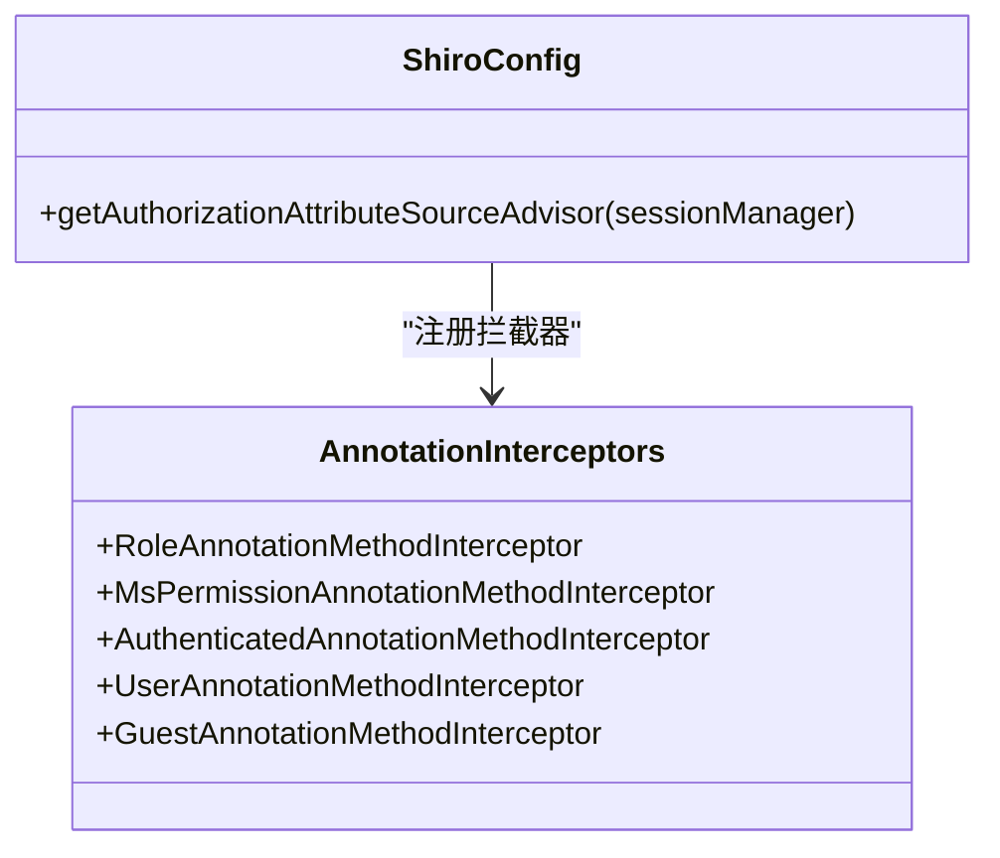
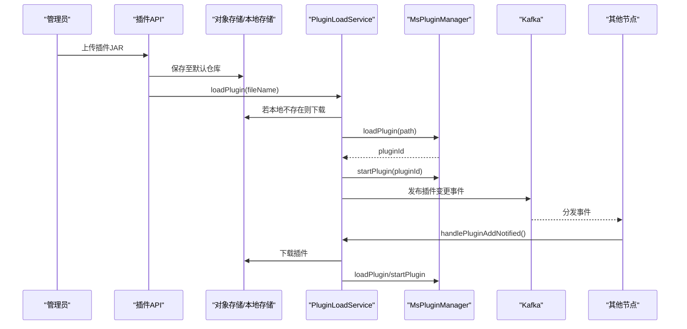
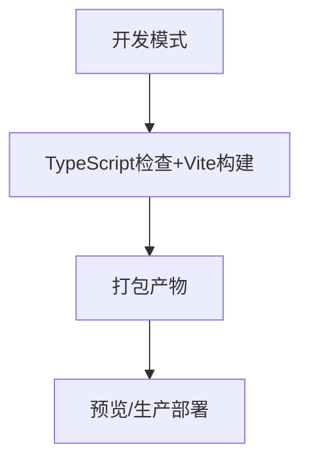
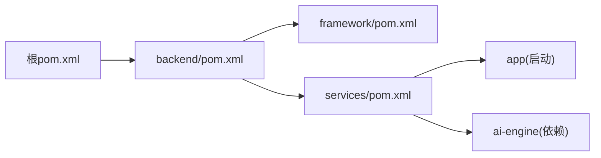
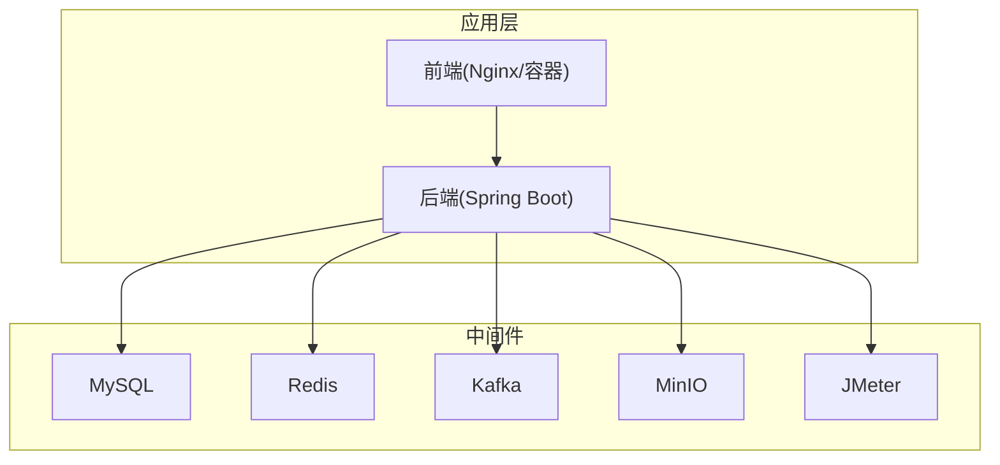

# 架构设计

<cite>
**本文引用的文件**   
- [README.md](file://README.md)
- [pom.xml](file://pom.xml)
- [backend/pom.xml](file://backend/pom.xml)
- [backend/framework/pom.xml](file://backend/framework/pom.xml)
- [backend/services/pom.xml](file://backend/services/pom.xml)
- [Application.java](file://backend/app/src/main/java/io/metersphere/Application.java)
- [ShiroConfig.java](file://backend/services/system-setting/src/main/java/io/metersphere/system/config/ShiroConfig.java)
- [PluginLoadService.java](file://backend/services/system-setting/src/main/java/io/metersphere/system/service/PluginLoadService.java)
- [PluginListener.java](file://backend/services/system-setting/src/main/java/io/metersphere/system/listener/PluginListener.java)
- [Platform.java](file://backend/framework/plugin/plugin-platform-sdk/src/main/java/io/metersphere/plugin/platform/spi/Platform.java)
- [package.json](file://frontend/package.json)
</cite>

## 目录
1. [引言](#引言)
2. [项目结构](#项目结构)
3. [核心组件](#核心组件)
4. [架构总览](#架构总览)
5. [详细组件分析](#详细组件分析)
6. [依赖关系分析](#依赖关系分析)
7. [性能与扩展性](#性能与扩展性)
8. [安全、监控与灾难恢复](#安全监控与灾难恢复)
9. [技术选型与版本兼容性](#技术选型与版本兼容性)
10. [部署拓扑与基础设施](#部署拓扑与基础设施)
11. [故障排查指南](#故障排查指南)
12. [结论](#结论)

## 引言
本架构设计文档面向 MeterSphere 3.x，系统性阐述整体系统架构、前后端分离设计、后端模块化分层（services、framework、domain）、插件化与扩展点机制、微服务友好设计、跨领域关注点（安全性、监控、灾难恢复），以及技术栈、第三方依赖与版本兼容性。文档同时给出系统边界定义、基础设施要求与部署拓扑图，帮助读者从全局到细节全面理解系统。

## 项目结构
仓库采用前后端分离的多模块 Maven 工程：
- 根 pom 聚合 frontend 与 backend 两个顶层模块，统一依赖管理与构建配置。
- backend 进一步划分为 framework（基础能力与 SDK）、services（业务域服务）、app（应用启动入口）。
- frontend 为 Vue 3 + Vite 前端工程，通过 API 与后端交互。



图表来源
- [pom.xml:97-100](file://pom.xml#L97-L100)
- [backend/pom.xml:16-20](file://backend/pom.xml#L16-L20)
- [backend/framework/pom.xml:16-22](file://backend/framework/pom.xml#L16-L22)
- [backend/services/pom.xml:22-30](file://backend/services/pom.xml#L22-L30)

章节来源
- [pom.xml:97-100](file://pom.xml#L97-L100)
- [backend/pom.xml:16-20](file://backend/pom.xml#L16-L20)
- [backend/framework/pom.xml:16-22](file://backend/framework/pom.xml#L16-L22)
- [backend/services/pom.xml:22-30](file://backend/services/pom.xml#L22-L30)

## 核心组件
- 应用启动与装配：Application 作为 Spring Boot 入口，排除不必要的自动配置，加载公共与外部配置文件，启用 Minio/JMeter 属性类，扫描 Servlet 组件。
- 安全与权限：基于 Shiro 的注解式鉴权拦截器链，支持角色、自定义权限、认证状态等注解。
- 插件体系：基于 PF4J 的插件管理器 MsPluginManager，提供插件生命周期管理、扩展点发现与实例化；通过 Kafka 实现集群内插件变更同步。
- 业务域服务：按领域拆分的 services 模块，如 api-test、case-management、project-management、system-setting、test-plan、dashboard 等。
- 前端工程：Vue 3 + Vite，模块化 API 调用、路由与状态管理，配合 Arco Design 等 UI 库。

章节来源
- [Application.java:14-31](file://backend/app/src/main/java/io/metersphere/Application.java#L14-L31)
- [ShiroConfig.java:100-116](file://backend/services/system-setting/src/main/java/io/metersphere/system/config/ShiroConfig.java#L100-L116)
- [PluginLoadService.java:45-76](file://backend/services/system-setting/src/main/java/io/metersphere/system/service/PluginLoadService.java#L45-L76)
- [PluginListener.java:14-41](file://backend/services/system-setting/src/main/java/io/metersphere/system/listener/PluginListener.java#L14-L41)
- [package.json:1-21](file://frontend/package.json#L1-L21)

## 架构总览
MeterSphere 3.x 采用“前后端分离 + 后端模块化 + 插件化”的总体架构：
- 前端通过 REST/WebSocket 与后端交互，负责页面渲染与用户交互。
- 后端以 Spring Boot 应用承载，按领域拆分 services 模块，共享 framework 层的基础能力与 SDK。
- 插件体系通过 SPI 暴露扩展点，允许第三方扩展协议、脚本、工具等能力。
- 中间件包括 MySQL、Redis、Kafka、MinIO，支撑数据持久化、缓存、消息与对象存储。
- 测试引擎集成 JMeter，用于接口与场景自动化执行。



图表来源
- [Application.java:14-31](file://backend/app/src/main/java/io/metersphere/Application.java#L14-L31)
- [ShiroConfig.java:100-116](file://backend/services/system-setting/src/main/java/io/metersphere/system/config/ShiroConfig.java#L100-L116)
- [PluginLoadService.java:45-76](file://backend/services/system-setting/src/main/java/io/metersphere/system/service/PluginLoadService.java#L45-L76)
- [pom.xml:20-95](file://pom.xml#L20-L95)

## 详细组件分析

### 应用启动与配置
- Application 主类排除 Quartz/LDAP/Neo4j 自动配置，避免不必要的依赖。
- 通过 @PropertySource 加载 classpath 与 /opt/metersphere/conf/metersphere.properties 的外部配置。
- 启用 MinioProperties 与 JmeterProperties，便于运行时注入配置。
- 使用 @ServletComponentScan 扫描 Servlet 组件。



图表来源
- [Application.java:14-31](file://backend/app/src/main/java/io/metersphere/Application.java#L14-L31)

章节来源
- [Application.java:14-31](file://backend/app/src/main/java/io/metersphere/Application.java#L14-L31)

### 安全与权限模型
- 基于 Shiro 的 AuthorizationAttributeSourceAdvisor 注册多种注解拦截器：角色、自定义权限、已认证、用户、访客等。
- 通过 AOP 对方法级注解进行解析与校验，实现细粒度访问控制。



图表来源
- [ShiroConfig.java:100-116](file://backend/services/system-setting/src/main/java/io/metersphere/system/config/ShiroConfig.java#L100-L116)

章节来源
- [ShiroConfig.java:100-116](file://backend/services/system-setting/src/main/java/io/metersphere/system/config/ShiroConfig.java#L100-L116)

### 插件化架构与扩展点
- 插件生命周期：上传、下载、加载、卸载、删除本地与远端文件，启动时批量加载。
- 扩展点发现：通过 MsPluginManager.getExtensions/getExtensionClasses 获取扩展实现类并实例化。
- 集群同步：通过 Kafka Topic 广播插件增删事件，各节点监听后触发加载或卸载逻辑。
- 脚本资源：支持从插件 Jar 中读取前端脚本资源，供界面动态渲染。



图表来源
- [PluginLoadService.java:63-76](file://backend/services/system-setting/src/main/java/io/metersphere/system/service/PluginLoadService.java#L63-L76)
- [PluginLoadService.java:196-206](file://backend/services/system-setting/src/main/java/io/metersphere/system/service/PluginLoadService.java#L196-L206)
- [PluginListener.java:22-41](file://backend/services/system-setting/src/main/java/io/metersphere/system/listener/PluginListener.java#L22-L41)

章节来源
- [PluginLoadService.java:45-76](file://backend/services/system-setting/src/main/java/io/metersphere/system/service/PluginLoadService.java#L45-L76)
- [PluginLoadService.java:196-206](file://backend/services/system-setting/src/main/java/io/metersphere/system/service/PluginLoadService.java#L196-L206)
- [PluginListener.java:14-41](file://backend/services/system-setting/src/main/java/io/metersphere/system/listener/PluginListener.java#L14-L41)

### 扩展点 SPI 设计
- Platform 作为平台级扩展点，由插件实现具体协议或能力。
- 通过 PluginLoadService.getExtensions(Class<T>) 获取所有实现类列表，结合扩展点类型进行调度。

```mermaid
classDiagram
class Platform {
<<interface>>
+扩展方法()
}
class PluginLoadService {
+getExtensions(clazz) T[]
+getExtensionsClass(clazz, pluginId) Class
+getImplInstance(clazz, pluginId, param) T
}
class MsPluginManager {
+getExtensions(clazz) List
+getExtensionClasses(clazz, pluginId) List
}
PluginLoadService --> MsPluginManager : "委托扩展发现"
Platform <|.. "插件实现"
```

图表来源
- [Platform.java](file://backend/framework/plugin/plugin-platform-sdk/src/main/java/io/metersphere/plugin/platform/spi/Platform.java)
- [PluginLoadService.java:278-316](file://backend/services/system-setting/src/main/java/io/metersphere/system/service/PluginLoadService.java#L278-L316)

章节来源
- [Platform.java](file://backend/framework/plugin/plugin-platform-sdk/src/main/java/io/metersphere/plugin/platform/spi/Platform.java)
- [PluginLoadService.java:278-316](file://backend/services/system-setting/src/main/java/io/metersphere/system/service/PluginLoadService.java#L278-L316)

### 前端工程与交互
- 前端基于 Vue 3 + Vite，使用 Pinia 做状态管理，Axios 发起 HTTP 请求，ECharts 可视化报表。
- 通过模块化 API 封装与路由守卫实现权限控制与页面导航。
- 构建流程包含 TypeScript 检查、ESLint/Prettier 代码规范、TailwindCSS 样式处理。



图表来源
- [package.json:9-21](file://frontend/package.json#L9-L21)
- [package.json:37-95](file://frontend/package.json#L37-L95)

章节来源
- [package.json:9-21](file://frontend/package.json#L9-L21)
- [package.json:37-95](file://frontend/package.json#L37-L95)

## 依赖关系分析
- 根工程统一管理依赖版本与插件，确保前后端构建一致性。
- backend 聚合 framework、services、app 三个子模块，services 依赖 ai-engine 能力。
- 关键第三方依赖包括 Spring Boot、Shiro、MyBatis、Redisson、Quartz、Swagger/OpenAPI、MinIO、Kafka、JMeter、PF4J 等。



图表来源
- [pom.xml:97-100](file://pom.xml#L97-L100)
- [backend/pom.xml:16-20](file://backend/pom.xml#L16-L20)
- [backend/services/pom.xml:15-21](file://backend/services/pom.xml#L15-L21)

章节来源
- [pom.xml:97-100](file://pom.xml#L97-L100)
- [backend/pom.xml:16-20](file://backend/pom.xml#L16-L20)
- [backend/services/pom.xml:15-21](file://backend/services/pom.xml#L15-L21)

## 性能与扩展性
- 插件化提升扩展性与可维护性，通过 PF4J 隔离插件类加载，避免主应用污染。
- Kafka 异步通知插件变更，降低耦合度，支持水平扩展。
- 对象存储与本地缓存结合，减少重复下载，提高插件加载效率。
- 前端按需构建与懒加载，优化首屏性能。

[本节为通用指导，不直接分析具体文件]

## 安全、监控与灾难恢复
- 安全性
  - 后端使用 Shiro 进行认证与授权，支持注解式权限控制。
  - 前端通过路由守卫与权限指令控制页面访问。
- 监控
  - 日志框架使用 Logback，建议接入集中式日志系统。
  - 可通过 Spring Actuator 暴露健康与指标端点（需按需开启）。
- 灾难恢复
  - 对象存储（MinIO）作为插件与文件持久化载体，支持备份与迁移。
  - 数据库建议使用定期备份策略，结合事务与幂等设计保证一致性。
  - Kafka 作为消息总线，具备高可用与重放能力，可用于恢复流程。

章节来源
- [ShiroConfig.java:100-116](file://backend/services/system-setting/src/main/java/io/metersphere/system/config/ShiroConfig.java#L100-L116)
- [PluginLoadService.java:121-146](file://backend/services/system-setting/src/main/java/io/metersphere/system/service/PluginLoadService.java#L121-L146)

## 技术选型与版本兼容性
- 后端
  - Java 21，Spring Boot 3.5.7，Shiro 2.0.2，MyBatis Starter 3.0.3，Redisson 3.49.0，Quartz Starter 1.0.7，Swagger/OpenAPI 2.7.0，MinIO 8.5.13，Kafka 客户端集成，JMeter 5.6.3，PF4J 3.10.0。
- 前端
  - Node >= 18，Vue 3.4.31，Vite 5.3.3，TypeScript 5.4.5，Arco Design Vue 2.56.3，Pinia 2.1.7，ECharts 5.5.1。
- 中间件
  - MySQL、Redis、Kafka、MinIO。

章节来源
- [pom.xml:20-95](file://pom.xml#L20-L95)
- [package.json:169-183](file://frontend/package.json#L169-L183)

## 部署拓扑与基础设施
- 部署形态
  - 单体应用（Spring Boot）+ 静态资源（Nginx 或容器内 Web 服务器）。
  - 可选 Kubernetes 部署，结合 RBAC 与命名空间隔离。
- 基础设施
  - 数据库：MySQL（结构化数据）。
  - 缓存：Redis（会话、缓存、分布式锁）。
  - 消息：Kafka（插件变更、任务编排、异步解耦）。
  - 对象存储：MinIO（插件包、报告、附件）。
  - 测试执行：JMeter（接口与场景自动化）。



图表来源
- [README.md:59-66](file://README.md#L59-L66)
- [Application.java:19-27](file://backend/app/src/main/java/io/metersphere/Application.java#L19-L27)

## 故障排查指南
- 插件加载失败
  - 检查对象存储是否可访问，确认插件文件是否存在。
  - 查看 PluginLoadService 日志，定位下载与加载异常。
  - 验证 Kafka 消费者组与主题是否正确，确保集群内同步生效。
- 权限问题
  - 检查 Shiro 注解与权限配置，确认用户角色与权限映射。
  - 前端路由守卫与权限指令是否正确配置。
- 构建与运行
  - 前端构建失败时检查 TypeScript 与 ESLint 错误。
  - 后端依赖冲突时检查根 pom 的版本管理与排除规则。

章节来源
- [PluginLoadService.java:63-76](file://backend/services/system-setting/src/main/java/io/metersphere/system/service/PluginLoadService.java#L63-L76)
- [PluginListener.java:22-41](file://backend/services/system-setting/src/main/java/io/metersphere/system/listener/PluginListener.java#L22-L41)
- [ShiroConfig.java:100-116](file://backend/services/system-setting/src/main/java/io/metersphere/system/config/ShiroConfig.java#L100-L116)

## 结论
MeterSphere 3.x 通过前后端分离、后端模块化与插件化设计，实现了高内聚低耦合的系统架构。Spring Boot 作为应用底座，Shiro 提供安全能力，PF4J 与 Kafka 支撑插件生态与集群同步，MySQL/Redis/Kafka/MinIO 构成稳定可靠的中间件层。前端以 Vue 3 为核心，提供现代化用户体验。该架构具备良好的扩展性、可维护性与可观测性，适合持续测试与团队协作场景。