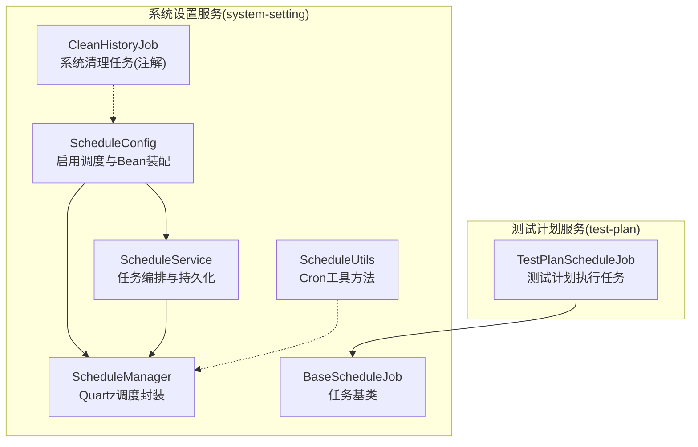
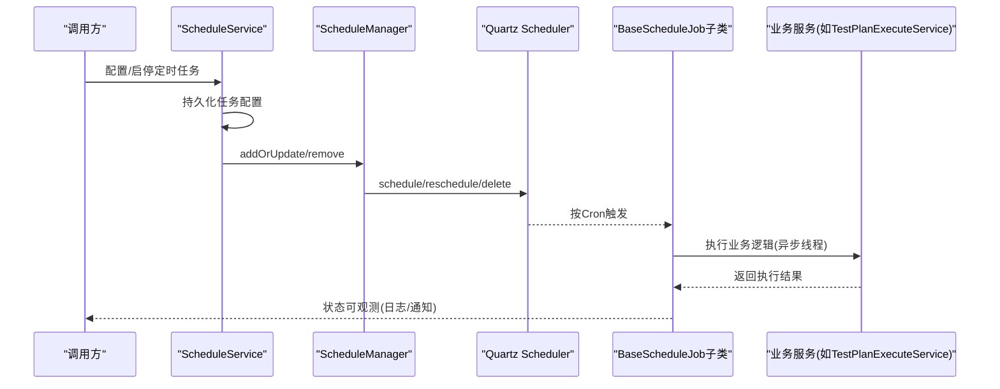
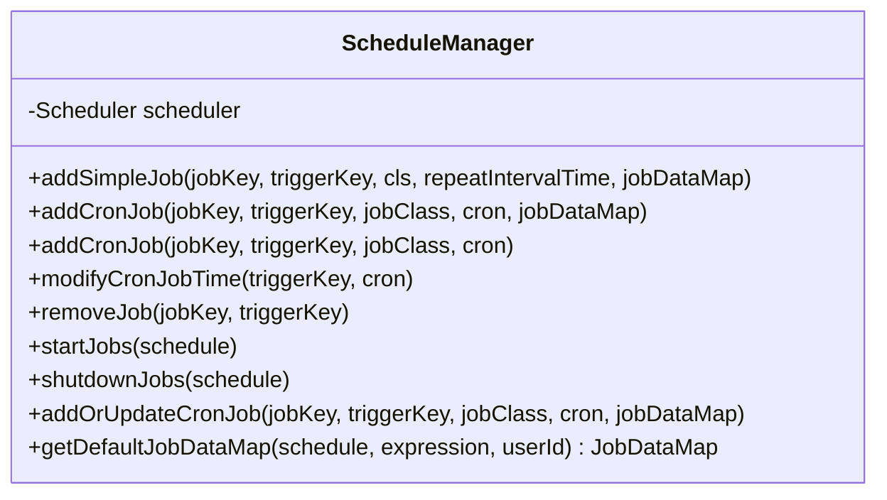
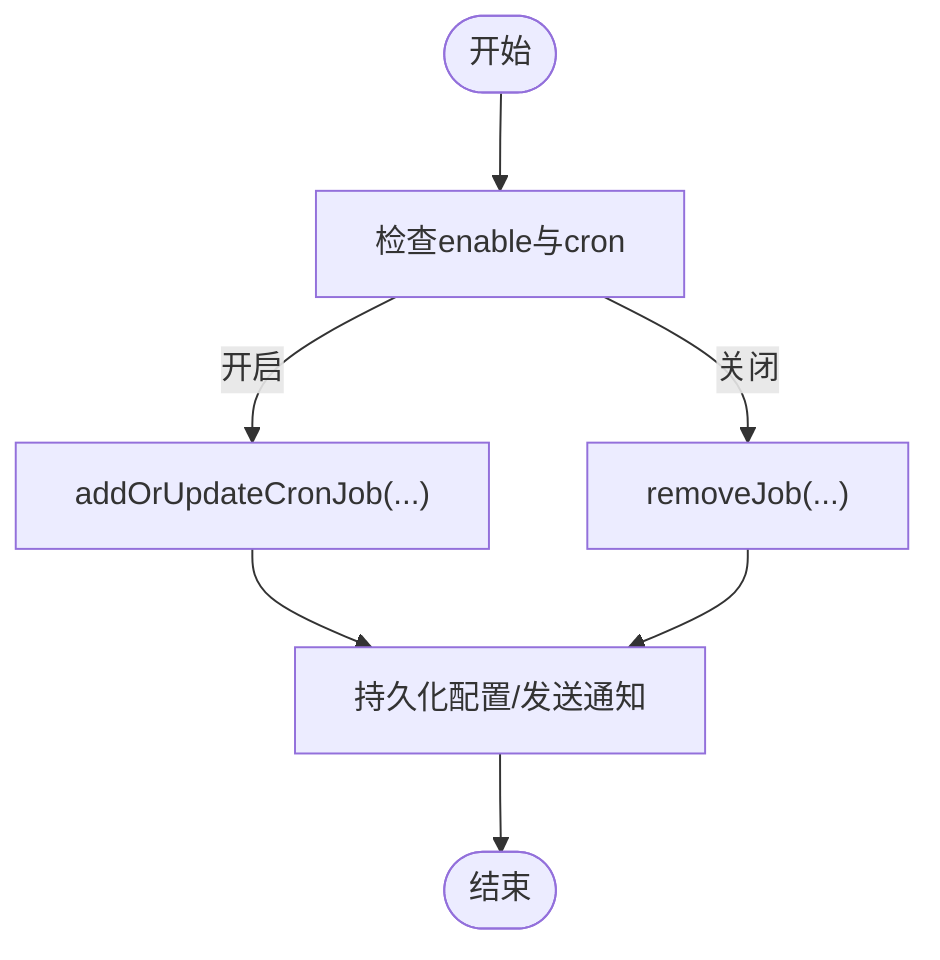
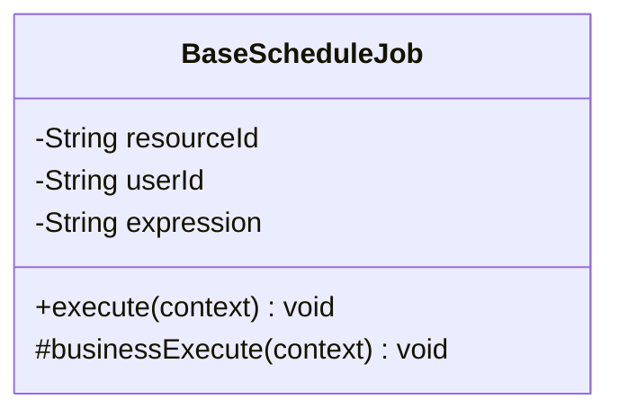
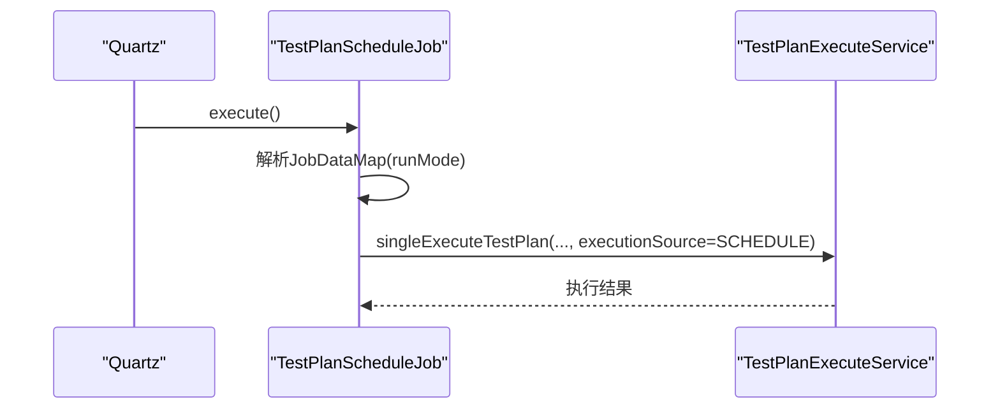
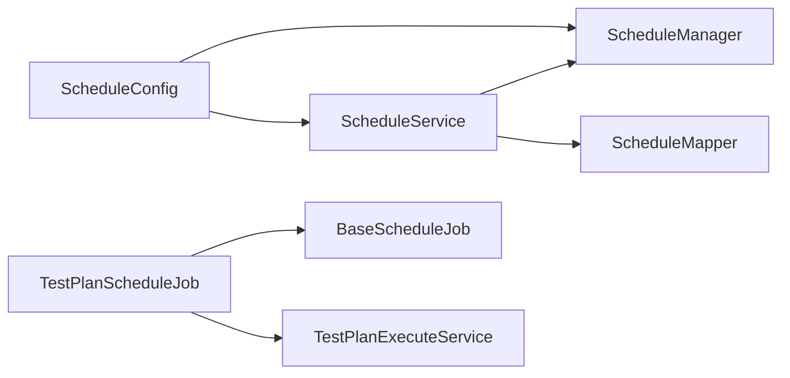

# 任务调度系统

<cite>
**本文引用的文件**   
- [ScheduleConfig.java](file://backend/services/system-setting/src/main/java/io/metersphere/system/config/ScheduleConfig.java)
- [ScheduleManager.java](file://backend/services/system-setting/src/main/java/io/metersphere/system/schedule/ScheduleManager.java)
- [ScheduleService.java](file://backend/services/system-setting/src/main/java/io/metersphere/system/schedule/ScheduleService.java)
- [BaseScheduleJob.java](file://backend/services/system-setting/src/main/java/io/metersphere/system/schedule/BaseScheduleJob.java)
- [TestPlanScheduleJob.java](file://backend/services/test-plan/src/main/java/io/metersphere/plan/job/TestPlanScheduleJob.java)
- [CleanHistoryJob.java](file://backend/services/system-setting/src/main/java/io/metersphere/system/job/CleanHistoryJob.java)
- [ScheduleUtils.java](file://backend/services/system-setting/src/main/java/io/metersphere/system/utils/ScheduleUtils.java)
</cite>

## 目录
1. [简介](#简介)
2. [项目结构](#项目结构)
3. [核心组件](#核心组件)
4. [架构总览](#架构总览)
5. [详细组件分析](#详细组件分析)
6. [依赖关系分析](#依赖关系分析)
7. [性能与并发控制](#性能与并发控制)
8. [故障排查指南](#故障排查指南)
9. [结论](#结论)
10. [附录：使用示例与最佳实践](#附录使用示例与最佳实践)

## 简介
本文件面向测试计划的任务调度系统，系统性阐述定时任务的创建、配置与执行机制。重点覆盖：
- Cron 表达式配置与校验
- 任务优先级管理与失败重试策略（设计建议）
- Quartz 调度器集成方式
- 任务状态跟踪与并发控制
- 任务队列管理与负载均衡策略（设计建议）
并提供具体使用示例，展示如何配置定时任务、监控执行状态和处理异常情况。

## 项目结构
后端采用 Spring Boot + Quartz 的调度方案，结合自定义封装类完成任务的注册、启停与生命周期管理；业务侧通过继承统一基类实现具体任务逻辑。系统内同时存在两类调度模式：
- 基于 Quartz 注解的系统级定时任务（如清理历史数据）
- 基于 Quartz API 动态管理的业务定时任务（如测试计划定时执行）

图示来源
- [ScheduleConfig.java:10-25](file://backend/services/system-setting/src/main/java/io/metersphere/system/config/ScheduleConfig.java#L10-L25)
- [ScheduleManager.java:12-154](file://backend/services/system-setting/src/main/java/io/metersphere/system/schedule/ScheduleManager.java#L12-L154)
- [ScheduleService.java:23-188](file://backend/services/system-setting/src/main/java/io/metersphere/system/schedule/ScheduleService.java#L23-L188)
- [BaseScheduleJob.java:6-27](file://backend/services/system-setting/src/main/java/io/metersphere/system/schedule/BaseScheduleJob.java#L6-L27)
- [TestPlanScheduleJob.java:18-44](file://backend/services/test-plan/src/main/java/io/metersphere/plan/job/TestPlanScheduleJob.java#L18-L44)
- [CleanHistoryJob.java:21-86](file://backend/services/system-setting/src/main/java/io/metersphere/system/job/CleanHistoryJob.java#L21-L86)
- [ScheduleUtils.java:11-27](file://backend/services/system-setting/src/main/java/io/metersphere/system/utils/ScheduleUtils.java#L11-L27)

章节来源
- [ScheduleConfig.java:10-25](file://backend/services/system-setting/src/main/java/io/metersphere/system/config/ScheduleConfig.java#L10-L25)
- [ScheduleManager.java:12-154](file://backend/services/system-setting/src/main/java/io/metersphere/system/schedule/ScheduleManager.java#L12-L154)
- [ScheduleService.java:23-188](file://backend/services/system-setting/src/main/java/io/metersphere/system/schedule/ScheduleService.java#L23-L188)
- [BaseScheduleJob.java:6-27](file://backend/services/system-setting/src/main/java/io/metersphere/system/schedule/BaseScheduleJob.java#L6-L27)
- [TestPlanScheduleJob.java:18-44](file://backend/services/test-plan/src/main/java/io/metersphere/plan/job/TestPlanScheduleJob.java#L18-L44)
- [CleanHistoryJob.java:21-86](file://backend/services/system-setting/src/main/java/io/metersphere/system/job/CleanHistoryJob.java#L21-L86)
- [ScheduleUtils.java:11-27](file://backend/services/system-setting/src/main/java/io/metersphere/system/utils/ScheduleUtils.java#L11-L27)

## 核心组件
- ScheduleConfig：条件装配调度相关 Bean，开启 Spring 调度能力，并通过 quartz.enabled 开关控制是否启用 Quartz 相关组件。
- ScheduleManager：对 Quartz Scheduler 的封装，提供添加/修改/删除 Cron 与 Simple 任务、启动/关闭调度器等能力。
- ScheduleService：负责任务配置的持久化、启停控制、通知发送以及 JobDataMap 的组装与注入。
- BaseScheduleJob：所有业务定时任务的抽象基类，统一从 JobDataMap 中读取上下文参数并记录运行日志。
- TestPlanScheduleJob：测试计划定时执行的具体任务实现，调用执行服务异步执行测试计划。
- CleanHistoryJob：基于 QuartzScheduled 注解的系统级定时任务，用于清理历史数据。
- ScheduleUtils：提供 Cron 表达式合法性校验与下次触发时间计算的工具方法。

章节来源
- [ScheduleConfig.java:10-25](file://backend/services/system-setting/src/main/java/io/metersphere/system/config/ScheduleConfig.java#L10-L25)
- [ScheduleManager.java:12-154](file://backend/services/system-setting/src/main/java/io/metersphere/system/schedule/ScheduleManager.java#L12-L154)
- [ScheduleService.java:23-188](file://backend/services/system-setting/src/main/java/io/metersphere/system/schedule/ScheduleService.java#L23-L188)
- [BaseScheduleJob.java:6-27](file://backend/services/system-setting/src/main/java/io/metersphere/system/schedule/BaseScheduleJob.java#L6-L27)
- [TestPlanScheduleJob.java:18-44](file://backend/services/test-plan/src/main/java/io/metersphere/plan/job/TestPlanScheduleJob.java#L18-L44)
- [CleanHistoryJob.java:21-86](file://backend/services/system-setting/src/main/java/io/metersphere/system/job/CleanHistoryJob.java#L21-L86)
- [ScheduleUtils.java:11-27](file://backend/services/system-setting/src/main/java/io/metersphere/system/utils/ScheduleUtils.java#L11-L27)

## 架构总览
下图展示了“配置—调度—执行”的主流程：用户或上层服务通过 ScheduleService 更新任务配置，ScheduleService 将配置持久化并委托 ScheduleManager 操作 Quartz；Quartz 根据 Cron 表达式触发任务，由 BaseScheduleJob 派生类执行业务逻辑。

图示来源
- [ScheduleService.java:104-188](file://backend/services/system-setting/src/main/java/io/metersphere/system/schedule/ScheduleService.java#L104-L188)
- [ScheduleManager.java:38-139](file://backend/services/system-setting/src/main/java/io/metersphere/system/schedule/ScheduleManager.java#L38-L139)
- [BaseScheduleJob.java:14-26](file://backend/services/system-setting/src/main/java/io/metersphere/system/schedule/BaseScheduleJob.java#L14-L26)
- [TestPlanScheduleJob.java:20-34](file://backend/services/test-plan/src/main/java/io/metersphere/plan/job/TestPlanScheduleJob.java#L20-L34)

## 详细组件分析

### ScheduleConfig：调度装配与开关
- 启用 Spring 调度能力
- 通过 quartz.enabled=true 条件装配 ScheduleManager 与 ScheduleService Bean

章节来源
- [ScheduleConfig.java:10-25](file://backend/services/system-setting/src/main/java/io/metersphere/system/config/ScheduleConfig.java#L10-L25)

### ScheduleManager：Quartz 调度封装
- 支持 Simple 与 Cron 两种触发器
- 提供 add/addOrUpdate/remove/modify 等能力
- 提供 start/shutdown 生命周期控制
- 提供 getDefaultJobDataMap 统一注入 resourceId、expression、userId、config、projectId 等上下文

图示来源
- [ScheduleManager.java:12-154](file://backend/services/system-setting/src/main/java/io/metersphere/system/schedule/ScheduleManager.java#L12-L154)

章节来源
- [ScheduleManager.java:12-154](file://backend/services/system-setting/src/main/java/io/metersphere/system/schedule/ScheduleManager.java#L12-L154)

### ScheduleService：任务编排与持久化
- 新增/编辑/查询/删除任务配置
- 根据 enable 与 cron 表达式决定开启或关闭任务
- 当配置变更时，先删除再重建任务以保证 JobDataMap 同步
- 在关键节点发送调度通知

图示来源
- [ScheduleService.java:104-188](file://backend/services/system-setting/src/main/java/io/metersphere/system/schedule/ScheduleService.java#L104-L188)

章节来源
- [ScheduleService.java:23-188](file://backend/services/system-setting/src/main/java/io/metersphere/system/schedule/ScheduleService.java#L23-L188)

### BaseScheduleJob：任务基类
- 统一从 JobDataMap 中读取 resourceId、userId、expression
- 记录任务运行日志
- 暴露 abstract businessExecute(context) 供子类实现

图示来源
- [BaseScheduleJob.java:6-27](file://backend/services/system-setting/src/main/java/io/metersphere/system/schedule/BaseScheduleJob.java#L6-L27)

章节来源
- [BaseScheduleJob.java:6-27](file://backend/services/system-setting/src/main/java/io/metersphere/system/schedule/BaseScheduleJob.java#L6-L27)

### TestPlanScheduleJob：测试计划定时执行
- 继承 BaseScheduleJob，从 JobDataMap 解析 runMode 等配置
- 使用虚拟线程异步调用测试计划执行服务
- 提供静态方法生成 JobKey/TriggerKey

图示来源
- [TestPlanScheduleJob.java:18-44](file://backend/services/test-plan/src/main/java/io/metersphere/plan/job/TestPlanScheduleJob.java#L18-L44)

章节来源
- [TestPlanScheduleJob.java:18-44](file://backend/services/test-plan/src/main/java/io/metersphere/plan/job/TestPlanScheduleJob.java#L18-L44)

### CleanHistoryJob：系统级清理任务（注解驱动）
- 使用 @QuartzScheduled(cron = "...") 定义每日凌晨两点执行
- 读取系统参数控制清理上限，分批处理避免大事务

章节来源
- [CleanHistoryJob.java:21-86](file://backend/services/system-setting/src/main/java/io/metersphere/system/job/CleanHistoryJob.java#L21-L86)

### ScheduleUtils：Cron 工具
- 校验 Cron 表达式合法性
- 计算下次触发时间（毫秒时间戳）

章节来源
- [ScheduleUtils.java:11-27](file://backend/services/system-setting/src/main/java/io/metersphere/system/utils/ScheduleUtils.java#L11-L27)

## 依赖关系分析
- ScheduleConfig 依赖 ScheduleManager 与 ScheduleService，并通过条件装配控制其生效范围。
- ScheduleService 依赖 ScheduleMapper（持久化）、ScheduleManager（调度操作）与通知服务。
- ScheduleManager 直接依赖 Quartz Scheduler。
- 业务任务（如 TestPlanScheduleJob）依赖 BaseScheduleJob 与业务服务。

图示来源
- [ScheduleConfig.java:10-25](file://backend/services/system-setting/src/main/java/io/metersphere/system/config/ScheduleConfig.java#L10-L25)
- [ScheduleService.java:23-188](file://backend/services/system-setting/src/main/java/io/metersphere/system/schedule/ScheduleService.java#L23-L188)
- [ScheduleManager.java:12-154](file://backend/services/system-setting/src/main/java/io/metersphere/system/schedule/ScheduleManager.java#L12-L154)
- [TestPlanScheduleJob.java:18-44](file://backend/services/test-plan/src/main/java/io/metersphere/plan/job/TestPlanScheduleJob.java#L18-L44)
- [BaseScheduleJob.java:6-27](file://backend/services/system-setting/src/main/java/io/metersphere/system/schedule/BaseScheduleJob.java#L6-L27)

章节来源
- [ScheduleConfig.java:10-25](file://backend/services/system-setting/src/main/java/io/metersphere/system/config/ScheduleConfig.java#L10-L25)
- [ScheduleService.java:23-188](file://backend/services/system-setting/src/main/java/io/metersphere/system/schedule/ScheduleService.java#L23-L188)
- [ScheduleManager.java:12-154](file://backend/services/system-setting/src/main/java/io/metersphere/system/schedule/ScheduleManager.java#L12-L154)
- [TestPlanScheduleJob.java:18-44](file://backend/services/test-plan/src/main/java/io/metersphere/plan/job/TestPlanScheduleJob.java#L18-L44)
- [BaseScheduleJob.java:6-27](file://backend/services/system-setting/src/main/java/io/metersphere/system/schedule/BaseScheduleJob.java#L6-L27)

## 性能与并发控制
- 并发模型
  - Quartz 默认以多线程池执行 Job，具体线程数取决于 Quartz 线程池配置。
  - 测试计划任务内部使用虚拟线程发起异步执行，提升吞吐与资源利用率。
- 任务优先级
  - 当前代码未显式设置 Quartz 任务优先级；如需优先级，可在 TriggerBuilder 中设置优先级并在 Quartz 层面进行排序。
- 失败重试
  - 当前代码未内置重试机制；建议在业务层实现幂等重试（例如基于任务ID与去重表），或在调度层引入重试策略（如指数退避）。
- 限流与背压
  - 可通过 Quartz 线程池大小与业务侧队列容量限制并发度，避免下游系统过载。
- 资源隔离
  - 不同业务域可使用不同的 JobGroup/TriggerGroup 进行隔离，便于独立扩缩容与监控。

[本节为通用指导，不直接分析具体文件]

## 故障排查指南
- Cron 表达式无效
  - 现象：无法计算下次触发时间或调度异常
  - 处理：使用 ScheduleUtils 校验表达式合法性，修正后重新配置
- 任务开启/关闭异常
  - 现象：抛出“定时任务开启/关闭异常”
  - 处理：检查 Quartz 调度器状态、数据库连接与权限；确认 JobKey/TriggerKey 唯一性
- 任务未触发
  - 现象：已配置但未执行
  - 处理：确认 quartz.enabled 配置生效；检查任务是否被暂停或删除；核对 Cron 表达式
- 任务执行失败
  - 现象：业务执行抛错
  - 处理：查看日志；在业务层增加重试与告警；确保任务幂等

章节来源
- [ScheduleUtils.java:11-27](file://backend/services/system-setting/src/main/java/io/metersphere/system/utils/ScheduleUtils.java#L11-L27)
- [ScheduleService.java:104-188](file://backend/services/system-setting/src/main/java/io/metersphere/system/schedule/ScheduleService.java#L104-L188)
- [ScheduleManager.java:38-139](file://backend/services/system-setting/src/main/java/io/metersphere/system/schedule/ScheduleManager.java#L38-L139)

## 结论
该任务调度系统以 Quartz 为核心，通过 ScheduleManager 与 ScheduleService 完成任务的动态管理与持久化，配合 BaseScheduleJob 抽象出统一的执行入口，满足测试计划等业务的定时执行需求。系统同时提供 Cron 工具方法与系统级注解任务，形成灵活且可扩展的调度体系。针对优先级、重试与负载均衡等高级特性，可在现有基础上按需扩展。

[本节为总结性内容，不直接分析具体文件]

## 附录：使用示例与最佳实践

### 示例一：配置测试计划定时任务
- 步骤
  1) 准备 Cron 表达式（建议使用 ScheduleUtils 校验）
  2) 构造 JobKey/TriggerKey（参考 TestPlanScheduleJob.getJobKey/getTriggerKey）
  3) 调用 ScheduleService.addOrUpdateCronJob 或 scheduleConfig 完成配置
  4) 观察日志与通知，确认任务已注册并按时触发

章节来源
- [ScheduleUtils.java:11-27](file://backend/services/system-setting/src/main/java/io/metersphere/system/utils/ScheduleUtils.java#L11-L27)
- [TestPlanScheduleJob.java:37-43](file://backend/services/test-plan/src/main/java/io/metersphere/plan/job/TestPlanScheduleJob.java#L37-L43)
- [ScheduleService.java:104-188](file://backend/services/system-setting/src/main/java/io/metersphere/system/schedule/ScheduleService.java#L104-L188)

### 示例二：禁用/删除任务
- 步骤
  1) 将 enable 置为 false 或直接调用 removeJob
  2) 确认任务已从调度器移除

章节来源
- [ScheduleService.java:104-188](file://backend/services/system-setting/src/main/java/io/metersphere/system/schedule/ScheduleService.java#L104-L188)
- [ScheduleManager.java:93-103](file://backend/services/system-setting/src/main/java/io/metersphere/system/schedule/ScheduleManager.java#L93-L103)

### 示例三：监控任务执行状态
- 建议
  - 在业务执行前后记录日志与指标（如开始/结束时间、耗时、状态码）
  - 结合通知服务发送执行结果摘要
  - 对失败任务建立重试与告警通道

章节来源
- [BaseScheduleJob.java:14-26](file://backend/services/system-setting/src/main/java/io/metersphere/system/schedule/BaseScheduleJob.java#L14-L26)
- [TestPlanScheduleJob.java:20-34](file://backend/services/test-plan/src/main/java/io/metersphere/plan/job/TestPlanScheduleJob.java#L20-L34)

### 最佳实践清单
- 使用 ScheduleUtils 校验 Cron 表达式后再入库
- 保证 JobKey/TriggerKey 全局唯一，避免覆盖
- 对业务执行逻辑做幂等设计，便于重试
- 合理设置 Quartz 线程池大小，避免资源争用
- 使用 Group 区分不同业务域，便于隔离与扩容
- 对关键任务增加监控与告警

[本节为通用指导，不直接分析具体文件]