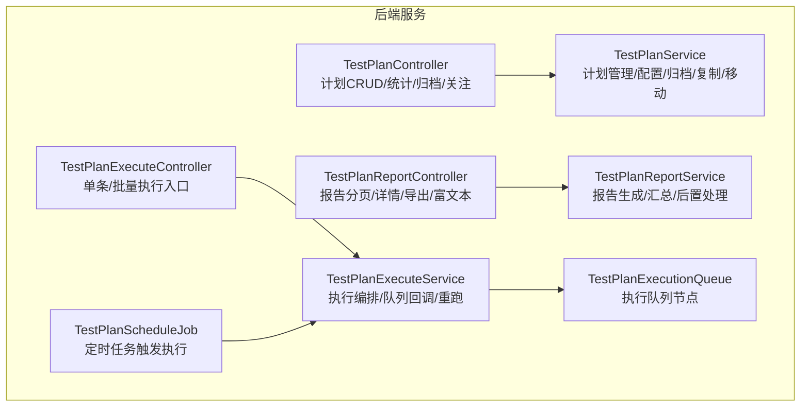
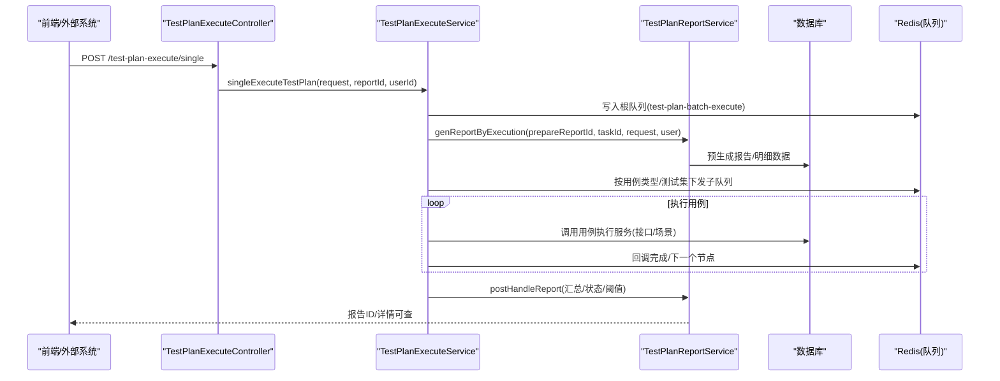
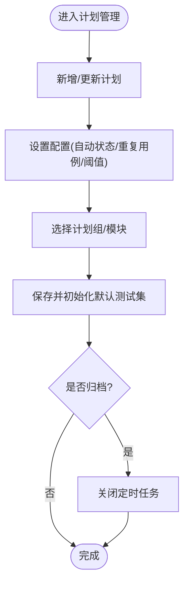
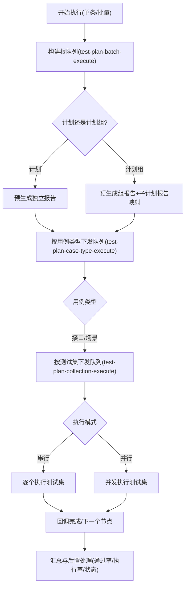
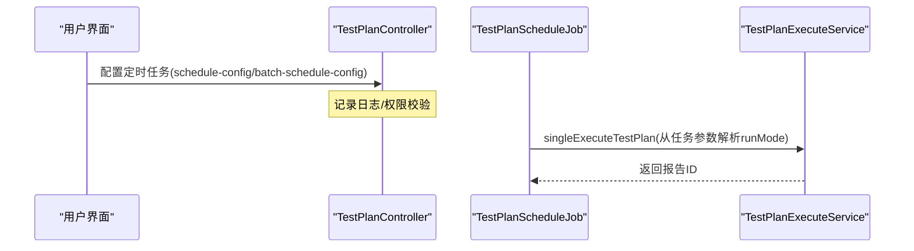
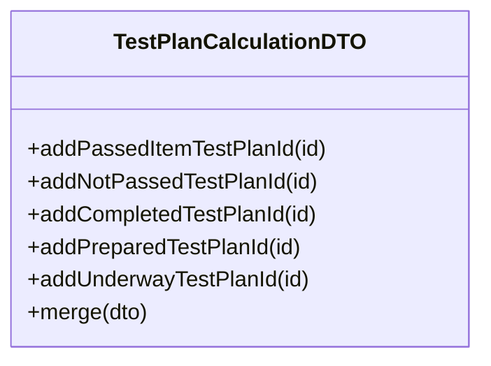
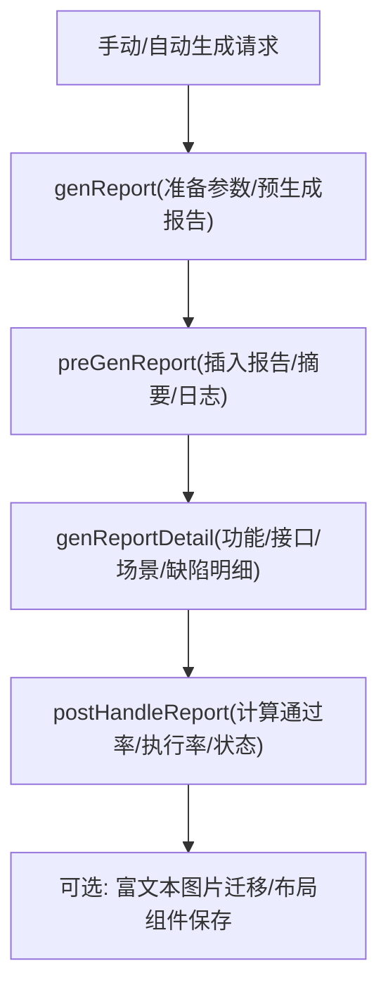
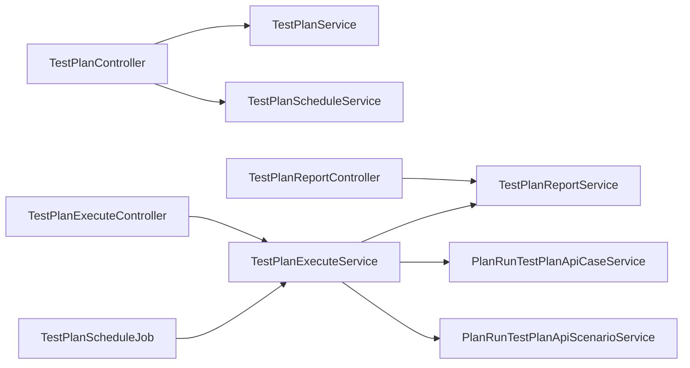

# 测试计划

<cite>
**本文引用的文件**   
- [TestPlanController.java](file://backend/services/test-plan/src/main/java/io/metersphere/plan/controller/TestPlanController.java)
- [TestPlanExecuteController.java](file://backend/services/test-plan/src/main/java/io/metersphere/plan/controller/TestPlanExecuteController.java)
- [TestPlanReportController.java](file://backend/services/test-plan/src/main/java/io/metersphere/plan/controller/TestPlanReportController.java)
- [TestPlanService.java](file://backend/services/test-plan/src/main/java/io/metersphere/plan/service/TestPlanService.java)
- [TestPlanExecuteService.java](file://backend/services/test-plan/src/main/java/io/metersphere/plan/service/TestPlanExecuteService.java)
- [TestPlanReportService.java](file://backend/services/test-plan/src/main/java/io/metersphere/plan/service/TestPlanReportService.java)
- [TestPlanScheduleJob.java](file://backend/services/test-plan/src/main/java/io/metersphere/plan/job/TestPlanScheduleJob.java)
- [TestPlanExecutionQueue.java](file://backend/framework/sdk/src/main/java/io/metersphere/sdk/dto/queue/TestPlanExecutionQueue.java)
- [TestPlanCalculationDTO.java](file://backend/services/test-plan/src/main/java/io/metersphere/plan/dto/TestPlanCalculationDTO.java)
</cite>

## 目录
1. [简介](#简介)
2. [项目结构](#项目结构)
3. [核心组件](#核心组件)
4. [架构总览](#架构总览)
5. [详细组件分析](#详细组件分析)
6. [依赖关系分析](#依赖关系分析)
7. [性能与并发控制](#性能与并发控制)
8. [故障排查指南](#故障排查指南)
9. [结论](#结论)
10. [附录：使用示例与CI/CD集成](#附录使用示例与cicd集成)

## 简介
本章节面向MeterSphere的“测试计划”模块，系统性阐述其创建与管理、任务调度、执行监控、结果统计分析与报告生成能力。文档将围绕以下关键点展开：
- 计划结构与用例关联：计划/计划组、测试集（功能用例、接口用例、场景用例）的组织方式
- 执行策略：串行/并行、失败停止、按用例类型与测试集分层执行
- 定时任务与并发控制：基于Quartz的任务调度与Redis队列的并发编排
- 执行监控与结果统计：任务中心、执行进度、通过率与执行率计算
- 报告生成与导出：手动/自动生成、布局组件、富文本图片、日志导出
- CI/CD集成：通过API触发执行、查询报告、对接流水线

## 项目结构
后端服务位于 backend/services/test-plan，主要包含控制器、服务、领域模型、定时任务等；框架层提供通用队列数据结构；前端在 frontend/src/views/test-plan 下提供页面与交互。

图表来源
- [TestPlanController.java:40-291](file://backend/services/test-plan/src/main/java/io/metersphere/plan/controller/TestPlanController.java#L40-L291)
- [TestPlanExecuteController.java:29-87](file://backend/services/test-plan/src/main/java/io/metersphere/plan/controller/TestPlanExecuteController.java#L29-L87)
- [TestPlanReportController.java:42-296](file://backend/services/test-plan/src/main/java/io/metersphere/plan/controller/TestPlanReportController.java#L42-L296)
- [TestPlanService.java:59-114](file://backend/services/test-plan/src/main/java/io/metersphere/plan/service/TestPlanService.java#L59-L114)
- [TestPlanExecuteService.java:41-88](file://backend/services/test-plan/src/main/java/io/metersphere/plan/service/TestPlanExecuteService.java#L41-L88)
- [TestPlanReportService.java:63-133](file://backend/services/test-plan/src/main/java/io/metersphere/plan/service/TestPlanReportService.java#L63-L133)
- [TestPlanScheduleJob.java:18-45](file://backend/services/test-plan/src/main/java/io/metersphere/plan/job/TestPlanScheduleJob.java#L18-L45)
- [TestPlanExecutionQueue.java:10-45](file://backend/framework/sdk/src/main/java/io/metersphere/sdk/dto/queue/TestPlanExecutionQueue.java#L10-L45)

章节来源
- [TestPlanController.java:40-291](file://backend/services/test-plan/src/main/java/io/metersphere/plan/controller/TestPlanController.java#L40-L291)
- [TestPlanExecuteController.java:29-87](file://backend/services/test-plan/src/main/java/io/metersphere/plan/controller/TestPlanExecuteController.java#L29-L87)
- [TestPlanReportController.java:42-296](file://backend/services/test-plan/src/main/java/io/metersphere/plan/controller/TestPlanReportController.java#L42-L296)

## 核心组件
- TestPlanController：提供测试计划的分页、统计、分组、新增/更新/删除、归档、复制、批量操作、定时任务配置、执行历史等能力
- TestPlanExecuteController：暴露单条与批量执行接口，异步启动执行流程并返回报告ID
- TestPlanReportController：报告的分页、重命名、删除、手动/自动生成、详情、富文本上传、缺陷/用例分页、集合分页、导出等
- TestPlanService：计划主数据、配置、归档、复制/移动、默认测试集初始化、统计聚合等
- TestPlanExecuteService：执行编排核心，负责队列构建、串行/并行调度、用例类型与测试集分发、停止与重跑、汇总回调
- TestPlanReportService：报告预生成、明细数据初始化（功能/接口/场景用例、缺陷）、汇总与后置处理（通过率/执行率/状态）
- TestPlanScheduleJob：Quartz定时任务，触发测试计划执行
- TestPlanExecutionQueue：执行队列节点，承载层级、模式、父级关系等信息

章节来源
- [TestPlanController.java:40-291](file://backend/services/test-plan/src/main/java/io/metersphere/plan/controller/TestPlanController.java#L40-L291)
- [TestPlanExecuteController.java:29-87](file://backend/services/test-plan/src/main/java/io/metersphere/plan/controller/TestPlanExecuteController.java#L29-L87)
- [TestPlanReportController.java:42-296](file://backend/services/test-plan/src/main/java/io/metersphere/plan/controller/TestPlanReportController.java#L42-L296)
- [TestPlanService.java:59-114](file://backend/services/test-plan/src/main/java/io/metersphere/plan/service/TestPlanService.java#L59-L114)
- [TestPlanExecuteService.java:41-88](file://backend/services/test-plan/src/main/java/io/metersphere/plan/service/TestPlanExecuteService.java#L41-L88)
- [TestPlanReportService.java:63-133](file://backend/services/test-plan/src/main/java/io/metersphere/plan/service/TestPlanReportService.java#L63-L133)
- [TestPlanScheduleJob.java:18-45](file://backend/services/test-plan/src/main/java/io/metersphere/plan/job/TestPlanScheduleJob.java#L18-L45)
- [TestPlanExecutionQueue.java:10-45](file://backend/framework/sdk/src/main/java/io/metersphere/sdk/dto/queue/TestPlanExecutionQueue.java#L10-L45)

## 架构总览
测试计划模块采用“控制器-服务-调度/执行-报告”的分层架构，结合Quartz定时任务与Redis队列实现高内聚、低耦合的可扩展执行引擎。

图表来源
- [TestPlanExecuteController.java:43-55](file://backend/services/test-plan/src/main/java/io/metersphere/plan/controller/TestPlanExecuteController.java#L43-L55)
- [TestPlanExecuteService.java:157-186](file://backend/services/test-plan/src/main/java/io/metersphere/plan/service/TestPlanExecuteService.java#L157-L186)
- [TestPlanReportService.java:338-407](file://backend/services/test-plan/src/main/java/io/metersphere/plan/service/TestPlanReportService.java#L338-L407)

## 详细组件分析

### 计划创建与管理
- 计划CRUD：支持新增、更新、删除、复制、批量移动/复制/编辑、归档、关注/取消关注
- 计划组：支持计划分组与容量校验，移动时清理定时任务
- 配置项：自动状态更新、重复用例、通过率阈值
- 统计：通过率、执行进度、模块计数、覆盖率

图表来源
- [TestPlanController.java:124-171](file://backend/services/test-plan/src/main/java/io/metersphere/plan/controller/TestPlanController.java#L124-L171)
- [TestPlanService.java:166-219](file://backend/services/test-plan/src/main/java/io/metersphere/plan/service/TestPlanService.java#L166-L219)
- [TestPlanService.java:448-500](file://backend/services/test-plan/src/main/java/io/metersphere/plan/service/TestPlanService.java#L448-L500)

章节来源
- [TestPlanController.java:58-250](file://backend/services/test-plan/src/main/java/io/metersphere/plan/controller/TestPlanController.java#L58-L250)
- [TestPlanService.java:166-219](file://backend/services/test-plan/src/main/java/io/metersphere/plan/service/TestPlanService.java#L166-L219)
- [TestPlanService.java:448-500](file://backend/services/test-plan/src/main/java/io/metersphere/plan/service/TestPlanService.java#L448-L500)

### 用例关联与测试集
- 测试集组织：功能用例、接口用例、场景用例三类，支持父子层级与执行方法（串行/并行）
- 默认测试集：新建计划后自动初始化默认测试集，并按资源类型填充
- 关联资源：功能用例、接口用例、场景用例、缺陷在报告中分别维护明细与统计

章节来源
- [TestPlanService.java:612-637](file://backend/services/test-plan/src/main/java/io/metersphere/plan/service/TestPlanService.java#L612-L637)
- [TestPlanReportService.java:467-683](file://backend/services/test-plan/src/main/java/io/metersphere/plan/service/TestPlanReportService.java#L467-L683)

### 执行策略与并发控制
- 执行入口：单条执行与批量执行，均异步启动
- 执行层级：计划/计划组 → 用例类型 → 测试集 → 用例
- 并发模式：支持串行与并行两种模式，可在不同层级配置
- 失败停止：支持按测试集或父级配置的失败停止策略
- 队列机制：基于Redis列表的多级队列，保证顺序与并发可控

图表来源
- [TestPlanExecuteService.java:157-186](file://backend/services/test-plan/src/main/java/io/metersphere/plan/service/TestPlanExecuteService.java#L157-L186)
- [TestPlanExecuteService.java:192-239](file://backend/services/test-plan/src/main/java/io/metersphere/plan/service/TestPlanExecuteService.java#L192-L239)
- [TestPlanExecuteService.java:350-412](file://backend/services/test-plan/src/main/java/io/metersphere/plan/service/TestPlanExecuteService.java#L350-L412)
- [TestPlanExecuteService.java:517-613](file://backend/services/test-plan/src/main/java/io/metersphere/plan/service/TestPlanExecuteService.java#L517-L613)
- [TestPlanExecuteService.java:750-798](file://backend/services/test-plan/src/main/java/io/metersphere/plan/service/TestPlanExecuteService.java#L750-L798)

章节来源
- [TestPlanExecuteController.java:43-67](file://backend/services/test-plan/src/main/java/io/metersphere/plan/controller/TestPlanExecuteController.java#L43-L67)
- [TestPlanExecuteService.java:157-239](file://backend/services/test-plan/src/main/java/io/metersphere/plan/service/TestPlanExecuteService.java#L157-L239)
- [TestPlanExecuteService.java:350-412](file://backend/services/test-plan/src/main/java/io/metersphere/plan/service/TestPlanExecuteService.java#L350-L412)
- [TestPlanExecuteService.java:517-613](file://backend/services/test-plan/src/main/java/io/metersphere/plan/service/TestPlanExecuteService.java#L517-L613)
- [TestPlanExecuteService.java:750-798](file://backend/services/test-plan/src/main/java/io/metersphere/plan/service/TestPlanExecuteService.java#L750-L798)

### 定时任务与调度
- 定时任务配置：支持单个计划与批量计划的定时任务配置、删除
- 任务执行：Quartz触发TestPlanScheduleJob，内部调用TestPlanExecuteService进行执行
- 运行模式：可从配置中读取串行/并行模式

图表来源
- [TestPlanController.java:252-279](file://backend/services/test-plan/src/main/java/io/metersphere/plan/controller/TestPlanController.java#L252-L279)
- [TestPlanScheduleJob.java:20-34](file://backend/services/test-plan/src/main/java/io/metersphere/plan/job/TestPlanScheduleJob.java#L20-L34)

章节来源
- [TestPlanController.java:252-279](file://backend/services/test-plan/src/main/java/io/metersphere/plan/controller/TestPlanController.java#L252-L279)
- [TestPlanScheduleJob.java:18-45](file://backend/services/test-plan/src/main/java/io/metersphere/plan/job/TestPlanScheduleJob.java#L18-L45)

### 执行监控与结果统计
- 执行历史：支持按计划查看执行历史分页
- 统计指标：通过率、执行率、用例总数、缺陷数、计划通过率（组报告）
- 报告详情：功能/接口/场景用例分页、缺陷分页、集合分页、富文本内容、布局组件

图表来源
- [TestPlanCalculationDTO.java:36-103](file://backend/services/test-plan/src/main/java/io/metersphere/plan/dto/TestPlanCalculationDTO.java#L36-L103)

章节来源
- [TestPlanController.java:107-122](file://backend/services/test-plan/src/main/java/io/metersphere/plan/controller/TestPlanController.java#L107-L122)
- [TestPlanReportController.java:121-296](file://backend/services/test-plan/src/main/java/io/metersphere/plan/controller/TestPlanReportController.java#L121-L296)
- [TestPlanCalculationDTO.java:36-103](file://backend/services/test-plan/src/main/java/io/metersphere/plan/dto/TestPlanCalculationDTO.java#L36-L103)

### 报告生成与分析
- 手动/自动生成：支持手动指定名称与布局组件，自动生成则跳过部分步骤
- 预生成报告：插入报告主表与摘要，初始化用例/缺陷明细
- 后置处理：计算通过率/执行率，依据阈值判定结果状态，发送通知
- 导出与分享：支持日志导出、富文本图片上传、预览

图表来源
- [TestPlanReportService.java:281-341](file://backend/services/test-plan/src/main/java/io/metersphere/plan/service/TestPlanReportService.java#L281-L341)
- [TestPlanReportService.java:343-407](file://backend/services/test-plan/src/main/java/io/metersphere/plan/service/TestPlanReportService.java#L343-L407)
- [TestPlanReportService.java:414-459](file://backend/services/test-plan/src/main/java/io/metersphere/plan/service/TestPlanReportService.java#L414-L459)
- [TestPlanReportService.java:717-755](file://backend/services/test-plan/src/main/java/io/metersphere/plan/service/TestPlanReportService.java#L717-L755)

章节来源
- [TestPlanReportController.java:101-117](file://backend/services/test-plan/src/main/java/io/metersphere/plan/controller/TestPlanReportController.java#L101-L117)
- [TestPlanReportService.java:281-407](file://backend/services/test-plan/src/main/java/io/metersphere/plan/service/TestPlanReportService.java#L281-L407)
- [TestPlanReportService.java:414-459](file://backend/services/test-plan/src/main/java/io/metersphere/plan/service/TestPlanReportService.java#L414-L459)
- [TestPlanReportService.java:717-755](file://backend/services/test-plan/src/main/java/io/metersphere/plan/service/TestPlanReportService.java#L717-L755)

## 依赖关系分析
- 控制器依赖服务：TestPlanController→TestPlanService/TestPlanScheduleService/TestPlanManagementService/TestPlanStatisticsService
- 执行控制器依赖执行服务：TestPlanExecuteController→TestPlanExecuteService
- 报告控制器依赖报告服务：TestPlanReportController→TestPlanReportService
- 执行服务依赖报告服务与用例执行服务：TestPlanExecuteService→TestPlanReportService/PlanRunTestPlanApiCaseService/PlanRunTestPlanApiScenarioService
- 定时任务依赖执行服务：TestPlanScheduleJob→TestPlanExecuteService

图表来源
- [TestPlanController.java:40-55](file://backend/services/test-plan/src/main/java/io/metersphere/plan/controller/TestPlanController.java#L40-L55)
- [TestPlanExecuteController.java:34-40](file://backend/services/test-plan/src/main/java/io/metersphere/plan/controller/TestPlanExecuteController.java#L34-L40)
- [TestPlanReportController.java:46-53](file://backend/services/test-plan/src/main/java/io/metersphere/plan/controller/TestPlanReportController.java#L46-L53)
- [TestPlanExecuteService.java:45-88](file://backend/services/test-plan/src/main/java/io/metersphere/plan/service/TestPlanExecuteService.java#L45-L88)
- [TestPlanScheduleJob.java:20-34](file://backend/services/test-plan/src/main/java/io/metersphere/plan/job/TestPlanScheduleJob.java#L20-L34)

章节来源
- [TestPlanController.java:40-55](file://backend/services/test-plan/src/main/java/io/metersphere/plan/controller/TestPlanController.java#L40-L55)
- [TestPlanExecuteController.java:34-40](file://backend/services/test-plan/src/main/java/io/metersphere/plan/controller/TestPlanExecuteController.java#L34-L40)
- [TestPlanReportController.java:46-53](file://backend/services/test-plan/src/main/java/io/metersphere/plan/controller/TestPlanReportController.java#L46-L53)
- [TestPlanExecuteService.java:45-88](file://backend/services/test-plan/src/main/java/io/metersphere/plan/service/TestPlanExecuteService.java#L45-L88)
- [TestPlanScheduleJob.java:20-34](file://backend/services/test-plan/src/main/java/io/metersphere/plan/job/TestPlanScheduleJob.java#L20-L34)

## 性能与并发控制
- 异步执行：控制器使用虚拟线程启动执行，避免阻塞HTTP响应
- Redis队列：多级队列（批量/计划组/用例类型/测试集）保障有序与并发
- 批量处理：报告明细初始化使用批处理SQL会话，减少IO次数
- 失败停止：根据父级与当前测试集配置决定是否继续执行，降低无效开销
- 阈值判定：通过后置处理统一计算通过率/执行率，避免重复计算

章节来源
- [TestPlanExecuteController.java:48-67](file://backend/services/test-plan/src/main/java/io/metersphere/plan/controller/TestPlanExecuteController.java#L48-L67)
- [TestPlanExecuteService.java:157-239](file://backend/services/test-plan/src/main/java/io/metersphere/plan/service/TestPlanExecuteService.java#L157-L239)
- [TestPlanReportService.java:467-683](file://backend/services/test-plan/src/main/java/io/metersphere/plan/service/TestPlanReportService.java#L467-L683)
- [TestPlanExecuteService.java:750-798](file://backend/services/test-plan/src/main/java/io/metersphere/plan/service/TestPlanExecuteService.java#L750-L798)

## 故障排查指南
- 执行中断：可通过停止接口清理队列并汇总未完成子报告，确保状态一致
- 报告缺失：检查预生成报告与明细数据是否成功入库，必要时重新生成
- 定时任务未触发：确认Quartz任务是否存在且配置正确，检查runMode参数
- 统计异常：核对后置处理逻辑中的通过率/执行率计算与阈值比较

章节来源
- [TestPlanExecuteService.java:89-155](file://backend/services/test-plan/src/main/java/io/metersphere/plan/service/TestPlanExecuteService.java#L89-L155)
- [TestPlanReportService.java:717-755](file://backend/services/test-plan/src/main/java/io/metersphere/plan/service/TestPlanReportService.java#L717-L755)
- [TestPlanScheduleJob.java:20-34](file://backend/services/test-plan/src/main/java/io/metersphere/plan/job/TestPlanScheduleJob.java#L20-L34)

## 结论
测试计划模块以清晰的层次化架构与可扩展的执行引擎为核心，提供了从计划创建、用例关联、执行调度到报告生成的完整闭环。通过Redis队列与Quartz调度，实现了高并发与强一致性的执行过程；通过报告后置处理与阈值判定，保证了结果的准确性与可观测性。该模块既适合手工测试编排，也便于与CI/CD流水线集成，满足持续交付的质量保障需求。

## 附录：使用示例与CI/CD集成

### 使用示例
- 创建测试计划
  - 调用计划新增接口，传入项目名称、计划名、计划时间、标签、模块、计划组、配置（自动状态更新、重复用例、通过率阈值）
  - 系统自动初始化默认测试集，并记录操作日志
  - 参考路径：[TestPlanController.add:124-132](file://backend/services/test-plan/src/main/java/io/metersphere/plan/controller/TestPlanController.java#L124-L132)、[TestPlanService.add:166-173](file://backend/services/test-plan/src/main/java/io/metersphere/plan/service/TestPlanService.java#L166-L173)

- 关联测试资源
  - 在计划详情中添加功能用例、接口用例、场景用例至测试集，支持父子层级与执行方法配置
  - 参考路径：[TestPlanService.initResourceDefaultCollection:630-637](file://backend/services/test-plan/src/main/java/io/metersphere/plan/service/TestPlanService.java#L630-L637)、[TestPlanReportService.genReportDetail:467-479](file://backend/services/test-plan/src/main/java/io/metersphere/plan/service/TestPlanReportService.java#L467-L479)

- 配置执行参数
  - 设置计划/计划组的执行模式（串行/并行），失败停止策略，以及用例类型的执行方法
  - 参考路径：[TestPlanExecuteService.executeTestPlan:350-412](file://backend/services/test-plan/src/main/java/io/metersphere/plan/service/TestPlanExecuteService.java#L350-L412)、[TestPlanExecuteService.executeByTestPlanCollection:517-570](file://backend/services/test-plan/src/main/java/io/metersphere/plan/service/TestPlanExecuteService.java#L517-L570)

- 查看执行结果
  - 通过报告分页接口获取报告列表，点击详情查看用例与缺陷明细、统计指标与富文本内容
  - 参考路径：[TestPlanReportController.page:55-64](file://backend/services/test-plan/src/main/java/io/metersphere/plan/controller/TestPlanReportController.java#L55-L64)、[TestPlanReportController.get:121-127](file://backend/services/test-plan/src/main/java/io/metersphere/plan/controller/TestPlanReportController.java#L121-L127)

### CI/CD集成建议
- 触发执行
  - 在流水线中调用单条/批量执行接口，传入计划ID与执行模式，获取报告ID
  - 参考路径：[TestPlanExecuteController.startExecute(single):43-55](file://backend/services/test-plan/src/main/java/io/metersphere/plan/controller/TestPlanExecuteController.java#L43-L55)、[TestPlanExecuteController.startExecute(batch):57-67](file://backend/services/test-plan/src/main/java/io/metersphere/plan/controller/TestPlanExecuteController.java#L57-L67)

- 等待与轮询
  - 根据报告ID轮询报告详情接口，直到执行状态为已完成或已停止
  - 参考路径：[TestPlanReportController.get:121-127](file://backend/services/test-plan/src/main/java/io/metersphere/plan/controller/TestPlanReportController.java#L121-L127)

- 质量门禁
  - 根据报告的通过率与阈值判定是否通过，失败则阻断流水线
  - 参考路径：[TestPlanReportService.postHandleReport:717-755](file://backend/services/test-plan/src/main/java/io/metersphere/plan/service/TestPlanReportService.java#L717-L755)

- 报告归档与导出
  - 流水线结束后导出报告日志或富文本内容，作为产物归档
  - 参考路径：[TestPlanReportController.exportLog:270-275](file://backend/services/test-plan/src/main/java/io/metersphere/plan/controller/TestPlanReportController.java#L270-L275)