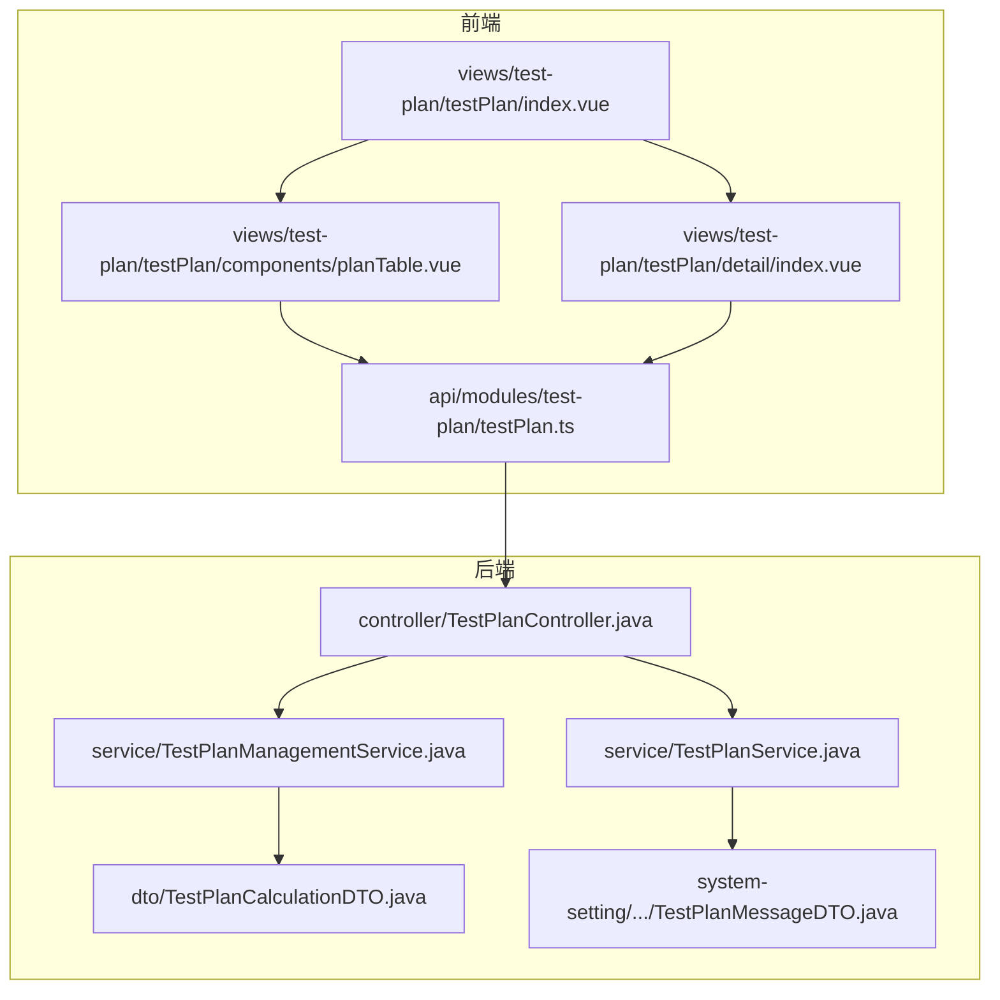
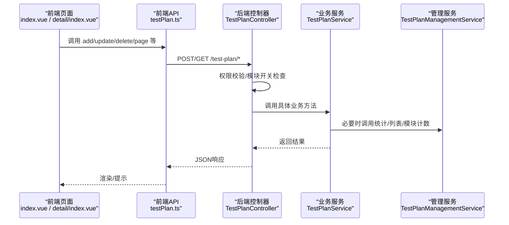
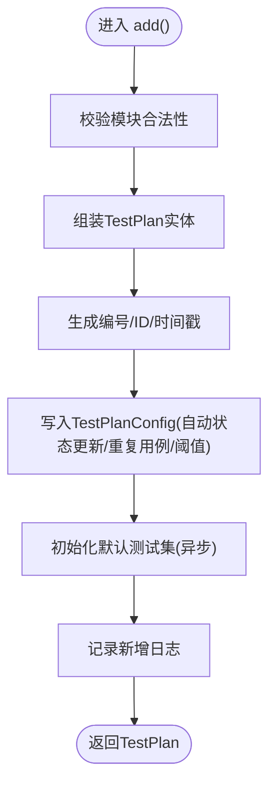
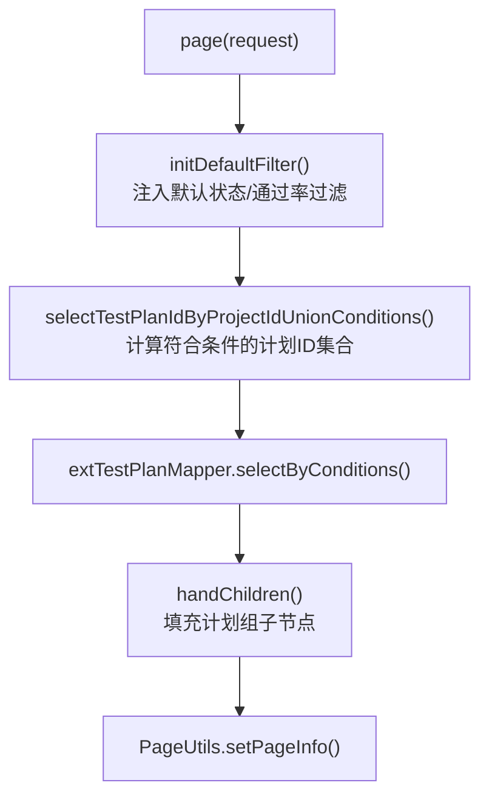
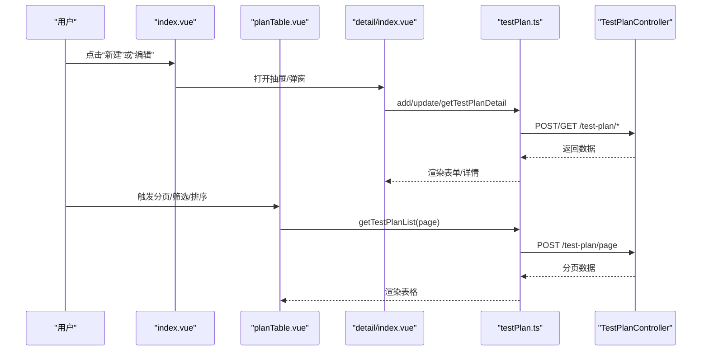
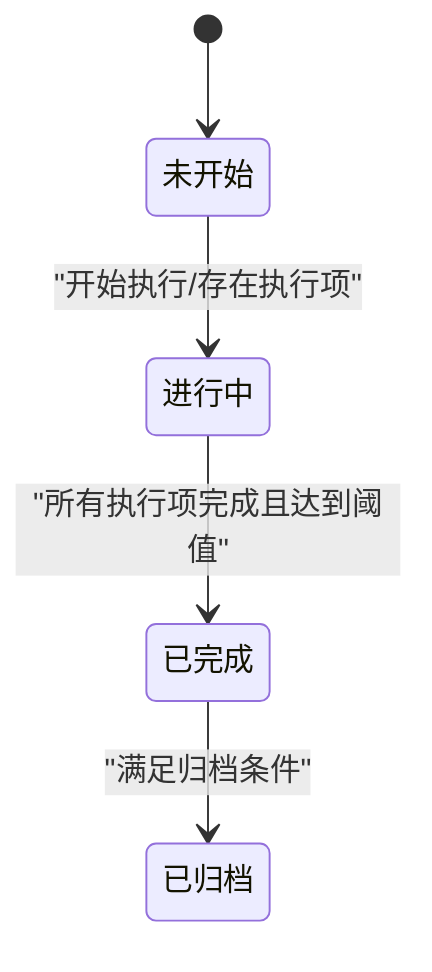
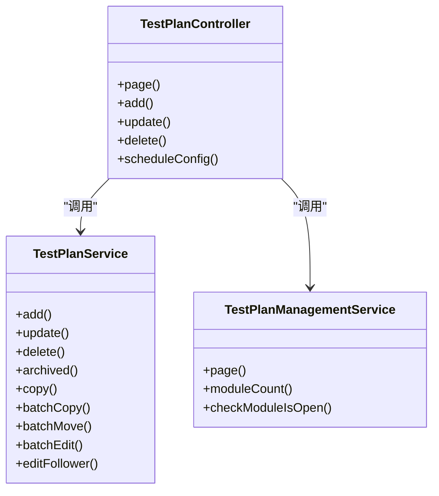

# 测试计划管理

<cite>
**本文引用的文件**   
- [TestPlanController.java](file://backend/services/test-plan/src/main/java/io/metersphere/plan/controller/TestPlanController.java)
- [TestPlanService.java](file://backend/services/test-plan/src/main/java/io/metersphere/plan/service/TestPlanService.java)
- [TestPlanManagementService.java](file://backend/services/test-plan/src/main/java/io/metersphere/plan/service/TestPlanManagementService.java)
- [testPlan.ts](file://frontend/src/api/modules/test-plan/testPlan.ts)
- [index.vue](file://frontend/src/views/test-plan/testPlan/index.vue)
- [detail/index.vue](file://frontend/src/views/test-plan/testPlan/detail/index.vue)
- [planTable.vue](file://frontend/src/views/test-plan/testPlan/components/planTable.vue)
- [TestPlanCalculationDTO.java](file://backend/services/test-plan/src/main/java/io/metersphere/plan/dto/TestPlanCalculationDTO.java)
- [TestPlanMessageDTO.java](file://backend/services/system-setting/src/main/java/io/metersphere/system/dto/sdk/TestPlanMessageDTO.java)
</cite>

## 目录
1. [简介](#简介)
2. [项目结构](#项目结构)
3. [核心组件](#核心组件)
4. [架构总览](#架构总览)
5. [详细组件分析](#详细组件分析)
6. [依赖关系分析](#依赖关系分析)
7. [性能与扩展性](#性能与扩展性)
8. [故障排查指南](#故障排查指南)
9. [结论](#结论)
10. [附录：API与交互示例](#附录api与交互示例)

## 简介
本文件围绕“测试计划管理”功能，系统梳理后端接口、领域服务、数据模型与前端交互流程。重点覆盖：
- 计划的创建、编辑、删除、查询（分页、分组、统计）
- 基本信息配置（名称、描述、时间、标签、通过率阈值、自动状态更新、重复用例等）
- 关联资源管理（功能用例、接口用例、接口场景、缺陷等）
- 权限控制与模块开关校验
- 计划状态管理与生命周期（未开始/进行中/已完成/归档）
- 定时任务配置与执行历史

## 项目结构
测试计划相关代码主要分布在以下位置：
- 后端控制器与服务：backend/services/test-plan/...
- 前端 API 封装与页面：frontend/src/api/modules/test-plan/ 与 frontend/src/views/test-plan/

图表来源
- [index.vue:1-116](file://frontend/src/views/test-plan/testPlan/index.vue#L1-L116)
- [detail/index.vue:247-286](file://frontend/src/views/test-plan/testPlan/detail/index.vue#L247-L286)
- [planTable.vue:446-497](file://frontend/src/views/test-plan/testPlan/components/planTable.vue#L446-L497)
- [testPlan.ts:180-211](file://frontend/src/api/modules/test-plan/testPlan.ts#L180-L211)
- [TestPlanController.java:40-180](file://backend/services/test-plan/src/main/java/io/metersphere/plan/controller/TestPlanController.java#L40-L180)
- [TestPlanService.java:163-219](file://backend/services/test-plan/src/main/java/io/metersphere/plan/service/TestPlanService.java#L163-L219)
- [TestPlanManagementService.java:82-90](file://backend/services/test-plan/src/main/java/io/metersphere/plan/service/TestPlanManagementService.java#L82-L90)
- [TestPlanCalculationDTO.java:36-103](file://backend/services/test-plan/src/main/java/io/metersphere/plan/dto/TestPlanCalculationDTO.java#L36-L103)
- [TestPlanMessageDTO.java:49-88](file://backend/services/system-setting/src/main/java/io/metersphere/system/dto/sdk/TestPlanMessageDTO.java#L49-L88)

章节来源
- [index.vue:1-341](file://frontend/src/views/test-plan/testPlan/index.vue#L1-L341)
- [TestPlanController.java:40-291](file://backend/services/test-plan/src/main/java/io/metersphere/plan/controller/TestPlanController.java#L40-L291)

## 核心组件
- 控制器层 TestPlanController：暴露 REST 接口，负责参数校验、权限与模块开关检查、日志与通知注解、调用服务层。
- 业务服务 TestPlanService：实现计划增删改查、复制/移动/批量操作、关注/取消关注、归档、定时任务配置、默认集合初始化、执行结果自动同步等。
- 管理服务 TestPlanManagementService：负责列表分页、模块计数、条件筛选（含“我的待办”）、计划组/计划树构建、模块菜单开关校验。
- 前端 API testPlan.ts：统一封装所有计划相关 HTTP 请求。
- 前端页面 index.vue/detail/index.vue/planTable.vue：计划树、表格、详情抽屉与操作入口。

章节来源
- [TestPlanController.java:40-291](file://backend/services/test-plan/src/main/java/io/metersphere/plan/controller/TestPlanController.java#L40-L291)
- [TestPlanService.java:163-800](file://backend/services/test-plan/src/main/java/io/metersphere/plan/service/TestPlanService.java#L163-L800)
- [TestPlanManagementService.java:65-568](file://backend/services/test-plan/src/main/java/io/metersphere/plan/service/TestPlanManagementService.java#L65-L568)
- [testPlan.ts:180-540](file://frontend/src/api/modules/test-plan/testPlan.ts#L180-L540)
- [index.vue:1-341](file://frontend/src/views/test-plan/testPlan/index.vue#L1-L341)
- [detail/index.vue:247-286](file://frontend/src/views/test-plan/testPlan/detail/index.vue#L247-L286)
- [planTable.vue:446-497](file://frontend/src/views/test-plan/testPlan/components/planTable.vue#L446-L497)

## 架构总览
测试计划管理采用前后端分离的 MVC 风格：
- 前端通过 testPlan.ts 发起请求，由 Vue 页面驱动用户交互（创建/编辑/删除/查询/执行/归档）。
- 后端 Controller 接收请求，进行权限与模块开关校验后交由 Service 处理。
- Service 组合多个 Mapper 与子服务完成数据持久化、统计计算、定时任务与通知。

图表来源
- [TestPlanController.java:124-180](file://backend/services/test-plan/src/main/java/io/metersphere/plan/controller/TestPlanController.java#L124-L180)
- [TestPlanService.java:163-219](file://backend/services/test-plan/src/main/java/io/metersphere/plan/service/TestPlanService.java#L163-L219)
- [TestPlanManagementService.java:82-90](file://backend/services/test-plan/src/main/java/io/metersphere/plan/service/TestPlanManagementService.java#L82-L90)
- [testPlan.ts:190-211](file://frontend/src/api/modules/test-plan/testPlan.ts#L190-L211)

## 详细组件分析

### 控制器层 TestPlanController
职责与要点：
- 提供计划分页、统计、组/计划列表、新增、更新、删除、批量删除、复制、批量复制/移动、批量归档、批量编辑、排序、定时任务配置、执行历史等接口。
- 使用 @RequiresPermissions 与 @CheckOwner 做权限与资源归属校验。
- 使用 @SendNotice 与 @Log 记录审计日志与发送通知。
- 对每个接口先调用 checkModuleIsOpen 校验项目是否开启“测试计划”模块。

关键接口路径（节选）：
- POST /test-plan/page：分页查询
- POST /test-plan/add：创建计划
- POST /test-plan/update：更新计划
- GET /test-plan/delete/{id}：删除计划
- POST /test-plan/batch-delete：批量删除
- GET /test-plan/archived/{id}：归档
- POST /test-plan/schedule-config：定时任务配置
- GET /test-plan/schedule-config-delete/{testPlanId}：删除定时任务
- POST /test-plan/his/page：执行历史分页

章节来源
- [TestPlanController.java:58-291](file://backend/services/test-plan/src/main/java/io/metersphere/plan/controller/TestPlanController.java#L58-L291)

### 业务服务 TestPlanService
职责与要点：
- 创建计划：保存基础信息、生成编号、写入计划配置（自动状态更新、重复用例、通过率阈值），并初始化默认测试集。
- 更新计划：支持变更计划组、模块、标签、计划配置；跨组移动时清理定时任务并重新计算排序。
- 删除计划：区分计划与计划组，级联删除关联资源、报告、关注者、执行历史、定时任务。
- 归档：仅允许已完成且满足条件的计划/计划组归档，归档后关闭定时任务。
- 复制/批量复制/移动/批量编辑：复用批量操作服务，维护日志与通知。
- 关注/取消关注：维护 TestPlanFollower。
- 默认集合初始化：异步为各资源类型初始化默认测试集。
- 自动状态更新：根据报告结果反向更新功能用例的执行结果。

图表来源
- [TestPlanService.java:163-219](file://backend/services/test-plan/src/main/java/io/metersphere/plan/service/TestPlanService.java#L163-L219)

章节来源
- [TestPlanService.java:163-800](file://backend/services/test-plan/src/main/java/io/metersphere/plan/service/TestPlanService.java#L163-L800)

### 管理服务 TestPlanManagementService
职责与要点：
- 列表分页 page：支持“我的待办”、默认排序、组合筛选（状态/通过率）与关键词搜索。
- 模块计数 moduleCount：按模块节点统计计划数量，包含“全部”。
- 条件筛选 selectTestPlanIdByProjectIdUnionConditions：基于执行结果与通过率阈值，聚合计划/计划组的通过/未通过、完成/进行中/未开始等状态集合。
- 模块菜单开关 checkModuleIsOpen：校验项目是否启用“测试计划”模块。

图表来源
- [TestPlanManagementService.java:82-90](file://backend/services/test-plan/src/main/java/io/metersphere/plan/service/TestPlanManagementService.java#L82-L90)
- [TestPlanManagementService.java:334-412](file://backend/services/test-plan/src/main/java/io/metersphere/plan/service/TestPlanManagementService.java#L334-L412)
- [TestPlanManagementService.java:443-460](file://backend/services/test-plan/src/main/java/io/metersphere/plan/service/TestPlanManagementService.java#L443-L460)

章节来源
- [TestPlanManagementService.java:65-568](file://backend/services/test-plan/src/main/java/io/metersphere/plan/service/TestPlanManagementService.java#L65-L568)

### 前端交互流程
- 列表页 index.vue：左侧计划树（支持新建计划/计划组、展开/折叠、拖拽排序），右侧表格 planTable.vue 展示计划列表与操作按钮。
- 详情页 detail/index.vue：获取计划详情、统计数据、缺陷列表，并提供归档/删除等操作，依据权限与状态动态显示。
- API 层 testPlan.ts：封装 add/update/delete/page/copy/batchCopy/batchMove/batchArchived/follow/generateReport 等接口。

图表来源
- [index.vue:12-27](file://frontend/src/views/test-plan/testPlan/index.vue#L12-L27)
- [detail/index.vue:247-286](file://frontend/src/views/test-plan/testPlan/detail/index.vue#L247-L286)
- [planTable.vue:446-497](file://frontend/src/views/test-plan/testPlan/components/planTable.vue#L446-L497)
- [testPlan.ts:180-211](file://frontend/src/api/modules/test-plan/testPlan.ts#L180-L211)
- [TestPlanController.java:58-65](file://backend/services/test-plan/src/main/java/io/metersphere/plan/controller/TestPlanController.java#L58-L65)

章节来源
- [index.vue:1-341](file://frontend/src/views/test-plan/testPlan/index.vue#L1-L341)
- [detail/index.vue:247-286](file://frontend/src/views/test-plan/testPlan/detail/index.vue#L247-L286)
- [planTable.vue:446-497](file://frontend/src/views/test-plan/testPlan/components/planTable.vue#L446-L497)
- [testPlan.ts:180-540](file://frontend/src/api/modules/test-plan/testPlan.ts#L180-L540)

### 计划状态与生命周期
- 状态维度：
  - 执行状态：未开始/进行中/已完成（由执行结果汇总得出）
  - 归档状态：未归档/已归档
- 状态计算：
  - 基于各资源类型的执行结果，结合通过率阈值，计算计划/计划组的状态与通过率。
  - TestPlanCalculationDTO 用于聚合不同维度的计划ID集合（如已通过/未通过、已完成/进行中/未开始等）。
- 归档规则：
  - 仅当计划/计划组已完成且满足阈值要求时方可归档，归档后关闭定时任务。

图表来源
- [TestPlanCalculationDTO.java:36-103](file://backend/services/test-plan/src/main/java/io/metersphere/plan/dto/TestPlanCalculationDTO.java#L36-L103)
- [TestPlanService.java:451-500](file://backend/services/test-plan/src/main/java/io/metersphere/plan/service/TestPlanService.java#L451-L500)

章节来源
- [TestPlanCalculationDTO.java:36-103](file://backend/services/test-plan/src/main/java/io/metersphere/plan/dto/TestPlanCalculationDTO.java#L36-L103)
- [TestPlanService.java:451-500](file://backend/services/test-plan/src/main/java/io/metersphere/plan/service/TestPlanService.java#L451-L500)

### 关联资源管理
- 功能用例、接口用例、接口场景：在计划详情中分别列出，支持拖拽排序、取消关联、批量执行、批量移动、查看报告等。
- 缺陷：支持在计划详情中对用例关联缺陷、批量关联/新建缺陷。
- 默认测试集：创建计划后异步初始化各资源类型的默认测试集，便于快速组织执行范围。

章节来源
- [testPlan.ts:256-411](file://frontend/src/api/modules/test-plan/testPlan.ts#L256-L411)
- [TestPlanService.java:612-637](file://backend/services/test-plan/src/main/java/io/metersphere/plan/service/TestPlanService.java#L612-L637)

### 权限控制与模块开关
- 权限控制：
  - 使用 @RequiresPermissions 控制读/写/执行/删除等能力。
  - 使用 @CheckOwner 校验资源归属（项目/计划）。
- 模块开关：
  - 每个接口先调用 checkModuleIsOpen 校验项目是否开启“测试计划”模块，否则抛出异常。

章节来源
- [TestPlanController.java:58-180](file://backend/services/test-plan/src/main/java/io/metersphere/plan/controller/TestPlanController.java#L58-L180)
- [TestPlanManagementService.java:462-505](file://backend/services/test-plan/src/main/java/io/metersphere/plan/service/TestPlanManagementService.java#L462-L505)

## 依赖关系分析
- 控制器依赖服务：TestPlanController 依赖 TestPlanService、TestPlanScheduleService、TestPlanManagementService、TestPlanStatisticsService、PermissionCheckService。
- 服务间协作：TestPlanService 组合 TestPlanBatchOperationService、TestPlanLogService、TestPlanReportService、ScheduleService 等。
- 前端依赖后端：testPlan.ts 将 URL 与方法映射到后端接口。

图表来源
- [TestPlanController.java:44-55](file://backend/services/test-plan/src/main/java/io/metersphere/plan/controller/TestPlanController.java#L44-L55)
- [TestPlanService.java:59-114](file://backend/services/test-plan/src/main/java/io/metersphere/plan/service/TestPlanService.java#L59-L114)
- [TestPlanManagementService.java:45-63](file://backend/services/test-plan/src/main/java/io/metersphere/plan/service/TestPlanManagementService.java#L45-L63)

章节来源
- [TestPlanController.java:40-291](file://backend/services/test-plan/src/main/java/io/metersphere/plan/controller/TestPlanController.java#L40-L291)
- [TestPlanService.java:59-114](file://backend/services/test-plan/src/main/java/io/metersphere/plan/service/TestPlanService.java#L59-L114)
- [TestPlanManagementService.java:45-63](file://backend/services/test-plan/src/main/java/io/metersphere/plan/service/TestPlanManagementService.java#L45-L63)

## 性能与扩展性
- 分页与排序：后端使用 PageHelper 与自定义排序字段 pos/id，提升大数据量下的列表性能。
- 批量操作：使用批处理工具与事务控制，减少数据库往返次数。
- 异步初始化：默认测试集初始化使用 @Async，避免阻塞主流程。
- 可扩展点：
  - 新增资源类型时，实现 TestPlanResourceService 以接入默认集合与级联删除逻辑。
  - 扩展状态计算策略，可在 TestPlanBaseUtilsService 中调整状态推导算法。

[本节为通用指导，不直接分析具体文件]

## 故障排查指南
常见问题与建议：
- 模块未开启导致接口报错：确认项目设置中已启用“测试计划”模块。
- 权限不足：检查当前用户是否具备对应权限（读/写/执行/删除）。
- 归档失败：确认计划/计划组已完成且达到通过率阈值。
- 定时任务未生效：检查计划是否被移动到计划组（会清空原定时任务），或归档后被关闭。
- 执行历史为空：确认是否成功执行过计划或单条用例。

章节来源
- [TestPlanManagementService.java:462-505](file://backend/services/test-plan/src/main/java/io/metersphere/plan/service/TestPlanManagementService.java#L462-L505)
- [TestPlanService.java:451-500](file://backend/services/test-plan/src/main/java/io/metersphere/plan/service/TestPlanService.java#L451-L500)

## 结论
测试计划管理在后端通过清晰的控制器-服务分层，结合权限与模块开关校验，提供了完整的计划全生命周期管理能力；在前端通过树-表-详情的交互模式，实现了从创建、编辑、关联资源到执行与归档的一体化体验。状态计算与阈值控制保证了质量门禁的可控性与可观测性。

[本节为总结性内容，不直接分析具体文件]

## 附录：API与交互示例
以下为常用操作的“调用路径参考”，不包含具体代码内容：

- 创建测试计划
  - 前端：调用 testPlan.ts 中的 addTestPlan(data)
  - 后端：POST /test-plan/add，由 TestPlanController.add 处理，最终由 TestPlanService.add 落库并初始化默认测试集

- 更新测试计划
  - 前端：调用 testPlan.ts 中的 updateTestPlan(data)
  - 后端：POST /test-plan/update，由 TestPlanController.update 处理，最终由 TestPlanService.update 更新基础信息与配置

- 删除测试计划
  - 前端：调用 testPlan.ts 中的 deletePlan(id)
  - 后端：GET /test-plan/delete/{id}，由 TestPlanController.delete 处理，最终由 TestPlanService.delete 级联清理关联资源

- 分页查询测试计划
  - 前端：调用 testPlan.ts 中的 getTestPlanList(params)
  - 后端：POST /test-plan/page，由 TestPlanController.page 处理，最终由 TestPlanManagementService.page 返回分页数据

- 归档测试计划
  - 前端：调用 testPlan.ts 中的 archivedPlan(id)
  - 后端：GET /test-plan/archived/{id}，由 TestPlanController.archived 处理，最终由 TestPlanService.archived 执行归档

- 配置定时任务
  - 前端：调用 testPlan.ts 中的 configSchedule(data)
  - 后端：POST /test-plan/schedule-config，由 TestPlanController.scheduleConfig 处理，最终由 TestPlanScheduleService 管理调度任务

- 获取执行历史
  - 前端：调用 testPlan.ts 中的 executeHistory(data)
  - 后端：POST /test-plan/his/page，由 TestPlanController.pageHis 处理，返回分页执行历史

章节来源
- [testPlan.ts:190-211](file://frontend/src/api/modules/test-plan/testPlan.ts#L190-L211)
- [TestPlanController.java:124-180](file://backend/services/test-plan/src/main/java/io/metersphere/plan/controller/TestPlanController.java#L124-L180)
- [TestPlanService.java:163-219](file://backend/services/test-plan/src/main/java/io/metersphere/plan/service/TestPlanService.java#L163-L219)