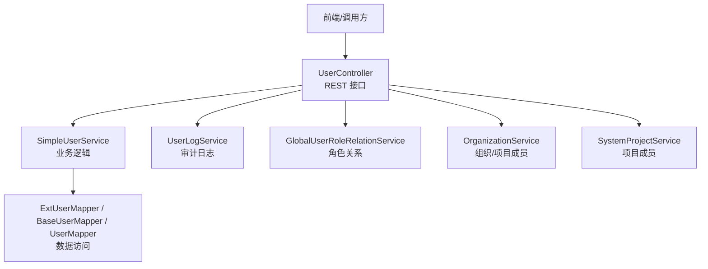
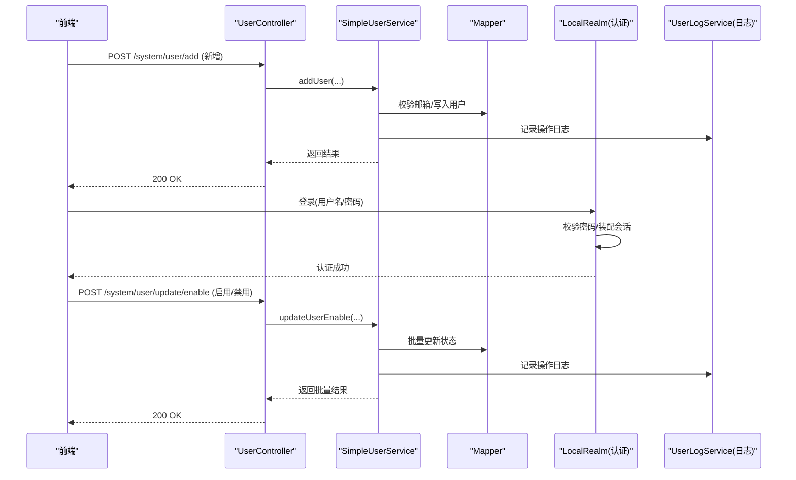
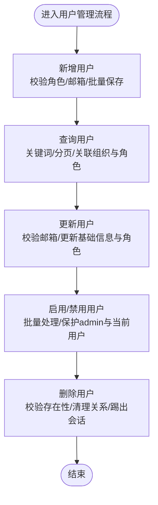
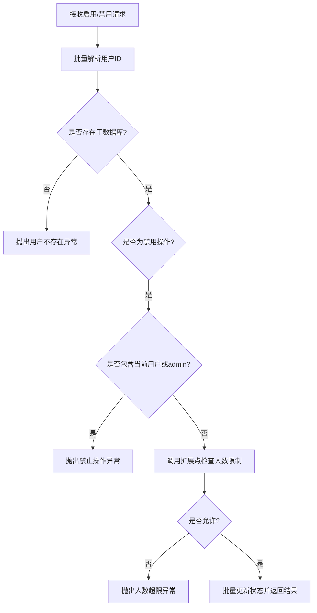
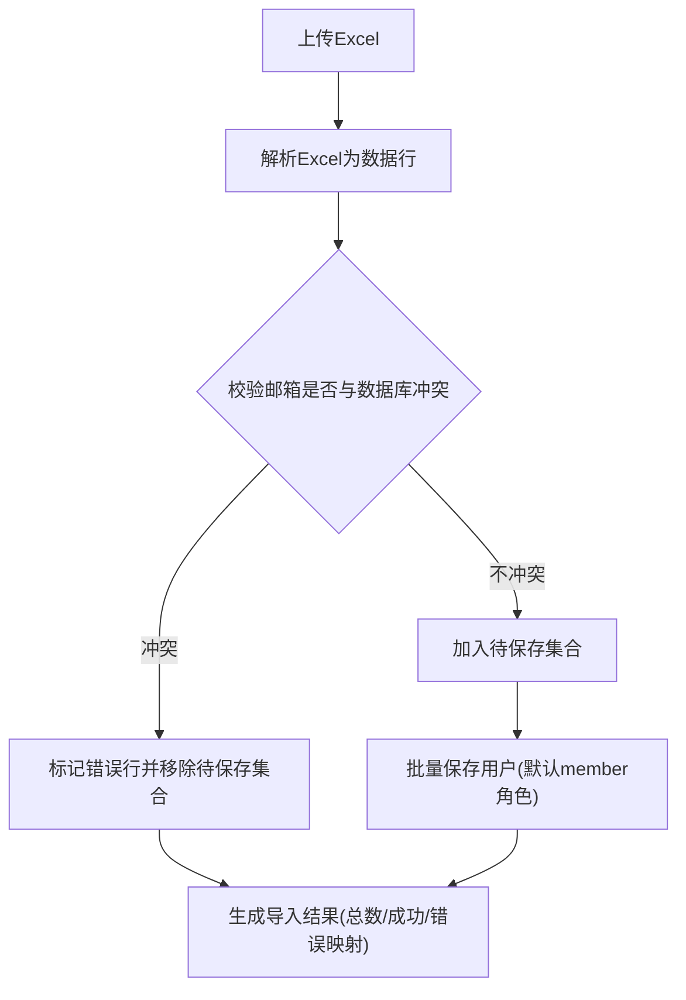
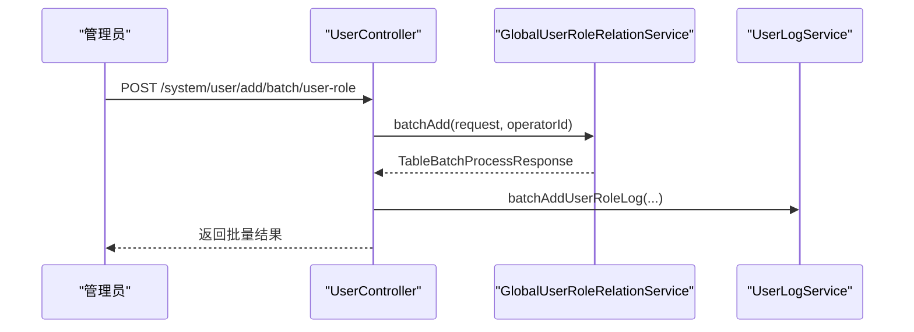
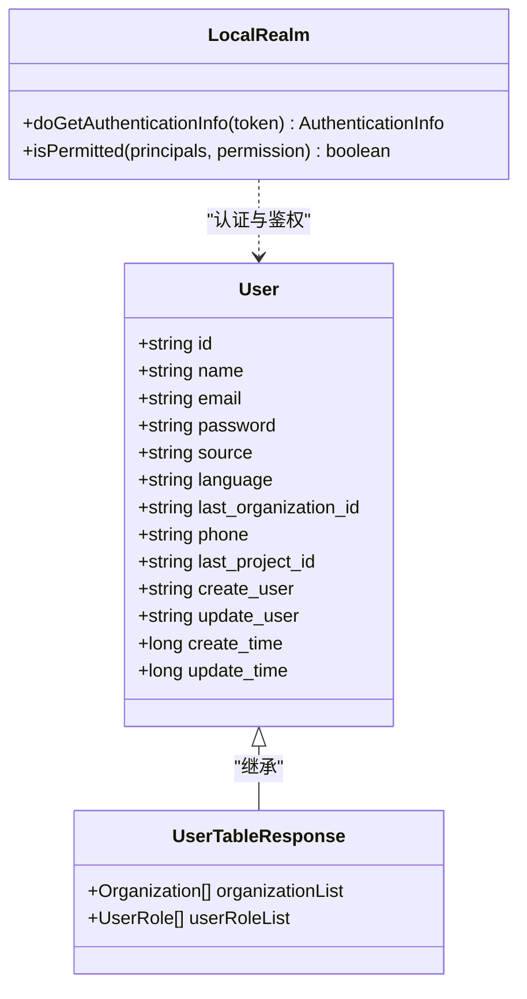
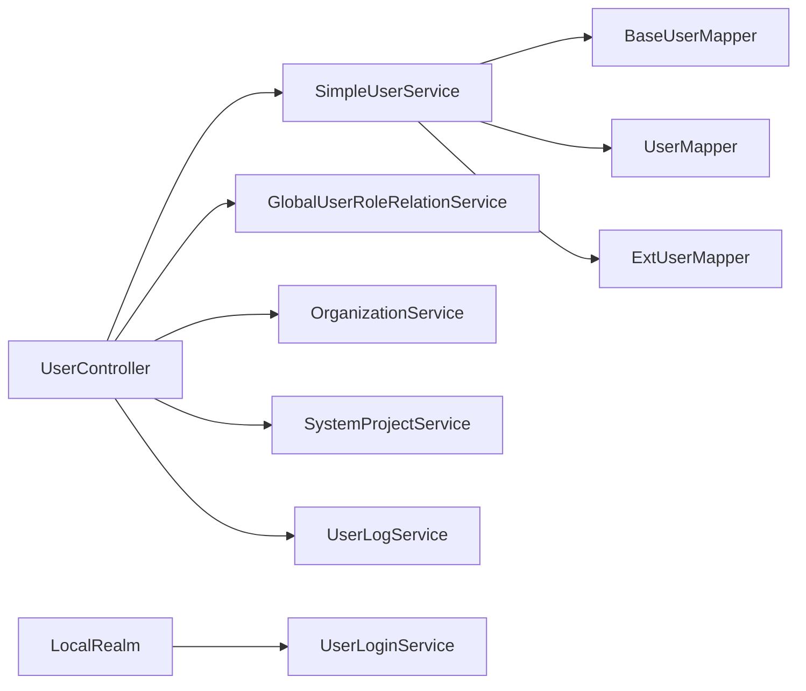

# 用户管理

<cite>
**本文引用的文件**   
- [UserController.java](file://backend/services/system-setting/src/main/java/io/metersphere/system/controller/UserController.java)
- [SimpleUserService.java](file://backend/services/system-setting/src/main/java/io/metersphere/system/service/SimpleUserService.java)
- [LocalRealm.java](file://backend/services/system-setting/src/main/java/io/metersphere/system/security/realm/LocalRealm.java)
- [UserImportResponse.java](file://backend/services/system-setting/src/main/java/io/metersphere/system/dto/user/response/UserImportResponse.java)
- [UserTableResponse.java](file://backend/services/system-setting/src/main/java/io/metersphere/system/dto/user/response/UserTableResponse.java)
- [ExtUserMapper.java](file://backend/services/system-setting/src/main/java/io/metersphere/system/mapper/ExtUserMapper.java)
- [UserControllerPermissionTests.java](file://backend/services/system-setting/src/test/java/io/metersphere/system/controller/user/UserControllerPermissionTests.java)
- [UserRequestUtils.java](file://backend/services/system-setting/src/test/java/io/metersphere/system/utils/user/UserRequestUtils.java)
</cite>

## 目录
1. [简介](#简介)
2. [项目结构](#项目结构)
3. [核心组件](#核心组件)
4. [架构总览](#架构总览)
5. [详细组件分析](#详细组件分析)
6. [依赖关系分析](#依赖关系分析)
7. [性能考虑](#性能考虑)
8. [故障排查指南](#故障排查指南)
9. [结论](#结论)
10. [附录](#附录)

## 简介
本章节面向 MeterSphere 的用户管理功能，系统性阐述用户在系统中的生命周期与能力边界，包括：
- 用户的创建、查询、更新、删除（CRUD）
- 用户状态管理（启用/禁用）
- 用户信息校验与数据导入导出
- 批量管理、权限配置与属性设置
- 安全策略（密码加密、会话管理、审计日志）
- 最佳实践与常见问题解决方案

## 项目结构
用户管理相关代码主要位于后端 services/system-setting 模块中，采用控制器-服务-数据访问的分层架构：
- 控制器层：对外暴露 REST API，负责参数校验、权限控制与日志记录
- 服务层：实现业务逻辑，协调多实体操作、事务与异常处理
- 数据访问层：通过 Mapper 与数据库交互
- 安全层：认证与鉴权、会话管理
- DTO/响应对象：承载请求与返回数据结构

图表来源
- [UserController.java:51-204](file://backend/services/system-setting/src/main/java/io/metersphere/system/controller/UserController.java#L51-L204)
- [SimpleUserService.java:66-604](file://backend/services/system-setting/src/main/java/io/metersphere/system/service/SimpleUserService.java#L66-L604)

章节来源
- [UserController.java:51-204](file://backend/services/system-setting/src/main/java/io/metersphere/system/controller/UserController.java#L51-L204)
- [SimpleUserService.java:66-604](file://backend/services/system-setting/src/main/java/io/metersphere/system/service/SimpleUserService.java#L66-L604)

## 核心组件
- UserController：定义用户管理的 REST 接口，涵盖新增、修改、分页查询、启用/禁用、导入、删除、重置密码、邀请注册、批量添加用户组/组织/项目成员等。
- SimpleUserService：实现用户全生命周期业务逻辑，包含邮箱唯一性校验、批量创建、Excel 导入解析与校验、批量启用/禁用、删除与踢出在线用户、密码重置、邀请注册流程等。
- LocalRealm：Shiro 认证入口，负责本地模式登录、密码校验与会话用户装配。
- UserImportResponse：封装 Excel 导入结果（导入总数、成功数、错误行映射）。
- UserTableResponse：用户列表展示扩展对象，附加组织与用户组信息。
- ExtUserMapper：提供用户扩展查询与密码更新等方法。

章节来源
- [UserController.java:51-204](file://backend/services/system-setting/src/main/java/io/metersphere/system/controller/UserController.java#L51-L204)
- [SimpleUserService.java:66-604](file://backend/services/system-setting/src/main/java/io/metersphere/system/service/SimpleUserService.java#L66-L604)
- [LocalRealm.java:32-115](file://backend/services/system-setting/src/main/java/io/metersphere/system/security/realm/LocalRealm.java#L32-L115)
- [UserImportResponse.java:12-29](file://backend/services/system-setting/src/main/java/io/metersphere/system/dto/user/response/UserImportResponse.java#L12-L29)
- [UserTableResponse.java:13-32](file://backend/services/system-setting/src/main/java/io/metersphere/system/dto/user/response/UserTableResponse.java#L13-L32)
- [ExtUserMapper.java:38-62](file://backend/services/system-setting/src/main/java/io/metersphere/system/mapper/ExtUserMapper.java#L38-L62)

## 架构总览
用户管理在系统内的整体交互如下：
- 前端或外部系统调用 UserController 的 REST 接口
- 控制器进行权限校验（基于 Shiro 注解），并委托 SimpleUserService 执行业务
- 服务层调用 Mapper 完成数据读写，必要时联动组织/项目/角色服务
- 认证流程由 LocalRealm 统一处理，完成用户身份验证与会话装配
- 审计日志通过 UserLogService 记录关键操作

图表来源
- [UserController.java:74-127](file://backend/services/system-setting/src/main/java/io/metersphere/system/controller/UserController.java#L74-L127)
- [SimpleUserService.java:117-245](file://backend/services/system-setting/src/main/java/io/metersphere/system/service/SimpleUserService.java#L117-L245)
- [LocalRealm.java:94-113](file://backend/services/system-setting/src/main/java/io/metersphere/system/security/realm/LocalRealm.java#L94-L113)

## 详细组件分析

### 用户 CRUD 与生命周期
- 创建用户
  - 接口：POST /system/user/add
  - 职责：校验全局角色合法性、邮箱唯一性、批量保存用户与角色关系、记录日志
  - 关键点：支持批量创建；失败时返回错误邮箱集合
- 查询用户
  - 接口：GET /system/user/get/{keyword}、POST /system/user/page
  - 职责：按关键词检索、分页查询并附带组织与用户组信息
- 更新用户
  - 接口：POST /system/user/update
  - 职责：校验邮箱唯一性、更新用户基本信息、同步系统级用户组关系
- 删除用户
  - 接口：POST /system/user/delete
  - 职责：校验用户存在性、禁止删除 admin/当前用户、软删或集成扩展删除、清理角色关系、踢出在线会话
- 启用/禁用用户
  - 接口：POST /system/user/update/enable
  - 职责：批量启用/禁用，禁止禁用 admin/当前用户，集成扩展限制（如开源版人数上限）

图表来源
- [UserController.java:67-127](file://backend/services/system-setting/src/main/java/io/metersphere/system/controller/UserController.java#L67-L127)
- [SimpleUserService.java:117-332](file://backend/services/system-setting/src/main/java/io/metersphere/system/service/SimpleUserService.java#L117-L332)

章节来源
- [UserController.java:67-127](file://backend/services/system-setting/src/main/java/io/metersphere/system/controller/UserController.java#L67-L127)
- [SimpleUserService.java:117-332](file://backend/services/system-setting/src/main/java/io/metersphere/system/service/SimpleUserService.java#L117-L332)

### 用户状态管理（启用/禁用）
- 前置校验：检查目标用户是否存在；若为禁用操作，禁止对当前用户与 admin 进行操作
- 扩展限制：通过扩展点判断是否超过用户数量限制（开源版/部门版）
- 批量处理：返回总处理数与成功数，便于前端提示

图表来源
- [SimpleUserService.java:222-245](file://backend/services/system-setting/src/main/java/io/metersphere/system/service/SimpleUserService.java#L222-L245)

章节来源
- [SimpleUserService.java:222-245](file://backend/services/system-setting/src/main/java/io/metersphere/system/service/SimpleUserService.java#L222-L245)

### 用户信息验证与导入导出
- 信息验证
  - 邮箱唯一性：批量创建与更新时均会校验邮箱是否重复或已存在于系统
  - 旧密码校验：个人密码修改前需校验旧密码
- 导入导出
  - 导入：支持 Excel 上传，解析并校验数据，过滤与数据库冲突的行，批量保存默认“member”角色
  - 导出：通过 UserImportResponse 汇总导入总数、成功数与错误行映射

图表来源
- [SimpleUserService.java:257-312](file://backend/services/system-setting/src/main/java/io/metersphere/system/service/SimpleUserService.java#L257-L312)
- [UserImportResponse.java:12-29](file://backend/services/system-setting/src/main/java/io/metersphere/system/dto/user/response/UserImportResponse.java#L12-L29)

章节来源
- [SimpleUserService.java:257-312](file://backend/services/system-setting/src/main/java/io/metersphere/system/service/SimpleUserService.java#L257-L312)
- [UserImportResponse.java:12-29](file://backend/services/system-setting/src/main/java/io/metersphere/system/dto/user/response/UserImportResponse.java#L12-L29)

### 批量管理与权限配置
- 批量添加用户到多个用户组
  - 接口：POST /system/user/add/batch/user-role
  - 职责：批量建立用户与全局用户组的关系，记录操作日志
- 批量添加用户到项目/组织
  - 接口：POST /system/user/add-project-member、POST /system/user/add-org-member
  - 职责：将用户批量加入项目或组织，记录操作日志
- 权限控制
  - 使用 Shiro 注解 @RequiresPermissions 控制各接口的访问权限
  - 测试用例覆盖权限校验（读、写、导入等）

图表来源
- [UserController.java:151-158](file://backend/services/system-setting/src/main/java/io/metersphere/system/controller/UserController.java#L151-L158)

章节来源
- [UserController.java:151-184](file://backend/services/system-setting/src/main/java/io/metersphere/system/controller/UserController.java#L151-L184)
- [UserControllerPermissionTests.java:57-77](file://backend/services/system-setting/src/test/java/io/metersphere/system/controller/user/UserControllerPermissionTests.java#L57-L77)

### 用户数据模型与安全策略
- 数据模型
  - 用户基础信息：id、name、email、password、source、language、last_organization_id、phone、last_project_id、create_user、update_user、create_time、update_time
  - 用户扩展信息：头像等扩展字段
  - 用户表响应：UserTableResponse 附加 organizationList 与 userRoleList
- 密码加密
  - 存储：使用 MD5 对用户密码进行哈希存储
  - 校验：LocalRealm 通过 UserLoginService.checkUserPassword 进行密码比对
  - 重置：管理员可批量重置密码，admin 默认密码为固定值，其他用户默认密码为其邮箱
- 会话管理
  - 认证通过后，LocalRealm 将 SessionUser 放入会话上下文，供后续鉴权使用
  - 删除用户时会踢出在线会话，确保权限即时失效
- 审计日志
  - 关键操作（新增、更新、删除、启用/禁用、重置密码、邀请注册等）均记录操作日志，便于追溯

图表来源
- [UserTableResponse.java:13-32](file://backend/services/system-setting/src/main/java/io/metersphere/system/dto/user/response/UserTableResponse.java#L13-L32)
- [LocalRealm.java:32-115](file://backend/services/system-setting/src/main/java/io/metersphere/system/security/realm/LocalRealm.java#L32-L115)

章节来源
- [LocalRealm.java:94-113](file://backend/services/system-setting/src/main/java/io/metersphere/system/security/realm/LocalRealm.java#L94-L113)
- [ExtUserMapper.java:41-43](file://backend/services/system-setting/src/main/java/io/metersphere/system/mapper/ExtUserMapper.java#L41-L43)

## 依赖关系分析
- 控制器与服务耦合
  - UserController 依赖 SimpleUserService 执行核心业务
  - 同时依赖 GlobalUserRoleRelationService、OrganizationService、SystemProjectService、UserLogService 完成角色、组织、项目与日志操作
- 服务与数据访问
  - SimpleUserService 依赖 BaseUserMapper、UserMapper、ExtUserMapper 进行数据读写
  - 通过 SqlSession 批量更新密码以提升性能
- 安全与认证
  - LocalRealm 依赖 UserLoginService 获取用户信息与校验密码
  - 权限判定通过 SessionUtils.hasPermission 结合当前组织/项目上下文

图表来源
- [UserController.java:51-204](file://backend/services/system-setting/src/main/java/io/metersphere/system/controller/UserController.java#L51-L204)
- [SimpleUserService.java:66-604](file://backend/services/system-setting/src/main/java/io/metersphere/system/service/SimpleUserService.java#L66-L604)
- [LocalRealm.java:32-115](file://backend/services/system-setting/src/main/java/io/metersphere/system/security/realm/LocalRealm.java#L32-L115)

章节来源
- [UserController.java:51-204](file://backend/services/system-setting/src/main/java/io/metersphere/system/controller/UserController.java#L51-L204)
- [SimpleUserService.java:66-604](file://backend/services/system-setting/src/main/java/io/metersphere/system/service/SimpleUserService.java#L66-L604)
- [LocalRealm.java:32-115](file://backend/services/system-setting/src/main/java/io/metersphere/system/security/realm/LocalRealm.java#L32-L115)

## 性能考虑
- 批量操作优化
  - 密码重置使用 SqlSession 批量更新，每 50 条 flushStatements，减少数据库往返开销
- 分页与排序
  - 用户列表分页查询支持按 id 或 createTime 排序，默认按 createTime desc,id desc
- 导入性能
  - Excel 解析与校验分离，先过滤冲突行再批量保存，避免无效写入

[本节为通用指导，不涉及具体文件分析]

## 故障排查指南
- 常见错误与定位
  - 邮箱重复：新增或更新用户时报错，检查邮箱是否已在系统中存在
  - 用户不存在：批量操作（启用/禁用/删除/重置密码）前需校验用户是否存在
  - 禁止操作：尝试禁用或删除当前用户或 admin 会抛出异常
  - 人数限制：扩展点返回非 0 表示超出限额（开源版/部门版）
- 调试建议
  - 查看操作日志（UserLogService）确认关键步骤是否执行
  - 检查权限注解与测试用例，确认调用方具备所需权限
  - 核对 Excel 导入的错误行映射，定位具体失败原因

章节来源
- [SimpleUserService.java:191-203](file://backend/services/system-setting/src/main/java/io/metersphere/system/service/SimpleUserService.java#L191-L203)
- [SimpleUserService.java:247-255](file://backend/services/system-setting/src/main/java/io/metersphere/system/service/SimpleUserService.java#L247-L255)
- [SimpleUserService.java:315-332](file://backend/services/system-setting/src/main/java/io/metersphere/system/service/SimpleUserService.java#L315-L332)
- [UserControllerPermissionTests.java:57-77](file://backend/services/system-setting/src/test/java/io/metersphere/system/controller/user/UserControllerPermissionTests.java#L57-L77)

## 结论
MeterSphere 的用户管理模块以清晰的控制器-服务-数据访问分层为基础，提供了完整的用户生命周期管理能力，并通过 Shiro 实现了严格的权限控制与安全的会话管理。结合审计日志与批量优化，系统在易用性与性能之间取得良好平衡。建议在大规模用户管理中优先使用批量接口，并遵循最小权限原则与数据校验规范，以确保系统的安全与稳定。

[本节为总结性内容，不涉及具体文件分析]

## 附录
- 常用接口参考（路径）
  - 新增用户：/system/user/add
  - 修改用户：/system/user/update
  - 分页查询：/system/user/page
  - 启用/禁用：/system/user/update/enable
  - 导入用户：/system/user/import
  - 删除用户：/system/user/delete
  - 重置密码：/system/user/reset/password
  - 批量添加用户组：/system/user/add/batch/user-role
  - 批量添加项目成员：/system/user/add-project-member
  - 批量添加组织成员：/system/user/add-org-member
  - 邀请注册：/system/user/invite、/system/user/register-by-invite

章节来源
- [UserRequestUtils.java:21-44](file://backend/services/system-setting/src/test/java/io/metersphere/system/utils/user/UserRequestUtils.java#L21-L44)