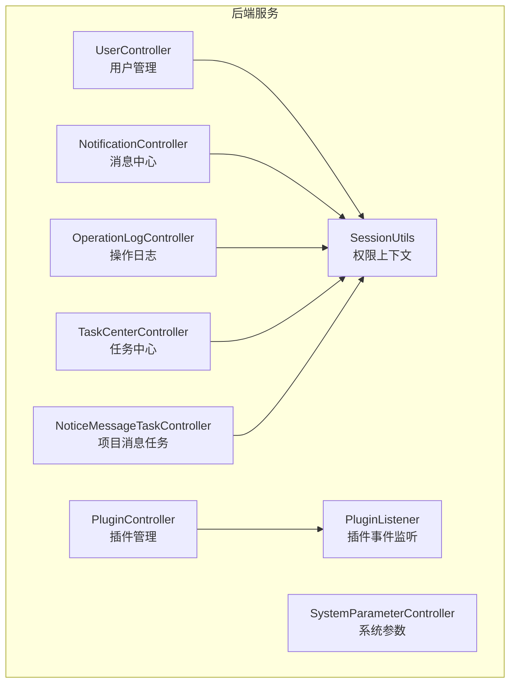
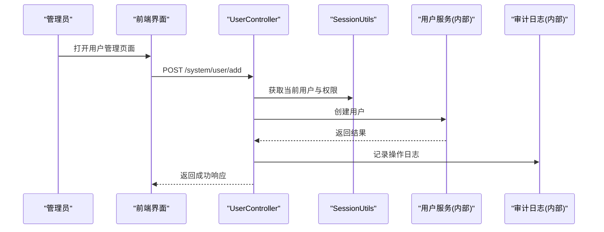
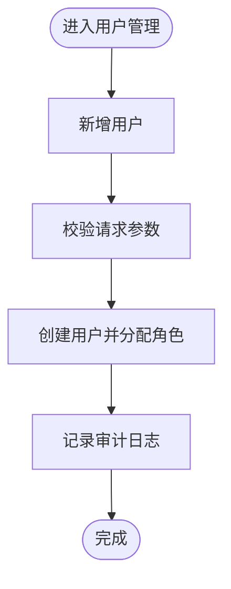
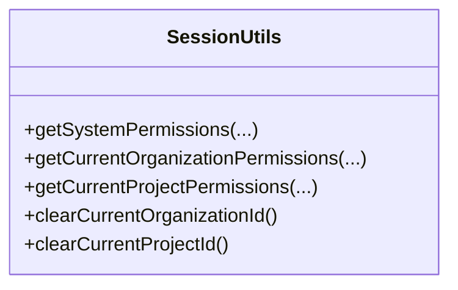
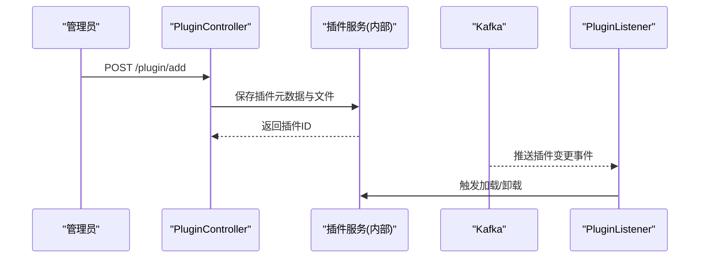
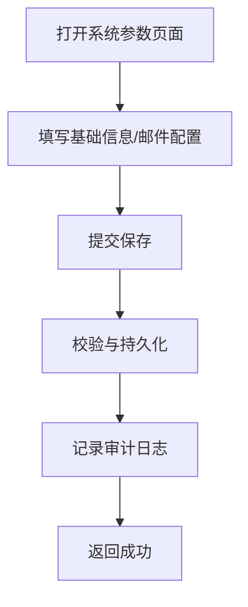
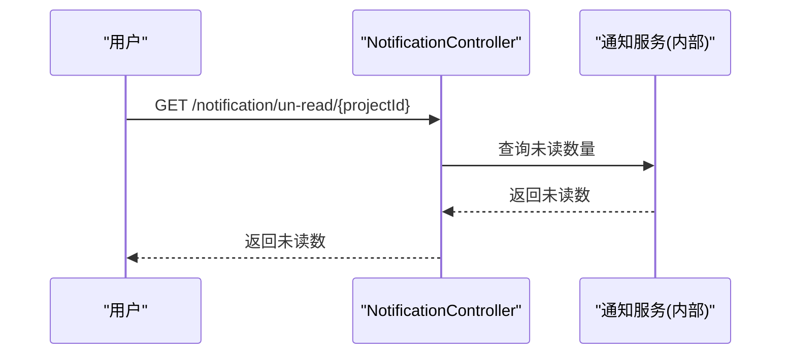
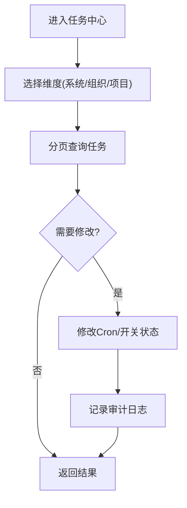
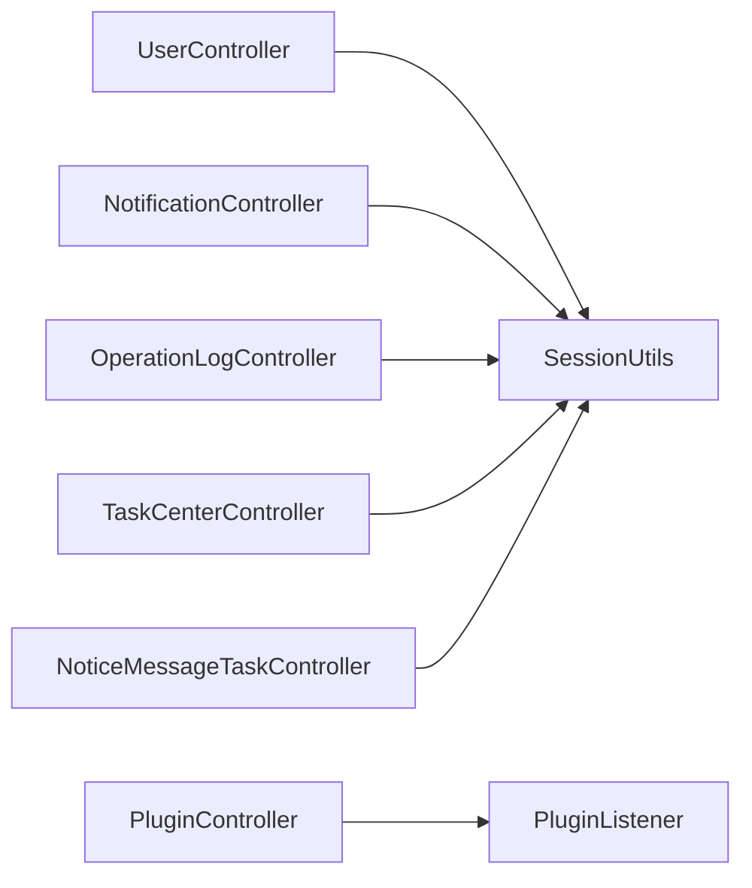

# 系统设置

<cite>
**本文引用的文件**   
- [UserController.java](file://backend/services/system-setting/src/main/java/io/metersphere/system/controller/UserController.java)
- [PluginController.java](file://backend/services/system-setting/src/main/java/io/metersphere/system/controller/PluginController.java)
- [SystemParameterController.java](file://backend/services/system-setting/src/main/java/io/metersphere/system/controller/SystemParameterController.java)
- [NotificationController.java](file://backend/services/system-setting/src/main/java/io/metersphere/system/controller/NotificationController.java)
- [OperationLogController.java](file://backend/services/system-setting/src/main/java/io/metersphere/system/controller/OperationLogController.java)
- [TaskCenterController.java](file://backend/services/system-setting/src/main/java/io/metersphere/system/controller/TaskCenterController.java)
- [SessionUtils.java](file://backend/services/system-setting/src/main/java/io/metersphere/system/utils/SessionUtils.java)
- [PluginListener.java](file://backend/services/system-setting/src/main/java/io/metersphere/system/listener/PluginListener.java)
- [NoticeMessageTaskController.java](file://backend/services/project-management/src/main/java/io/metersphere/project/controller/NoticeMessageTaskController.java)
</cite>

## 目录
1. [简介](#简介)
2. [项目结构](#项目结构)
3. [核心组件](#核心组件)
4. [架构总览](#架构总览)
5. [详细组件分析](#详细组件分析)
6. [依赖关系分析](#依赖关系分析)
7. [性能与可扩展性](#性能与可扩展性)
8. [故障排查指南](#故障排查指南)
9. [结论](#结论)

## 简介
本章节面向 MeterSphere 的系统设置模块，围绕用户管理、权限控制、插件管理、系统配置、消息通知、日志管理与任务中心进行系统化说明。文档从后端控制器与服务能力出发，结合前端路由与模型组织，给出可操作的使用示例与安全策略建议，帮助管理员高效完成系统级治理与运维。

## 项目结构
系统设置相关功能主要位于后端 services/system-setting 模块的 controller 层，涵盖用户、插件、参数、通知、日志与任务中心等入口；同时通过 utils.SessionUtils 提供权限计算上下文，listener.PluginListener 监听插件变更事件，project-management 模块中的 NoticeMessageTaskController 负责项目级消息任务配置。

图表来源
- [UserController.java:48-205](file://backend/services/system-setting/src/main/java/io/metersphere/system/controller/UserController.java#L48-L205)
- [PluginController.java:35-106](file://backend/services/system-setting/src/main/java/io/metersphere/system/controller/PluginController.java#L35-L106)
- [SystemParameterController.java:22-112](file://backend/services/system-setting/src/main/java/io/metersphere/system/controller/SystemParameterController.java#L22-L112)
- [NotificationController.java:22-62](file://backend/services/system-setting/src/main/java/io/metersphere/system/controller/NotificationController.java#L22-L62)
- [OperationLogController.java:29-84](file://backend/services/system-setting/src/main/java/io/metersphere/system/controller/OperationLogController.java#L29-L84)
- [TaskCenterController.java:26-200](file://backend/services/system-setting/src/main/java/io/metersphere/system/controller/TaskCenterController.java#L26-L200)
- [SessionUtils.java:167-205](file://backend/services/system-setting/src/main/java/io/metersphere/system/utils/SessionUtils.java#L167-L205)
- [PluginListener.java:14-41](file://backend/services/system-setting/src/main/java/io/metersphere/system/listener/PluginListener.java#L14-L41)
- [NoticeMessageTaskController.java:31-53](file://backend/services/project-management/src/main/java/io/metersphere/project/controller/NoticeMessageTaskController.java#L31-L53)

章节来源
- [UserController.java:48-205](file://backend/services/system-setting/src/main/java/io/metersphere/system/controller/UserController.java#L48-L205)
- [PluginController.java:35-106](file://backend/services/system-setting/src/main/java/io/metersphere/system/controller/PluginController.java#L35-L106)
- [SystemParameterController.java:22-112](file://backend/services/system-setting/src/main/java/io/metersphere/system/controller/SystemParameterController.java#L22-L112)
- [NotificationController.java:22-62](file://backend/services/system-setting/src/main/java/io/metersphere/system/controller/NotificationController.java#L22-L62)
- [OperationLogController.java:29-84](file://backend/services/system-setting/src/main/java/io/metersphere/system/controller/OperationLogController.java#L29-L84)
- [TaskCenterController.java:26-200](file://backend/services/system-setting/src/main/java/io/metersphere/system/controller/TaskCenterController.java#L26-L200)
- [SessionUtils.java:167-205](file://backend/services/system-setting/src/main/java/io/metersphere/system/utils/SessionUtils.java#L167-L205)
- [PluginListener.java:14-41](file://backend/services/system-setting/src/main/java/io/metersphere/system/listener/PluginListener.java#L14-L41)
- [NoticeMessageTaskController.java:31-53](file://backend/services/project-management/src/main/java/io/metersphere/project/controller/NoticeMessageTaskController.java#L31-L53)

## 核心组件
- 用户管理：提供用户的增删改查、批量导入、启用/禁用、密码重置、邀请注册、组织/项目成员批量添加等能力，并记录审计日志。
- 权限控制：基于角色（全局/组织/项目）与权限标识进行细粒度访问控制，支持按资源维度的所有者校验。
- 插件管理：支持插件上传、更新、删除、脚本获取、图片资源访问与下拉选项扩展，并通过 Kafka 事件实现多节点同步加载。
- 系统配置：基础信息、邮件配置、内存清理策略、并发限制、上传限制等系统级参数的读取与保存。
- 消息通知：消息列表分页、已读/全部已读、未读数统计、按类型计数等。
- 日志管理：系统操作日志查询、组织/项目级联选项、用户检索等。
- 任务中心：定时任务的列表、开启/关闭、修改 Cron、批量启停与总数统计，覆盖系统/组织/项目三级维度。

章节来源
- [UserController.java:48-205](file://backend/services/system-setting/src/main/java/io/metersphere/system/controller/UserController.java#L48-L205)
- [SessionUtils.java:167-205](file://backend/services/system-setting/src/main/java/io/metersphere/system/utils/SessionUtils.java#L167-L205)
- [PluginController.java:35-106](file://backend/services/system-setting/src/main/java/io/metersphere/system/controller/PluginController.java#L35-L106)
- [SystemParameterController.java:22-112](file://backend/services/system-setting/src/main/java/io/metersphere/system/controller/SystemParameterController.java#L22-L112)
- [NotificationController.java:22-62](file://backend/services/system-setting/src/main/java/io/metersphere/system/controller/NotificationController.java#L22-L62)
- [OperationLogController.java:29-84](file://backend/services/system-setting/src/main/java/io/metersphere/system/controller/OperationLogController.java#L29-L84)
- [TaskCenterController.java:26-200](file://backend/services/system-setting/src/main/java/io/metersphere/system/controller/TaskCenterController.java#L26-L200)

## 架构总览
系统设置模块采用“控制器 + 服务 + 工具/监听”的分层设计。控制器暴露 REST API，服务层封装业务逻辑，工具类 SessionUtils 提供权限上下文，监听器 PluginListener 处理跨节点插件变更事件。项目级消息任务由 project-management 模块提供，与系统设置协同工作。

图表来源
- [UserController.java:74-87](file://backend/services/system-setting/src/main/java/io/metersphere/system/controller/UserController.java#L74-L87)
- [SessionUtils.java:167-205](file://backend/services/system-setting/src/main/java/io/metersphere/system/utils/SessionUtils.java#L167-L205)

## 详细组件分析

### 用户管理
- 能力概览
  - 用户查询、分页、新增、编辑、删除、启用/禁用、密码重置、Excel 导入、邀请注册。
  - 批量将用户加入多个用户组或组织/项目。
  - 所有写操作均带审计日志注解，便于追踪。
- 权限要点
  - 使用 @RequiresPermissions 保护接口，如 SYSTEM_USER_READ/ADD/UPDATE/DELETE/IMPORT/INVITE 等。
  - 批量操作需具备相应角色与资源权限组合。
- 使用示例
  - 新增用户：调用 /system/user/add，携带用户基本信息与初始角色。
  - 批量加入组织：调用 /system/user/add-org-member，选择用户与目标组织。
  - 邀请注册：调用 /system/user/invite 生成邀请链接，用户通过 /system/user/register-by-invite 完成注册。

图表来源
- [UserController.java:74-87](file://backend/services/system-setting/src/main/java/io/metersphere/system/controller/UserController.java#L74-L87)

章节来源
- [UserController.java:48-205](file://backend/services/system-setting/src/main/java/io/metersphere/system/controller/UserController.java#L48-L205)

### 权限控制与组织架构
- 模型要点
  - 支持系统级、组织级、项目级三类角色范围，权限计算在 SessionUtils 中完成。
  - 通过 getCurrentOrganizationPermissions/getCurrentProjectPermissions/getSystemPermissions 等方法聚合权限集合。
  - 资源级校验通过 @CheckOwner 注解对资源归属进行二次确认。
- 使用示例
  - 判断系统级权限：调用 SessionUtils 提供的权限判定方法。
  - 项目级资源访问：在控制器上使用 @CheckOwner(resourceId = "#id", resourceType = "schedule") 确保仅资源所有者可操作。

图表来源
- [SessionUtils.java:167-205](file://backend/services/system-setting/src/main/java/io/metersphere/system/utils/SessionUtils.java#L167-L205)

章节来源
- [SessionUtils.java:167-205](file://backend/services/system-setting/src/main/java/io/metersphere/system/utils/SessionUtils.java#L167-L205)

### 插件管理
- 能力概览
  - 插件列表、上传安装、更新、删除、脚本内容获取、图片资源访问、平台下拉选项扩展。
  - 通过 Kafka 监听插件变更事件，触发多实例间的插件加载/卸载同步。
- 安全与审计
  - 上传接口受 @FileLimit 与权限控制，写操作记录审计日志。
- 使用示例
  - 安装插件：POST /plugin/add，携带插件元信息与 jar 包。
  - 获取脚本：GET /plugin/script/get/{pluginId}/{scriptId}。
  - 获取图片：GET /plugin/image/{pluginId}?imagePath=...。

图表来源
- [PluginController.java:50-59](file://backend/services/system-setting/src/main/java/io/metersphere/system/controller/PluginController.java#L50-L59)
- [PluginListener.java:23-40](file://backend/services/system-setting/src/main/java/io/metersphere/system/listener/PluginListener.java#L23-L40)

章节来源
- [PluginController.java:35-106](file://backend/services/system-setting/src/main/java/io/metersphere/system/controller/PluginController.java#L35-L106)
- [PluginListener.java:14-41](file://backend/services/system-setting/src/main/java/io/metersphere/system/listener/PluginListener.java#L14-L41)

### 系统配置
- 能力概览
  - 基础信息、邮件配置、内存清理策略、API 并发数、上传限制等系统级参数读取与保存。
  - 邮件连接测试、默认站点替换等辅助能力。
- 使用示例
  - 保存基础信息：POST /system/parameter/save/base-info。
  - 获取邮件配置：GET /system/parameter/get/email-info。
  - 测试邮件连接：POST /system/parameter/test/email。

图表来源
- [SystemParameterController.java:31-37](file://backend/services/system-setting/src/main/java/io/metersphere/system/controller/SystemParameterController.java#L31-L37)
- [SystemParameterController.java:56-62](file://backend/services/system-setting/src/main/java/io/metersphere/system/controller/SystemParameterController.java#L56-L62)

章节来源
- [SystemParameterController.java:22-112](file://backend/services/system-setting/src/main/java/io/metersphere/system/controller/SystemParameterController.java#L22-L112)

### 消息通知
- 能力概览
  - 消息列表分页、标记已读、全部已读、未读数统计、按类型计数。
  - 项目维度未读数通过资源所有者校验。
- 使用示例
  - 分页查询消息：POST /notification/list/all/page。
  - 标记单条已读：GET /notification/read/{id}。
  - 获取未读数：GET /notification/un-read/{projectId}。

图表来源
- [NotificationController.java:49-54](file://backend/services/system-setting/src/main/java/io/metersphere/system/controller/NotificationController.java#L49-L54)

章节来源
- [NotificationController.java:22-62](file://backend/services/system-setting/src/main/java/io/metersphere/system/controller/NotificationController.java#L22-L62)

### 日志管理
- 能力概览
  - 系统操作日志分页查询、组织/项目级联下拉选项、用户搜索。
  - 所有查询接口受权限控制。
- 使用示例
  - 获取筛选选项：GET /operation/log/get/options。
  - 查询日志列表：POST /operation/log/list。
  - 用户搜索：GET /operation/log/user/list?keyword=...。

章节来源
- [OperationLogController.java:29-84](file://backend/services/system-setting/src/main/java/io/metersphere/system/controller/OperationLogController.java#L29-L84)

### 任务中心
- 能力概览
  - 定时任务列表（系统/组织/项目）、开启/关闭、修改 Cron、批量启停、总数统计。
  - 各维度接口具备相应的权限校验与资源所有者校验。
- 使用示例
  - 查看系统任务列表：POST /task/center/system/schedule/page。
  - 开启项目任务：GET /task/center/project/schedule/switch/{moduleType}/{id}。
  - 批量关闭组织任务：POST /task/center/org/schedule/batch-disable。

图表来源
- [TaskCenterController.java:35-53](file://backend/services/system-setting/src/main/java/io/metersphere/system/controller/TaskCenterController.java#L35-L53)
- [TaskCenterController.java:78-100](file://backend/services/system-setting/src/main/java/io/metersphere/system/controller/TaskCenterController.java#L78-L100)

章节来源
- [TaskCenterController.java:26-200](file://backend/services/system-setting/src/main/java/io/metersphere/system/controller/TaskCenterController.java#L26-L200)

### 项目消息任务（与系统设置联动）
- 能力概览
  - 项目级消息任务保存与获取，支持特殊用户（创建者、关注人、操作者）作为接收方。
  - 接口具备权限与资源所有者校验，并记录审计日志。
- 使用示例
  - 保存消息任务：POST /notice/message/task/save。
  - 获取消息任务：GET /notice/message/task/get/{projectId}。

章节来源
- [NoticeMessageTaskController.java:31-53](file://backend/services/project-management/src/main/java/io/metersphere/project/controller/NoticeMessageTaskController.java#L31-L53)

## 依赖关系分析
- 控制器间耦合度低，职责清晰，主要通过 SessionUtils 共享权限上下文。
- 插件模块通过 Kafka 解耦多实例同步，避免强依赖。
- 项目消息任务与系统设置通过统一的权限与审计机制协作。

图表来源
- [UserController.java:48-205](file://backend/services/system-setting/src/main/java/io/metersphere/system/controller/UserController.java#L48-L205)
- [PluginController.java:35-106](file://backend/services/system-setting/src/main/java/io/metersphere/system/controller/PluginController.java#L35-L106)
- [NotificationController.java:22-62](file://backend/services/system-setting/src/main/java/io/metersphere/system/controller/NotificationController.java#L22-L62)
- [OperationLogController.java:29-84](file://backend/services/system-setting/src/main/java/io/metersphere/system/controller/OperationLogController.java#L29-L84)
- [TaskCenterController.java:26-200](file://backend/services/system-setting/src/main/java/io/metersphere/system/controller/TaskCenterController.java#L26-L200)
- [NoticeMessageTaskController.java:31-53](file://backend/services/project-management/src/main/java/io/metersphere/project/controller/NoticeMessageTaskController.java#L31-L53)

## 性能与可扩展性
- 分页与排序：用户、通知、日志、任务中心等多处使用分页与排序，避免全量查询。
- 异步与事件驱动：插件变更通过 Kafka 广播，降低实例间直接耦合，提升扩展性。
- 权限计算优化：SessionUtils 集中计算权限集合，减少重复逻辑。
- 建议
  - 对高频查询增加缓存（如系统参数、下拉选项）。
  - 对大文件上传与插件加载引入限流与超时控制。
  - 审计日志写入考虑异步化，避免阻塞主流程。

## 故障排查指南
- 用户管理
  - 新增失败：检查权限是否满足 SYSTEM_USER_ADD，校验请求体必填字段。
  - 批量操作无影响：确认选择的组织/项目存在且用户未被重复添加。
- 插件管理
  - 安装后未生效：检查 Kafka 消费者是否正常消费，确认 PluginListener 是否触发加载。
  - 脚本/图片无法访问：核对 pluginId 与 scriptId/imagePath 是否正确。
- 系统配置
  - 邮件配置无效：使用测试连接接口验证 SMTP 连通性。
  - 上传失败：检查上传大小限制与存储路径权限。
- 消息通知
  - 未读数异常：确认资源所有者校验与项目维度过滤条件。
- 日志管理
  - 日志缺失：检查审计日志注解是否生效，确认操作触发了日志记录。
- 任务中心
  - 任务未执行：检查 Cron 表达式与任务开关状态，确认权限与资源归属正确。

章节来源
- [UserController.java:74-127](file://backend/services/system-setting/src/main/java/io/metersphere/system/controller/UserController.java#L74-L127)
- [PluginController.java:50-97](file://backend/services/system-setting/src/main/java/io/metersphere/system/controller/PluginController.java#L50-L97)
- [SystemParameterController.java:56-70](file://backend/services/system-setting/src/main/java/io/metersphere/system/controller/SystemParameterController.java#L56-L70)
- [NotificationController.java:37-54](file://backend/services/system-setting/src/main/java/io/metersphere/system/controller/NotificationController.java#L37-L54)
- [OperationLogController.java:47-82](file://backend/services/system-setting/src/main/java/io/metersphere/system/controller/OperationLogController.java#L47-L82)
- [TaskCenterController.java:78-162](file://backend/services/system-setting/src/main/java/io/metersphere/system/controller/TaskCenterController.java#L78-L162)

## 结论
MeterSphere 系统设置模块以清晰的控制器分层、完善的权限上下文与审计机制，为用户管理、插件生态、系统配置、消息通知、日志与任务中心提供了稳定可靠的基础能力。通过 Kafka 事件与资源所有者校验，系统在扩展性与安全性之间取得平衡。建议在生产环境中结合缓存、限流与异步化策略进一步提升性能与稳定性。