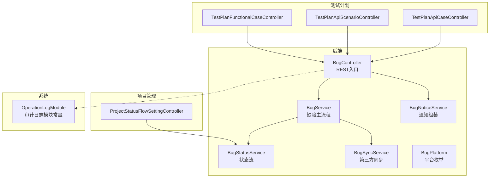
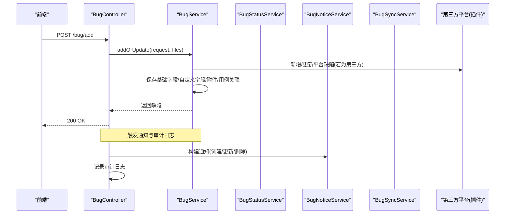
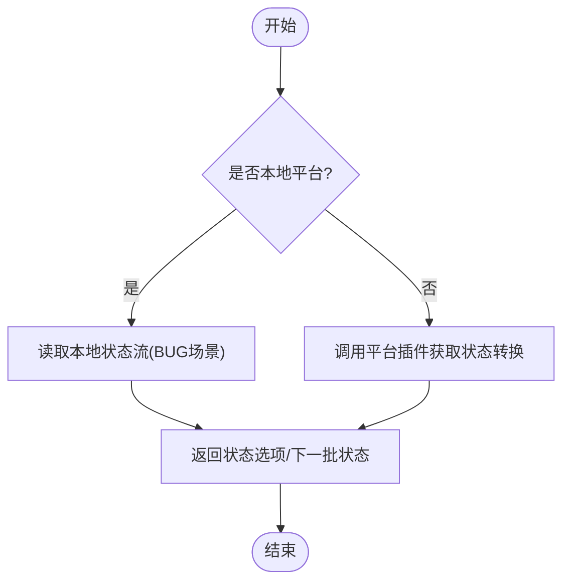
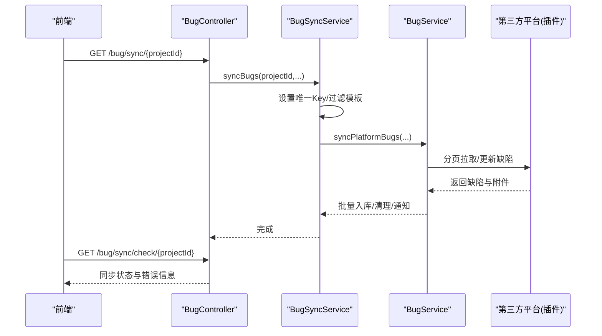
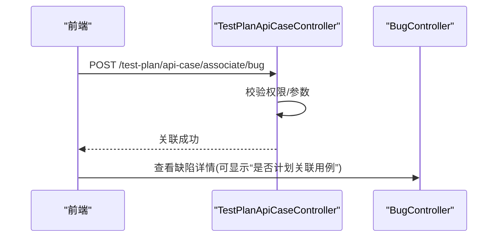
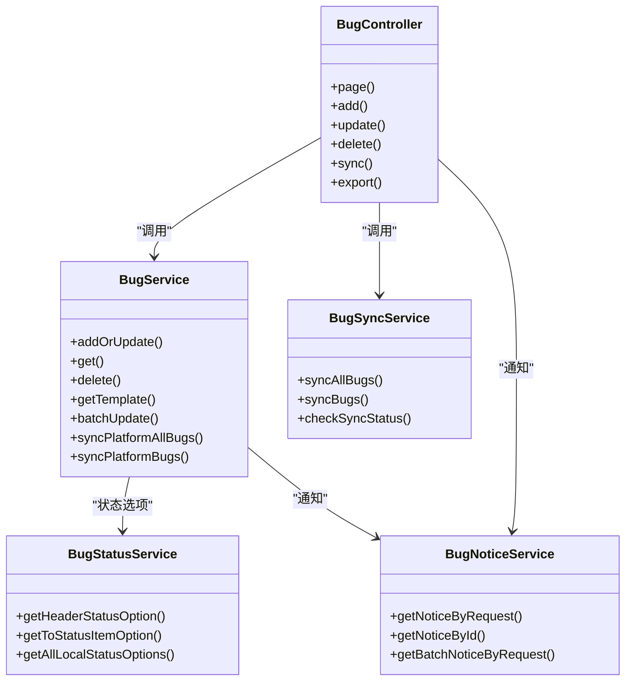

# 缺陷管理

<cite>
**本文引用的文件**   
- [BugController.java](file://backend/services/bug-management/src/main/java/io/metersphere/bug/controller/BugController.java)
- [BugService.java](file://backend/services/bug-management/src/main/java/io/metersphere/bug/service/BugService.java)
- [BugStatusService.java](file://backend/services/bug-management/src/main/java/io/metersphere/bug/service/BugStatusService.java)
- [BugNoticeService.java](file://backend/services/bug-management/src/main/java/io/metersphere/bug/service/BugNoticeService.java)
- [BugSyncService.java](file://backend/services/bug-management/src/main/java/io/metersphere/bug/service/BugSyncService.java)
- [BugPlatform.java](file://backend/services/bug-management/src/main/java/io/metersphere/bug/enums/BugPlatform.java)
- [ProjectStatusFlowSettingController.java](file://backend/services/project-management/src/main/java/io/metersphere/project/controller/ProjectStatusFlowSettingController.java)
- [OperationLogModule.java](file://backend/services/system-setting/src/main/java/io/metersphere/system/log/constants/OperationLogModule.java)
- [TestPlanApiCaseController.java](file://backend/services/test-plan/src/main/java/io/metersphere/plan/controller/TestPlanApiCaseController.java)
- [TestPlanApiScenarioController.java](file://backend/services/test-plan/src/main/java/io/metersphere/plan/controller/TestPlanApiScenarioController.java)
- [TestPlanFunctionalCaseController.java](file://backend/services/test-plan/src/main/java/io/metersphere/plan/controller/TestPlanFunctionalCaseController.java)
- [TestPlanCaseBugDTO.java](file://backend/services/test-plan/src/main/java/io/metersphere/plan/dto/TestPlanCaseBugDTO.java)
- [caseTable.vue（接口用例）](file://frontend/src/views/test-plan/testPlan/detail/apiCase/components/caseTable.vue)
- [caseTable.vue（功能用例）](file://frontend/src/views/test-plan/testPlan/detail/featureCase/components/caseTable.vue)
</cite>

## 目录
1. [简介](#简介)
2. [项目结构](#项目结构)
3. [核心组件](#核心组件)
4. [架构总览](#架构总览)
5. [详细组件分析](#详细组件分析)
6. [依赖关系分析](#依赖关系分析)
7. [性能与扩展性](#性能与扩展性)
8. [故障排查指南](#故障排查指南)
9. [结论](#结论)
10. [附录：使用示例与最佳实践](#附录使用示例与最佳实践)

## 简介
本章节面向 MeterSphere 的缺陷管理模块，系统性说明缺陷生命周期、状态流转、缺陷跟踪、统计报表、第三方平台集成、数据结构、工作流配置、权限控制、通知机制与审计日志。同时给出创建缺陷、分配处理人、跟踪进度、生成分析报告以及关联测试用例/接口用例的实践路径。

## 项目结构
后端缺陷管理位于 services/bug-management 模块，提供 REST API、业务编排、状态流、同步与通知等能力；前端在 views/bug-management 下提供缺陷列表、详情、编辑、回收站等页面。测试计划模块提供与缺陷的关联能力，支持功能用例、接口用例、场景用例与缺陷的双向关联。

图表来源
- [BugController.java:52-251](file://backend/services/bug-management/src/main/java/io/metersphere/bug/controller/BugController.java#L52-L251)
- [BugService.java:100-247](file://backend/services/bug-management/src/main/java/io/metersphere/bug/service/BugService.java#L100-L247)
- [BugStatusService.java:22-107](file://backend/services/bug-management/src/main/java/io/metersphere/bug/service/BugStatusService.java#L22-L107)
- [BugNoticeService.java:24-149](file://backend/services/bug-management/src/main/java/io/metersphere/bug/service/BugNoticeService.java#L24-L149)
- [BugSyncService.java:33-163](file://backend/services/bug-management/src/main/java/io/metersphere/bug/service/BugSyncService.java#L33-L163)
- [BugPlatform.java:9-26](file://backend/services/bug-management/src/main/java/io/metersphere/bug/enums/BugPlatform.java#L9-L26)
- [ProjectStatusFlowSettingController.java:35-46](file://backend/services/project-management/src/main/java/io/metersphere/project/controller/ProjectStatusFlowSettingController.java#L35-L46)
- [OperationLogModule.java:85-93](file://backend/services/system-setting/src/main/java/io/metersphere/system/log/constants/OperationLogModule.java#L85-L93)

章节来源
- [BugController.java:52-251](file://backend/services/bug-management/src/main/java/io/metersphere/bug/controller/BugController.java#L52-L251)
- [BugService.java:100-247](file://backend/services/bug-management/src/main/java/io/metersphere/bug/service/BugService.java#L100-L247)

## 核心组件
- BugController：对外暴露缺陷的增删改查、分页、批量操作、导出、模板选项、关注/取消关注、同步等接口，统一进行权限校验与审计日志埋点。
- BugService：缺陷全量业务编排，包含创建/更新、删除/恢复、模板注入、自定义字段、附件、用例关联、第三方平台同步、富文本临时文件处理等。
- BugStatusService：负责获取表头状态选项与下一批可流转状态，区分本地与第三方平台状态流。
- BugNoticeService：根据缺陷数据构建通知对象，用于创建/更新/删除等事件的通知推送。
- BugSyncService：封装第三方平台缺陷同步的全量/存量逻辑，含并发控制、异常清理与结果查询。
- BugPlatform：平台枚举（Local、JIRA、禅道、TAPD）。

章节来源
- [BugController.java:52-251](file://backend/services/bug-management/src/main/java/io/metersphere/bug/controller/BugController.java#L52-L251)
- [BugService.java:100-247](file://backend/services/bug-management/src/main/java/io/metersphere/bug/service/BugService.java#L100-L247)
- [BugStatusService.java:22-107](file://backend/services/bug-management/src/main/java/io/metersphere/bug/service/BugStatusService.java#L22-L107)
- [BugNoticeService.java:24-149](file://backend/services/bug-management/src/main/java/io/metersphere/bug/service/BugNoticeService.java#L24-L149)
- [BugSyncService.java:33-163](file://backend/services/bug-management/src/main/java/io/metersphere/bug/service/BugSyncService.java#L33-L163)
- [BugPlatform.java:9-26](file://backend/services/bug-management/src/main/java/io/metersphere/bug/enums/BugPlatform.java#L9-L26)

## 架构总览
缺陷管理采用分层架构：控制器层接收请求并做权限校验与审计标记；服务层编排业务逻辑，包括模板注入、自定义字段、附件、用例关联、第三方同步与通知；状态流由统一的“状态流设置”服务支撑，支持本地与第三方平台差异。

图表来源
- [BugController.java:104-126](file://backend/services/bug-management/src/main/java/io/metersphere/bug/controller/BugController.java#L104-L126)
- [BugService.java:201-247](file://backend/services/bug-management/src/main/java/io/metersphere/bug/service/BugService.java#L201-L247)
- [BugNoticeService.java:44-68](file://backend/services/bug-management/src/main/java/io/metersphere/bug/service/BugNoticeService.java#L44-L68)

## 详细组件分析

### 缺陷生命周期与状态流转
- 生命周期阶段：新建、处理中、已解决、已关闭、已拒绝、回收站（仅本地）、彻底删除（仅本地）。
- 状态来源：
  - 本地：通过“状态流设置”服务按场景（BUG）获取全部状态与下一批可选状态。
  - 第三方：通过平台插件接口获取状态转换选项，Jira 需要 issueKey 参数。
- 状态展示：表头状态选项与详情中的“下一批状态”均通过 BugStatusService 聚合。

图表来源
- [BugStatusService.java:36-107](file://backend/services/bug-management/src/main/java/io/metersphere/bug/service/BugStatusService.java#L36-L107)
- [ProjectStatusFlowSettingController.java:35-46](file://backend/services/project-management/src/main/java/io/metersphere/project/controller/ProjectStatusFlowSettingController.java#L35-L46)

章节来源
- [BugStatusService.java:36-107](file://backend/services/bug-management/src/main/java/io/metersphere/bug/service/BugStatusService.java#L36-L107)
- [ProjectStatusFlowSettingController.java:35-46](file://backend/services/project-management/src/main/java/io/metersphere/project/controller/ProjectStatusFlowSettingController.java#L35-L46)

### 缺陷数据结构与模板
- 基础字段：ID、编号、标题、项目ID、平台、平台缺陷ID、状态、处理人、标签、内容等。
- 模板与自定义字段：
  - 支持系统模板与项目级模板，支持第三方平台默认模板。
  - 非平台默认模板时，会注入“状态”和“处理人”两个特殊自定义字段到详情。
  - 模板详情可通过模板ID或项目+场景获取，支持按语言渲染。
- 附件与富文本：
  - 支持本地附件与第三方平台附件双向同步。
  - 富文本图片在同步过程中会落库为本地附件引用。

章节来源
- [BugService.java:255-311](file://backend/services/bug-management/src/main/java/io/metersphere/bug/service/BugService.java#L255-L311)
- [BugService.java:384-401](file://backend/services/bug-management/src/main/java/io/metersphere/bug/service/BugService.java#L384-L401)
- [BugService.java:639-728](file://backend/services/bug-management/src/main/java/io/metersphere/bug/service/BugService.java#L639-L728)

### 权限控制与审计日志
- 权限控制：所有缺陷接口通过 @RequiresPermissions 与 @CheckOwner 校验项目级权限与资源归属。
- 审计日志：增删改等关键操作通过 @Log 注解记录，模块常量定义于 OperationLogModule。

章节来源
- [BugController.java:66-251](file://backend/services/bug-management/src/main/java/io/metersphere/bug/controller/BugController.java#L66-L251)
- [OperationLogModule.java:85-93](file://backend/services/system-setting/src/main/java/io/metersphere/system/log/constants/OperationLogModule.java#L85-L93)

### 通知机制
- 触发时机：创建、更新、删除、批量更新/删除等。
- 通知内容：标题、状态、处理人与其他自定义字段，支持从请求体或原始值解析。
- 实现方式：控制器通过 @SendNotice 注解将任务类型与目标类注入，BugNoticeService 负责组装通知对象。

章节来源
- [BugController.java:104-126](file://backend/services/bug-management/src/main/java/io/metersphere/bug/controller/BugController.java#L104-L126)
- [BugNoticeService.java:44-149](file://backend/services/bug-management/src/main/java/io/metersphere/bug/service/BugNoticeService.java#L44-L149)

### 与第三方系统的集成
- 平台枚举：Local、JIRA、禅道、TAPD。
- 同步策略：
  - 增量/全量：支持按时间区间或全量拉取。
  - 并发控制：通过 Redis Key 保证同一项目只执行一次同步。
  - 结果反馈：提供检查接口返回完成状态与错误信息。
- 数据映射：
  - 非平台默认模板需处理 MS 模板字段与平台字段的映射。
  - 富文本图片与附件双向同步。

图表来源
- [BugController.java:151-173](file://backend/services/bug-management/src/main/java/io/metersphere/bug/controller/BugController.java#L151-L173)
- [BugSyncService.java:57-163](file://backend/services/bug-management/src/main/java/io/metersphere/bug/service/BugSyncService.java#L57-L163)
- [BugService.java:588-728](file://backend/services/bug-management/src/main/java/io/metersphere/bug/service/BugService.java#L588-L728)

章节来源
- [BugPlatform.java:9-26](file://backend/services/bug-management/src/main/java/io/metersphere/bug/enums/BugPlatform.java#L9-L26)
- [BugSyncService.java:57-163](file://backend/services/bug-management/src/main/java/io/metersphere/bug/service/BugSyncService.java#L57-L163)
- [BugService.java:588-728](file://backend/services/bug-management/src/main/java/io/metersphere/bug/service/BugService.java#L588-L728)

### 与测试用例、接口测试的关联关系
- 测试计划-功能用例：支持在计划内关联缺陷，或在用例详情页直接关联缺陷。
- 测试计划-接口用例：支持批量/单条关联缺陷，并在计划内解绑。
- 测试计划-场景用例：同样支持关联缺陷与解绑。
- 关联数据模型：TestPlanCaseBugDTO 包含关联ID、缺陷编号、标题、状态与计划-用例-缺陷关系ID。

图表来源
- [TestPlanApiCaseController.java:187-210](file://backend/services/test-plan/src/main/java/io/metersphere/plan/controller/TestPlanApiCaseController.java#L187-L210)
- [TestPlanApiScenarioController.java:172-195](file://backend/services/test-plan/src/main/java/io/metersphere/plan/controller/TestPlanApiScenarioController.java#L172-L195)
- [TestPlanFunctionalCaseController.java:130-144](file://backend/services/test-plan/src/main/java/io/metersphere/plan/controller/TestPlanFunctionalCaseController.java#L130-L144)
- [TestPlanCaseBugDTO.java:7-21](file://backend/services/test-plan/src/main/java/io/metersphere/plan/dto/TestPlanCaseBugDTO.java#L7-L21)

章节来源
- [TestPlanApiCaseController.java:187-210](file://backend/services/test-plan/src/main/java/io/metersphere/plan/controller/TestPlanApiCaseController.java#L187-L210)
- [TestPlanApiScenarioController.java:172-195](file://backend/services/test-plan/src/main/java/io/metersphere/plan/controller/TestPlanApiScenarioController.java#L172-L195)
- [TestPlanFunctionalCaseController.java:130-144](file://backend/services/test-plan/src/main/java/io/metersphere/plan/controller/TestPlanFunctionalCaseController.java#L130-L144)
- [TestPlanCaseBugDTO.java:7-21](file://backend/services/test-plan/src/main/java/io/metersphere/plan/dto/TestPlanCaseBugDTO.java#L7-L21)

## 依赖关系分析
- 控制器与服务：BugController 依赖 BugService、BugSyncService、ProjectTemplateService、ProjectApplicationService 等。
- 状态流：BugStatusService 依赖 ProjectApplicationService 与 BaseStatusFlowSettingService。
- 通知：BugNoticeService 依赖 BugService 与 BugLogService。
- 同步：BugSyncService 依赖 BugService、ProjectTemplateService、ProjectApplicationService 与 Redis 键管理。

图表来源
- [BugController.java:52-251](file://backend/services/bug-management/src/main/java/io/metersphere/bug/controller/BugController.java#L52-L251)
- [BugService.java:100-247](file://backend/services/bug-management/src/main/java/io/metersphere/bug/service/BugService.java#L100-L247)
- [BugStatusService.java:22-107](file://backend/services/bug-management/src/main/java/io/metersphere/bug/service/BugStatusService.java#L22-L107)
- [BugNoticeService.java:24-149](file://backend/services/bug-management/src/main/java/io/metersphere/bug/service/BugNoticeService.java#L24-L149)
- [BugSyncService.java:33-163](file://backend/services/bug-management/src/main/java/io/metersphere/bug/service/BugSyncService.java#L33-L163)

## 性能与扩展性
- 批量操作：批量更新标签使用批量 SQL 会话减少往返开销。
- 异步处理：第三方平台同步与附件同步采用异步线程，避免超时。
- 分页与排序：列表查询支持 PageHelper 分页与动态排序。
- 可扩展点：
  - 第三方平台通过 Platform SPI 接入，支持自定义字段映射与附件同步。
  - 模板与自定义字段支持组织级与项目级配置，便于多租户差异化。

章节来源
- [BugService.java:493-524](file://backend/services/bug-management/src/main/java/io/metersphere/bug/service/BugService.java#L493-L524)
- [BugService.java:588-728](file://backend/services/bug-management/src/main/java/io/metersphere/bug/service/BugService.java#L588-L728)

## 故障排查指南
- 同步失败：
  - 检查项目是否配置第三方平台与用户平台账号。
  - 通过 /bug/sync/check/{projectId} 获取错误信息并清空。
- 状态选项为空：
  - 确认当前项目平台是否为 Local；若是第三方平台，检查平台插件配置与网络连通性。
- 通知未送达：
  - 检查通知目标解析是否正确（标题、状态、处理人），确认通知通道配置。
- 权限不足：
  - 确认当前用户具备 PROJECT_BUG_READ/ADD/UPDATE/DELETE/EXPORT 等权限。

章节来源
- [BugSyncService.java:117-132](file://backend/services/bug-management/src/main/java/io/metersphere/bug/service/BugSyncService.java#L117-L132)
- [BugStatusService.java:36-87](file://backend/services/bug-management/src/main/java/io/metersphere/bug/service/BugStatusService.java#L36-L87)
- [BugNoticeService.java:44-149](file://backend/services/bug-management/src/main/java/io/metersphere/bug/service/BugNoticeService.java#L44-L149)
- [BugController.java:66-251](file://backend/services/bug-management/src/main/java/io/metersphere/bug/controller/BugController.java#L66-L251)

## 结论
MeterSphere 缺陷管理模块以清晰的层次化架构与灵活的模板/状态流机制，实现了本地与第三方平台的统一缺陷治理。通过完善的权限、通知与审计能力，以及与测试计划的深度集成，有效支撑了端到端的缺陷追踪与闭环管理。

## 附录：使用示例与最佳实践

- 创建缺陷
  - 步骤：选择项目与模板 -> 填写标题、描述、标签、处理人、状态 -> 上传附件 -> 提交。
  - 后端入口：POST /bug/add（控制器带权限校验与审计日志）。
  - 参考实现位置：[BugController.java:104-114](file://backend/services/bug-management/src/main/java/io/metersphere/bug/controller/BugController.java#L104-L114)、[BugService.java:201-247](file://backend/services/bug-management/src/main/java/io/metersphere/bug/service/BugService.java#L201-L247)。

- 分配处理与状态流转
  - 步骤：在缺陷详情中选择“处理人”，根据当前状态选择“下一批状态”进行流转。
  - 后端入口：GET /bug/header/columns-option/{projectId} 与 GET /bug/template/detail。
  - 参考实现位置：[BugController.java:82-88](file://backend/services/bug-management/src/main/java/io/metersphere/bug/controller/BugController.java#L82-L88)、[BugStatusService.java:70-98](file://backend/services/bug-management/src/main/java/io/metersphere/bug/service/BugStatusService.java#L70-L98)。

- 跟踪进度
  - 步骤：在缺陷列表中使用“待我处理/我创建的/未解决的”筛选条件，结合拖拽排序与标签批量编辑。
  - 后端入口：POST /bug/page、POST /bug/edit/pos、POST /bug/batch-update。
  - 参考实现位置：[BugController.java:90-102](file://backend/services/bug-management/src/main/java/io/metersphere/bug/controller/BugController.java#L90-L102)、[BugController.java:214-220](file://backend/services/bug-management/src/main/java/io/metersphere/bug/controller/BugController.java#L214-L220)、[BugController.java:204-212](file://backend/services/bug-management/src/main/java/io/metersphere/bug/controller/BugController.java#L204-L212)。

- 生成分析报告
  - 步骤：选择导出列（含自定义字段）-> 导出 Excel/PDF。
  - 后端入口：GET /bug/export/columns/{projectId}、POST /bug/export。
  - 参考实现位置：[BugController.java:175-191](file://backend/services/bug-management/src/main/java/io/metersphere/bug/controller/BugController.java#L175-L191)。

- 关联测试用例/接口用例
  - 步骤：在测试计划的功能用例/接口用例/场景用例界面，打开“关联缺陷”抽屉，选择缺陷并保存。
  - 前端入口：caseTable.vue（接口用例/功能用例）相关方法。
  - 后端入口：TestPlanApiCaseController/TestPlanApiScenarioController/TestPlanFunctionalCaseController 的 associate/disassociate 接口。
  - 参考实现位置：
    - [caseTable.vue（接口用例）:981-1017](file://frontend/src/views/test-plan/testPlan/detail/apiCase/components/caseTable.vue#L981-L1017)
    - [caseTable.vue（功能用例）:1015-1052](file://frontend/src/views/test-plan/testPlan/detail/featureCase/components/caseTable.vue#L1015-L1052)
    - [TestPlanApiCaseController.java:187-210](file://backend/services/test-plan/src/main/java/io/metersphere/plan/controller/TestPlanApiCaseController.java#L187-L210)
    - [TestPlanApiScenarioController.java:172-195](file://backend/services/test-plan/src/main/java/io/metersphere/plan/controller/TestPlanApiScenarioController.java#L172-L195)
    - [TestPlanFunctionalCaseController.java:130-144](file://backend/services/test-plan/src/main/java/io/metersphere/plan/controller/TestPlanFunctionalCaseController.java#L130-L144)

- 与第三方平台同步
  - 步骤：在项目缺陷管理中点击“同步缺陷”，或通过定时任务自动同步。
  - 后端入口：GET /bug/sync/{projectId}、GET /bug/sync/check/{projectId}。
  - 参考实现位置：[BugController.java:151-173](file://backend/services/bug-management/src/main/java/io/metersphere/bug/controller/BugController.java#L151-L173)、[BugSyncService.java:57-163](file://backend/services/bug-management/src/main/java/io/metersphere/bug/service/BugSyncService.java#L57-L163)。