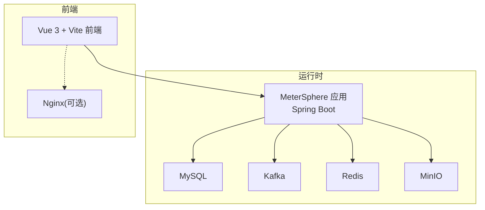
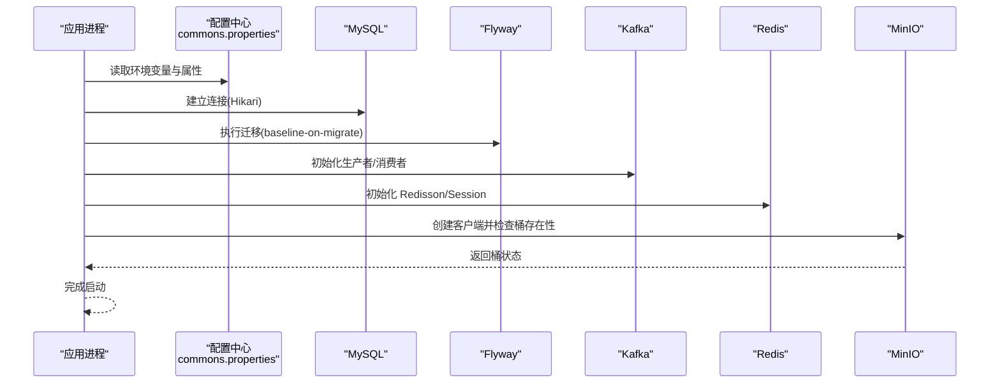
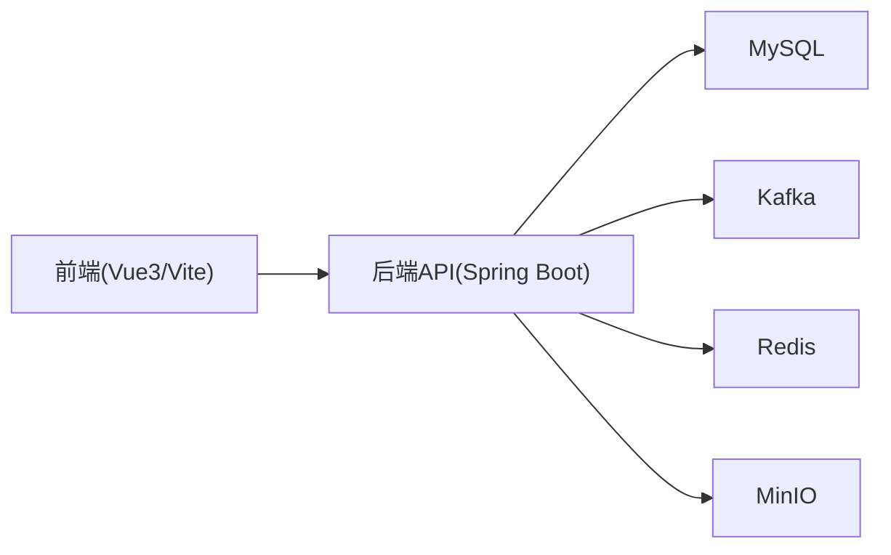

# 环境搭建

<cite>
**本文引用的文件**   
- [README.md](file://README.md)
- [Dockerfile](file://Dockerfile)
- [Jenkinsfile](file://Jenkinsfile)
- [commons.properties](file://backend/app/src/main/resources/commons.properties)
- [MinioConfig.java](file://backend/services/system-setting/src/main/java/io/metersphere/system/config/MinioConfig.java)
- [MinioProperties.java](file://backend/services/system-setting/src/main/java/io/metersphere/system/config/MinioProperties.java)
- [AppStartListener.java](file://backend/app/src/main/java/io/metersphere/listener/AppStartListener.java)
- [package.json](file://frontend/package.json)
</cite>

## 目录
1. [简介](#简介)
2. [项目结构](#项目结构)
3. [核心组件](#核心组件)
4. [架构总览](#架构总览)
5. [详细组件分析](#详细组件分析)
6. [依赖关系分析](#依赖关系分析)
7. [性能与容量规划](#性能与容量规划)
8. [故障排查指南](#故障排查指南)
9. [结论](#结论)
10. [附录：安装步骤与验证清单](#附录安装步骤与验证清单)

## 简介
本指南面向开发者与运维人员，提供 MeterSphere V3 的开发环境与生产环境的完整搭建说明。内容涵盖系统要求、依赖软件（Java 21、MySQL、Redis、Kafka、MinIO）、数据库初始化、环境变量与配置文件说明、前端开发环境配置、常见环境问题与解决方案，以及可操作的安装步骤和验证方法，帮助快速搭建可用的测试与开发环境。

## 项目结构
MeterSphere 采用前后端分离架构：
- 后端基于 Spring Boot，使用 MySQL 持久化、Redis 会话与缓存、Kafka 消息队列、MinIO 对象存储；
- 前端基于 Vue 3 + Vite，通过 Nginx 或容器静态资源方式提供服务；
- 构建与运行支持 Docker 镜像打包，CI/CD 使用 Jenkinsfile。

图表来源
- [Dockerfile:1-25](file://Dockerfile#L1-L25)
- [commons.properties:1-97](file://backend/app/src/main/resources/commons.properties#L1-L97)
- [package.json:1-183](file://frontend/package.json#L1-L183)

章节来源
- [README.md:59-65](file://README.md#L59-L65)

## 核心组件
- 后端运行时
  - Java 21 JRE（容器基础镜像）
  - Spring Boot 应用（端口 8081，管理端口 7071）
  - 数据库连接池 HikariCP
  - Flyway 数据库迁移
  - Quartz 定时任务
  - Kafka 生产者/消费者
  - Redisson/Redis 会话与缓存
  - MinIO 对象存储
- 前端运行时
  - Node.js >= 18（开发与构建）
  - Vite 构建工具
  - Vue 3 生态（Pinia、Vue Router、i18n 等）

章节来源
- [Dockerfile:1-25](file://Dockerfile#L1-L25)
- [commons.properties:1-97](file://backend/app/src/main/resources/commons.properties#L1-L97)
- [package.json:169-171](file://frontend/package.json#L169-L171)

## 架构总览
下图展示启动阶段关键组件的交互：应用启动时加载配置、初始化数据库迁移、连接中间件并校验 MinIO 桶可用性。

图表来源
- [commons.properties:15-66](file://backend/app/src/main/resources/commons.properties#L15-L66)
- [MinioConfig.java:21-37](file://backend/services/system-setting/src/main/java/io/metersphere/system/config/MinioConfig.java#L21-L37)
- [AppStartListener.java:14-42](file://backend/app/src/main/java/io/metersphere/listener/AppStartListener.java#L14-L42)

## 详细组件分析

### 后端运行时与环境变量
- Java 版本
  - 容器基础镜像为 OpenJDK 21 JRE，CI 也使用 Java 21。
- 服务端口
  - 业务端口：8081
  - 管理端口：7071
- 数据库
  - 使用 HikariCP 连接池，Quartz 使用独立数据源配置项但默认复用主库 URL/凭据。
  - Flyway 启用并开启 baseline-on-migrate，表前缀与位置由配置指定。
- 消息队列
  - Kafka bootstrap-servers 通过环境变量注入。
- 缓存与会话
  - Redisson 配置文件路径通过环境变量覆盖，会话超时时间以秒为单位。
- 对象存储
  - MinIO 客户端在启动时根据 endpoint/accessKey/secretKey 创建，并自动检测/创建桶。

章节来源
- [Dockerfile:1-25](file://Dockerfile#L1-L25)
- [Jenkinsfile:12-81](file://Jenkinsfile#L12-L81)
- [commons.properties:1-97](file://backend/app/src/main/resources/commons.properties#L1-L97)
- [MinioConfig.java:21-37](file://backend/services/system-setting/src/main/java/io/metersphere/system/config/MinioConfig.java#L21-L37)
- [MinioProperties.java:10-16](file://backend/services/system-setting/src/main/java/io/metersphere/system/config/MinioProperties.java#L10-L16)
- [AppStartListener.java:14-42](file://backend/app/src/main/java/io/metersphere/listener/AppStartListener.java#L14-L42)

### 数据库与初始化
- 数据库类型：MySQL
- 连接池：HikariCP（最大连接数、空闲超时、连接超时等参数已配置）
- 迁移：Flyway 启用，baseline-on-migrate=true，locations=classpath:migration，表名 metersphere_version
- 建议
  - 确保数据库字符集为 UTF-8
  - 首次部署允许 Flyway 自动建表与基线化

章节来源
- [commons.properties:15-36](file://backend/app/src/main/resources/commons.properties#L15-L36)
- [commons.properties:59-66](file://backend/app/src/main/resources/commons.properties#L59-L66)

### 缓存与会话（Redis）
- 会话超时：43200s
- Redisson 配置文件路径：/opt/metersphere/conf/redisson.yml（可通过环境变量覆盖）
- 建议
  - 提前准备 Redisson 配置文件，包含集群/单机模式、密码、连接池等

章节来源
- [commons.properties:78-81](file://backend/app/src/main/resources/commons.properties#L78-L81)

### 消息队列（Kafka）
- 地址：spring.kafka.bootstrap-servers=${kafka.bootstrap-servers}
- 消费者组：metersphere_group_id
- 建议
  - 至少一个可用 broker
  - 若某些 topic 不存在，配置了 missing-topics-fatal=false，不会导致启动失败

章节来源
- [commons.properties:38-47](file://backend/app/src/main/resources/commons.properties#L38-L47)

### 对象存储（MinIO）
- 客户端初始化：endpoint/accessKey/secretKey 来自配置类 MinioProperties
- 桶策略：启动时检查桶是否存在，不存在则创建；并为 temp/excel/api 等路径设置生命周期规则
- 建议
  - 提前创建 bucket=metersphere
  - 确保网络可达且凭证正确

章节来源
- [MinioProperties.java:10-16](file://backend/services/system-setting/src/main/java/io/metersphere/system/config/MinioProperties.java#L10-L16)
- [MinioConfig.java:21-37](file://backend/services/system-setting/src/main/java/io/metersphere/system/config/MinioConfig.java#L21-L37)
- [MinioConfig.java:40-68](file://backend/services/system-setting/src/main/java/io/metersphere/system/config/MinioConfig.java#L40-L68)
- [MinioConfig.java:72-107](file://backend/services/system-setting/src/main/java/io/metersphere/system/config/MinioConfig.java#L72-L107)
- [AppStartListener.java:14-42](file://backend/app/src/main/java/io/metersphere/listener/AppStartListener.java#L14-L42)

### 前端开发环境
- Node.js 版本：>= 18
- 包管理器：npm/yarn/pnpm（任选其一）
- 常用命令
  - 开发：npm run dev
  - 构建：npm run build
  - 本地预览：npm run preview
- 代理与后端地址
  - 开发服务器通过 Vite 配置进行 API 转发（具体转发规则见前端 vite 配置）

章节来源
- [package.json:9-20](file://frontend/package.json#L9-L20)
- [package.json:169-171](file://frontend/package.json#L169-L171)

## 依赖关系分析
- 后端依赖
  - MySQL：持久化数据与 Flyway 迁移
  - Redis：会话与缓存
  - Kafka：异步消息处理
  - MinIO：对象存储（附件、报告、导出等）
- 前端依赖
  - Node.js >= 18
  - Vite 构建工具链

图表来源
- [README.md:59-65](file://README.md#L59-L65)
- [commons.properties:15-47](file://backend/app/src/main/resources/commons.properties#L15-L47)
- [package.json:169-171](file://frontend/package.json#L169-L171)

章节来源
- [README.md:59-65](file://README.md#L59-L65)

## 性能与容量规划
- JVM
  - 使用 OpenJDK 21 JRE，建议在容器内通过 JAVA_OPTIONS 调整堆大小与 GC 参数
- 数据库
  - HikariCP 默认最大连接数 100，可根据并发规模调优
- Kafka
  - 生产者批量大小、缓冲区内存、拉取字节数已配置较大值，适合大报文场景
- MinIO
  - 桶生命周期策略自动清理临时与导出文件，避免磁盘膨胀
- 前端
  - 开发环境建议使用 Node 18+，构建产物通过 Nginx 或容器静态资源托管

章节来源
- [commons.properties:15-47](file://backend/app/src/main/resources/commons.properties#L15-L47)
- [MinioConfig.java:40-107](file://backend/services/system-setting/src/main/java/io/metersphere/system/config/MinioConfig.java#L40-L107)
- [package.json:169-171](file://frontend/package.json#L169-L171)

## 故障排查指南
- 无法连接 MySQL
  - 检查 spring.datasource.url/username/password 是否通过环境变量注入
  - 确认 Flyway 是否成功执行迁移（查看日志中 migration 相关输出）
- Kafka 连接失败
  - 检查 kafka.bootstrap-servers 环境变量是否正确
  - 确认防火墙/安全组放行相应端口
- Redis 连接异常
  - 检查 redisson.yml 路径与内容是否正确
  - 确认 Redis 服务可达且凭据正确
- MinIO 访问失败
  - 检查 minio.endpoint/minio.access-key/minio.secret-key 环境变量
  - 确认桶 metersphere 存在且网络可达
- 前端无法访问后端接口
  - 检查 Vite 开发服务器的代理配置
  - 确认后端服务端口 8081 可访问

章节来源
- [commons.properties:15-47](file://backend/app/src/main/resources/commons.properties#L15-L47)
- [commons.properties:78-81](file://backend/app/src/main/resources/commons.properties#L78-L81)
- [MinioConfig.java:21-37](file://backend/services/system-setting/src/main/java/io/metersphere/system/config/MinioConfig.java#L21-L37)
- [package.json:9-20](file://frontend/package.json#L9-L20)

## 结论
通过上述步骤，您可以完成 MeterSphere 的开发与生产环境搭建。后端依赖 MySQL、Redis、Kafka、MinIO，前端依赖 Node.js >= 18。合理配置环境变量与中间件后，即可启动应用并完成功能验证。

## 附录：安装步骤与验证清单

### 一、系统要求
- 操作系统：Linux/Windows/macOS（推荐 Linux）
- CPU/内存：开发环境建议 4C/8G 起，生产环境按并发与数据量评估
- 磁盘：预留足够空间用于日志、MinIO 对象与数据库文件

### 二、依赖软件安装
- Java 21
  - 使用 JDK 21 或容器镜像中的 OpenJDK 21 JRE
- MySQL
  - 版本建议 8.x，字符集 UTF-8
- Redis
  - 版本建议 6.x 或更高
- Kafka
  - 单节点或多节点均可，至少一个 broker
- MinIO
  - 对象存储服务，提供 S3 兼容 API

### 三、环境变量与配置
- 通用
  - JAVA_HOME、PATH（CI 中使用）
- 后端
  - spring.datasource.url/username/password
  - kafka.bootstrap-servers
  - minio.endpoint/minio.access-key/minio.secret-key
  - spring.redis.redisson.file=/opt/metersphere/conf/redisson.yml
- 前端
  - 开发服务器代理目标指向后端 8081 端口

章节来源
- [Jenkinsfile:12-81](file://Jenkinsfile#L12-L81)
- [commons.properties:15-47](file://backend/app/src/main/resources/commons.properties#L15-L47)
- [commons.properties:78-81](file://backend/app/src/main/resources/commons.properties#L78-L81)

### 四、数据库初始化
- 创建数据库与用户
- 启动应用，Flyway 将自动执行迁移并创建基线

章节来源
- [commons.properties:59-66](file://backend/app/src/main/resources/commons.properties#L59-L66)

### 五、后端启动
- 直接运行
  - 设置环境变量后，启动 Spring Boot 应用（端口 8081）
- 容器运行
  - 使用内置 Dockerfile 构建镜像并运行

章节来源
- [Dockerfile:1-25](file://Dockerfile#L1-L25)
- [commons.properties:1-10](file://backend/app/src/main/resources/commons.properties#L1-L10)

### 六、前端开发环境
- 安装 Node.js >= 18
- 进入 frontend 目录
- 执行 npm install
- 执行 npm run dev
- 浏览器访问开发服务器地址（默认 localhost:5173 或 Vite 默认端口）

章节来源
- [package.json:9-20](file://frontend/package.json#L9-L20)
- [package.json:169-171](file://frontend/package.json#L169-L171)

### 七、验证清单
- 后端健康检查
  - 访问 http://localhost:8081 或 /actuator 相关端点（视暴露策略）
- 数据库连通
  - 观察启动日志中 Flyway 迁移是否成功
- Kafka 连通
  - 观察无缺失 topic 致命错误（missing-topics-fatal=false）
- Redis 连通
  - 观察 Redisson 初始化日志
- MinIO 连通
  - 观察桶 metersphere 是否存在及生命周期规则是否生效
- 前端页面
  - 登录后可看到工作台与菜单

章节来源
- [commons.properties:38-47](file://backend/app/src/main/resources/commons.properties#L38-L47)
- [commons.properties:59-66](file://backend/app/src/main/resources/commons.properties#L59-L66)
- [MinioConfig.java:21-37](file://backend/services/system-setting/src/main/java/io/metersphere/system/config/MinioConfig.java#L21-L37)
- [package.json:9-20](file://frontend/package.json#L9-L20)