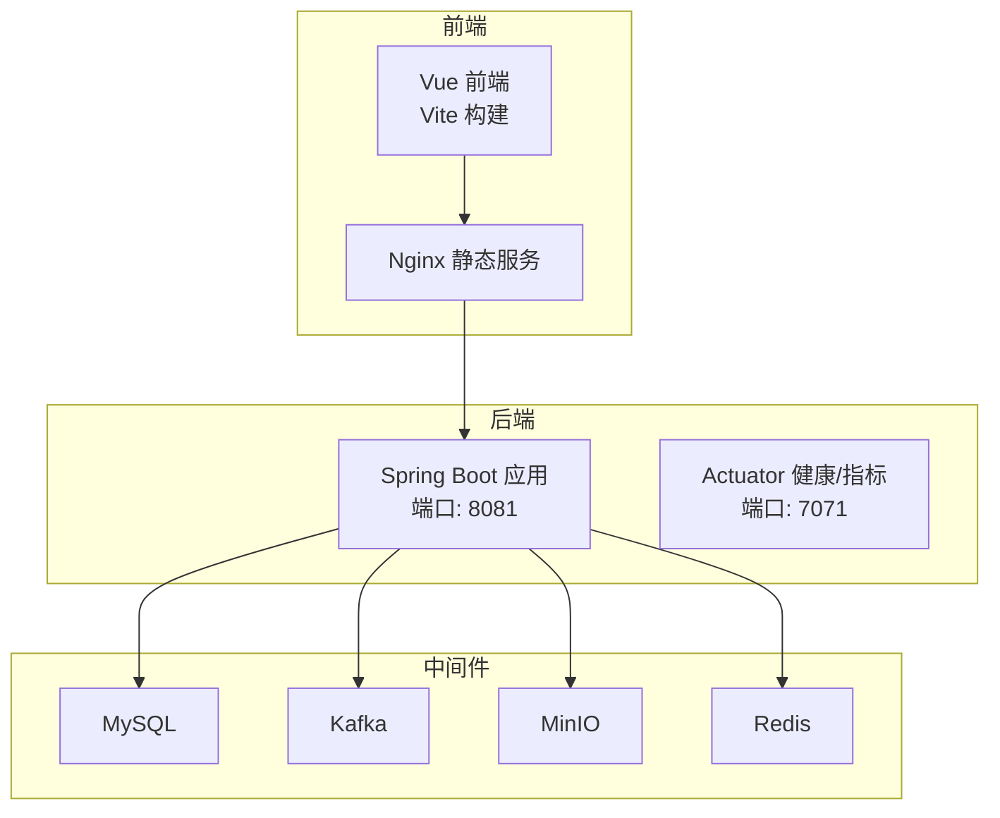
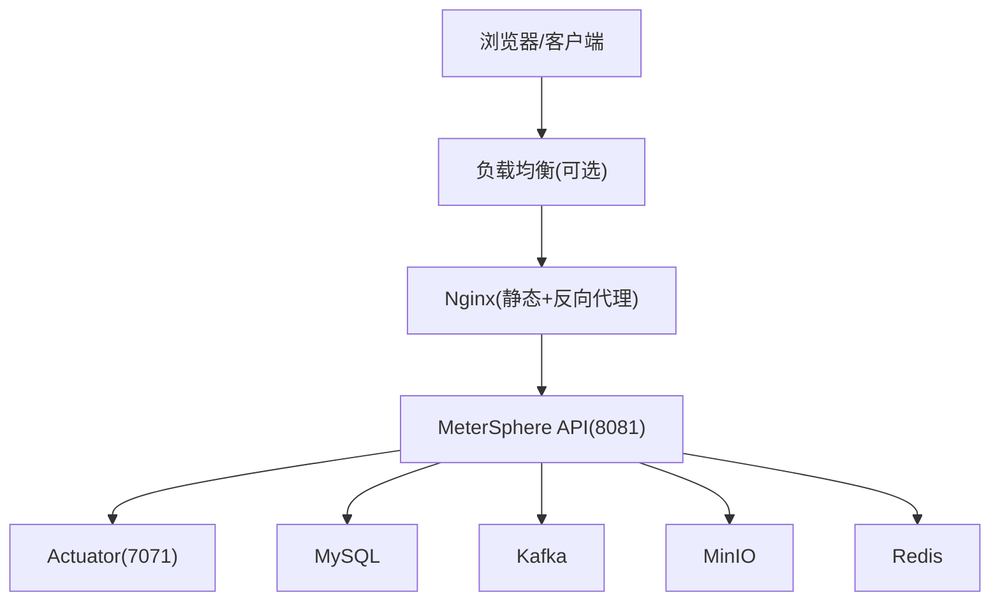
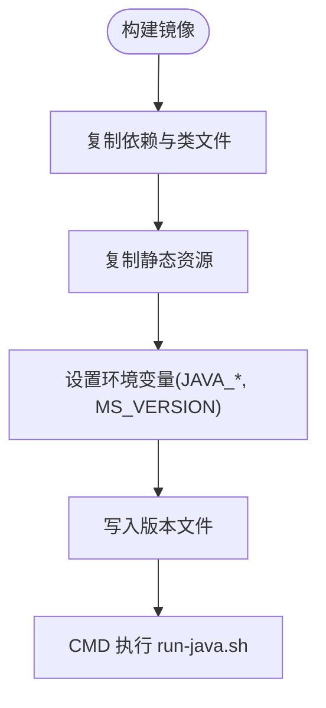
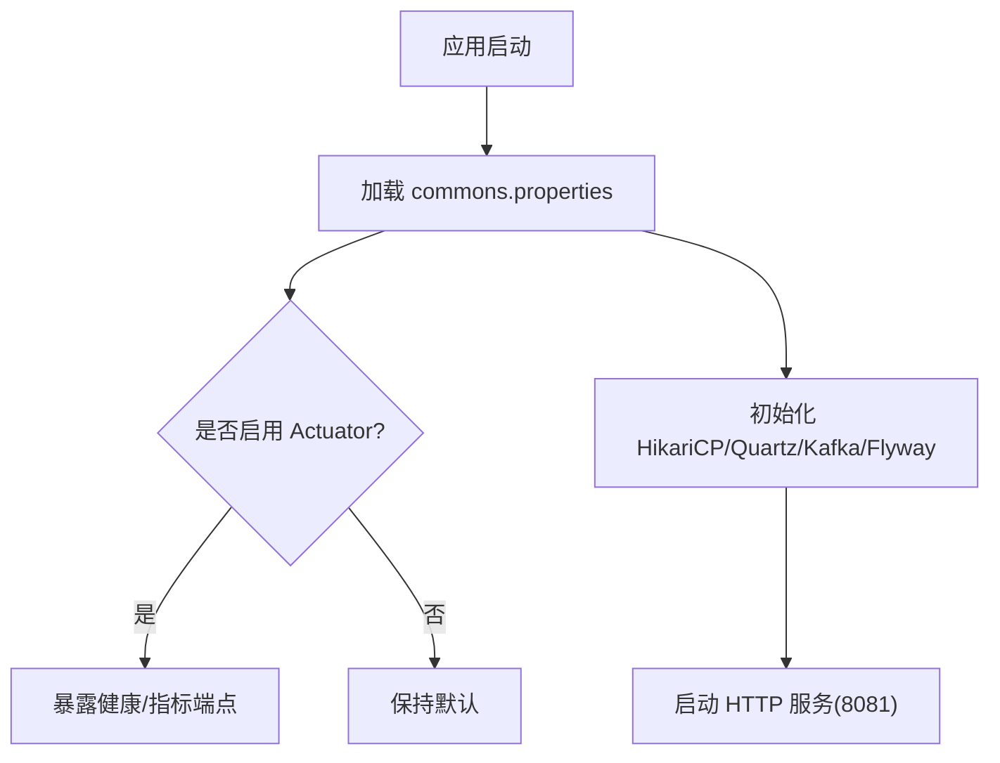
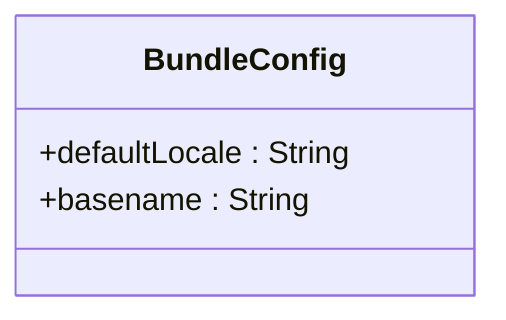
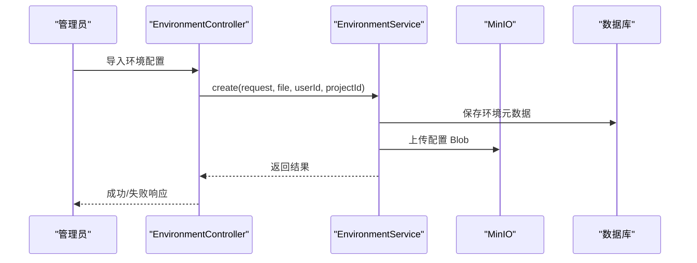
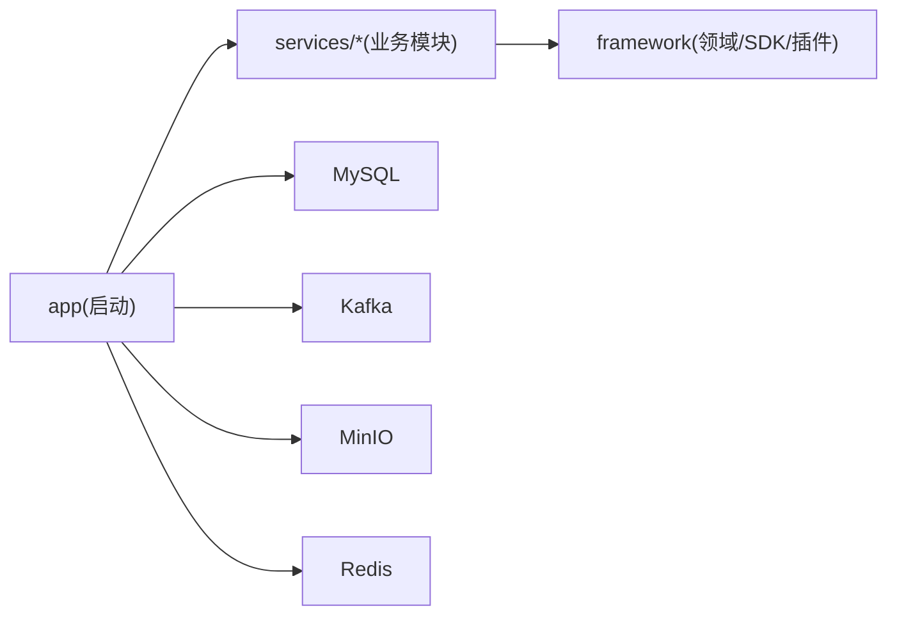
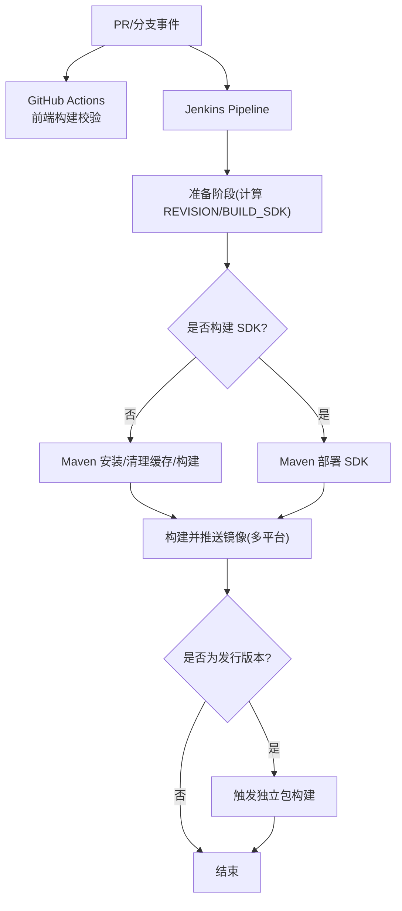

# 部署运维

<cite>
**本文引用的文件**   
- [README.md](file://README.md)
- [Dockerfile](file://Dockerfile)
- [Jenkinsfile](file://Jenkinsfile)
- [frontend-build.yml](file://.github/workflows/frontend-build.yml)
- [commons.properties](file://backend/app/src/main/resources/commons.properties)
- [BundleConfig.java](file://backend/app/src/main/java/io/metersphere/config/BundleConfig.java)
- [EnvironmentController.java](file://backend/services/project-management/src/main/java/io/metersphere/project/controller/EnvironmentController.java)
- [EnvironmentService.java](file://backend/services/project-management/src/main/java/io/metersphere/project/service/EnvironmentService.java)
</cite>

## 目录
1. [简介](#简介)
2. [项目结构](#项目结构)
3. [核心组件](#核心组件)
4. [架构总览](#架构总览)
5. [详细组件分析](#详细组件分析)
6. [依赖关系分析](#依赖关系分析)
7. [性能与容量规划](#性能与容量规划)
8. [监控与告警](#监控与告警)
9. [CI/CD 与版本管理](#cicd-与版本管理)
10. [高可用与容灾](#高可用与容灾)
11. [备份与恢复](#备份与恢复)
12. [故障排查指南](#故障排查指南)
13. [结论](#结论)

## 简介
本文件面向生产环境的 MeterSphere 部署与运维，覆盖环境准备、容器化构建与发布、监控告警、性能调优、高可用架构、备份恢复、CI/CD 流水线与版本管理等主题。MeterSphere 后端基于 Spring Boot，前端基于 Vue.js，中间件包括 MySQL、Kafka、MinIO、Redis；测试引擎集成 JMeter，基础设施以 Docker 为主。

## 项目结构
仓库采用前后端分离的多模块结构：
- 后端：Spring Boot 多模块（app、framework、services），包含系统设置、项目管理、用例管理、API 测试、测试计划、看板等能力
- 前端：Vue + TypeScript，Vite 构建，Nginx 静态资源托管
- 构建与发布：Maven + Jenkinsfile，GitHub Actions 前端校验，Docker 镜像打包
- 配置与运行时：commons.properties 集中配置，Dockerfile 定义运行镜像

图表来源
- [Dockerfile:1-26](file://Dockerfile#L1-L26)
- [commons.properties:1-97](file://backend/app/src/main/resources/commons.properties#L1-L97)

章节来源
- [README.md:59-65](file://README.md#L59-L65)
- [Dockerfile:1-26](file://Dockerfile#L1-L26)
- [commons.properties:1-97](file://backend/app/src/main/resources/commons.properties#L1-L97)

## 核心组件
- 应用入口与运行参数：Dockerfile 中定义 Java 主类、类路径、JVM 选项与版本注入
- 运行时配置：commons.properties 提供 Web 端口、压缩、日志路径、HikariCP、Quartz、Kafka、MyBatis、Flyway、上传大小、国际化、Actuator、Redisson、Swagger 开关等
- 前端构建：GitHub Actions 对前端进行代码校验与构建
- CI/CD：Jenkinsfile 负责 SDK 构建、后端编译测试、镜像构建与推送、独立包触发

章节来源
- [Dockerfile:1-26](file://Dockerfile#L1-L26)
- [commons.properties:1-97](file://backend/app/src/main/resources/commons.properties#L1-L97)
- [frontend-build.yml:1-32](file://.github/workflows/frontend-build.yml#L1-L32)
- [Jenkinsfile:1-119](file://Jenkinsfile#L1-L119)

## 架构总览
下图展示生产环境典型部署拓扑：前端通过 Nginx 反向代理到后端 API，后端连接数据库、消息队列、对象存储与缓存；Actuator 暴露健康与指标用于监控。

图表来源
- [commons.properties:1-97](file://backend/app/src/main/resources/commons.properties#L1-L97)

## 详细组件分析

### 容器镜像与运行环境
- 基础镜像：Alpine + OpenJDK 21 JRE
- 应用包：将 Maven 依赖与 classes 复制到 /app/lib 与 /app
- 静态资源：后端 resources/static 与 frontend/public 合并为 /app/static
- JVM 启动：JAVA_MAIN_CLASS=io.metersphere.Application，JAVA_OPTIONS 设置编码、headless 与必要的 --add-opens
- 版本注入：MS_VERSION 写入 /tmp/MS_VERSION 便于运行时识别

图表来源
- [Dockerfile:1-26](file://Dockerfile#L1-L26)

章节来源
- [Dockerfile:1-26](file://Dockerfile#L1-L26)

### 运行时配置与关键参数
- Web 服务：server.port=8081，启用 gzip 压缩
- 日志：logging.file.path=/opt/metersphere/logs/metersphere
- 数据库连接池：HikariCP 最大连接数、空闲超时、连接测试等
- 定时任务：Quartz 线程数与锁策略
- 消息队列：Kafka bootstrap-servers、消费者组、批量与内存参数
- 数据迁移：Flyway 启用并指向 classpath:migration
- 文件上传：单文件与请求体上限 1024MB
- 国际化：默认 zh_CN，i18n 资源基名
- 监控：Actuator 端点暴露全部，默认禁用其他端点
- 会话与缓存：Redisson 配置文件路径、Session 过期时间
- Swagger：默认关闭

图表来源
- [commons.properties:1-97](file://backend/app/src/main/resources/commons.properties#L1-L97)

章节来源
- [commons.properties:1-97](file://backend/app/src/main/resources/commons.properties#L1-L97)

### 国际化与本地化
- BundleConfig 读取 spring.messages.default-locale 与 basename，决定 i18n 行为
- 默认语言为 zh_CN，可通过配置调整

图表来源
- [BundleConfig.java:13-15](file://backend/app/src/main/java/io/metersphere/config/BundleConfig.java#L13-L15)

章节来源
- [BundleConfig.java:13-15](file://backend/app/src/main/java/io/metersphere/config/BundleConfig.java#L13-L15)
- [commons.properties:73-92](file://backend/app/src/main/resources/commons.properties#L73-L92)

### 项目管理与环境配置
- EnvironmentController 暴露环境相关接口，如驱动选项、导入导出等
- EnvironmentService 实现环境数据的持久化、Blob 配置处理、MinIO 集成、JDBC 驱动插件、项目关联、操作日志记录等

图表来源
- [EnvironmentController.java:101-121](file://backend/services/project-management/src/main/java/io/metersphere/project/controller/EnvironmentController.java#L101-L121)
- [EnvironmentService.java:62-89](file://backend/services/project-management/src/main/java/io/metersphere/project/service/EnvironmentService.java#L62-L89)

章节来源
- [EnvironmentController.java:101-121](file://backend/services/project-management/src/main/java/io/metersphere/project/controller/EnvironmentController.java#L101-L121)
- [EnvironmentService.java:62-89](file://backend/services/project-management/src/main/java/io/metersphere/project/service/EnvironmentService.java#L62-L89)

## 依赖关系分析
- 外部依赖：MySQL、Kafka、MinIO、Redis
- 内部模块：app 作为启动入口，services 下各业务模块通过共享 framework 层
- 构建依赖：Maven 聚合构建，前端独立构建

图表来源
- [README.md:59-65](file://README.md#L59-L65)
- [commons.properties:1-97](file://backend/app/src/main/resources/commons.properties#L1-L97)

章节来源
- [README.md:59-65](file://README.md#L59-L65)
- [commons.properties:1-97](file://backend/app/src/main/resources/commons.properties#L1-L97)

## 性能与容量规划
- Web 层
  - 开启 gzip 压缩，减少传输体积
  - 合理设置并发线程与异步超时（按需）
- 数据库层
  - HikariCP 最大连接数建议按 CPU 核数与 QPS 评估，避免过大导致上下文切换开销
  - 连接超时与空闲超时需与数据库侧配置一致
- 消息队列
  - Kafka producer batch-size、buffer.memory、max.request.size 根据吞吐与网络带宽调优
  - consumer.fetch.bytes 与分区数匹配，避免长尾消费
- 存储层
  - MinIO 对象存储容量与 IOPS 按报告与附件增长趋势规划
- 缓存与会话
  - Redis 集群或哨兵模式，Session 过期时间与业务访问峰值匹配
- 资源估算
  - 单机小型团队：4C8G 起步，MySQL/Redis 同机或近线
  - 中型团队：后端 8C16G，MySQL/Redis 独立实例，Kafka 双节点，MinIO 三节点纠删码
  - 大型团队：后端水平扩展，MySQL 读写分离，Kafka 多副本，MinIO 分布式集群

[本节为通用指导，不直接分析具体文件]

## 监控与告警
- 应用指标
  - Actuator 暴露全部端点，建议仅在生产暴露健康与指标端点，并通过网关/防火墙限制访问
  - 结合 Prometheus/Grafana 采集 JVM、HTTP、数据库、Kafka 等指标
- 日志收集
  - 日志输出至 /opt/metersphere/logs/metersphere，建议接入 ELK/Loki 统一收集
- 链路追踪
  - 可集成 SkyWalking/Zipkin，结合业务埋点定位慢调用
- 告警规则
  - 基于指标阈值（CPU、内存、磁盘、连接池、错误率、延迟）与业务指标（用例通过率、任务失败率）配置告警

[本节为通用指导，不直接分析具体文件]

## CI/CD 与版本管理
- GitHub Actions 前端校验
  - 在 PR 进入 v3.* 分支且修改 frontend/** 时触发
  - 使用 JDK 21 构建前端模块
- Jenkins 流水线
  - 阶段：准备、SDK 构建（可选）、Build/Test、社区版镜像构建与推送、独立包构建
  - 变量：IMAGE_PREFIX、IMAGE_NAME、JAVA_HOME、REVISION、BUILD_SDK
  - 产物：Docker 镜像（支持多平台 linux/amd64, linux/arm64），版本号由 TAG_NAME 或分支前缀+提交短哈希组成
  - 通知：构建完成后通过企业微信机器人发送通知

图表来源
- [frontend-build.yml:1-32](file://.github/workflows/frontend-build.yml#L1-L32)
- [Jenkinsfile:1-119](file://Jenkinsfile#L1-L119)

章节来源
- [frontend-build.yml:1-32](file://.github/workflows/frontend-build.yml#L1-L32)
- [Jenkinsfile:1-119](file://Jenkinsfile#L1-L119)

## 高可用与容灾
- 应用层
  - 无状态后端多实例横向扩展，配合负载均衡器分发流量
  - 会话存储在 Redis，确保跨实例共享
- 数据层
  - MySQL 主从或 MGR 集群，定期全量+增量备份
  - Kafka 多副本，MinIO 纠删码或多副本，Redis 哨兵/集群
- 部署层
  - 使用 Kubernetes 或编排平台管理 Pod/Deployment，滚动更新与健康检查
  - 灰度发布与回滚策略，结合蓝绿/金丝雀发布

[本节为通用指导，不直接分析具体文件]

## 备份与恢复
- 数据库
  - 全量：mysqldump 或物理备份工具（Percona XtraBackup）
  - 增量：binlog 实时归档，结合时间点恢复
- 对象存储
  - MinIO 使用 mc mirror/sync 同步到异地桶或冷存储
- 配置与密钥
  - 将 redisson.yml、系统参数、证书等纳入配置中心或加密存储
- 恢复演练
  - 定期演练灾难恢复流程，验证 RTO/RPO 目标达成

[本节为通用指导，不直接分析具体文件]

## 故障排查指南
- 启动失败
  - 检查 JAVA_HOME、JDK 版本、端口占用、依赖中间件连通性
  - 查看 /opt/metersphere/logs/metersphere 下的应用日志
- 数据库连接异常
  - 核对 HikariCP 参数与数据库侧连接数、超时配置
  - 检查 Flyway 迁移是否成功
- Kafka 消费异常
  - 检查 bootstrap-servers、group-id、topic 是否存在
  - 观察 consumer.fetch.bytes 与 broker 配置是否匹配
- 文件上传失败
  - 检查 MinIO 连通性与权限，确认 multipart 大小限制
- 前端无法访问
  - 检查 Nginx 静态资源路径与反向代理配置
  - 确认后端 8081 端口可达

[本节为通用指导，不直接分析具体文件]

## 结论
通过容器化与标准化配置，MeterSphere 可在多种环境中稳定运行。生产环境建议采用高可用架构、完善的监控与日志体系、规范的 CI/CD 流程与严格的备份恢复策略。结合本文的性能调优与容量规划建议，可有效提升系统的稳定性与可扩展性。