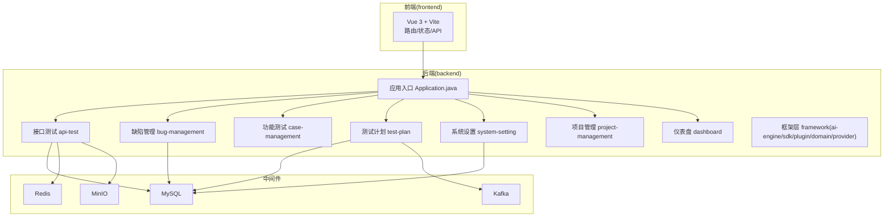
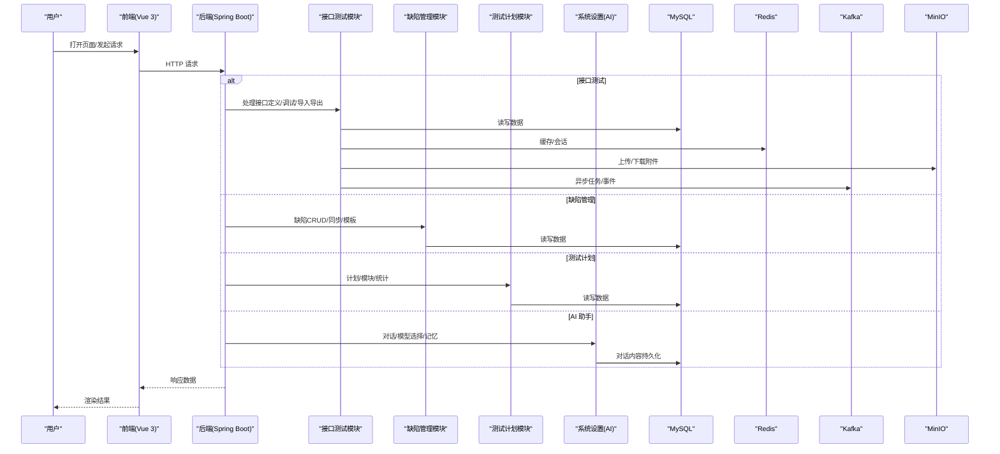
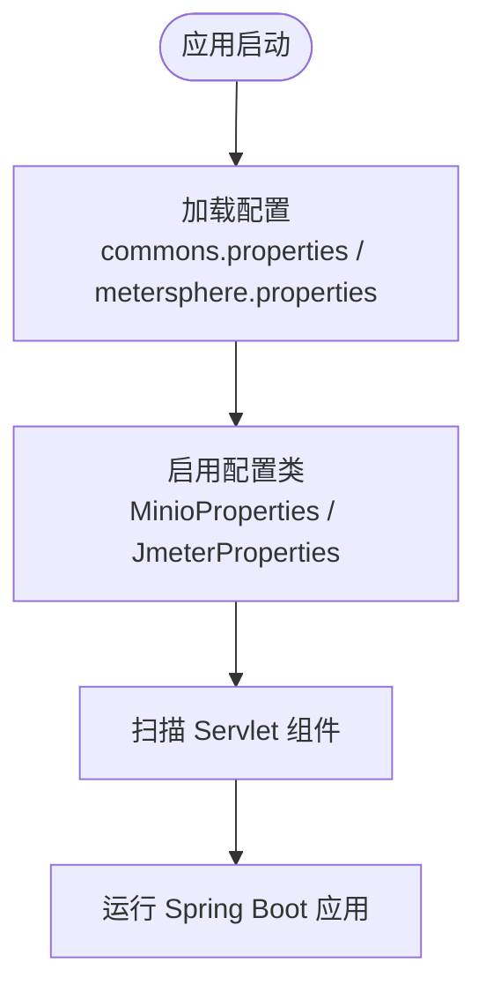
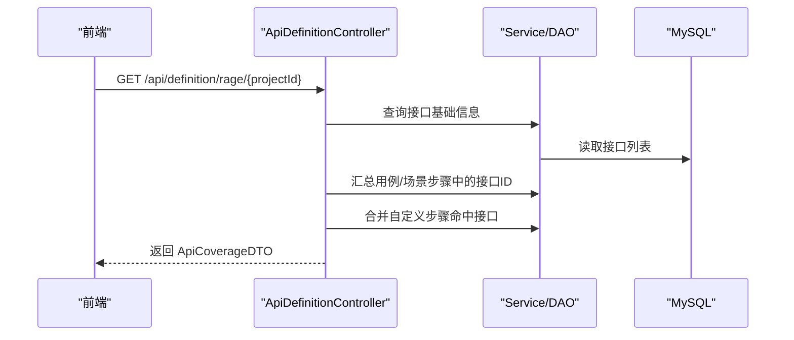
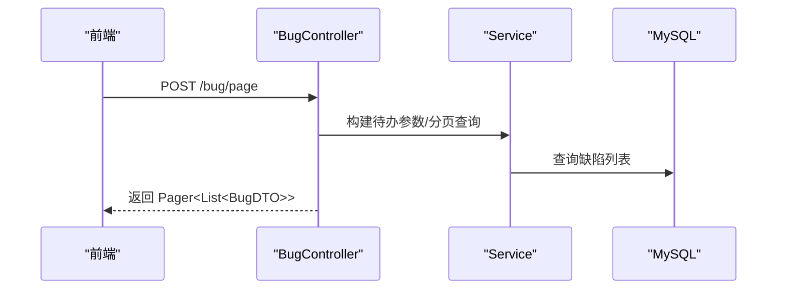
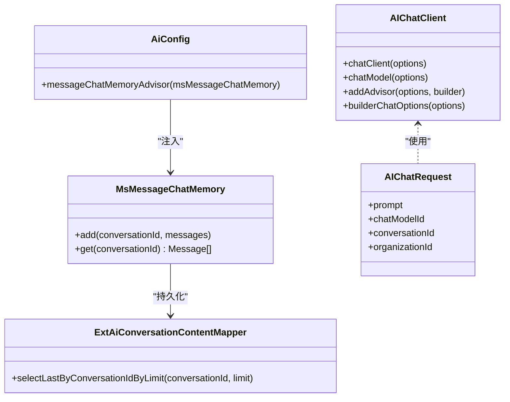
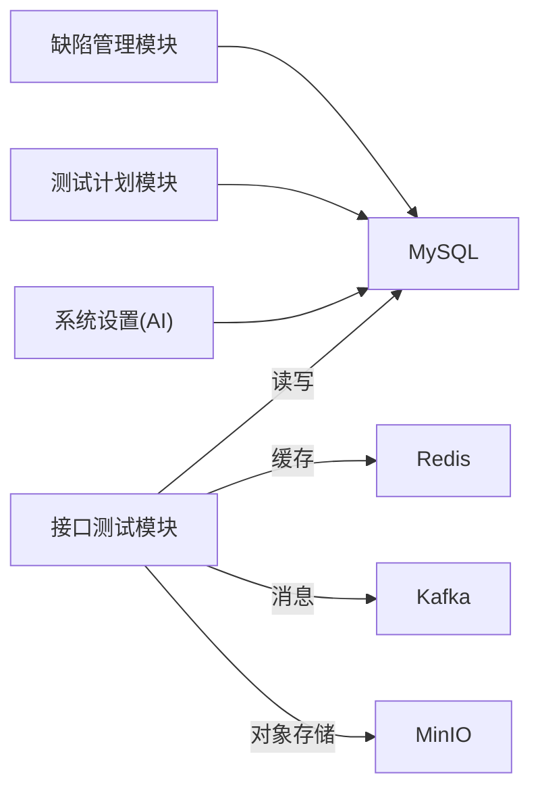

# 项目概述

<cite>
**本文引用的文件**   
- [README.md](file://README.md)
- [Application.java](file://backend/app/src/main/java/io/metersphere/Application.java)
- [package.json](file://frontend/package.json)
- [ApiDefinitionController.java](file://backend/services/api-test/src/main/java/io/metersphere/api/controller/definition/ApiDefinitionController.java)
- [BugController.java](file://backend/services/bug-management/src/main/java/io/metersphere/bug/controller/BugController.java)
- [TestPlanController.java](file://backend/services/test-plan/src/main/java/io/metersphere/plan/controller/TestPlanController.java)
- [AIChatClient.java](file://backend/framework/ai-engine/src/main/java/io/metersphere/ai/engine/common/AIChatClient.java)
- [AiConfig.java](file://backend/services/system-setting/src/main/java/io/metersphere/system/config/ai/AiConfig.java)
- [MsMessageChatMemory.java](file://backend/services/system-setting/src/main/java/io/metersphere/system/config/ai/MsMessageChatMemory.java)
- [ExtAiConversationContentMapper.xml](file://backend/services/system-setting/src/main/java/io/metersphere/system/mapper/ExtAiConversationContentMapper.xml)
- [AIChatRequest.java](file://backend/services/system-setting/src/main/java/io/metersphere/system/dto/request/ai/AIChatRequest.java)
</cite>

## 目录
1. [简介](#简介)
2. [项目结构](#项目结构)
3. [核心组件](#核心组件)
4. [架构总览](#架构总览)
5. [详细组件分析](#详细组件分析)
6. [依赖关系分析](#依赖关系分析)
7. [性能考量](#性能考量)
8. [故障排查指南](#故障排查指南)
9. [结论](#结论)
10. [附录](#附录)

## 简介
MeterSphere 是新一代开源持续测试平台，内置 AI 助手，覆盖接口测试、功能测试、缺陷管理、测试计划与报告等全链路能力，帮助团队在持续交付中提升质量与效率。其核心价值在于：
- AI 赋能：支持基于大模型的智能生成用例、对话式调试与辅助决策
- 测试管理：从用例到计划执行、缺陷闭环与报告输出的一体化体验
- 接口测试：融合 Postman 的易用性与 JMeter 的灵活性，端到端支持调试、定义、Mock、场景自动化与报告
- 团队协作：“系统-组织-项目”分层设计，便于多租户与权限治理
- 插件体系：提供丰富插件扩展点，快速对接 DevOps 流水线

版本与许可证：
- 当前主版本为 V3（社区版与企业版）
- 许可证遵循 FIT2CLOUD Open Source License（本质为 GPLv3，含额外限制）

技术栈概览：
- 后端：Spring Boot
- 前端：Vue 3 + Vite
- 中间件：MySQL、Redis、Kafka、MinIO
- 基础设施：Docker
- 测试引擎：JMeter

章节来源
- [README.md:16-22](file://README.md#L16-L22)
- [README.md:53-66](file://README.md#L53-L66)
- [README.md:77-84](file://README.md#L77-L84)

## 项目结构
仓库采用前后端分离与多模块后端架构：
- backend：Spring Boot 多模块服务，按业务域拆分（api-test、bug-management、case-management、test-plan、system-setting、project-management、dashboard 等），并提供 framework 层（AI Engine、SDK、Provider、Domain、Plugin）
- frontend：Vue 3 + TypeScript + Vite 工程，模块化路由、状态管理与 API 封装

图表来源
- [Application.java:14-27](file://backend/app/src/main/java/io/metersphere/Application.java#L14-L27)
- [package.json:1-10](file://frontend/package.json#L1-L10)

章节来源
- [Application.java:14-27](file://backend/app/src/main/java/io/metersphere/Application.java#L14-L27)
- [package.json:1-10](file://frontend/package.json#L1-L10)

## 核心组件
- 应用启动与配置
  - Spring Boot 应用入口，加载公共与外部配置文件，启用 MinIO/JMeter 属性绑定，排除不需要的自动装配
- 前端工程
  - Vue 3 + Vite 构建，TypeScript 类型检查，统一 HTTP 客户端与路由守卫
- 接口测试
  - 接口定义、导入导出、文档、调试、覆盖率统计、引用关系、操作历史等
- 缺陷管理
  - 缺陷 CRUD、同步第三方平台、模板字段、关注/取消关注、批量操作、导出
- 测试计划
  - 计划管理、模块树、关联功能用例、统计指标、模块计数
- AI 智能助手
  - 模型抽象与 ChatClient 构建、记忆持久化、对话内容存储与查询

章节来源
- [Application.java:14-27](file://backend/app/src/main/java/io/metersphere/Application.java#L14-L27)
- [package.json:1-10](file://frontend/package.json#L1-L10)
- [ApiDefinitionController.java:59-83](file://backend/services/api-test/src/main/java/io/metersphere/api/controller/definition/ApiDefinitionController.java#L59-L83)
- [BugController.java:52-65](file://backend/services/bug-management/src/main/java/io/metersphere/bug/controller/BugController.java#L52-L65)
- [TestPlanController.java:107-122](file://backend/services/test-plan/src/main/java/io/metersphere/plan/controller/TestPlanController.java#L107-L122)
- [AIChatClient.java:14-63](file://backend/framework/ai-engine/src/main/java/io/metersphere/ai/engine/common/AIChatClient.java#L14-L63)

## 架构总览
下图展示用户通过前端访问后端各业务模块，并调用中间件的典型交互路径。

图表来源
- [ApiDefinitionController.java:97-126](file://backend/services/api-test/src/main/java/io/metersphere/api/controller/definition/ApiDefinitionController.java#L97-L126)
- [BugController.java:90-126](file://backend/services/bug-management/src/main/java/io/metersphere/bug/controller/BugController.java#L90-L126)
- [TestPlanController.java:107-122](file://backend/services/test-plan/src/main/java/io/metersphere/plan/controller/TestPlanController.java#L107-L122)
- [AiConfig.java:11-17](file://backend/services/system-setting/src/main/java/io/metersphere/system/config/ai/AiConfig.java#L11-L17)
- [MsMessageChatMemory.java:18-39](file://backend/services/system-setting/src/main/java/io/metersphere/system/config/ai/MsMessageChatMemory.java#L18-L39)

## 详细组件分析

### 应用启动与配置（Application）
- 作用：初始化 Spring Boot 应用，加载 commons.properties 与外部 metersphere.properties，启用 Servlet 扫描，绑定 MinIO/JMeter 配置
- 关键点：排除 Quartz/LDAP/Neo4j 自动装配，减少不必要的依赖；通过 @EnableConfigurationProperties 暴露配置项

图表来源
- [Application.java:14-27](file://backend/app/src/main/java/io/metersphere/Application.java#L14-L27)

章节来源
- [Application.java:14-27](file://backend/app/src/main/java/io/metersphere/Application.java#L14-L27)

### 前端工程（frontend）
- 作用：提供 Web 界面，包含路由、状态管理、国际化、组件库与 API 封装
- 关键点：使用 Vite 构建，TypeScript 校验，Node >= 18，浏览器兼容策略明确

章节来源
- [package.json:1-10](file://frontend/package.json#L1-L10)
- [package.json:169-176](file://frontend/package.json#L169-L176)

### 接口测试（ApiDefinitionController）
- 能力：接口定义增删改查、分页、复制、移动、回收站、恢复、文档、导入导出、JSON Schema 预览/自动生成、调试、引用关系、操作历史、拖拽排序、覆盖率统计
- 权限与审计：广泛使用权限注解与操作日志、通知发送
- 关键流程（以“接口覆盖率”为例）：
  - 获取项目下所有接口与 HTTP 协议接口
  - 汇总用例与场景步骤中的接口 ID
  - 合并自定义步骤命中接口
  - 返回覆盖率 DTO

图表来源
- [ApiDefinitionController.java:97-126](file://backend/services/api-test/src/main/java/io/metersphere/api/controller/definition/ApiDefinitionController.java#L97-L126)

章节来源
- [ApiDefinitionController.java:59-83](file://backend/services/api-test/src/main/java/io/metersphere/api/controller/definition/ApiDefinitionController.java#L59-L83)
- [ApiDefinitionController.java:97-126](file://backend/services/api-test/src/main/java/io/metersphere/api/controller/definition/ApiDefinitionController.java#L97-L126)
- [ApiDefinitionController.java:128-171](file://backend/services/api-test/src/main/java/io/metersphere/api/controller/definition/ApiDefinitionController.java#L128-L171)
- [ApiDefinitionController.java:206-215](file://backend/services/api-test/src/main/java/io/metersphere/api/controller/definition/ApiDefinitionController.java#L206-L215)
- [ApiDefinitionController.java:279-301](file://backend/services/api-test/src/main/java/io/metersphere/api/controller/definition/ApiDefinitionController.java#L279-L301)
- [ApiDefinitionController.java:355-374](file://backend/services/api-test/src/main/java/io/metersphere/api/controller/definition/ApiDefinitionController.java#L355-L374)

### 缺陷管理（BugController）
- 能力：缺陷分页、创建/更新/删除、批量操作、同步第三方平台、模板字段、导出、关注/取消关注、拖拽排序
- 权限与审计：统一的权限控制、操作日志与通知

图表来源
- [BugController.java:90-102](file://backend/services/bug-management/src/main/java/io/metersphere/bug/controller/BugController.java#L90-L102)

章节来源
- [BugController.java:52-65](file://backend/services/bug-management/src/main/java/io/metersphere/bug/controller/BugController.java#L52-L65)
- [BugController.java:90-126](file://backend/services/bug-management/src/main/java/io/metersphere/bug/controller/BugController.java#L90-L126)
- [BugController.java:151-173](file://backend/services/bug-management/src/main/java/io/metersphere/bug/controller/BugController.java#L151-L173)
- [BugController.java:175-212](file://backend/services/bug-management/src/main/java/io/metersphere/bug/controller/BugController.java#L175-L212)

### 测试计划（TestPlanController）
- 能力：计划详情统计（通过率/执行进度）、模块统计、模块树、关联功能用例等
- 权限与审计：基于项目的资源归属校验与权限控制

章节来源
- [TestPlanController.java:107-122](file://backend/services/test-plan/src/main/java/io/metersphere/plan/controller/TestPlanController.java#L107-L122)

### AI 智能助手（AI Engine + System Setting）
- 模型抽象与构建
  - 抽象基类 AIChatClient 提供 ChatClient/ChatModel 构建与顾问注入（日志流/调用日志）
  - 通过 AiConfig 注册 MessageChatMemoryAdvisor，结合 MsMessageChatMemory 实现对话记忆持久化
- 对话内容与持久化
  - ExtAiConversationContentMapper 提供按 conversationId 倒序取最近 N 条记录
  - AIChatRequest 承载提示词、模型ID、对话ID、组织ID等入参

图表来源
- [AIChatClient.java:14-63](file://backend/framework/ai-engine/src/main/java/io/metersphere/ai/engine/common/AIChatClient.java#L14-L63)
- [AiConfig.java:11-17](file://backend/services/system-setting/src/main/java/io/metersphere/system/config/ai/AiConfig.java#L11-L17)
- [MsMessageChatMemory.java:18-39](file://backend/services/system-setting/src/main/java/io/metersphere/system/config/ai/MsMessageChatMemory.java#L18-L39)
- [ExtAiConversationContentMapper.xml:5-11](file://backend/services/system-setting/src/main/java/io/metersphere/system/mapper/ExtAiConversationContentMapper.xml#L5-L11)
- [AIChatRequest.java:9-29](file://backend/services/system-setting/src/main/java/io/metersphere/system/dto/request/ai/AIChatRequest.java#L9-L29)

章节来源
- [AIChatClient.java:14-63](file://backend/framework/ai-engine/src/main/java/io/metersphere/ai/engine/common/AIChatClient.java#L14-L63)
- [AiConfig.java:11-17](file://backend/services/system-setting/src/main/java/io/metersphere/system/config/ai/AiConfig.java#L11-L17)
- [MsMessageChatMemory.java:18-39](file://backend/services/system-setting/src/main/java/io/metersphere/system/config/ai/MsMessageChatMemory.java#L18-L39)
- [ExtAiConversationContentMapper.xml:5-11](file://backend/services/system-setting/src/main/java/io/metersphere/system/mapper/ExtAiConversationContentMapper.xml#L5-L11)
- [AIChatRequest.java:9-29](file://backend/services/system-setting/src/main/java/io/metersphere/system/dto/request/ai/AIChatRequest.java#L9-L29)

## 依赖关系分析
- 模块耦合
  - 控制器层依赖 Service/DAO，Service 层依赖领域模型与 SDK
  - 跨模块通过 Provider/SDK 进行解耦（如项目模板、通知、权限等）
- 外部依赖
  - MySQL：持久化业务数据
  - Redis：缓存与会话
  - Kafka：异步任务与事件驱动
  - MinIO：对象存储（附件、报告等）
  - JMeter：接口/场景执行引擎

图表来源
- [ApiDefinitionController.java:279-301](file://backend/services/api-test/src/main/java/io/metersphere/api/controller/definition/ApiDefinitionController.java#L279-L301)
- [Application.java:24-27](file://backend/app/src/main/java/io/metersphere/Application.java#L24-L27)

章节来源
- [ApiDefinitionController.java:279-301](file://backend/services/api-test/src/main/java/io/metersphere/api/controller/definition/ApiDefinitionController.java#L279-L301)
- [Application.java:24-27](file://backend/app/src/main/java/io/metersphere/Application.java#L24-L27)

## 性能考量
- 数据库
  - 合理使用分页与排序字段，避免全表扫描
  - 对高频查询建立索引（如项目ID、模块ID、时间戳）
- 缓存
  - 热点字典/配置使用 Redis 缓存，注意过期与一致性
- 异步
  - 耗时任务（导入导出、同步、报告生成）走 Kafka 异步处理，降低请求延迟
- 存储
  - 大文件/二进制对象走 MinIO，避免直接落盘与数据库膨胀
- 前端
  - 按需加载路由与组件，压缩与懒加载静态资源，减少首屏体积

[本节为通用指导，无需代码来源]

## 故障排查指南
- 接口测试
  - 导入失败：检查文件格式与字段映射；查看导入任务日志
  - 调试异常：确认环境配置与鉴权；核对请求头/参数/Schema
- 缺陷管理
  - 同步失败：检查第三方平台连接与权限；查看同步状态接口
  - 模板字段缺失：确认项目模板配置是否生效
- 测试计划
  - 统计不准确：检查用例关联关系与执行结果回写
  - 模块树为空：确认模块开关与权限
- AI 助手
  - 对话无记忆：检查 MsMessageChatMemory 与 Mapper 是否正确持久化
  - 模型不可用：检查模型配置与网络连通性

章节来源
- [ApiDefinitionController.java:295-301](file://backend/services/api-test/src/main/java/io/metersphere/api/controller/definition/ApiDefinitionController.java#L295-L301)
- [BugController.java:151-173](file://backend/services/bug-management/src/main/java/io/metersphere/bug/controller/BugController.java#L151-L173)
- [MsMessageChatMemory.java:18-39](file://backend/services/system-setting/src/main/java/io/metersphere/system/config/ai/MsMessageChatMemory.java#L18-L39)

## 结论
MeterSphere 3.x 以清晰的模块化架构与完善的测试工具链，为团队提供从需求到发布的全链路质量保障能力。通过 AI 助手与插件生态，进一步提升了用例生成、调试与集成的效率。建议在部署时合理配置中间件与资源池，结合权限与模板机制，形成可复用、可扩展的测试资产与流程。

[本节为总结性内容，无需代码来源]

## 附录
- 安装与部署：参考 README 中的快速开始与离线安装包说明
- 产品对比与版本：参见 README 的版本说明与定价页链接
- 许可证：FIT2CLOUD Open Source License（GPLv3 为基础，含额外限制）

章节来源
- [README.md:24-30](file://README.md#L24-L30)
- [README.md:53-66](file://README.md#L53-L66)
- [README.md:77-84](file://README.md#L77-L84)