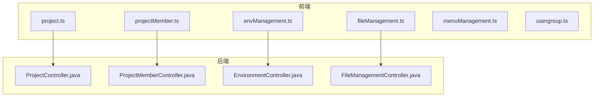
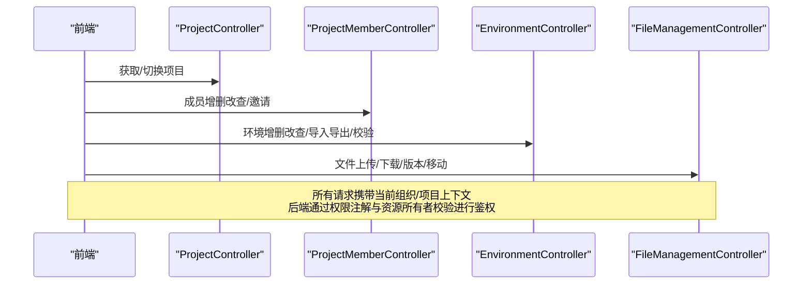
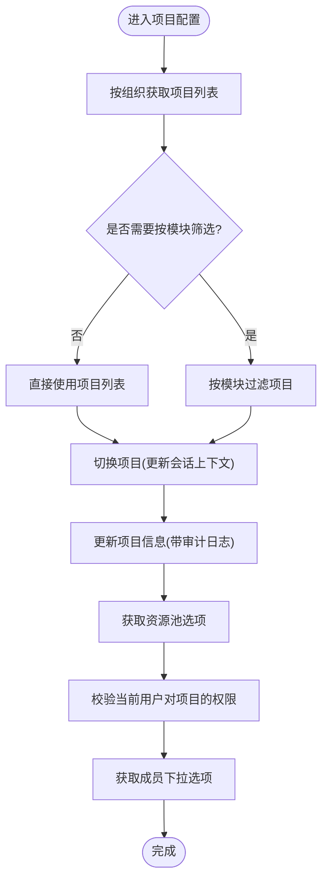
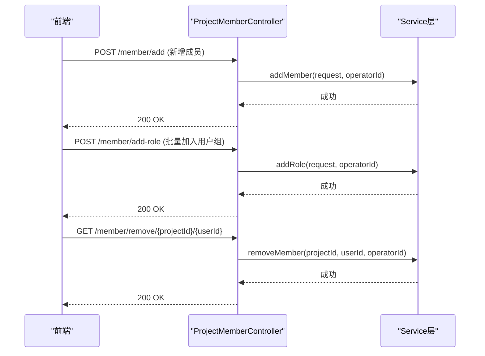
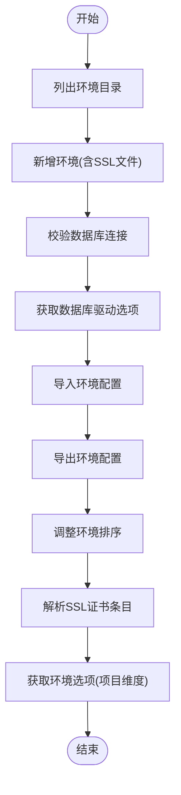
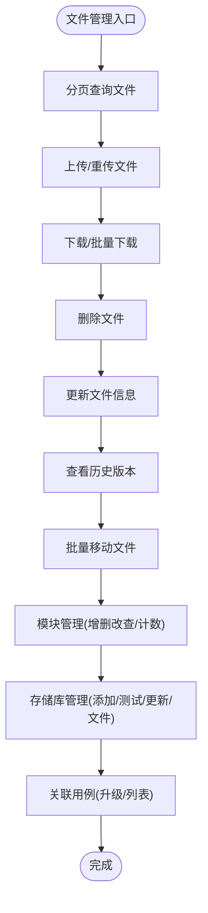
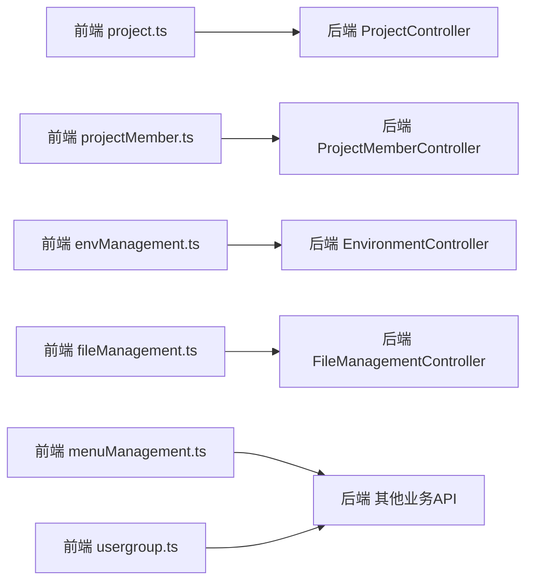

# 项目管理

<cite>
**本文引用的文件**   
- [project.ts](file://frontend/src/api/modules/project-management/project.ts)
- [projectMember.ts](file://frontend/src/api/modules/project-management/projectMember.ts)
- [envManagement.ts](file://frontend/src/api/modules/project-management/envManagement.ts)
- [fileManagement.ts](file://frontend/src/api/modules/project-management/fileManagement.ts)
- [menuManagement.ts](file://frontend/src/api/modules/project-management/menuManagement.ts)
- [usergroup.ts](file://frontend/src/api/modules/project-management/usergroup.ts)
- [ProjectController.java](file://backend/services/project-management/src/main/java/io/metersphere/project/controller/ProjectController.java)
- [ProjectMemberController.java](file://backend/services/project-management/src/main/java/io/metersphere/project/controller/ProjectMemberController.java)
- [EnvironmentController.java](file://backend/services/project-management/src/main/java/io/metersphere/project/controller/EnvironmentController.java)
- [FileManagementController.java](file://backend/services/project-management/src/main/java/io/metersphere/project/controller/FileManagementController.java)
</cite>

## 目录
1. [简介](#简介)
2. [项目结构](#项目结构)
3. [核心组件](#核心组件)
4. [架构总览](#架构总览)
5. [详细组件分析](#详细组件分析)
6. [依赖关系分析](#依赖关系分析)
7. [性能考虑](#性能考虑)
8. [故障排查指南](#故障排查指南)
9. [结论](#结论)
10. [附录：使用示例与最佳实践](#附录使用示例与最佳实践)

## 简介
本章节面向 MeterSphere 的项目管理模块，围绕以下能力进行系统化说明：项目配置、成员管理、环境管理、文件管理、菜单管理与用户组管理。文档同时解释多租户（组织）架构、权限控制体系、项目隔离机制与数据安全策略，并提供可操作的使用示例，帮助读者快速上手并安全高效地管理项目资源。

## 项目结构
后端采用按业务域划分的模块化结构，项目管理相关控制器位于 services/project-management 下；前端 API 调用集中在 frontend/src/api/modules/project-management 中，前后端通过 RESTful 接口交互。

图示来源
- [project.ts:1-21](file://frontend/src/api/modules/project-management/project.ts#L1-L21)
- [projectMember.ts:1-84](file://frontend/src/api/modules/project-management/projectMember.ts#L1-L84)
- [envManagement.ts:1-115](file://frontend/src/api/modules/project-management/envManagement.ts#L1-L115)
- [fileManagement.ts:1-195](file://frontend/src/api/modules/project-management/fileManagement.ts#L1-L195)
- [ProjectController.java:1-100](file://backend/services/project-management/src/main/java/io/metersphere/project/controller/ProjectController.java#L1-L100)
- [ProjectMemberController.java:1-138](file://backend/services/project-management/src/main/java/io/metersphere/project/controller/ProjectMemberController.java#L1-L138)
- [EnvironmentController.java:1-143](file://backend/services/project-management/src/main/java/io/metersphere/project/controller/EnvironmentController.java#L1-L143)
- [FileManagementController.java:1-145](file://backend/services/project-management/src/main/java/io/metersphere/project/controller/FileManagementController.java#L1-L145)

章节来源
- [project.ts:1-21](file://frontend/src/api/modules/project-management/project.ts#L1-L21)
- [ProjectController.java:1-100](file://backend/services/project-management/src/main/java/io/metersphere/project/controller/ProjectController.java#L1-L100)

## 核心组件
- 项目配置：提供项目基本信息查询、更新、切换、资源池选项等能力，支持基于组织的权限过滤。
- 成员管理：支持成员列表查询、添加/编辑/移除、批量操作、邀请注册、评论@成员等。
- 环境管理：支持环境目录的增删改查、导入导出、排序、数据库连接校验、驱动选项获取、SSL 证书处理等。
- 文件管理：支持文件上传/重传/下载/删除、模块管理、历史版本、Jar 启用禁用、批量移动、存储库管理等。
- 菜单管理：支持菜单配置、平台集成（缺陷/用例）、误报规则、同步配置等。
- 用户组管理：支持用户组增删改、权限配置、成员管理、成员选项获取等。

章节来源
- [ProjectController.java:35-97](file://backend/services/project-management/src/main/java/io/metersphere/project/controller/ProjectController.java#L35-L97)
- [ProjectMemberController.java:47-136](file://backend/services/project-management/src/main/java/io/metersphere/project/controller/ProjectMemberController.java#L47-L136)
- [EnvironmentController.java:42-141](file://backend/services/project-management/src/main/java/io/metersphere/project/controller/EnvironmentController.java#L42-L141)
- [FileManagementController.java:37-143](file://backend/services/project-management/src/main/java/io/metersphere/project/controller/FileManagementController.java#L37-L143)
- [menuManagement.ts:17-195](file://frontend/src/api/modules/project-management/menuManagement.ts#L17-L195)
- [usergroup.ts:14-63](file://frontend/src/api/modules/project-management/usergroup.ts#L14-L63)

## 架构总览
系统采用“前端 API 模块 -> 后端 Controller -> Service/Mapper”的分层架构。所有写操作均通过权限注解与资源归属校验双重保护，确保跨组织的数据隔离与安全访问。

图示来源
- [ProjectController.java:35-97](file://backend/services/project-management/src/main/java/io/metersphere/project/controller/ProjectController.java#L35-L97)
- [ProjectMemberController.java:47-136](file://backend/services/project-management/src/main/java/io/metersphere/project/controller/ProjectMemberController.java#L47-L136)
- [EnvironmentController.java:42-141](file://backend/services/project-management/src/main/java/io/metersphere/project/controller/EnvironmentController.java#L42-L141)
- [FileManagementController.java:37-143](file://backend/services/project-management/src/main/java/io/metersphere/project/controller/FileManagementController.java#L37-L143)

## 详细组件分析

### 项目配置
- 功能要点
  - 根据组织获取有权限的项目列表，支持按模块筛选。
  - 切换项目以改变当前会话上下文。
  - 更新项目基本信息，记录审计日志。
  - 获取项目下的资源池选项。
  - 检查当前用户是否对某项目具备权限。
  - 获取项目成员下拉选项（用于分配成员）。
- 关键接口路径
  - GET /project/get/{id}
  - GET /project/list/options/{organizationId}
  - GET /project/list/options/{organizationId}/{module}
  - POST /project/switch
  - POST /project/update
  - GET /project/pool-options/{type}/{projectId}
  - GET /project/has-permission/{id}
  - GET /project/get-member/option/{projectId}

图示来源
- [ProjectController.java:35-97](file://backend/services/project-management/src/main/java/io/metersphere/project/controller/ProjectController.java#L35-L97)
- [project.ts:6-20](file://frontend/src/api/modules/project-management/project.ts#L6-L20)

章节来源
- [ProjectController.java:35-97](file://backend/services/project-management/src/main/java/io/metersphere/project/controller/ProjectController.java#L35-L97)
- [project.ts:6-20](file://frontend/src/api/modules/project-management/project.ts#L6-L20)

### 成员管理
- 功能要点
  - 分页查询项目成员列表。
  - 新增/编辑成员、批量添加到用户组。
  - 批量移除成员、单个移除成员。
  - 邀请成员注册（邮件邀请）。
  - 获取成员/用户组下拉选项、评论@成员选项。
  - 在系统设置中更新成员的用户组。
- 关键接口路径
  - POST /project/member/list
  - POST /project/member/add
  - POST /project/member/update
  - POST /project/member/add-role
  - POST /project/member/batch/remove
  - GET /project/member/remove/{projectId}/{userId}
  - GET /project/member/get-member/option/{projectId}
  - GET /project/member/get-role/option/{projectId}
  - GET /project/member/comment/user-option/{projectId}
  - POST /project/member/invite
  - POST /project/member/update-member

图示来源
- [ProjectMemberController.java:74-136](file://backend/services/project-management/src/main/java/io/metersphere/project/controller/ProjectMemberController.java#L74-L136)
- [projectMember.ts:27-84](file://frontend/src/api/modules/project-management/projectMember.ts#L27-L84)

章节来源
- [ProjectMemberController.java:47-136](file://backend/services/project-management/src/main/java/io/metersphere/project/controller/ProjectMemberController.java#L47-L136)
- [projectMember.ts:27-84](file://frontend/src/api/modules/project-management/projectMember.ts#L27-L84)

### 环境管理
- 功能要点
  - 环境目录的增删改查、排序调整。
  - 导入/导出环境配置。
  - 数据库连接校验与驱动选项获取。
  - SSL 证书条目解析。
  - 获取环境插件脚本列表。
- 关键接口路径
  - POST /project/environment/list
  - GET /project/environment/get/{id}
  - POST /project/environment/add
  - POST /project/environment/update
  - GET /project/environment/delete/{id}
  - POST /project/environment/database/validate
  - GET /project/environment/database/driver-options/{organizationId}
  - POST /project/environment/import
  - POST /project/environment/export
  - POST /project/environment/get/entry
  - POST /project/environment/edit/pos
  - GET /project/environment/get-options/{projectId}

图示来源
- [EnvironmentController.java:42-141](file://backend/services/project-management/src/main/java/io/metersphere/project/controller/EnvironmentController.java#L42-L141)
- [envManagement.ts:17-115](file://frontend/src/api/modules/project-management/envManagement.ts#L17-L115)

章节来源
- [EnvironmentController.java:42-141](file://backend/services/project-management/src/main/java/io/metersphere/project/controller/EnvironmentController.java#L42-L141)
- [envManagement.ts:17-115](file://frontend/src/api/modules/project-management/envManagement.ts#L17-L115)

### 文件管理
- 功能要点
  - 文件分页查询、详情查看、类型统计。
  - 文件上传/重传、下载/批量下载。
  - 文件删除、修改、历史版本查看。
  - Jar 文件启用/禁用。
  - 模块增删改查、批量移动。
  - 存储库管理（添加/测试连接/更新/文件同步）。
  - 关联用例升级与关联列表查询。
- 关键接口路径
  - GET /project/file/type/{projectId}
  - POST /project/file/page
  - GET /project/file/get/{id}
  - POST /project/file/module/count
  - POST /project/file/upload
  - POST /project/file/re-upload
  - GET /project/file/download/{id}
  - POST /project/file/delete
  - POST /project/file/update
  - GET /project/file/jar-file-status/{fileId}/{enable}
  - POST /project/file/batch-download
  - POST /project/file/batch-move
  - GET /project/file/file-version/{fileId}

图示来源
- [FileManagementController.java:37-143](file://backend/services/project-management/src/main/java/io/metersphere/project/controller/FileManagementController.java#L37-L143)
- [fileManagement.ts:57-195](file://frontend/src/api/modules/project-management/fileManagement.ts#L57-L195)

章节来源
- [FileManagementController.java:37-143](file://backend/services/project-management/src/main/java/io/metersphere/project/controller/FileManagementController.java#L37-L143)
- [fileManagement.ts:57-195](file://frontend/src/api/modules/project-management/fileManagement.ts#L57-L195)

### 菜单管理
- 功能要点
  - 获取菜单列表、按菜单类型更新配置。
  - 获取各应用（工作台/测试计划/缺陷/用例/API/UI/任务中心）的配置项。
  - 平台集成（缺陷/用例）平台选项与插件信息。
  - 缺陷同步与用例关联配置保存。
  - 误报规则（增删改查、启用禁用）。
  - JIRA Key 校验。
- 关键接口路径
  - GET /project/application/{suffix}/resource/pool/{projectId}
  - GET /project/application/{suffix}/user/{projectId}
  - POST /project/menu/config/{suffixUrl}
  - POST /project/menu/config/by-type/{suffix}
  - GET /project/menu/platform/{orgId}?type=...
  - GET /project/menu/plugin-info/{pluginId}?type=...
  - POST /project/menu/sync-bug/{projectId}
  - POST /project/menu/related-case/{projectId}
  - POST /project/menu/fake-table/*
  - POST /project/menu/validate-jira-key/{pluginId}
  - GET /project/menu/bug-sync-info/{projectId}
  - GET /project/menu/case-related-info/{projectId}

章节来源
- [menuManagement.ts:17-195](file://frontend/src/api/modules/project-management/menuManagement.ts#L17-L195)

### 用户组管理
- 功能要点
  - 创建/修改用户组、删除用户组。
  - 配置用户组权限、查询用户组权限。
  - 管理用户组成员（添加/删除/查询）。
  - 获取需要关联的用户选项。
- 关键接口路径
  - POST /project/usergroup (add/update)
  - POST /project/usergroup/list
  - GET /project/usergroup/{id}
  - POST /project/usergroup/permission
  - GET /project/usergroup/permission/{id}
  - POST /project/usergroup/member
  - POST /project/usergroup/member/remove
  - GET /project/usergroup/member/options/{projectId}/{userRoleId}
  - POST /project/usergroup/member/add

章节来源
- [usergroup.ts:14-63](file://frontend/src/api/modules/project-management/usergroup.ts#L14-L63)

## 依赖关系分析
- 前端 API 模块与后端 Controller 一一对应，职责清晰，耦合度低。
- 权限控制通过注解统一实现，避免在各方法内重复编写鉴权逻辑。
- 资源归属校验（CheckOwner）确保跨组织访问的安全边界。
- 审计日志通过注解注入，保证关键操作的留痕与可追溯性。

图示来源
- [project.ts:1-21](file://frontend/src/api/modules/project-management/project.ts#L1-L21)
- [projectMember.ts:1-84](file://frontend/src/api/modules/project-management/projectMember.ts#L1-L84)
- [envManagement.ts:1-115](file://frontend/src/api/modules/project-management/envManagement.ts#L1-L115)
- [fileManagement.ts:1-195](file://frontend/src/api/modules/project-management/fileManagement.ts#L1-L195)
- [ProjectController.java:1-100](file://backend/services/project-management/src/main/java/io/metersphere/project/controller/ProjectController.java#L1-L100)
- [ProjectMemberController.java:1-138](file://backend/services/project-management/src/main/java/io/metersphere/project/controller/ProjectMemberController.java#L1-L138)
- [EnvironmentController.java:1-143](file://backend/services/project-management/src/main/java/io/metersphere/project/controller/EnvironmentController.java#L1-L143)
- [FileManagementController.java:1-145](file://backend/services/project-management/src/main/java/io/metersphere/project/controller/FileManagementController.java#L1-L145)

## 性能考虑
- 分页与批量操作：成员与环境列表均采用分页接口，减少单次数据量；批量下载/移动/删除提升效率。
- 大文件处理：文件上传/重传/下载使用流式响应与分片策略（由后端限制与前端上传组件配合），避免内存溢出。
- 缓存与选项接口：资源池、驱动选项、成员/用户组下拉选项等高频读取接口适合缓存，降低数据库压力。
- 并发控制：批量操作需在前端做防抖与确认提示，避免重复提交。

[本节为通用指导，不直接分析具体文件]

## 故障排查指南
- 权限不足
  - 现象：调用接口返回无权限或资源不存在。
  - 排查：确认当前用户是否具备对应权限常量（如 PROJECT_BASE_INFO_READ、PROJECT_USER_READ 等），以及是否拥有目标资源的归属权（CheckOwner）。
- 项目切换失败
  - 现象：切换项目后页面仍显示旧项目数据。
  - 排查：确认 switchProject 接口调用成功且会话上下文已更新；检查前端是否正确刷新路由与状态。
- 环境导入/导出异常
  - 现象：导入失败或导出为空。
  - 排查：检查文件格式与字段映射；确认组织/项目维度参数正确；验证数据库驱动选项是否匹配。
- 文件上传/下载失败
  - 现象：上传进度卡住或下载内容为空。
  - 排查：检查文件大小限制、网络超时、后端存储可用性与权限；确认下载接口返回类型为二进制流。

章节来源
- [ProjectController.java:35-97](file://backend/services/project-management/src/main/java/io/metersphere/project/controller/ProjectController.java#L35-L97)
- [ProjectMemberController.java:47-136](file://backend/services/project-management/src/main/java/io/metersphere/project/controller/ProjectMemberController.java#L47-L136)
- [EnvironmentController.java:42-141](file://backend/services/project-management/src/main/java/io/metersphere/project/controller/EnvironmentController.java#L42-L141)
- [FileManagementController.java:37-143](file://backend/services/project-management/src/main/java/io/metersphere/project/controller/FileManagementController.java#L37-L143)

## 结论
MeterSphere 的项目管理模块通过清晰的 API 分层、统一的权限与资源归属校验、完善的审计日志与丰富的业务能力，支撑了多租户场景下的项目级隔离与精细化管控。结合成员、环境、文件、菜单与用户组的全链路管理能力，企业可在保障数据安全的前提下，灵活构建与维护多个独立项目空间。

[本节为总结性内容，不直接分析具体文件]

## 附录：使用示例与最佳实践

- 创建项目
  - 步骤
    - 在组织维度获取项目列表，按需筛选模块。
    - 如需新建项目，调用后端新增接口（参考项目更新接口的权限与审计模式）。
    - 切换至新项目以生效上下文。
  - 参考接口
    - GET /project/list/options/{organizationId}
    - GET /project/list/options/{organizationId}/{module}
    - POST /project/switch

- 配置成员权限
  - 步骤
    - 获取项目成员下拉选项，选择目标用户。
    - 将用户添加到项目或批量加入用户组。
    - 为用户组配置权限，必要时在系统设置中更新成员用户组。
  - 参考接口
    - GET /project/member/get-member/option/{projectId}
    - POST /project/member/add
    - POST /project/member/add-role
    - POST /project/usergroup/permission

- 管理环境
  - 步骤
    - 新增环境并上传 SSL 证书（可选）。
    - 校验数据库连接，获取驱动选项。
    - 导入/导出环境配置，调整排序。
  - 参考接口
    - POST /project/environment/add
    - POST /project/environment/database/validate
    - GET /project/environment/database/driver-options/{organizationId}
    - POST /project/environment/import
    - POST /project/environment/export
    - POST /project/environment/edit/pos

- 上传与管理文件
  - 步骤
    - 上传文件或重传已有文件。
    - 查看文件详情与历史版本。
    - 批量下载/移动文件，管理模块与存储库。
  - 参考接口
    - POST /project/file/upload
    - POST /project/file/re-upload
    - GET /project/file/get/{id}
    - GET /project/file/file-version/{fileId}
    - POST /project/file/batch-download
    - POST /project/file/batch-move

- 多租户与组织层级映射
  - 组织（Organization）作为顶层租户，项目（Project）隶属于组织。
  - 成员与用户组在项目维度授权，但可在系统设置中进行全局维护。
  - 环境、文件等资源在项目维度隔离，确保不同组织间的数据互不可见。

- 权限控制体系与数据安全策略
  - 权限控制：通过权限常量与注解（RequiresPermissions）控制接口访问。
  - 资源归属：通过 CheckOwner 校验当前用户是否为资源所有者或具备相应角色。
  - 审计日志：关键写操作通过 Log 注解记录操作人、时间与变更摘要。
  - 数据隔离：所有接口均基于当前组织/项目上下文进行数据过滤，防止越权访问。

章节来源
- [ProjectController.java:35-97](file://backend/services/project-management/src/main/java/io/metersphere/project/controller/ProjectController.java#L35-L97)
- [ProjectMemberController.java:47-136](file://backend/services/project-management/src/main/java/io/metersphere/project/controller/ProjectMemberController.java#L47-L136)
- [EnvironmentController.java:42-141](file://backend/services/project-management/src/main/java/io/metersphere/project/controller/EnvironmentController.java#L42-L141)
- [FileManagementController.java:37-143](file://backend/services/project-management/src/main/java/io/metersphere/project/controller/FileManagementController.java#L37-L143)
- [project.ts:6-20](file://frontend/src/api/modules/project-management/project.ts#L6-L20)
- [projectMember.ts:27-84](file://frontend/src/api/modules/project-management/projectMember.ts#L27-L84)
- [envManagement.ts:17-115](file://frontend/src/api/modules/project-management/envManagement.ts#L17-L115)
- [fileManagement.ts:57-195](file://frontend/src/api/modules/project-management/fileManagement.ts#L57-L195)