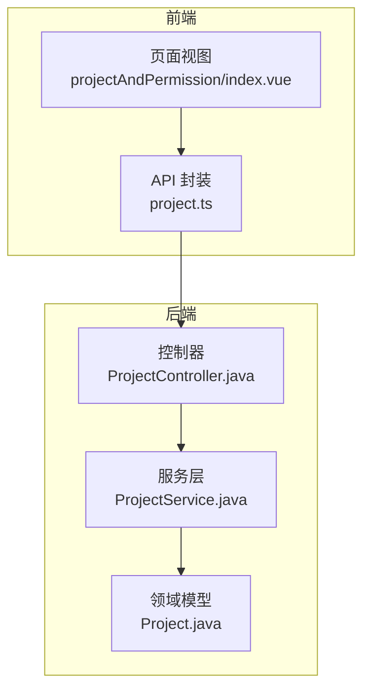
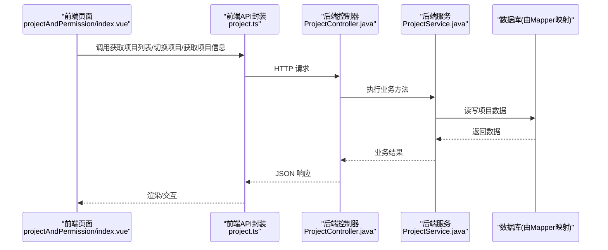
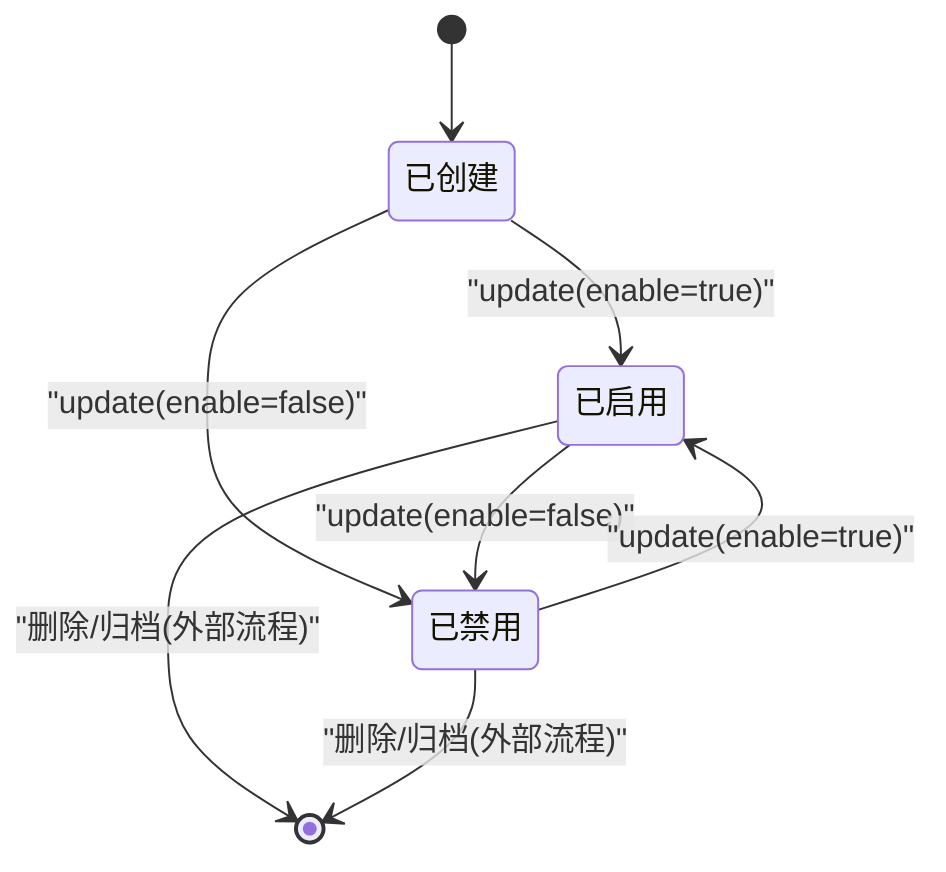
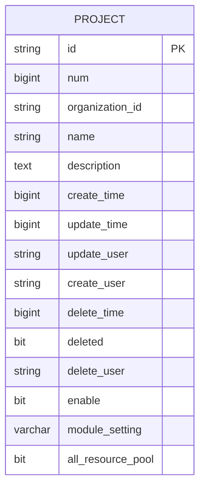
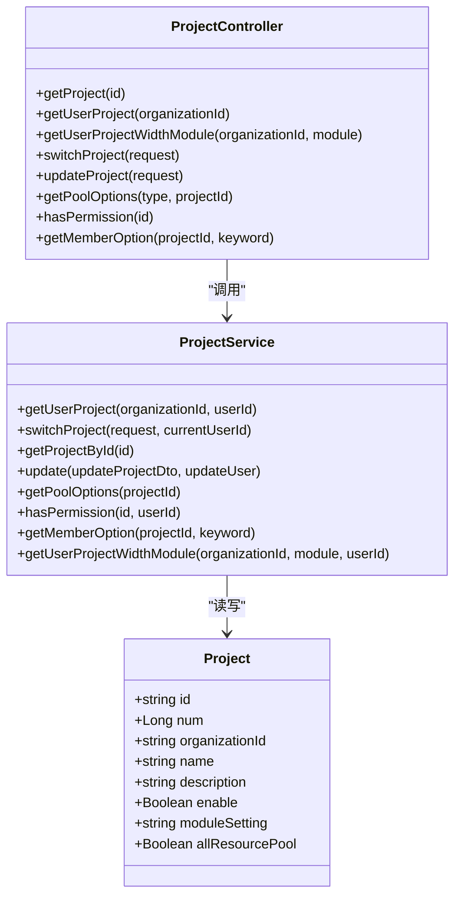

# 项目配置

<cite>
**本文引用的文件**   
- [ProjectController.java](file://backend/services/project-management/src/main/java/io/metersphere/project/controller/ProjectController.java)
- [ProjectService.java](file://backend/services/project-management/src/main/java/io/metersphere/project/service/ProjectService.java)
- [Project.java](file://backend/framework/domain/src/main/java/io/metersphere/project/domain/Project.java)
- [project.ts](file://frontend/src/api/modules/project-management/project.ts)
- [index.vue（项目管理-项目与权限）](file://frontend/src/views/project-management/projectAndPermission/index.vue)
</cite>

## 目录
1. [简介](#简介)
2. [项目结构](#项目结构)
3. [核心组件](#核心组件)
4. [架构总览](#架构总览)
5. [详细组件分析](#详细组件分析)
6. [依赖关系分析](#依赖关系分析)
7. [性能考虑](#性能考虑)
8. [故障排查指南](#故障排查指南)
9. [结论](#结论)
10. [附录](#附录)

## 简介
本文围绕 MeterSphere 的“项目配置”能力，系统说明项目的创建、编辑、删除等基本操作；解释项目基本信息字段（如项目名称、描述、标识符等）的作用与约束；阐述项目的生命周期管理（状态流转、启用禁用机制）；给出调用项目配置 API 的前后端示例路径；说明项目配置与组织层级的关系以及配置数据的存储结构。

## 项目结构
本项目在前后端分离架构下实现：
- 后端服务位于 backend/services/project-management，提供项目管理的 REST 接口与服务逻辑。
- 前端位于 frontend/src，包含项目管理的页面与 API 封装。

图表来源
- [project.ts:1-21](file://frontend/src/api/modules/project-management/project.ts#L1-L21)
- [ProjectController.java:28-99](file://backend/services/project-management/src/main/java/io/metersphere/project/controller/ProjectController.java#L28-L99)
- [ProjectService.java:48-334](file://backend/services/project-management/src/main/java/io/metersphere/project/service/ProjectService.java#L48-L334)
- [Project.java:11-66](file://backend/framework/domain/src/main/java/io/metersphere/project/domain/Project.java#L11-L66)

章节来源
- [ProjectController.java:28-99](file://backend/services/project-management/src/main/java/io/metersphere/project/controller/ProjectController.java#L28-L99)
- [ProjectService.java:48-334](file://backend/services/project-management/src/main/java/io/metersphere/project/service/ProjectService.java#L48-L334)
- [project.ts:1-21](file://frontend/src/api/modules/project-management/project.ts#L1-L21)
- [index.vue（项目管理-项目与权限）:1-176](file://frontend/src/views/project-management/projectAndPermission/index.vue#L1-L176)

## 核心组件
- 控制器 ProjectController：暴露项目相关 REST 接口，包括获取项目信息、按组织获取项目列表、切换项目、更新项目、获取资源池选项、权限校验、成员下拉选项等。
- 服务层 ProjectService：实现项目业务逻辑，包括用户项目列表查询、项目切换、项目更新、权限判断、模块过滤的项目列表、资源池选项计算等。
- 领域模型 Project：定义项目实体的字段与校验规则，如 id、organizationId、name、description、enable、moduleSetting、allResourcePool 等。
- 前端 API 封装 project.ts：封装获取项目列表、切换项目、获取项目信息等 HTTP 调用。
- 前端页面 index.vue：项目管理-项目与权限的主入口，承载子菜单与路由跳转。

章节来源
- [ProjectController.java:28-99](file://backend/services/project-management/src/main/java/io/metersphere/project/controller/ProjectController.java#L28-L99)
- [ProjectService.java:48-334](file://backend/services/project-management/src/main/java/io/metersphere/project/service/ProjectService.java#L48-L334)
- [Project.java:11-66](file://backend/framework/domain/src/main/java/io/metersphere/project/domain/Project.java#L11-L66)
- [project.ts:1-21](file://frontend/src/api/modules/project-management/project.ts#L1-L21)
- [index.vue（项目管理-项目与权限）:1-176](file://frontend/src/views/project-management/projectAndPermission/index.vue#L1-L176)

## 架构总览
下图展示从前端到后端的请求链路，以及关键职责分工。

图表来源
- [project.ts:1-21](file://frontend/src/api/modules/project-management/project.ts#L1-L21)
- [ProjectController.java:28-99](file://backend/services/project-management/src/main/java/io/metersphere/project/controller/ProjectController.java#L28-L99)
- [ProjectService.java:48-334](file://backend/services/project-management/src/main/java/io/metersphere/project/service/ProjectService.java#L48-L334)

## 详细组件分析

### 项目基本信息与字段约束
- 标识符 id：项目唯一标识，长度与必填校验在创建/更新时生效。
- 组织ID organizationId：项目归属组织，创建时必须提供，长度受限。
- 名称 name：项目名称，创建必填，更新时非空且长度受限；同一组织内不可重复。
- 描述 description：可选的项目描述。
- 是否启用 enable：控制项目可用性的开关。
- 模块设置 moduleSetting：以字符串形式保存启用的模块集合（例如 API/UI 测试等）。
- 全部资源池 allResourcePool：决定项目是否使用组织级全部资源池或仅指定资源池。

章节来源
- [Project.java:11-66](file://backend/framework/domain/src/main/java/io/metersphere/project/domain/Project.java#L11-L66)

### 基本操作与接口说明
- 获取项目基本信息
  - 路径与方法：GET /project/get/{id}
  - 功能：根据项目 ID 返回项目详情（DTO）。
  - 权限：需要项目基础信息读取权限，并具备资源所有者校验。
  - 参考：[ProjectController.java:35-41](file://backend/services/project-management/src/main/java/io/metersphere/project/controller/ProjectController.java#L35-L41)

- 根据组织获取项目列表
  - 路径与方法：GET /project/list/options/{organizationId}
  - 功能：返回当前用户在指定组织下有权限的项目列表。
  - 参考：[ProjectController.java:43-48](file://backend/services/project-management/src/main/java/io/metersphere/project/controller/ProjectController.java#L43-L48)

- 根据组织与模块筛选项目
  - 路径与方法：GET /project/list/options/{organizationId}/{module}
  - 功能：返回指定组织下开启某模块且有权限的项目列表。
  - 参考：[ProjectController.java:50-55](file://backend/services/project-management/src/main/java/io/metersphere/project/controller/ProjectController.java#L50-L55)

- 切换项目
  - 路径与方法：POST /project/switch
  - 功能：切换当前用户的默认项目，并更新会话上下文。
  - 参考：[ProjectController.java:57-63](file://backend/services/project-management/src/main/java/io/metersphere/project/controller/ProjectController.java#L57-L63)

- 更新项目
  - 路径与方法：POST /project/update
  - 功能：更新项目基本信息（名称、描述、组织、启用状态等），并进行名称唯一性校验。
  - 参考：[ProjectController.java:65-72](file://backend/services/project-management/src/main/java/io/metersphere/project/controller/ProjectController.java#L65-L72)

- 获取项目下的资源池选项
  - 路径与方法：GET /project/pool-options/{type}/{projectId}
  - 功能：根据项目配置返回可用的资源池下拉选项。
  - 参考：[ProjectController.java:74-80](file://backend/services/project-management/src/main/java/io/metersphere/project/controller/ProjectController.java#L74-L80)

- 权限校验
  - 路径与方法：GET /project/has-permission/{id}
  - 功能：判断当前用户是否对指定项目有访问权限。
  - 参考：[ProjectController.java:82-87](file://backend/services/project-management/src/main/java/io/metersphere/project/controller/ProjectController.java#L82-L87)

- 成员下拉选项
  - 路径与方法：GET /project/get-member/option/{projectId}?keyword=...
  - 功能：根据项目与关键字检索成员选项。
  - 参考：[ProjectController.java:89-97](file://backend/services/project-management/src/main/java/io/metersphere/project/controller/ProjectController.java#L89-L97)

章节来源
- [ProjectController.java:35-97](file://backend/services/project-management/src/main/java/io/metersphere/project/controller/ProjectController.java#L35-L97)

### 项目生命周期与状态流转
- 启用/禁用
  - 通过 update 接口修改 enable 字段，控制项目是否可用。
  - 权限判断 hasPermission 会检查 enable=true 且用户具有项目角色关联。
  - 参考：
    - [ProjectService.java:138-157](file://backend/services/project-management/src/main/java/io/metersphere/project/service/ProjectService.java#L138-L157)
    - [ProjectService.java:213-232](file://backend/services/project-management/src/main/java/io/metersphere/project/service/ProjectService.java#L213-L232)

- 项目切换
  - 切换项目会更新用户 lastProjectId，并刷新会话中的用户信息。
  - 参考：[ProjectService.java:116-132](file://backend/services/project-management/src/main/java/io/metersphere/project/service/ProjectService.java#L116-L132)

- 模块维度可见性
  - 支持按模块（API/SCENARIO/FUNCTIONAL/BUG/TEST_PLAN）筛选项目，便于不同业务域隔离。
  - 参考：[ProjectService.java:242-291](file://backend/services/project-management/src/main/java/io/metersphere/project/service/ProjectService.java#L242-L291)

图表来源
- [ProjectService.java:138-157](file://backend/services/project-management/src/main/java/io/metersphere/project/service/ProjectService.java#L138-L157)
- [ProjectService.java:213-232](file://backend/services/project-management/src/main/java/io/metersphere/project/service/ProjectService.java#L213-L232)

### 项目与组织层级关系
- 项目属于某个组织（organizationId），所有项目列表接口均基于组织维度进行权限与可见性控制。
- 获取用户项目列表时，会根据用户是否为系统管理员决定全量或受限查询，并将最近使用的项目置顶。
- 参考：
  - [ProjectService.java:79-108](file://backend/services/project-management/src/main/java/io/metersphere/project/service/ProjectService.java#L79-L108)
  - [ProjectService.java:242-291](file://backend/services/project-management/src/main/java/io/metersphere/project/service/ProjectService.java#L242-L291)

章节来源
- [ProjectService.java:79-108](file://backend/services/project-management/src/main/java/io/metersphere/project/service/ProjectService.java#L79-L108)
- [ProjectService.java:242-291](file://backend/services/project-management/src/main/java/io/metersphere/project/service/ProjectService.java#L242-L291)

### 配置数据存储结构
- 项目实体 Project 包含以下关键字段：
  - id：项目唯一标识
  - organizationId：所属组织
  - name：项目名称
  - description：项目描述
  - enable：启用状态
  - moduleSetting：模块设置（字符串形式）
  - allResourcePool：是否使用全部资源池
- 这些字段直接映射到数据库表结构，并通过 Mapper 进行持久化。

图表来源
- [Project.java:11-66](file://backend/framework/domain/src/main/java/io/metersphere/project/domain/Project.java#L11-L66)

### 前端组件与 API 调用示例
- 获取项目列表
  - 函数：getProjectList(organizationId)
  - 行为：调用后端 /project/list/options/{organizationId}
  - 参考：[project.ts:6-8](file://frontend/src/api/modules/project-management/project.ts#L6-L8)

- 切换项目
  - 函数：switchProject({ projectId, userId })
  - 行为：调用后端 /project/switch
  - 参考：[project.ts:10-12](file://frontend/src/api/modules/project-management/project.ts#L10-L12)

- 获取项目信息
  - 函数：getProjectInfo(projectId)
  - 行为：调用后端 /project/get/{projectId}
  - 参考：[project.ts:14-16](file://frontend/src/api/modules/project-management/project.ts#L14-L16)

- 根据组织与模块获取项目
  - 函数：getProjectListByOrgAndModule(orgId, module)
  - 行为：调用后端 /project/list/options/{orgId}/{module}
  - 参考：[project.ts:18-20](file://frontend/src/api/modules/project-management/project.ts#L18-L20)

- 页面入口
  - 项目管理-项目与权限主页面负责左侧菜单与路由分发，承载具体子功能页。
  - 参考：[index.vue（项目管理-项目与权限）:1-176](file://frontend/src/views/project-management/projectAndPermission/index.vue#L1-L176)

章节来源
- [project.ts:1-21](file://frontend/src/api/modules/project-management/project.ts#L1-L21)
- [index.vue（项目管理-项目与权限）:1-176](file://frontend/src/views/project-management/projectAndPermission/index.vue#L1-L176)

### 代码级类图（后端）

图表来源
- [ProjectController.java:28-99](file://backend/services/project-management/src/main/java/io/metersphere/project/controller/ProjectController.java#L28-L99)
- [ProjectService.java:48-334](file://backend/services/project-management/src/main/java/io/metersphere/project/service/ProjectService.java#L48-L334)
- [Project.java:11-66](file://backend/framework/domain/src/main/java/io/metersphere/project/domain/Project.java#L11-L66)

## 依赖关系分析
- 控制器依赖服务层完成业务处理，服务层依赖领域模型与系统侧的通用服务（如 CommonProjectService、CommonProjectPoolService）与 Mapper。
- 前端通过统一的 HTTP 客户端封装发起请求，避免硬编码 URL，提高可维护性。

图表来源
- [project.ts:1-21](file://frontend/src/api/modules/project-management/project.ts#L1-L21)
- [ProjectController.java:28-99](file://backend/services/project-management/src/main/java/io/metersphere/project/controller/ProjectController.java#L28-L99)
- [ProjectService.java:48-334](file://backend/services/project-management/src/main/java/io/metersphere/project/service/ProjectService.java#L48-L334)
- [Project.java:11-66](file://backend/framework/domain/src/main/java/io/metersphere/project/domain/Project.java#L11-L66)

## 性能考虑
- 列表查询优化：按组织与模块筛选可减少不必要的数据传输。
- 权限校验前置：在控制器层进行权限与资源所有者校验，减少无效业务执行。
- 资源池选项缓存：若资源池选项频繁读取，可在服务层引入缓存策略以降低数据库压力。

## 故障排查指南
- 项目不存在
  - 现象：更新或切换项目时报错提示项目不存在。
  - 定位：检查传入的 projectId 是否存在于数据库。
  - 参考：[ProjectService.java:167-173](file://backend/services/project-management/src/main/java/io/metersphere/project/service/ProjectService.java#L167-L173)

- 项目名称重复
  - 现象：更新项目时报错提示名称已存在。
  - 定位：检查同组织下是否已有同名项目。
  - 参考：[ProjectService.java:159-165](file://backend/services/project-management/src/main/java/io/metersphere/project/service/ProjectService.java#L159-L165)

- 无权限访问
  - 现象：调用 has-permission 或受保护接口返回无权限。
  - 定位：确认用户是否具有项目角色关联且项目处于启用状态。
  - 参考：[ProjectService.java:213-232](file://backend/services/project-management/src/main/java/io/metersphere/project/service/ProjectService.java#L213-L232)

- 模块参数错误
  - 现象：按模块筛选项目时报错模块名错误或为空。
  - 定位：检查 module 参数是否在允许范围内。
  - 参考：[ProjectService.java:242-261](file://backend/services/project-management/src/main/java/io/metersphere/project/service/ProjectService.java#L242-L261)

章节来源
- [ProjectService.java:159-173](file://backend/services/project-management/src/main/java/io/metersphere/project/service/ProjectService.java#L159-L173)
- [ProjectService.java:213-232](file://backend/services/project-management/src/main/java/io/metersphere/project/service/ProjectService.java#L213-L232)
- [ProjectService.java:242-261](file://backend/services/project-management/src/main/java/io/metersphere/project/service/ProjectService.java#L242-L261)

## 结论
MeterSphere 的项目配置能力以清晰的控制器-服务-领域模型分层实现，提供了完善的项目基本信息管理、权限控制、组织与模块维度的可见性控制，以及灵活的资源池配置。前端通过统一的 API 封装与页面入口，为使用者提供一致的操作体验。建议在生产环境中结合缓存与审计日志进一步提升性能与可观测性。

## 附录
- 常用 API 速查
  - GET /project/get/{id}：获取项目基本信息
  - GET /project/list/options/{organizationId}：获取组织下项目列表
  - GET /project/list/options/{organizationId}/{module}：按模块筛选项目
  - POST /project/switch：切换项目
  - POST /project/update：更新项目
  - GET /project/pool-options/{type}/{projectId}：获取资源池选项
  - GET /project/has-permission/{id}：权限校验
  - GET /project/get-member/option/{projectId}?keyword=...：成员下拉选项